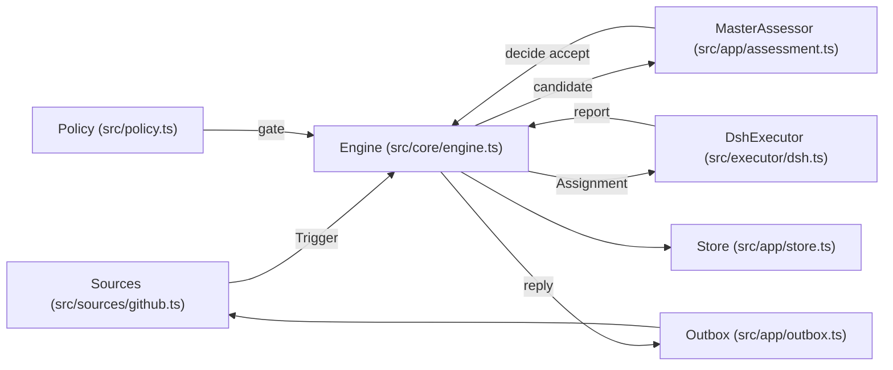
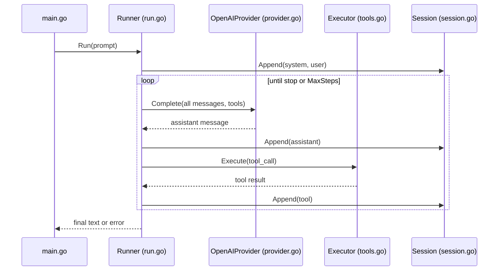
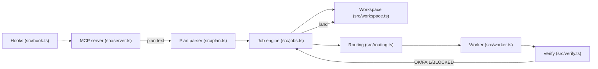

# Agentic AI Weekly Scan — 2026-11-02

**Nguồn:** `search/repositories` (`agent OR multi-agent OR agentic created:>2026-10-26 stars:>200`) → 14 kết quả (≥4 nên không cần fallback `pushed:`). Stars lấy tại thời điểm search. Các repo được clone shallow (depth 1) để đọc code; 3 repo được chọn.

## Executive summary

- **Control-plane > agent loop:** `dsh-superagent` (DeepSeek) coi agent như hệ thống có Policy/Mandate/Ticket/Outbox — rule-based gate đứng trước LLM, side-effect đi qua outbox transactional. Repo có kiến trúc chín nhất tuần này.
- **Hai cực đối lập về cost/context:** `uncut` (không compaction, không retry, fail-fast) vs `cheap-agent` (Opus lập plan, model rẻ gõ code, test quyết định cái gì được land).
- **Verification & failure-visibility là tính năng chính:** truncation = lỗi (uncut), `done-when` + worktree + land có điều kiện (cheap-agent), idempotent Trigger + resume Assignment (dsh-superagent).

## Mục lục

1. [deepseek-ai/dsh-superagent-prototype](#1-deepseek-aidsh-superagent-prototype)
2. [Balanov/uncut](#2-balanovuncut)
3. [muaaz9329/cheap-ag](#3-muaaz9329cheap-ag)

**Không chọn:** `cs329z-chinese` (course), `stack-diagram`, `douyin-comments`, `teachable-figures` (skill đơn lẻ), `grim-prompter` (prompt-framework), `AgentFlux`/`Pi-Remote`/`roblox-ai-studio-agent` (không thấy insight kiến trúc nổi bật), `Mika`/`phongent` (191k LOC Kotlin, chưa đủ thời gian đọc sâu — ứng viên tuần sau), `sapper-v2` (công cụ offensive-security, bỏ khỏi báo cáo này).

**Ghi chú verify:** link HTTP 200 không kiểm tra trực tiếp được (proxy trả 403 cho repo ngoài scope session); thay bằng: repo xuất hiện trong search API và `git clone` thành công. Contributors không xác định (clone depth 1, API bị chặn).

---

## 1. deepseek-ai/dsh-superagent-prototype

### §1 — Quick context
**Pitch:** Agent chủ động cho một GitHub repo: nghe GitHub/Feishu, xét quyền bằng Policy, biến request hợp lệ thành Ticket giao worker session riêng.
**Stack:** TypeScript (Node ≥22, `node:sqlite`), zod, cordis, DeepSeek Harness (`@deepseek-ai/dsh-agent`, `dsh-llm`); client React.
**Health:** ~9.2k stars, ~25k LOC TS, vitest trong `tests/`, **không có `.github/` (không CI)**; README tự nhận là research prototype.

### §2 — Architecture deep-dive
**A. Components**
- `Runtime` (`src/app/runtime.ts`) — composition root, lock state dir, startup/shutdown/resume.
- `Engine` (`src/core/engine.ts`) — nơi duy nhất ghi Trigger/Thread/Decision/Ticket/Assignment; chia `Intake` (`src/core/intake.ts`), `Evals` (`src/core/evals.ts`), `Tickets` (`src/core/tickets.ts`), `Assignments` (`src/core/assignments.ts`), `Replies` (`src/core/replies.ts`).
- `Policy` (`src/policy.ts`) — admission gate, rule match schema, role models.
- `MasterAssessor` (`src/app/assessment.ts`) — đưa candidate cho main Session quyết định.
- `DshExecutor` (`src/executor/dsh.ts`) — chạy worker Session `worker-<ticketId>`.
- `Outbox` (`src/app/outbox.ts`), `Effects` (`src/app/effects.ts`) — gửi reply sau commit.
- `Passes` (`src/app/passes.ts`) — vòng lặp định kỳ (2 giây theo docs).
- Sources: `src/sources/github.ts`, `feishu.ts`, `registry.ts`.
- `Store` (`src/app/store.ts`) — SQLite; `MemoryRepositories` (`src/core/memory.ts`) cho test.

**B. Control flow:** *Event-driven + hierarchical* (main Session → worker Session per Ticket); Engine là state machine đồng bộ.
1. Source poll → `Engine.receive(trigger)`: lưu một lần, trả `stored/duplicate/filtered`.
2. Intake fan-out tới Ticket đang subscribe; Trigger còn lại xếp hàng Eval theo Thread (tối đa một Eval/Thread).
3. `Passes` gọi `evaluateDue`: gom batch, gate (Policy) gán strength `explicit|inferred` và actor.
4. Main Session (LLM) nhận candidate, gọi tool `decide` (`src/app/tools/main.ts`): accept/stop/ignore; accept tạo Ticket + Mandate + Assignment + Subscriptions + acknowledgement trong **một transaction**.
5. `DshExecutor` chuẩn bị thư mục (prepare command, ví dụ `git worktree`) và khởi chạy worker Session.
6. Worker gọi `report` (progress/ready/blocked/failed/dropped) → `Replies`/`Outbox` → Source gửi lại PR/message; Thread đóng thì Ticket kết thúc.

**C. State & data flow:** domain type chặt (`src/core/model.ts`, zod ở boundary); SQLite schema v11 có migration; ports enqueue external work *trong* transaction, adapter thực thi *sau* commit. Mỗi Ticket có session riêng; Inputs có trạng thái delivered/read; relay vào main Session gộp theo step.

**D. Tools:** tool cho main Session (`src/app/tools/main.ts`) và worker (`src/app/tools/executor.ts`) khai báo bằng zod qua wrapper `tool()` (`src/app/tools/tool.ts`); có validation độ dài routing note. Sandbox: thư mục riêng/Ticket + command shim (`src/app/setup.ts`). MCP: không xác định từ code.

**E. Memory:** không thấy vector/semantic memory; state = SQLite + lịch sử Decision/Report. Summarization: không xác định từ code.

**F. Model orchestration:** `RoleModel` trong Policy; `initializeRoleModel` (`src/app/role-models.ts`) gán model/reasoning effort theo role cho session mới mà không đổi global default. Eval hết hạn được requeue 2 lần rồi ghi `unavailable` (`src/core/evals.ts`).

**G. Observability & eval:** `DomainEvents` (12 loại), Decision có `reason` code và `audit`; web panel `src/client/*`. "Eval" là đánh giá request, không phải benchmark chất lượng model.

**H. Extension:** Source plugin (`docs/008-cookbook.md`, `src/sources/host.ts`), prompts sửa qua panel (`src/app/prompts.ts`), thư mục `skills/`.

### §3 — Diagram

### §4 — Verdict
**Đáng học:** tách *authorization/mandate* khỏi *execution*; gate rule-based trước LLM; Engine đồng bộ + outbox-in-transaction nên idempotent và resume được sau crash (`assignmentInterrupted`); "ít attention nhất" được mã hoá thành predicate cụ thể (`waitsForPerson`, `followupOwners`).
**Red flags:** không CI; docs 000–008 rất lớn, khó audit; gắn chặt DeepSeek Harness/cordis; một số thiết kế trong paper chưa implement (theo README).
**Open questions:** chất lượng assessor có được đo không? Chi phí token/Ticket? Paper "Exploring Super-agent Design" bổ sung gì ngoài prototype?

---

## 2. Balanov/uncut

### §1 — Quick context
**Pitch:** Coding-agent harness headless bằng Go, 4 tool, gửi toàn bộ hội thoại mỗi lượt, không cắt/tóm tắt ngữ cảnh âm thầm.
**Stack:** Go 1.26 stdlib-only, OpenAI-compatible Chat Completions; Python stdlib cho `bench/`.
**Health:** ~348 stars, ~1.3k LOC Go gồm test (README: 837 dòng impl), có `.github/workflows/ci.yml` + release.

### §2 — Architecture deep-dive
**A. Components**
- `Runner` (`internal/harness/run.go`) — vòng lặp agent.
- `OpenAIProvider` (`internal/harness/provider.go`) — HTTP client, validate UTF-8, `ProviderError`.
- `Executor` (`internal/harness/tools.go`) — `read_file`, `write_file`, `replace`, `run_command`.
- `Session` (`internal/harness/session.go`) — JSONL append-only, resume.
- Types/Event (`internal/harness/types.go`), CLI (`cmd/uncut/main.go`).
- Bench (`bench/proof.py`, `bench/startup.py`).

**B. Control flow:** *ReAct-style loop* (model → tool_calls → observation), tối đa `MaxSteps`.
1. CLI dựng `Runner`, nạp messages từ `Session` nếu resume, thêm system + user prompt.
2. `Provider.Complete` với toàn bộ messages + `ToolDefinitions()`.
3. Assistant message được append và emit `assistant_meta` (usage).
4. `finish_reason` là `length`/`max_tokens` → `ErrProviderTruncated`, không chấp nhận câu trả lời một phần.
5. Có `tool_calls` → `Executor.Execute` từng call; lỗi thành `"error: ..."` trong tool message; lặp.
6. Không có tool call → cần `stop` và nội dung không rỗng mới xong; vượt step → `ErrMaxSteps`.

**C. State & data flow:** message struct theo OpenAI; state = slice RAM + JSONL; **không compaction** (chủ đích). Resume từ chối record JSONL partial/invalid.

**D. Tools:** function-calling native; `resolve()` chặn thoát workspace bằng `filepath.Rel` (kiểm tra lexical; xử lý symlink không xác định từ phần đã đọc). `run_command` chạy shell với `cmd.Dir = root`, **không sandbox thật**; từ chối output không phải UTF-8 thay vì thay byte.

**E. Memory:** chỉ session log; không retrieval.

**F. Model orchestration:** một model, một provider; không fallback/retry/song song (README nói rõ).

**G. Observability & eval:** `--json` phát NDJSON events; `bench/proof.py` dùng provider giả trên loopback kiểm chứng deterministic: file 442 KB, output 213 KB, truncation → exit 3, step limit → exit 4, UTF-8 sai. Bench README ghi rõ đây là transport test, không phải model eval.

**H. Extension:** cố ý không có plugin; mở rộng bằng fork (interface `Provider` là điểm cắm duy nhất).

### §3 — Diagram

### §4 — Verdict
**Đáng học:** biến "không mất thông tin" thành contract kiểm chứng được: truncation = lỗi, UTF-8 sai = lỗi, JSONL hỏng = từ chối resume; harness đủ nhỏ để audit trong một buổi.
**Red flags:** gửi toàn bộ history mỗi lượt → chi phí tăng theo bậc hai, không thấy cơ chế khi vượt context window; `run_command` không sandbox; benchmark chỉ đo startup/footprint, không đo chất lượng hay token.
**Open questions:** hành vi khi vượt context window? Có chống prompt injection từ file/command output không (không thấy)?

---

## 3. muaaz9329/cheap-ag

### §1 — Quick context
**Pitch:** MCP server cho Claude Code: Opus lập plan, model rẻ thực thi trong git worktree, test quyết định có land hay không.
**Stack:** TypeScript (Node ≥20), `@modelcontextprotocol/sdk`, OpenCode SDK 1.19; worker DeepSeek/GLM/Qwen/Kimi qua OpenRouter, OpenCode Go, DeepSeek, Command Code.
**Health:** ~205 stars, ~5.2k LOC `src/`, vitest (`test/`), CI (`.github/workflows/ci.yml`), ADR trong `docs/adr/`, bench SWE-bench.

### §2 — Architecture deep-dive
**A. Components**
- MCP server (`src/server.ts`) — đăng ký 6 tool: `ping`, `delegate`, `research`, `reply`, `jobs`, `land`.
- Plan parser (`src/plan.ts`) — grammar `# title` / `## id` / `files:` `do:` `done-when:` (+`needs:`, `difficulty:`), lỗi có số dòng.
- Job engine (`src/jobs.ts`, `delegate()`) — điều phối step, escalation, land.
- Worker (`src/worker.ts`), OpenCode wrapper (`src/opencode.ts`).
- Workspace (`src/workspace.ts`) — `createWorktree`, `land`, `withLock`, symlink dependency dirs.
- Verify (`src/verify.ts`) — chạy `done-when`, `envFailure`, `sameFailure`.
- Routing (`src/routing.ts`) — `ROLES`, `PRESETS`, fallback, spend ledger.
- Permissions (`src/permissions.ts`), Hooks (`src/hook.ts`, `plugin/hooks/hooks.json`).

**B. Control flow:** *Planner-executor, hierarchical* (Claude = planner, worker = executor).
1. Claude viết plan theo grammar và gọi `delegate`.
2. `parsePlan` validate; mỗi job có worktree riêng (ADR-0003), copy trạng thái chưa commit.
3. Worker model rẻ thực thi step; `difficulty` quyết định turn cap/tier.
4. `runVerify` chạy lệnh `done-when`; kết quả OK/PARTIAL/FAIL, và BLOCKED (câu hỏi ngược lên Claude, ví dụ cần cài package).
5. Chạm provider limit → fallback model; hết turn cap → một lần escalation với budget nhỏ hơn.
6. Chỉ job `OK` được `land` (apply/discard) vào working tree; hook PostToolUse chuyển FAIL/PARTIAL cho Sonnet subagent.

**C. State & data flow:** plan = markdown có grammar; job records lưu đĩa (`records`, `recoverJobs` trong `src/jobs.ts`) để resume; `FinishReport` typed (`summary, risks, review, missing`).

**D. Tools:** worker chạy trong OpenCode với agent `cheapag-worker`; permission denied/asked ghi thành `Rejection`; lệnh install bị hard-deny vì dependency dirs symlink dùng chung (ADR-0003).

**E. Memory:** không có; `research` (`src/research.ts`) là tool đọc.

**F. Model orchestration:** `ROLES` map `implement/research/escalation` theo provider, kèm chuỗi fallback; comment trong code dẫn số benchmark làm cơ sở chọn model; OpenRouter được ép `data_collection: deny`.

**G. Observability & eval:** `Usage` có `costUsd`, cache read/write (`src/worker.ts`); `recordSpend` ledger cục bộ; `bench/` có task suite với hidden tests và SWE-bench runner (`bench/swe/run.mjs`).

**H. Extension:** `~/.config/cheapag/config.json` (`models`), presets cheapest/balanced/strongest, plugin skills (`plugin/skills/*`), edit-guard hook bật bằng `/cheapag:hook on`.

### §3 — Diagram

### §4 — Verdict
**Đáng học:** "worker phải chứng minh bằng test"; always-worktree + symlink deps + hard-deny install; BLOCKED đẩy câu hỏi ngược lên planner; fallback và escalation tách bạch; có benchmark SWE-bench kèm blog.
**Red flags:** `jobs.ts` ~1.2k dòng; claim "63% fewer Opus tokens" chưa tái lập được ở đây; hook dùng `npx -y cheap-agent@x` là supply-chain surface; pin OpenCode 1.19.
**Open questions:** tỉ lệ OK/PARTIAL trên SWE-bench so với Opus thuần? Chi phí của vòng re-plan khi worker FAIL?
