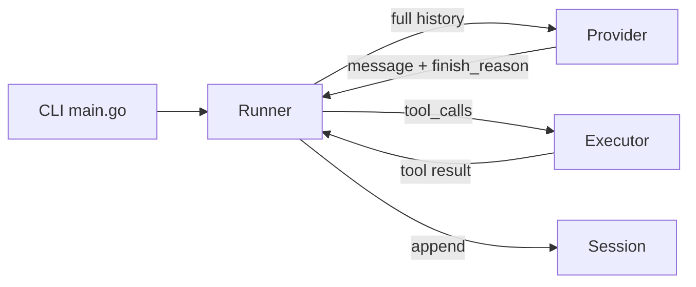
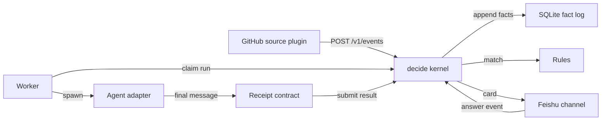
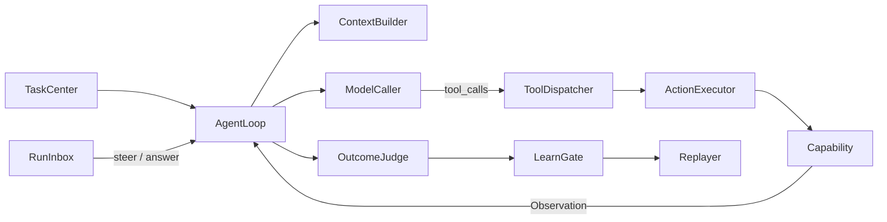
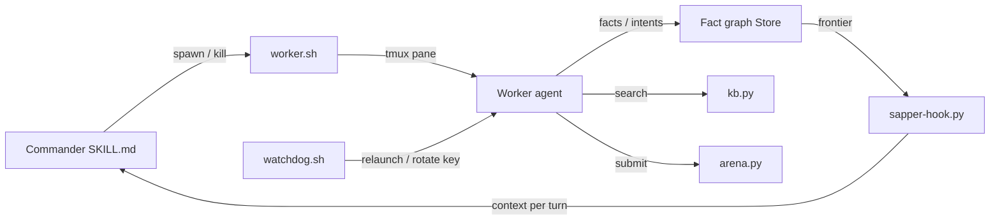

# Agentic AI Weekly Scan — 2026-11-04

**Cửa sổ quét:** 2026-10-28 → 2026-11-04 · **Nguồn:** GitHub Search `agent OR multi-agent OR agentic created:>2026-10-28 stars:>200` (17 kết quả, ≥4 nên không cần fallback `pushed:`).

## Executive summary

- **Event-sourcing + "agent là một process"** (agent-autoloop) và **lossless harness 837 LOC** (uncut) là hai thái cực thiết kế đáng so sánh: một bên đẩy toàn bộ độ phức tạp vào kernel deterministic quanh CLI agent có sẵn, bên kia loại bỏ mọi thứ (compaction, retry, plugin) để giữ tính tái lập.
- **Mika** là codebase production-grade hiếm gặp (~197k LOC Kotlin, 21 contributors) với kiến trúc đáng học: *single execution gate* ép bằng type system, prefix-cache-friendly append-only context, eval có tune/holdout partition.
- **sapper-v2** là ví dụ multi-agent chạy 8 giờ unattended, dùng tmux làm "bus" và fact-intent graph làm shared memory; claim về hiệu quả token chưa tái lập được từ repo (không có CI, 1 file test).

## Mục lục

1. [Balanov/uncut](#1-balanovuncut)
2. [KKKKhazix/agent-autoloop](#2-kkkkhazixagent-autoloop)
3. [wangzan101/Mika](#3-wangzan101mika)
4. [N1nEmAn/sapper-v2](#4-n1nemansapper-v2)

**Đã loại (17 kết quả → 4):** `deepseek-ai/dsh-superagent-prototype` (17k★ nhưng size 37 KB, mới tạo trong tuần — dấu hiệu bất thường, không đủ code để phân tích); `stack-diagram`, `douyin-comments`, `open-3d-skills`, `product-engineering` (agent *skill* / prompt pack, không phải kiến trúc agent); `NamiAgent` (tutorial); `weeping-of-the-empire` (không phải agent framework); `anyscene`, `roblox-ai-studio-agent`, `meu-emprego-novo` (ứng dụng domain/CrewAI wrapper, ít insight kiến trúc); `shim`, `verdict` (có tiềm năng, chưa kịp đọc sâu — xem "Theo dõi").

> **Ghi chú phương pháp:** các repo đã `git clone` và đọc code thật. Kiểm tra "HTTP 200" qua `curl` bị proxy sandbox chặn (403 cho github.com ngoài scope), nên tính tồn tại của repo được xác minh bằng `git clone` / `git ls-remote` thành công. Stars lấy từ GitHub Search lúc quét; số contributor là số author trong `git log --depth 50` (cận dưới).

---

## 1. Balanov/uncut

[github.com/Balanov/uncut](https://github.com/Balanov/uncut)

### §1 — Quick Context
**Pitch:** Harness coding-agent headless, một binary Go 7 MB, cố tình *không* nén/cắt ngữ cảnh.
**Stack:** Go 1.26 (không dependency ngoài), OpenAI-compatible Chat Completions, 4 tool. **Health:** ~598★, 1 contributor, push 2026-11-02, có CI (`.github/workflows/ci.yml`) và test cho từng module; ~837 dòng implementation (~1.7k kể cả test).

### §2 — Architecture Deep-Dive

**A. Component inventory**
- `Runner` (`internal/harness/run.go`) — agent loop duy nhất, giới hạn `MaxSteps`.
- `Provider` / `OpenAIProvider` (`internal/harness/provider.go`) — interface 1 method `Complete`, POST `/chat/completions`.
- `Executor` (`internal/harness/tools.go`) — thực thi 4 tool `read_file`, `write_file`, `replace`, `run_command`; `ToolDefinitions()` cùng file khai báo JSON schema.
- `Session` (`internal/harness/session.go`) — log JSONL append-only, resume được.
- `Message`/`Event`/`Usage` types (`internal/harness/types.go`).
- CLI/flags (`cmd/uncut/main.go`); bằng chứng benchmark (`bench/proof.py`, `BENCHMARKS.md`).

**B. Control flow: ReAct-style tối giản** (think→tool→observe, không planner).
1. `main.go` parse flag, đọc prompt từ args/stdin.
2. `Runner.Run` nạp system prompt (+`AGENTS.md` trừ khi `--no-agents`) và user message, mỗi message được append vào `Session`.
3. Vòng lặp gọi `Provider.Complete` với **toàn bộ** messages.
4. Nếu `finish_reason` là `length`/`max_tokens` → trả `ErrProviderTruncated` (không chấp nhận câu trả lời cụt).
5. Nếu có `tool_calls` → `Executor.Execute` từng call, lỗi tool được trả lại model dưới dạng `error: …`.
6. Không còn tool call + `stop` → in text ra stdout; vượt `MaxSteps` → `ErrMaxSteps`.

**C. State & data flow:** message là struct typed (subset OpenAI chat), state nằm trong slice in-memory + file JSONL (mỗi dòng có `v` version; từ chối dòng dở/invalid UTF-8). Context strategy: **không có** — gửi toàn bộ lịch sử mỗi lượt (chủ đích).

**D. Tool integration:** hardcode 4 tool, native function-calling. Validation: `resolve()` chặn path thoát workspace; `replace` yêu cầu `old` xuất hiện đúng 1 lần; UTF-8 không hợp lệ bị từ chối thay vì thay ký tự. **Không sandbox** cho `run_command` (shell chạy trực tiếp trong workspace).

**E. Memory:** không có ngoài session log. **F. Model orchestration:** 1 model, không fallback/parallel; không retry tự động (theo README). **G. Observability:** `--json` phát NDJSON event (`assistant_meta` kèm usage, `done`); eval hooks: `bench/proof.py` chạy binary thật với loopback provider giả. **H. Extension:** không có plugin; "fork" là cơ chế mở rộng.

### §3 — Architecture Diagram

### §4 — Verdict
**Đáng học:** coi *finish_reason* là hợp đồng — truncation thành lỗi exit code riêng thay vì "thành công một phần"; `bench/proof.py` so sánh *JSON thật nhận được ở provider* (442,400 byte file lớn đi nguyên vẹn) chứ không chỉ text cuối — một dạng eval cho tính "lossless" hiếm thấy.
**Red flags:** `run_command` không sandbox/timeout riêng; gửi full history làm chi phí tăng bình phương theo độ dài task; benchmark chủ yếu đo startup/kích thước (so với Pi), tác giả tự nhận không đo chất lượng; 1 contributor, repo mới.
**Open questions:** hành vi khi context vượt giới hạn provider (chỉ fail?); có chiến lược cho tool output khổng lồ không?

---

## 2. KKKKhazix/agent-autoloop

[github.com/KKKKhazix/agent-autoloop](https://github.com/KKKKhazix/agent-autoloop)

### §1 — Quick Context
**Pitch:** Biến CLI agent thành vòng lặp nền; chỉ gửi "thẻ" cho người khi cần quyết định.
**Stack:** TypeScript (Node ≥24, `node:sqlite`, 0 runtime dependency), adapter cho Claude Code / Codex / ACP / lệnh bất kỳ; kênh Feishu/Webhook/Desktop. **Health:** ~1,022★, 2 author, push 2026-11-03, CI `check.yml`, 46 file test + mô phỏng crash/mutation (`sim/`); ~15k LOC.

### §2 — Architecture Deep-Dive

**A. Component inventory**
- Kernel `decide` (`kernel/decide.ts`) — hàm thuần: (view, input, now, env) → facts + value.
- Event log + projection (`kernel/store.ts`, `kernel/evolve.ts`) — facts append-only, bảng SQLite chỉ là projection có thể rebuild.
- Scheduler deadlines (`kernel/due.ts`) — tính thời điểm cần "đồng hồ" kế tiếp (cron, retry, resend thẻ, lease).
- Rules (`kernel/rules.ts`, `protocol/rules.ts`) — `rules.json` quyết định agent/cwd/skill/quyền.
- Worker (`worker/worker.ts`) — poll hub, spawn agent detached, lưu job/result trước khi làm.
- Adapter (`worker/agents.ts`, `plugins/claude/agent.ts`, `plugins/codex/agent.ts`, `plugins/acp/agent.ts`, `plugins/command/agent.ts`).
- Receipt contract (`worker/contract.ts`, `protocol/validate.ts`) — parse khối `agent-autoloop` JSON ở tin nhắn cuối.
- Channels (`plugins/feishu/channel.ts`, `plugins/desktop/channel.ts`, `plugins/webhook/channel.ts`), source (`plugins/github/source.ts`), HTTP (`kernel/http.ts`, `host/server.ts`).

**B. Control flow: event-driven + state machine trên event log** (hub không chủ động kết nối ra ngoài).
1. Source (cron / GitHub / webhook) `POST /v1/events`, dedupe theo `(source, key)`.
2. `decide` match rule → tạo/merge *run* (gom theo "subject"/lane, giới hạn `parallel`).
3. Worker claim run, build prompt từ rule (nội dung ngoài chỉ vào file "là tài liệu", không vào prompt), spawn CLI agent, agent kết thúc sau 1 "vòng".
4. Receipt (tin nhắn cuối) được parse; sai JSON → bắt agent viết lại receipt trong cùng session (tối đa `REPAIRS=2`).
5. Receipt áp dụng trong **một transaction**: `ask` → tạo card gửi kênh; `later` → timer; `events` → phát event mới (giới hạn `MAX_HOPS = 8`).
6. Người trả lời card → thành event mới → resume đúng session; trong lúc chờ không tốn process/token.

**C. State:** typed JSON facts (`Fact{seq, changes[{table,key,row}]}`) trong bảng `facts` SQLite (WAL, `synchronous=FULL` trong `sim/crash.ts`); projection 11 bảng (`kernel/evolve.ts`). Context do chính CLI agent lo; hub chỉ giữ `session`/`resume` id.

**D. Tool:** không có tool registry — agent là process ngoài, dùng tool riêng của nó; hub kiểm soát qua `access: read|edit|full` trong `Turn` (`worker/agents.ts`) và `emits` allowlist cho event. Input từ ngoài bị ràng buộc (`subject` chỉ ký tự định danh).
**E. Memory:** không có memory riêng; tiếp tục hội thoại bằng session resume. **F. Model:** rule chọn `model`/`effort` theo agent; không fallback tự động xác định từ code đã đọc. **G. Observability:** `agent-autoloop status/why/spend` (`cli/why.ts`, `cli/spend.ts`) tính round/token/cost; `scripts/benchmark.ts --check`; replay: `rebuild()` dựng lại projection từ log. **H. Extension:** plugin 4 cạnh (source/agent/channel/delivery) qua giao thức HTTP+JSON (`docs/protocol.md`), kèm `protocol/conformance.ts`.

### §3 — Architecture Diagram

### §4 — Verdict
**Đáng học:** (1) `decide` là hàm thuần với thời gian/secret truyền vào → `sim/` có thể replay, mutate và kiểm invariant bằng "oracle" độc lập (`sim/invariants.ts`); projection chỉ là cache. (2) Nguyên tắc "một vòng không chờ người": hỏi = kết thúc process, trả lời = event → 0 token khi chờ. (3) Quyền do *rule* quyết, không phải do nội dung event (giảm prompt-injection blast radius).
**Red flags:** README/CLI chủ yếu tiếng Trung; Node 24 + `node:sqlite` (experimental); phụ thuộc agent tuân thủ định dạng receipt; 2 author, tuổi repo ~1 tháng.
**Open questions:** độ tin cậy của adapter cho agent khác ngoài Claude/Codex; `scripts/benchmark.ts` đo gì cụ thể; mô hình bảo mật khi worker chạy `access: full`.

---

## 3. wangzan101/Mika

[github.com/wangzan101/Mika](https://github.com/wangzan101/Mika)

### §1 — Quick Context
**Pitch:** Trợ lý AI trên Android điều khiển app và web trên màn hình ảo nền, dữ liệu ở lại máy.
**Stack:** Kotlin (`:core` JVM thuần + `:app` Android), 4 giao thức model (OpenAI-compat, Responses, Anthropic, Gemini), WebView, sandbox Linux, relay Go tùy chọn. **Health:** ~6,174★, ≥21 contributor, push 2026-11-04, ~197k LOC Kotlin, ~630 file test; **không có GitHub Actions workflow** (chỉ template issue/CONTRIBUTING).

### §2 — Architecture Deep-Dive
*(Dựa trên `docs/dev/architecture.md` + xác minh tồn tại từng file path trong cây mã.)*

**A. Component inventory** (`core/…` = `core/src/main/kotlin/com/wangzan101/mika/core/`)
- `AgentLoop` (`core/agent/AgentLoop.kt`) — chỉ điều phối; `ModelCaller`, `TurnPolicy`, `StopRules`, `BatchRunner` (`core/agent/*.kt`) giữ từng quyết định.
- `RunInbox` (`core/run/RunInbox.kt`) — hàng nhận Steer/Redirect/Answer/Confirm/HandBack/Cancel.
- `ToolRegistry`/`ToolDispatcher` (`core/tool/`) và `AgentTool` — mỗi tool tự khai báo risk (Read/Write/External).
- `ActionExecutor` (`core/action/ActionExecutor.kt`) — cổng thực thi duy nhất; `ActionPass` (`core/tool/ActionPass.kt`) có constructor internal.
- `Capability` (`core/capability/Capability.kt`) với `cap/phone`, `cap/web`, `cap/sandbox`, `cap/mcp`.
- `ContextBuilder`/`ContextCompressor` (`core/agent/`), `MemoryStore` (`core/memory/`).
- `OutcomeJudge` + `LearnGate` (`core/agent/`), `Replayer`/`RouteRecorder` (`core/replay/`), `Verifier` (`core/verify/`).
- `RunTrace` (`core/trace/RunTrace.kt`), `RunMetrics` (`core/record/RunMetrics.kt`); `TaskCenter` (`app/…/task/TaskRegistry.kt`).

**B. Control flow: ReAct-style loop bọc trong policy layer** (+ replay không gọi model, + sub-agent `spawn_agent`).
1. `TaskCenter` tạo `Run` (mỗi hội thoại 1 Run; tin nhắn mới khi đang chạy thành *steer*).
2. `ContextBuilder` dựng vùng 0 (system+tool) và vùng 1 (mở đầu, ghi một lần).
3. `RouteReplay` có thể phát lại tuyến thành công cũ; không khớp thì giao lại cho model.
4. `ModelCaller` gọi model; tool call đi qua `ToolDispatcher` → `ActionExecutor`: guard → khóa màn hình → kiểm tra hành động không thể đảo ngược → thực thi → xác minh sau hành động → ghi log.
5. Không có tool "done": trả lời không kèm tool call = kết thúc; `end_not_done` cho thất bại có phân loại.
6. Sau khi giao, `OutcomeJudge` (model nhẹ) phân loại Done/Partial/NotPossible; chỉ `Done` qua `LearnGate` mới được học/replay.

**C. State:** `Observation` typed (`core/observation/`, kind Read/Output/Reply/…, nội dung không tin cậy bọc `<untrusted>`); run state `runs-v3.json` ghi atomic, `events.jsonl` cho mỗi run (giữ 30 lần gần nhất). Context: append-only, nén khi vượt ngưỡng bằng cách rút gọn kết quả cũ (không gọi model), `ContextRecovery` bổ sung lại lời user; lời user không bao giờ bị cắt.
**D. Tool:** registry theo class, tool *gập* theo nhóm (phone/web/sandbox mở khi dùng entry tool); function-calling native; validation bằng guard + ngân sách; sandbox Linux riêng và MCP client.
**E. Memory** (`core/memory/`): fact/preference/practice; chỉ học từ lời user nói (không từ nội dung màn hình), `SensitiveFilter` chặn mật khẩu/số thẻ; retrieval theo token budget (toàn bộ 4,000 / truy xuất 800).
**F. Model:** 3 vai (`main`, vision, light); light model làm `OutcomeJudge`/`IntentGate`; `RetryPolicy` backoff ≤3 lần.
**G. Observability:** trace OTLP Protobuf (`core/trace/`, mặc định tắt, redact), `RunMetrics` thuần hàm; eval trên máy thật `eval/tasks/*` với `partition: tune|holdout`, check như `answer_grounded`.
**H. Extension:** `AgentTool`/`Capability` và MCP; relay Go (`tools/relay/`).

### §3 — Architecture Diagram

### §4 — Verdict
**Đáng học:** (1) "Cổng thực thi duy nhất" ép bằng visibility của constructor (`ActionPass`) + test kiểm hướng phụ thuộc package; (2) thiết kế prefix-cache: system/tool định nghĩa đóng băng, chỉ append; (3) kỷ luật eval: tune/holdout, `answer_grounded`, ghi rõ không chỉnh prompt theo holdout.
**Red flags:** `Verifier` (kiểm chứng độc lập) đang tắt trong sản phẩm (`reviewFinalAnswer = false` theo docs) nên câu trả lời đều "chưa xác minh"; chính sách phê duyệt chỉ hỏi bước *trả tiền*, các hành động gửi/xóa/đổi tài khoản chạy thẳng; không có CI công khai; tài liệu rất dày, dễ lệch code.
**Open questions:** tỉ lệ thành công thật trên bộ eval (repo có task, không có kết quả công bố mà tôi đọc được); độ bền khi UI app đổi.

---

## 4. N1nEmAn/sapper-v2

[github.com/N1nEmAn/sapper-v2](https://github.com/N1nEmAn/sapper-v2)

### §1 — Quick Context
**Pitch:** Đội AI nhiều vai (commander, worker, watchdog) phối hợp qua tmux và đồ thị fact-intent, thiết kế cho CTF được ủy quyền.
**Stack:** Python stdlib (`lib/sapper.py` ~4.7k dòng), bash (`worker.sh`, `watchdog.sh`), tmux, Docker; bất kỳ CLI agent/model (mặc định GLM / DeepSeek qua Claude Code). **Health:** ~673★, 2 author, push 2026-11-03, 13 commit, **không CI**, 1 file test (`tests/test_sapper.py`). Có `DISCLAIMER.md`: chỉ dùng cho kiểm thử được ủy quyền. *Báo cáo này chỉ phân tích kiến trúc điều phối, không đi vào nội dung tấn công.*

### §2 — Architecture Deep-Dive

**A. Component inventory**
- `Store` fact/intent graph (`lib/sapper.py`, class `Store`) — mỗi node một file JSON dưới `.sapper/`, khóa bằng `fcntl.flock`.
- Commander (`docker/commander/SKILL.md`, 426 dòng "standing orders") — vòng lặp quyết định do chính AI chạy; handover file `commander-state.md`.
- `worker.sh` (`docker/commander/worker.sh`) — "đôi tay" của commander: spawn/kill/peek worker pane, tier model theo pane.
- Watchdog (`docker/commander/watchdog.sh`) — vòng bảo vệ "zero-strategy": relaunch pane chết, xoay key khi hết quota, auto-accept dialog, deadline toàn cục.
- Arena adapter (`lib/arena.py`) — API nền tảng thi; KB offline (`lib/kb.py`, `kb/entries/`, 56 file).
- Hook bridge (`lib/sapper-hook.py`) — tiêm frontier của graph vào Claude Code mỗi lượt; `SPEC.md` mô tả hợp đồng 3 unit.

**B. Control flow: Hierarchical (commander → workers) + watchdog tách biệt**, giao tiếp kiểu swarm qua graph chung.
1. `entrypoint.sh` dựng tmux session `sapper-cmd`, chạy watchdog nền và commander (một TUI agent).
2. Commander đọc board (`sapper status`), chọn việc, `worker.sh spawn <code> --mission …` (cap 8 pane, 3 instance nền tảng).
3. Worker làm việc, ghi *fact* và *intent* vào chung `.sapper/` (worker thứ hai cùng thử thách dùng symlink).
4. Worker nói chuyện bằng `sapper send` (gõ vào input box của peer qua tmux + append `ai-channel.txt`).
5. Watchdog xử lý hồi phục cơ học (pane chết, quota) mà *không* quyết chiến lược; commander tự ghi `commander-state.md` để sống sót qua việc bị nén/thay thế.
6. Đến deadline, watchdog dừng worker và "finish_flags" thay cho commander nếu commander đã chết.

**C. State:** facts (typed, `data` key=value) và intents (hyper-edge `from`→`to`) là JSON typed, schema kiểm trong `_node_schema_errors`; recall bằng substring + difflib trên title/description (không embedding); 3 tầng title/summary/evidence để tiết kiệm context.
**D. Tool:** không có registry riêng — dùng tool của CLI agent; `worker.sh`/`sapper` CLI là giao diện. Sandbox: container Docker; không xác định chi tiết từ code đã đọc.
**E. Memory:** dài hạn = fact graph + KB offline; ngắn hạn = context của mỗi pane (pane "amnesiac", commander re-brief).
**F. Model:** phân tầng — `SAPPER_MODEL` (smart) cho commander/chuỗi khó, `SAPPER_MODEL_FLASH` cho worker mặc định; xoay key pool, có thể sang provider khác.
**G. Observability:** `drive.log`, `BATTLE-REPORT.md`, `docs/events-2026-10-17.md`; replay không xác định từ code.
**H. Extension:** thay `SKILL.md` doctrine, `--agent`/`--model`, KB entries.

### §3 — Architecture Diagram

### §4 — Verdict
**Đáng học:** tách *cơ học hồi phục* (watchdog bash không có chiến lược) khỏi *quyết định* (commander LLM) và buộc commander có handover file; graph 3 tầng giảm đầu độc ngữ cảnh; tmux "gõ vào input box" cho phép hoán đổi bất kỳ CLI agent nào.
**Red flags:** lõi 4.7k dòng trong một file; tmux send-keys giòn (code có workaround paste LF); không CI, 1 file test; claim "1B vs 4.5B token / vô địch 634 đội" chỉ có từ README/`BATTLE-REPORT.md`, không tái lập được; doctrine đặc thù cuộc thi.
**Open questions:** cơ chế đo token thật; hành vi khi hai worker ghi cùng intent; ranh giới an toàn ngoài tuyên bố disclaimer.

---

## Theo dõi (chưa đọc sâu)
`Balanov/shim` (harness Go local-first, MCP + Agent Skills), `Balanov/verdict` (verifier ngữ nghĩa cục bộ cho tool call của agent, ~548 LOC Python + training) — đáng xem tuần sau; `deepseek-ai/dsh-superagent-prototype` cần kiểm tra tính xác thực của tổ chức trước khi dùng.
