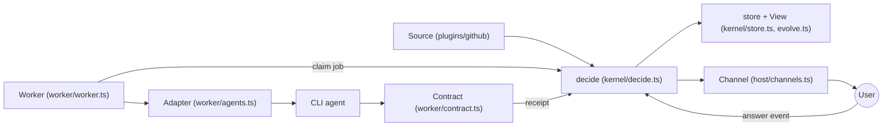
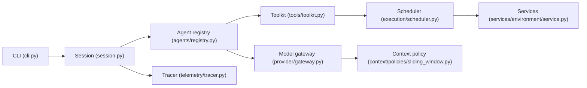
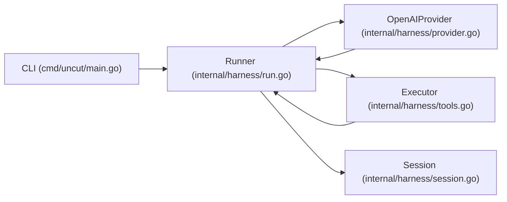

# Agentic AI Weekly Scan — 2026-11-06

> **Trạng thái: DRAFT, chưa commit.** Self-check "link verify được (HTTP 200)" FAIL (xem cuối file).

## Executive summary

- **agent-autoloop** là repo đáng đọc nhất: kernel event-sourced (hàm `decide` thuần, replay được) + worker "một lượt không chờ người", kèm simulation/crash/mutation test cho kernel.
- **uni-robot-agent** cho thấy cách harness hoá Codex/Claude Code SDK cho robot: scheduler với resource queue (exclusive vs parallel), tách "tool success / agent done / task success".
- **uncut** là phản đề tối giản (≈840 dòng Go): không compaction, không retry, từ chối câu trả lời bị cắt (`finish_reason=length`); có `bench/proof.py` kiểm chứng transport lossless.

Loại trong tuần này: `deepseek-ai/dsh-superagent-prototype` (19.7k stars nhưng chỉ 37 KB, 1 contributor trong 50 commit gần nhất — chưa xác minh được tính xác thực, không đưa vào), các repo skill/media/ebook (`stack-diagram`, `cinecode`, `agentic-hacking-skills`, `open-3d-skills`...), `verdict` (classifier nhỏ, chỉ ~500 LOC Python, không phải kiến trúc agent), `latch` (~1.5k LOC JS, spec HTTP, không có agent loop). Phương pháp: nguồn 1 (`created:>2026-10-30 stars:>200`) cho 17 kết quả, đủ ≥4 nên không cần fallback `pushed:`.

## Mục lục

1. [KKKKhazix/agent-autoloop](#1-kkkkhazixagent-autoloop)
2. [Open-RUA/uni-robot-agent](#2-open-ruauni-robot-agent)
3. [Balanov/uncut](#3-balanovuncut)

---

## 1. KKKKhazix/agent-autoloop

https://github.com/KKKKhazix/agent-autoloop

### §1 — Quick context

**Pitch:** Hub chạy nền cho CLI agent: tự nhận việc, theo đến cùng, chỉ gửi thẻ hỏi người khi cần quyết định.

- Stack: TypeScript (Node ≥24, `node:sqlite`, chạy `.ts` trực tiếp), zero runtime deps; agent: Claude Code, Codex, ACP, DeepSeek Harness, `command` bất kỳ.
- Health: 3,353 stars (tạo trong tuần), 11 tác giả trong clone depth-50, commit mới nhất 2026-11-06, có CI (`.github/workflows/check.yml`, `nightly.yml`) và ~25k LOC gồm rất nhiều test.

### §2 — Architecture deep-dive

**A. Component inventory**
- `decide` (`kernel/decide.ts`) — hàm quyết định thuần: (view, input) → facts + answer; thời gian và secret đi vào qua tham số.
- `evolve`/`View` (`kernel/evolve.ts`) — áp dụng `Fact` (changes theo bảng) lên view SQLite; `TABLES`, `snapshot`.
- `store` (`kernel/store.ts`) — `commit`, `commitLatest`, `rebuild`, `iterateLog`: log là nguồn sự thật, view dựng lại được.
- `Rules` (`kernel/rules.ts`, `protocol/rules.ts`) — rules.json: when/to/cwd/skill/parallel/resume.
- `Runtime` (`host/runtime.ts`) — mở `hub.db` (WAL, `synchronous=FULL`), master key, áp input.
- `Worker` (`worker/worker.ts`) — poll hub, spawn agent tách process group, ghi file để sống sót khi restart.
- `Adapter` (`worker/agents.ts`, `plugins/claude/agent.ts`, `plugins/codex/agent.ts`, `plugins/command/agent.ts`) — `command/read/link` cho từng agent.
- `Contract` (`worker/contract.ts`) — `promptFor`, `readMessage`, `repairPrompt`, `resultFrom`: biến tin nhắn cuối thành receipt.
- `Channel` (`host/channels.ts`, `plugins/feishu/channel.ts`, `plugins/desktop/channel.ts`) — gửi thẻ, nhận trả lời.
- `Delivery` (`plugins/delivery/delivery.ts`) — pipeline PR: review → CI → merge → verify.
- `MCP` (`cli/mcp.ts`) — mở các cửa của hub dưới dạng MCP tools.

**B. Control flow:** event-driven + event-sourced; mỗi "lượt" (run) là một lần chạy agent ngắn (không phải vòng ReAct dài).
1. Source (cron, GitHub webhook, HTTP) tạo event chuẩn hoá vào kernel.
2. `decide` đối chiếu rule → tạo "item" và "run", ghi facts.
3. Worker nhận job, dựng prompt (`promptFor`), chạy agent, agent kết thúc process.
4. Tin nhắn cuối chứa block ```` ```agent-autoloop ```` JSON (`ask`/`notice`/`resolve`/`later`/`events`); `readMessage` parse, sai thì `repairPrompt` nhờ viết lại trong cùng session (tối đa `REPAIRS = 2`).
5. Receipt được áp dụng trong một transaction; `ask` → thẻ đến channel, lượt kết thúc, không chiếm process/token trong lúc chờ.
6. Người chọn → thành event mới → resume session cũ (hoặc `later` hẹn giờ tự dậy).

**C. State & data flow:** protocol HTTP+JSON, schema ở `protocol/schema.json` (918 dòng) + `protocol/validate.ts`. State: SQLite append-only log + projection (`host/state.ts`, `kernel/evolve.ts`). Context: không quản lý window — mỗi lượt resume session của agent (`resume: true`), compaction thuộc về agent bên dưới.

**D. Tool integration:** hub không có tool-calling riêng; agent chỉ cần in tin cuối. Tool "kênh điều khiển" là fenced JSON block. Bảo mật: lời trong event không vào prompt, chỉ vào file "là tài liệu"; quyền (`access: read/edit/full`) do rule quyết định (`docs/protocol.md`, nguyên tắc 6). `command` truyền `{prompt}` làm argv riêng, không qua shell.

**F. Model orchestration:** model/effort khai báo theo agent trong rules.json; retry `MAX_ATTEMPTS = 10`, lease `RUN_LEASE`, resend thẻ theo `RESEND_AT` (`kernel/decide.ts`). Song song theo `parallel` trên mỗi rule.

**G. Observability & eval:** `worker/usage.ts` theo dõi token/cost theo session; `agent-autoloop spend/status`; `scripts/benchmark.ts`, `scripts/history.ts`. Không thấy OpenTelemetry/Langfuse. Eval của chính hệ thống: `sim/random.ts` (seeded, 20k bước, inject lost/duplicate/restart/offline/clock), `sim/crash.ts`, `sim/mutation.test.ts`, `sim/invariants.ts`.

**H. Extension points:** plugin Source/Agent/Channel/Delivery (`docs/plugins.md`, `examples/plugins/hello-*`), `agent-autoloop add <git url>`.

E (memory): không xác định từ code ngoài session resume.

### §3 — Diagram



### §4 — Verdict

**Đáng học:** (1) kernel thuần + log là sự thật + view dựng lại được, kèm simulation có fault injection và mutation test — hiếm thấy ở agent infra; (2) "receipt trong tin nhắn cuối + repair trong cùng session" thay vì SDK; (3) quy tắc không để nội dung event quyết định cwd/quyền/skill.

**Red flags:** README tự nhận nhiều đường chưa test với tài khoản thật (GitLab, webhook templates, lệnh agent khác); không có tracing chuẩn; phụ thuộc Node 24 + `node:sqlite` (experimental); repo vừa tạo trong tuần nên API chưa ổn định.

**Câu hỏi mở:** hành vi khi hai worker tranh `claim`; chi phí replay log lớn (`rebuild`); mức chống prompt injection thực tế ngoài giới hạn quyền.

---

## 2. Open-RUA/uni-robot-agent

https://github.com/Open-RUA/uni-robot-agent

### §1 — Quick context

**Pitch:** Harness thống nhất cho agent điều khiển robot, bọc Codex/Claude Code, có CLI, SDK và TUI.

- Stack: Python ≥3.11, `claude-agent-sdk==0.2.165`, `openai-codex==0.147.0`, FastAPI/uvicorn/httpx, pydantic, Textual; môi trường RoboDojo/RoboUse/RoboLab; provider backends aliyun/deepseek/minimax/moonshot/tencent/volcengine.
- Health: 238 stars, 4 tác giả (clone depth-50), commit 2026-11-05, ~28k LOC Python, có `release.yml`; **không thấy thư mục tests/** và không có CI test workflow.

### §2 — Architecture deep-dive

**A. Component inventory**
- `Session` (`uni_robot_agent/session.py`) — lắp ráp integration, tool, prompt; quản lý vòng đời run, outcome.
- Agent registry (`agents/registry.py`) + `CodexAgent` (`agents/codex/agent.py`) + Claude Code agent (`agents/claude_code/agent.py`) — đăng ký lazy, bọc SDK.
- `Toolkit` (`tools/toolkit.py`) — khai báo tool, validate binding, registry.
- Tool providers: gripper (`tools/gripper/provider.py`), scene, skills (`tools/skills.py`), episode (`tools/episode.py`).
- Scheduler (`execution/scheduler.py`) + `ParallelToolExecutor` (`execution/parallel.py`) — `ToolExecutionPolicy(resource_key, return_mode, concurrency)`, `JobRecord`.
- `ActorRunner` (`tools/gripper/actor.py`) + reviewer (`tools/gripper/reviewer.py`) + `ActorArchive` (`artifacts/actor.py`) — chế độ Hybrid: action model đề xuất, reviewer model đánh giá.
- Context policy (`context/policies/sliding_window.py`) — sliding window cắt theo block tương tác, có `ContextBudget`.
- Model gateway (`provider/gateway.py`) — HTTP request chung, quan sát được, chuyển đổi giao thức (`provider/conversions/responses_chat.py`).
- Services (`services/environment/service.py`, `services/actor/service.py`, `services/perception/backends/sam3.py`) — HTTP service độc lập.
- Telemetry (`telemetry/tracer.py`) — span API tự viết; artifacts (`artifacts/sft`) — export trajectory sang định dạng SFT.

**B. Control flow:** ReAct-style do SDK bên ngoài điều khiển (agent loop nằm trong Codex/Claude SDK), harness cung cấp tool qua MCP adapter; bổ sung lớp scheduler async.
1. CLI resolve/validate config, `--validate-config` thoát sớm.
2. `Session` nạp `IntegrationSpec`, khởi động `IntegrationSession`, đăng ký tool, dựng prompt.
3. Agent gọi tool qua MCP adapter → executor.
4. Tool đọc một `Episode` chung; hành động vật lý, `capture_scene`, `finish` dùng chung queue exclusive `episode`; `locate` chạy trên snapshot bất biến nên song song được.
5. Lời gọi background trả job handle để agent suy luận chồng lên hành động.
6. `finish` chỉ nộp yêu cầu kết thúc; `EpisodeOutcome` ghi kết quả chính thức riêng, không lộ verdict cho agent.

**C. State & data flow:** `Episode` projection chung; observation bất biến (`observation/hub.py`); sự kiện qua `events/core.py` cho console/TUI/JSONL trajectory. Giao tiếp service: Domain client → HttpTransport → FastAPI route typed.

**D. Tool integration:** `Toolkit` đăng ký provider; gọi tool qua MCP của Codex/Claude SDK; schema + handler do provider sở hữu. Validate binding trong `tools/toolkit.py`. Sandbox: không xác định từ code đã đọc.

**E. Memory:** skill Markdown dùng chung/theo môi trường (`list_skills`, `read_skill`; `write_skill` chỉ bật bằng `--skill-writing`). Không thấy vector/summarization.

**F. Model orchestration:** agent chính qua SDK; model riêng cho actor/reviewer (Hybrid); provider backends theo vendor (`provider/backends/*`); batching và dispatch concurrency là hai điều khiển tách biệt (`docs/architecture.md`).

**G. Observability:** tracer/sinks tự viết (`telemetry/`), artifact ghi mỗi exchange (`provider/recording/exchanges.py`), không dùng OpenTelemetry (grep không thấy).

**H. Extension:** thay runtime, tool, backend, context policy qua `register_agent`, `register_context_policy`, IntegrationSpec.

### §3 — Diagram



### §4 — Verdict

**Đáng học:** tách ba mức thành công (tool / agent / task) và giấu verdict khỏi agent; scheduler với `resource_key` + `return_mode` để chồng suy luận lên hành động vật lý; actor–reviewer có archive proposals/decisions/receipts.

**Red flags:** không có thư mục tests trong clone; bị pin cứng version SDK; nhiều code phụ thuộc môi trường sim nặng (khó tái lập); đánh giá chủ yếu dựa paper bên ngoài.

**Câu hỏi mở:** ảnh hưởng thực của overlap reasoning/action lên success rate; độ an toàn khi chạy robot thật; kết quả paper có tái lập được từ repo không.

---

## 3. Balanov/uncut

https://github.com/Balanov/uncut

### §1 — Quick context

**Pitch:** Harness coding-agent headless một binary Go, gửi toàn bộ hội thoại mỗi lượt, không cắt ngầm.

- Stack: Go 1.26, không dependency ngoài; provider OpenAI-compatible Chat Completions.
- Health: 608 stars, 3 tác giả, commit 2026-11-06, có CI + release workflow, test trong `internal/harness/*_test.go`; ~840 dòng Go thực thi (+ test).

### §2 — Architecture deep-dive

**A. Component inventory**
- CLI (`cmd/uncut/main.go`) — flag, stdin/stdout, `--json` NDJSON, `--max-steps`.
- `Runner` (`internal/harness/run.go`) — vòng lặp agent.
- `Provider`/`OpenAIProvider` (`internal/harness/provider.go`) — POST `/chat/completions`, `ProviderError`.
- `Executor` (`internal/harness/tools.go`) — 4 tool: `read_file`, `write_file`, `replace`, `run_command`; `resolve` chặn path thoát workspace.
- `Session` (`internal/harness/session.go`) — JSONL append-only, từ chối record lỗi/UTF-8 sai/version sai.
- Proof harness (`bench/proof.py`) — provider giả kiểm tra JSON byte-for-byte.

**B. Control flow:** ReAct-style tối giản (think→act→observe) với giới hạn bước.
1. Nạp system + user message, append vào session.
2. Gọi `Provider.Complete` với toàn bộ `Messages` và `ToolDefinitions()`.
3. Nếu `finish_reason` là `length`/`max_tokens` → trả lỗi `ErrProviderTruncated`, không chấp nhận câu trả lời cụt; `content_filter` cũng lỗi.
4. Nếu có `ToolCalls` → `Executor.Execute` từng call, lỗi tool trả về model dưới dạng `"error: ..."`, append message `tool`.
5. Không có tool call và `stop` → trả `Text`; nội dung rỗng là lỗi.
6. Quá `MaxSteps` → `ErrMaxSteps`.

**C. State:** `[]Message` trong bộ nhớ + tuỳ chọn JSONL session; message là struct typed (`types.go`). Context: không có chiến lược nào — chủ đích gửi toàn bộ.

**D. Tool:** native function-calling của Chat Completions; tham số JSON parse trong `Execute`; sandbox chỉ là chống path escape, `run_command` chạy shell (`shell_unix.go`/`shell_windows.go`) — không cô lập thật sự.

**E. Memory:** skip (chỉ transcript).

**F. Model orchestration:** một model, không fallback/retry/parallelism (README nói rõ).

**G. Observability & eval:** event stream NDJSON (`Event`: assistant_meta với usage, done); `bench/proof.py` + `bench/results/*.json`; `BENCHMARKS.md`.

**H. Extension:** README nói không có plugin system; mở rộng bằng fork.

### §3 — Diagram



### §4 — Verdict

**Đáng học:** fail-closed khi provider cắt output; session log từ chối đọc record dở thay vì bỏ qua; bench chứng minh transport lossless bằng provider giả — một phản đề rõ ràng với compaction.

**Red flags:** "lossless" nghĩa là chi phí và giới hạn context tăng tuyến tính, mọi tool output vào context; `run_command` không sandbox; benchmark chỉ chứng minh transport, không chứng minh chất lượng agent (chính `proof.py` ghi vậy).

**Câu hỏi mở:** hành vi khi context vượt giới hạn model (lỗi provider?); so sánh chất lượng/chi phí với harness có compaction trên tác vụ thật.

---

## Self-check log

| Mục | Kết quả |
|---|---|
| Link verify HTTP 200 | **FAIL** — `curl https://github.com/<repo>` qua proxy trả 403; `gh api repos/...` bị chặn vì repo ngoài scope session. `git clone` thành công nên repo tồn tại, nhưng không đo được HTTP 200 như yêu cầu |
| Không awesome/tutorial | PASS |
| §2.A có file path | PASS (path đã `ls`/đọc trong clone) |
| §2.B pattern rõ | PASS |
| Mermaid parse test | PASS (mermaid@11.4.1 `parse`, 3/3 block OK) |
| Node trong diagram ⊂ §2.A | PASS (đối chiếu thủ công) |
| §4 cụ thể | PASS |
| Đường dẫn file | PASS |
