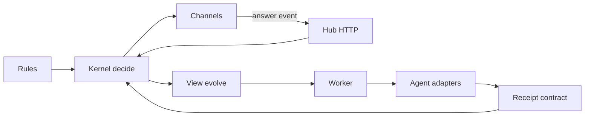
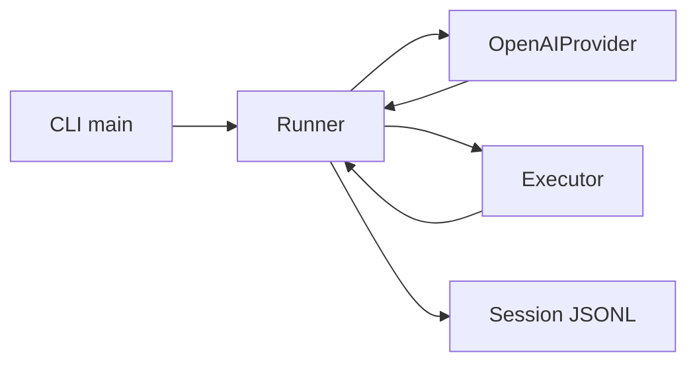
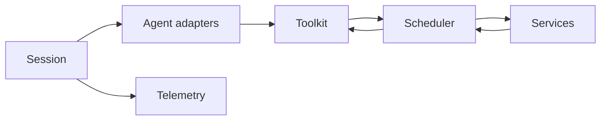
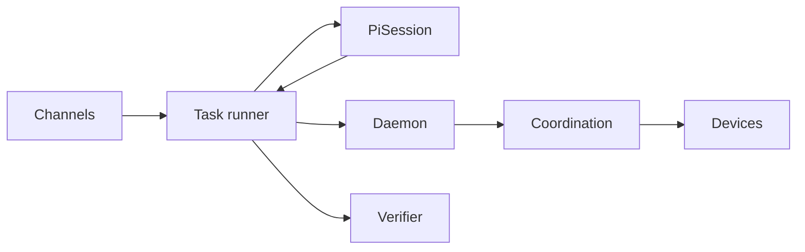

# Agentic AI Weekly Scan — 2026-11-07

**Nguồn:** `search/repositories` với `agent OR multi-agent OR agentic created:>2026-10-31 stars:>200` → 16 kết quả (≥4, không cần fallback). Loại: skill-pack/ebook (agentic-hacking-skills, dyz-med-paper-skills, turkish-anti-ai-skill), tool không phải agent architecture (stack-diagram, cinecode, vork, devvm, open-bot-avatar), repo ít code/không rõ. Chọn 4 repo bên dưới. Toàn bộ nội dung §2 đọc từ clone `--depth 1` (README, tree, entry points, core modules, manifest).

## Executive summary

- **Agent như một process, không phải SDK**: `agent-autoloop` đẩy toàn bộ điều phối vào kernel event-sourced deterministic (SQLite + fact log) và kiểm chứng bằng simulation/mutation testing; `uncut` đi hướng ngược lại — harness tối thiểu, *không* compaction, fail-loud khi bị truncate.
- **Scheduling tool-call theo resource** là pattern đáng chú ý ở `uni-robot-agent` (exclusive FIFO queue + background job handle để reasoning chồng lên physical action) — hữu ích cho mọi agent có side-effect không đảo ngược.
- **Device lease + MCP daemon** (`poki`) cho thấy cách chia sẻ một tài nguyên vật lý (iPhone) giữa nhiều agent session; có lớp verify kết quả bằng LLM thứ hai.

## Mục lục

1. [KKKKhazix/agent-autoloop](#1-kkkkhazixagent-autoloop)
2. [Balanov/uncut](#2-balanovuncut)
3. [Open-RUA/uni-robot-agent](#3-open-ruauni-robot-agent)
4. [JosssphZhou/poki](#4-josssphzhoupoki)

---

## 1. KKKKhazix/agent-autoloop

https://github.com/KKKKhazix/agent-autoloop

### §1 — Quick context
- **Pitch:** Chạy CLI agent (Claude Code, Codex…) nền theo rules; chỉ gửi "thẻ" cho người khi cần quyết định.
- **Stack:** TypeScript (Node ≥24, `node:sqlite`, zero runtime deps), agent adapters: Claude, Codex, ACP, command; channels: Feishu/Slack/Discord/desktop.
- **Health:** 3.743★; tạo ~tuần này, commit mới nhất 2026-11-07; có CI (`.github/workflows/check.yml`, `nightly.yml`) và ~hàng chục file test + `sim/`. Số contributor: không xác định (clone shallow).

### §2 — Architecture deep-dive

**A. Component inventory**
- `Kernel/decide` (`kernel/decide.ts`, 755 dòng) — hàm thuần `decide(view, input, now, env) → {facts, value}`; mọi thay đổi state đi qua đây.
- `View/evolve` (`kernel/evolve.ts`) — projection SQLite từ fact log; 12 bảng (`events, runs, cards, timers, schedules…`).
- `Store` (`kernel/store.ts`) — `commit`/`rebuild` replay log.
- `Rules` (`kernel/rules.ts`, `kernel/cron.ts`) — matcher event→agent/cwd/skill.
- `Hub HTTP` (`kernel/http.ts`, `host/server.ts`) — giao thức HTTP+JSON; plugin tự kết nối vào.
- `Worker` (`worker/worker.ts`, `worker/run.ts`) — claim run, spawn agent.
- `Agent adapters` (`worker/agents.ts`, `plugins/claude/agent.ts`, `plugins/acp/`) — command line + parse output.
- `Receipt contract` (`worker/contract.ts`, `protocol/validate.ts`) — parse khối ```` ```agent-autoloop ```` ở message cuối.
- `Channels` (`host/channels.ts`, `plugins/feishu`, `plugins/desktop`) — gửi card.
- `Delivery pipeline` (`plugins/delivery/`) — CI/CD review/merge theo plugin.
- `Simulation` (`sim/world.ts`, `sim/invariants.ts`, `sim/mutate.ts`) — random/crash/mutation test.

**B. Control flow:** *Event-driven + event-sourced state machine*, mỗi "round" của agent là một lượt ngắn (không giữ process chờ người).
1. Source/cron phát event chuẩn hóa tới hub.
2. `decide` khớp rule, gom event cùng subject vào một run ("lane"/`parallel`).
3. Worker claim run (lease `RUN_LEASE` 5 phút), spawn agent process với prompt do rule dựng.
4. Agent in message cuối; `parseResult` đọc receipt (`ask/notice/resolve/later/events`), áp dụng trong **một transaction**.
5. `ask` → card tới channel (resend theo `RESEND_AT`); process thoát, không tốn token khi chờ.
6. Câu trả lời của người = event mới → resume cùng session.

**C. State/data:** typed JSON schema (`protocol/schema.json`); state = fact log + projection SQLite; context của agent: session resume của CLI; text do người ngoài viết đi vào *context file* đánh dấu "là dữ liệu", không vào prompt (`worker/contract.ts`).

**D. Tool integration:** agent không có tool/SDK nào gọi hub — mọi hành động nằm trong receipt. Sandbox qua `access: read|edit|full` (`worker/agents.ts`).

**E. Memory:** không có memory dài hạn riêng; chỉ session resume + `later` timers.

**F. Model orchestration:** model/effort khai báo từng agent trong `rules.json`; `parallel`, `worker.capacity` giới hạn đồng thời; retry tối đa `MAX_ATTEMPTS=10`.

**G. Observability/eval:** fact log là audit/replay; `agent-autoloop status` thống kê rounds/tokens/cost (`worker/usage.ts`, `cli/spend.ts`); `explain`/`why` (`cli/`). Eval bằng `sim/` (replay oracle độc lập, mutation `sim/mutate.ts`).

**H. Extension:** plugin theo `plugins/<use>/agent.ts` hoặc `use: "command"` trong `rules.json`; protocol conformance (`protocol/conformance.ts`).

### §3 — Diagram



### §4 — Verdict
- **Đáng học:** kernel *hàm thuần* + fact log + "replay oracle" độc lập và mutation test (`sim/mutate.ts` đột biến chính `decide.ts` để xem test có bắt được) — mức kỷ luật hiếm thấy ở agent infra; "receipt" thay tool-call giúp agent không cần SDK/credential.
- **Red flags:** CLI/notification mặc định còn tiếng Trung; prompt-injection chỉ được *giới hạn phạm vi*, không chặn (tác giả tự nhận); số contributor/lịch sử không xác định.
- **Open questions:** chi phí replay khi log lớn? snapshot (`snapshot()` trong `evolve.ts`) đủ chưa? chất lượng agent tự quyết "việc nào cần hỏi" (`askFirst`) được đo thế nào?

---

## 2. Balanov/uncut

https://github.com/Balanov/uncut

### §1 — Quick context
- **Pitch:** Harness coding-agent headless, "không cắt" context, một binary Go 7 MB.
- **Stack:** Go 1.26, không dependency ngoài; provider OpenAI-compatible Chat Completions (cả local server).
- **Health:** 252★; commit 2026-11-06; ~1.5k LOC Go gồm test; CI (`.github/workflows/ci.yml`, `release.yml`); 1 maintainer (không xác định thêm).

### §2 — Architecture deep-dive

**A. Component inventory**
- `Runner` (`internal/harness/run.go`) — vòng lặp agent.
- `Provider`/`OpenAIProvider` (`internal/harness/provider.go`) — HTTP tới `/chat/completions`.
- `Executor` (`internal/harness/tools.go`) — 4 tool: `read_file`, `write_file`, `replace`, `run_command`; chặn path thoát workspace.
- `Session` (`internal/harness/session.go`) — JSONL append-only, resume được.
- `Types` (`internal/harness/types.go`) — message/usage/event portable.
- `CLI` (`cmd/uncut/main.go`) — flags, `--json` NDJSON.
- `Bench` (`bench/proof.py`, `BENCHMARKS.md`) — chứng minh lossless.

**B. Control flow:** *ReAct-style loop* đơn giản (function-calling native).
1. Nạp session (nếu có), thêm `system` + `user`.
2. Gửi **toàn bộ** history tới provider.
3. Nếu `finish_reason` là `length`/`max_tokens` → lỗi (exit 3), không nhận câu trả lời cụt.
4. Có `tool_calls` → `Executor.Execute`, lỗi tool trả về như text `error: …`.
5. Append kết quả tool, lặp tới khi hết tool call hoặc `MaxSteps` (exit 4).
6. In text cuối ra stdout.

**C. State:** `[]Message` trong memory + JSONL; không compaction, sliding window hay summarization — chủ đích.

**D. Tool:** khai báo tĩnh `ToolDefinitions()`; validation: JSON args, `resolve()` chặn path escape; `run_command` qua shell (`shell_unix.go`/`shell_windows.go`) — **không có sandbox** ngoài workspace-root cho file tool.

**E. Memory:** chỉ session log.

**F. Model orchestration:** 1 model, không fallback/parallel/retry (README nói rõ "no automatic retries").

**G. Observability/eval:** `assistant_meta` event có usage/finish_reason; eval = `bench/proof.py` chạy binary thật với provider loopback tất định, so sánh byte-by-byte (442.400 B file, 213.018 B output).

**H. Extension:** "forkable"; không có plugin system theo thiết kế.

### §3 — Diagram



### §4 — Verdict
- **Đáng học:** coi *im lặng cắt dữ liệu* là bug: truncation → exit code riêng; proof lossless bằng provider giả tất định so sánh byte-level — phương pháp eval rẻ, tái lập được.
- **Red flags:** `run_command` không sandbox (path check chỉ cho file tool); benchmark chỉ đo startup/footprint (tự thừa nhận không đo chất lượng); không compaction nghĩa là task dài sẽ chạm context limit.
- **Open questions:** hành vi khi context vượt giới hạn model? so sánh chất lượng task thực với harness khác chưa có.

---

## 3. Open-RUA/uni-robot-agent

https://github.com/Open-RUA/uni-robot-agent

### §1 — Quick context
- **Pitch:** Harness thống nhất cho robot-use agent, chạy Codex/Claude Code với tool robot dùng chung.
- **Stack:** Python ≥3.11, FastAPI/uvicorn, `openai-codex`, `claude-agent-sdk`, MCP; Pi0.5 (OpenPI/JAX), SAM3; sim RoboDojo/RoboLab/RoboTwin/LIBERO.
- **Health:** 264★; commit 2026-11-07; ~33k LOC Python; chỉ thấy workflow `release.yml`, không thấy thư mục test trong repo → test/CI chất lượng: không xác định; 1 contributor (shallow clone).

### §2 — Architecture deep-dive

**A. Component inventory**
- `Session` (`uni_robot_agent/session.py`) — lắp ráp & vòng đời run.
- `Agent adapters` (`uni_robot_agent/agents/`, `registry.py`, `contracts.py`) — Codex, Claude Code, OpenCode, Gemini CLI (thử nghiệm).
- `Toolkit` (`uni_robot_agent/tools/toolkit.py`) — registry `ToolDef`.
- Tool providers (`tools/gripper/`, `tools/scene/`, `tools/hybrid/`, `tools/skills.py`, `tools/episode.py`) — `move/grasp/locate/actor_act/finish`.
- `Scheduler`/`ParallelToolExecutor` (`execution/scheduler.py`, `execution/parallel.py`) — job, resource queue.
- `Context` (`context/history.py`, `context/policies/sliding_window.py`) — history policy.
- Services (`services/environment`, `services/actor`, `services/perception`, `services/batching.py`) — FastAPI + `BatchWorker`.
- `Provider gateway` (`provider/gateway.py`).
- `Telemetry` (`telemetry/tracer.py`) và `EventBus` (`events/core.py`).
- `Integrations` (`integrations/robodojo`, `robouse`, `robolab`…).

**B. Control flow:** *ReAct-style do SDK bên ngoài điều khiển* + execution layer tự viết (scheduler); chế độ Hybrid thêm action model (Pi0.5).
1. CLI validate config.
2. `session.py` nạp `IntegrationSpec`, đăng ký tool, dựng prompt.
3. Codex/Claude gọi tool qua MCP adapter → executor.
4. Tool đọc `Episode` chia sẻ; motion = chuỗi HTTP step nguyên thủy.
5. Tool `exclusive` vào FIFO queue theo `resource_key`; `background` trả job handle để agent suy luận tiếp.
6. `finish` chỉ nộp yêu cầu kết thúc; `EpisodeOutcome` ghi kết quả chính thức, không báo verdict cho agent.

**C. State:** `Episode` + observation bất biến; JSONL trajectory; receipt reconciliation (mất response không replay tự động).

**D. Tool:** `ToolDef(name, spec JSON-schema, handler, readonly)`; model gọi qua MCP/SDK; `ToolExecutionPolicy` (`return_mode`, `concurrency`, `resource_key`).

**E. Memory:** `SkillTools` — `list_skills/read_skill`, tùy chọn `write_skill` lưu kinh nghiệm theo môi trường (`--skill-writing`).

**F. Model orchestration:** agent LLM (vision) + actor model (Pi0.5) + perception (SAM3); `BatchWorker` micro-batch; cờ `--model-parallel-tool-calls`, `--mcp-parallel-dispatch`, `--resource-scheduling`.

**G. Observability:** tracer có span API (`telemetry/tracer.py`); không xác định có OpenTelemetry hay không.

**H. Extension:** `register_agent` (`agents/registry.py`), entry point `robouse.backends`, hợp đồng trong `docs/hybrid.md`, `docs/services.md`.

### §3 — Diagram



### §4 — Verdict
- **Đáng học:** tách *tool-call success / agent completion / task success*; scheduler theo `resource_key` cho phép reasoning chồng lên action vật lý mà vẫn giữ thứ tự; không replay tự động khi mất response.
- **Red flags:** không thấy test suite trong repo; dependency pin cứng vào SDK còn rất mới; 1 contributor; dùng được cần GPU Linux.
- **Open questions:** lợi ích đo được của pipeline hai tầng (paper có bảng số?); `context/policies` chỉ thấy sliding window — có policy visual nào khác?

---

## 4. JosssphZhou/poki

https://github.com/JosssphZhou/poki

### §1 — Quick context
- **Pitch:** MCP server + agent điều khiển iPhone thật/simulator như người dùng.
- **Stack:** Node ≥24 (ESM), `@modelcontextprotocol/*`, zod; native bridge (Rust/ObjC/Swift, idevice); agent dùng `pi-ai`, mặc định model OpenAI cấu hình ở `agent/model-config.mjs`.
- **Health:** 434★; commit 2026-11-07; có `test/` và `agent/test/`; không thấy workflow CI (chỉ CODEOWNERS/templates); AGPL-3.0; 1 contributor (shallow).

### §2 — Architecture deep-dive

**A. Component inventory**
- `Daemon` (`src/daemon.mjs`) — HTTP MCP server, bearer token ≥32 ký tự, host/origin validation.
- `Tools` (`src/tools.mjs`, `src/data/tools.json`) — catalog tool + `batch_commands`.
- `Coordination` (`src/coordination.mjs`) — device lease, operation tracking, revision theo frame.
- `Devices`/`Interaction` (`src/device.mjs`, `src/interaction.mjs`, `src/platform.mjs`).
- `Task runner` (`agent/task-runner.mjs`) — vòng nhiệm vụ, allowlist tool.
- `PiSession` (`agent/pi-session.mjs`) — kết nối model.
- `Verifier` (`agent/verify-result.mjs`) — LLM thứ hai xác minh kết quả (timeout 45s).
- `Routes` (`agent/routes.mjs`), `Fast` (`agent/fast/`) — đường nhanh cho tác vụ đã biết.
- Channels (`agent/imessage.mjs`, `agent/telegram.mjs`).

**B. Control flow:** *ReAct-style* observe→act, cộng *verify pass* sau cùng.
1. Task đến từ terminal/iMessage/Telegram.
2. `task-runner` mở session model, chỉ cho phép tập tool trong allowlist.
3. Agent gọi MCP tool (ưu tiên `batch_commands` khi biết target).
4. `Coordination.access` kiểm tra lease/occupancy trước mỗi thao tác.
5. Kết thúc → `verifyResult` gọi `report_verification {verified, reason}`.
6. Trả kết quả/readout qua channel.

**C. State:** state dir cục bộ (`src/config.mjs`); `routes.mjs` lưu route tái dùng; message dạng MCP content + structured observation; chiến lược context window: không xác định từ code đã đọc.

**D. Tool:** schema zod trong `src/tools.mjs`; MCP over HTTP/stdio (`src/stdio.mjs`); bảo vệ bằng token, lease, `step-deadline.mjs`.

**E. Memory:** không xác định (có `routes`, `reply-ledger.mjs` nhưng chưa đọc đủ để kết luận).

**F. Model:** một model cho execution/verification/route answers, reasoning cố định `low` (README agent); service tier "priority" có retry về `default`; ghi lại `servedServiceTier`.

**G. Observability:** request/response record, trace passive vs active tool (`task-runner.mjs`), `docs/verification/`; OpenTelemetry: không xác định.

**H. Extension:** đăng ký làm MCP server cho Claude Code/Codex (`bin/poki-mcp`); channel nguồn (`message-source.mjs`).

### §3 — Diagram



### §4 — Verdict
- **Đáng học:** device lease + revision theo screenshot để tránh nhiều session đạp nhau; ghi lại tier thực sự được phục vụ thay vì tin request; verifier tách biệt khỏi executor.
- **Red flags:** chỉ macOS + Xcode; file mật độ cao, ít comment (dòng rất dài, khó review); không CI workflow; một số file ghi "Source: poki-app" → code tách từ repo private, lịch sử hạn chế.
- **Open questions:** tỉ lệ verifier bắt được false-success? quản lý context cho task dài? bảo mật khi mở `remote.mjs` ra mạng.

---

*Self-check log:* link verify HTTP 200 qua `curl`/`gh api repos/…` **không thực hiện được** (proxy trả 403 do giới hạn scope repo); thay bằng: repo xuất hiện trong kết quả `search/repositories` và `git clone` thành công. Mermaid: cả 4 diagram parse OK bằng `mermaid@11` `parse()`.
