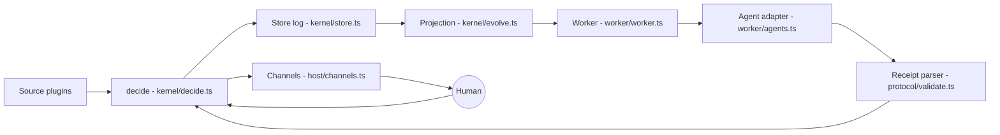
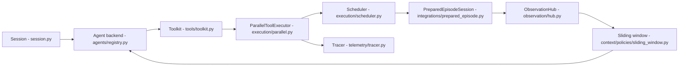
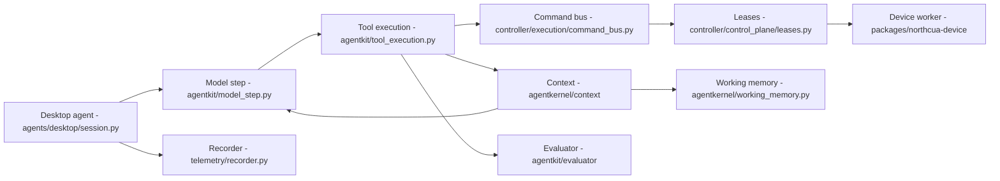
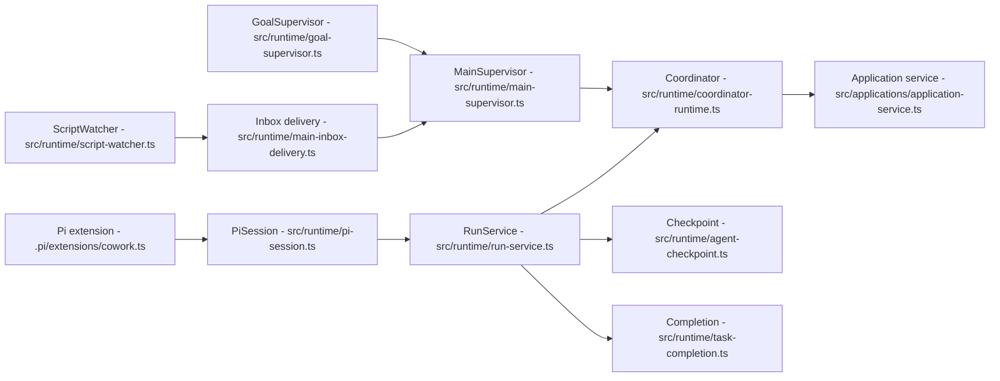

# Agentic AI Weekly Scan — 2026-11-08

Cửa sổ quét: 2026-11-01 → 2026-11-08. Nguồn: GitHub Search API (`created:>2026-11-01`), clone `--depth 1` và đọc code trực tiếp.

**Xác minh link:** `curl` tới github.com bị proxy chặn (HTTP 403 theo scope), nên "link sống" được xác nhận gián tiếp bằng việc `git clone` thành công và Search API trả về repo.

## Executive summary

- **Xu hướng "harness quanh CLI agent có sẵn"**: cả `agent-autoloop` và `uni-robot-agent` không tự viết agent loop mà bọc Codex / Claude Code, rồi thêm lớp scheduling + human-in-the-loop riêng. Phần giá trị nằm ở lớp bọc, không ở model.
- **Event-sourcing và durable state đang vào agent infra**: `agent-autoloop` (log append-only + projection có thể rebuild, test bằng simulation/crash/mutation) và `CoworkOS` (checkpoint, Inbox bền, Goal/Watcher) coi agent là tiến trình dài hạn có thể chết bất cứ lúc nào.
- **Context management trở thành thành phần hạng nhất**: `NorthCUA` (image-window budget + compaction `off/shadow/enforce` + pinned content) và `uni-robot-agent` (sliding window cắt theo block hoàn chỉnh) đều tách "record đầy đủ" khỏi "projection đưa vào prompt".

**Lưu ý phương pháp (ngoại lệ ngưỡng):** truy vấn gốc `stars:>200` trả 13 repo nhưng phần lớn là marketing / skill pack / tool không phải agent architecture. Chỉ 2 repo pass bộ lọc relevance ở ngưỡng đó (`agent-autoloop`, `uni-robot-agent`). Theo EMPTY-WEEK protocol không nặn thêm, nhưng tôi mở rộng sang `created:>7d stars:>100` và lấy thêm `NorthCUA` (104★) và `CoworkOS` (141★) vì có technical report + code đủ đọc. Hai repo này dưới ngưỡng 200★ — người đọc cân nhắc. Không dùng nhánh `pushed:>7d stars:>500` vì ra các repo lớn (hermes-agent, opencode…) mà "significantly updated" không xác định được trong 1 lần quét.

Đã loại: `mattpocock/skills`, `obra/superpowers` (skill pack), `Glen-Web-App/best-agent-memory-mcp` (list), `agent-deploy-memory-muse` (đáng ngờ, 6 KB), `cinecode`/`vork`/`poki`/`muse4ai` (ứng dụng domain, chưa đủ thời gian đọc — để tuần sau), `devvm` (sandbox, không phải agent architecture), `phuryn/mini-harness` (dạy học, 140★).

## Mục lục

1. [agent-autoloop](#1-agent-autoloop)
2. [uni-robot-agent](#2-uni-robot-agent)
3. [NorthCUA](#3-northcua)
4. [CoworkOS](#4-coworkos)

---

## 1. agent-autoloop

### §1 — Quick context
Link: https://github.com/KKKKhazix/agent-autoloop

**Pitch:** Kernel tất định chạy nền, biến CLI agent thành vòng lặp tự nhận việc, chỉ gửi thẻ hỏi người khi cần quyết định.

- Stack: TypeScript, Node ≥24 (`node:sqlite`), zero runtime dependency (`package.json` chỉ có devDependencies). Model: không cố định, adapter cho Codex/Claude/DSH/ACP/command.
- Health: 3989★, push 2026-11-08, CI (`check.yml`, `nightly.yml`), thư mục `tests/` + `sim/`. Contributors: không xác định (clone shallow, API repo bị chặn).

### §2 — Architecture deep-dive

**A. Components**
- `decide` (`kernel/decide.ts`, 769 dòng) — hàm thuần: (view, input, time, secrets) → facts + answer.
- `Store` (`kernel/store.ts`) — log `facts` append-only trên SQLite, `commit` kiểm tra `seq` (optimistic, ném `Conflict`), `rebuild` projection từ log.
- `Projection/evolve` (`kernel/evolve.ts`) — bảng `events, runs, cards, deliveries, timers, schedules, pauses…` dẫn xuất từ facts.
- `Due/Cron` (`kernel/due.ts`, `kernel/cron.ts`) — deadline, lease (`RUN_LEASE`, `OFFLINE_AFTER`), lịch cron.
- `Rules` (`kernel/rules.ts`, `protocol/rules.ts`) — `rules.json` map event → agent + cwd + prompt/skill.
- `Worker` (`worker/worker.ts`) — chạy agent như process, mỗi lượt một round rồi thoát.
- `Agent adapter` (`worker/agents.ts`; `plugins/codex/agent.ts`) — `command()`/`read()`/`check()` cho từng CLI.
- `Receipt parser` (`protocol/validate.ts`, `protocol/schema.json`) — parse khối ```` ```agent-autoloop ```` trong final message (`ask/notice/resolve/later/events`).
- `Channels` (`host/channels.ts`, `plugins/feishu/channel.ts`) — gửi thẻ, resend theo `RESEND_AT`.
- `Sim` (`sim/invariants.ts`, `sim/crash.ts`, `sim/mutate.ts`) — kiểm thử mô phỏng.

**B. Control flow:** event-driven + event-sourced state machine (không có ReAct loop nội bộ; vòng lặp nằm ở agent bên ngoài).
1. Source/cron phát event → `decide` ghi fact, gộp event cùng subject đang queue.
2. Rule chọn agent + cwd; run vào hàng đợi theo `lane`.
3. Worker spawn CLI agent (resume session nếu có), chạy một round.
4. Final message được parse thành receipt; `ask` tạo card, `later` tạo timer, `events` phát event mới (giới hạn `MAX_HOPS = 8`).
5. Card gửi qua channel; trong lúc chờ không có process nào chạy.
6. Người trả lời → event trả lời → resume đúng session.

**C. State:** typed JSON schema; SQLite (log + projection); context do session của agent CLI giữ (resume bằng session id) — kernel không quản lý context window.

**D. Tool:** không có tool registry; agent mang tool riêng. Giao tiếp ngược qua receipt JSON. Giới hạn an toàn: `access: read|edit|full` trong `Turn`, `MAX_ATTEMPTS = 10` chống đốt token.

**F. Model:** chọn theo rule (`model`, `effort` trong `Turn`); không có planner/executor tách.

**G. Observability:** CLI `status`, `why`, `explain`, `spend` (`cli/`); usage token/cost theo round (`worker/usage.ts`); replay = rebuild từ log.

**H. Extension:** thư mục `plugins/<use>/agent.ts`; `use: "command"` cho mọi CLI có print mode; `docs/plugins.md`.

E (memory dài hạn): không xác định từ code.

### §3 — Diagram


### §4 — Verdict
- **Đáng học:** tách rõ "fact log + projection có thể rebuild" với "hàm decide thuần nhận time/secrets làm tham số"; kiểm bằng simulation 20.000 bước, crash test và mutation test. Mô hình "agent chết giữa chừng không sao" hiếm gặp ở repo agent.
- **Red flags:** chỉ có 1 commit nhìn thấy (shallow, chưa xác minh lịch sử); output CLI vẫn tiếng Trung; không tự quản lý context; chất lượng quyết định hoàn toàn phụ thuộc agent bên ngoài.
- **Câu hỏi mở:** `sim/invariants.ts` kiểm những invariant nào? Chi phí `benchmark.ts` ở quy mô nhiều rule song song? Bảo mật credential khi source là webhook công khai (`kernel/credentials.ts`).

---

## 2. uni-robot-agent

### §1 — Quick context
Link: https://github.com/Open-RUA/uni-robot-agent

**Pitch:** Harness thống nhất cho agent điều khiển robot, bọc Codex/Claude Code qua tool MCP và scheduler cho thao tác vật lý.

- Stack: Python ≥3.11, FastAPI/uvicorn, `openai-codex`, `claude-agent-sdk`, Textual TUI; môi trường RoboDojo/RoboLab, action model Pi0.5 (hybrid).
- Health: 278★, v0.1.1 (Alpha), push 2026-11-07, CI chỉ có `release.yml`; **không thấy file test nào**. Contributors: không xác định.

### §2 — Architecture deep-dive

**A. Components**
- `Session` (`uni_robot_agent/session.py`, 887 dòng) — lắp ráp và vòng đời run.
- `Agent backends` (`agents/registry.py`, `agents/contracts.py`; `agents/codex/`, `agents/claude_code/`, `agents/opencode/`, `agents/gemini_cli/`) — adapter SDK, đăng ký lazy.
- `Toolkit` (`tools/toolkit.py`) — registry `ToolDef` (spec JSON schema + handler + `readonly`).
- `ParallelToolExecutor` (`execution/parallel.py`) và scheduler (`execution/scheduler.py`) — job nền, hàng đợi theo `resource_key`.
- `PreparedEpisodeSession` (`integrations/prepared_episode.py`) — giữ kết nối, tạo `Episode` dùng chung.
- `ObservationHub` (`observation/hub.py`) — snapshot quan sát, độ tươi.
- `Context policy` (`context/policies/sliding_window.py`, `context/history.py`).
- `Provider gateway` (`provider/gateway.py`, `provider/conversions/responses_chat.py`) — chuyển đổi Responses↔Chat.
- `Actor service` (`services/actor/service.py`) — action model cho Hybrid mode.
- `Tracing/SFT` (`telemetry/tracer.py`, `artifacts/sft/`).

**B. Control flow:** ReAct-style do agent SDK bên ngoài thực hiện; harness thêm "two-stage pipeline" (reasoning chồng lên thực thi). Happy path (theo `docs/architecture.md`, đối chiếu code):
1. CLI validate config (`--validate-config` thoát sớm).
2. `session.py` nạp `IntegrationSpec`, khởi động `IntegrationSession`, đăng ký tool, dựng prompt.
3. Codex/Claude gọi tool qua MCP adapter → executor.
4. Tool đọc chung một `Episode`; tool vật lý dùng `ToolExecutionPolicy` (`return_mode` immediate/background, `concurrency` exclusive/parallel, `resource_key`) → trả job handle.
5. `finish` chỉ gửi yêu cầu kết thúc, không lộ verdict; `EpisodeOutcome` ghi riêng.

**C. State:** typed (pydantic, dataclass `JobRecord`); `Episode` in-memory; JSONL trajectory + artifacts trên đĩa. Context: sliding window cắt theo block call/output hoàn chỉnh, có xử lý riêng cho ảnh.

**D. Tool:** `Toolkit` đăng ký provider → schema JSON; gọi bằng function-calling native của SDK qua MCP; sandbox/validation: không xác định từ code đã đọc.

**F. Model:** agent runtime chọn Codex/Claude/OpenCode/Gemini; Hybrid thêm action model (Pi0.5) qua `actor_act`; planner/executor tách: không xác định.

**G. Observability:** sự kiện lifecycle tool (`ToolLifecycleEvent`), queue snapshot listener, tracer, export SFT.

**H. Extension:** `@register_agent`, `register_context_policy`, `IntegrationSpec` cho môi trường mới.

E (memory dài hạn): không có.

### §3 — Diagram


### §4 — Verdict
- **Đáng học:** `ToolExecutionPolicy` với `resource_key` + job handle cho phép agent suy luận trong lúc robot đang chạy mà vẫn giữ thứ tự thao tác dùng chung tài nguyên; tách "tool success / agent completion / task success".
- **Red flags:** không có test trong repo; phụ thuộc cứng phiên bản `openai-codex==0.147.0`, `claude-agent-sdk==0.2.165`; 1 commit nhìn thấy; Alpha.
- **Câu hỏi mở:** receipt reconciliation hoạt động thế nào khi tool timeout? Có benchmark số liệu trong paper không? `code_as_policy` (`execution/code_as_policy/`) sandbox ra sao?

---

## 3. NorthCUA

### §1 — Quick context
Link: https://github.com/beipo-ai/NorthCUA

**Pitch:** Harness mã nguồn mở cho computer-use agent Desktop/Web, có controller, device worker và evaluator tách biệt.

- Stack: Python ≥3.12, NexAU (pin commit), Playwright, pyautogui, FastMCP; model bring-your-own (có `NorthCUA-Pro` trên Hugging Face).
- Health: 104★ (dưới ngưỡng 200), Apache-2.0, v0.2.0, CI `ci.yml`, thư mục `tests/` rộng (kể cả `tests/architecture`), technical report arXiv. Contributors: không xác định.

### §2 — Architecture deep-dive

**A. Components**
- `Desktop agent` (`northcua/agents/desktop/session.py`), `Web agent` (`northcua/agents/web/session/`) — quan sát/hành động theo nền tảng.
- `Model step` (`northcua/agentkit/model_step.py`) và `Tool execution` (`agentkit/tool_execution.py`) — một step = gọi policy + dispatch tool.
- `Context` (`northcua/agentkernel/context/`, `strategies/compression.py`) và `Working memory` (`agentkernel/working_memory.py`).
- `Controller` (`controller/control_plane/leases.py`, `scheduler.py`; `controller/execution/command_bus.py`, `command_idempotency.py`) — lease worker/session được phép chạy lệnh.
- `Evaluator` (`northcua/agentkit/evaluator/`) — chấm theo artifact hoặc live.
- `Batch` (`northcua/batch/`) và `Sandboxes` (`northcua/sandboxes/`) — lịch chạy hàng loạt, sandbox mới/đã chuẩn bị theo task attempt.
- `Telemetry` (`telemetry/recorder.py`, `telemetry/redaction.py`).
- Registry/extension (`agentkit/registry.py`, `agentkit/external_tools.py`).

(Vai trò của `command_idempotency`, `leases` lấy từ tên file + `docs/architecture.md`; chưa đọc từng hàm.)

**B. Control flow:** vòng lặp session → round → step kiểu ReAct, bọc trong pipeline prepare → execute → evaluate → save evidence → release; thực thi lệnh có thể đi qua controller tới device worker từ xa.
1. Nhận task (CLI/Python/websocket), chuẩn bị sandbox.
2. Mỗi step: dựng prompt từ task + quan sát hiện tại + tool exchange giữ lại + working memory.
3. Model sinh tool call; dispatch tới backend local (native/Playwright) hoặc qua controller tới worker có lease.
4. Tool GUI trả screenshot sau hành động làm quan sát kế tiếp.
5. Kết thúc → evaluator (artifact/live) → lưu evidence → giải phóng lease/sandbox.

**C. State & context:** artifact thô lưu riêng khỏi prompt projection. `prompt.screenshot_window_images` là tổng ngân sách ảnh (clean state + action overlay); `context_management.mode` ∈ `off|shadow|enforce`, enforce tóm tắt các exchange cũ, ghim system/task/observation hiện tại/tool exchange chưa xong/memory; không cắt cặp tool-use/result (`docs/context.md`). Agent ghi `note` văn bản làm working memory.

**D. Tool:** schema chung ở package `northcua-runtime-shared`, thực thi bởi `northcua-device`; MCP (`fastmcp`) có mặt trong deps. Validation chi tiết: không xác định.

**G. Observability:** recorder + sink + báo cáo (`telemetry/reporting.py`), phân loại failure, trace viewer cho Web.

**H. Extension:** controller plugins (`northcua_controller_plugins/`), skills, `agentkit` registry.

### §3 — Diagram


### §4 — Verdict
- **Đáng học:** chế độ compaction `shadow` (tính diagnostic nhưng không thay prompt) để đo trước khi bật `enforce`; ngân sách ảnh thống nhất cho GUI + Set-of-Mark; lease tách "ai được chạy lệnh" khỏi "task kết thúc thế nào"; docs ghi rõ field config đã bị xóa và validation từ chối thay vì đổi nghĩa âm thầm.
- **Red flags:** phụ thuộc NexAU pin commit và lớp `nexau_compat` giữ tên lịch sử; 104★, 1 commit nhìn thấy.
- **Câu hỏi mở:** số liệu benchmark trong report có tái lập được bằng `docs/evaluation.md` không? Command idempotency xử lý retry thế nào khi worker mất kết nối?

---

## 4. CoworkOS

### §1 — Quick context
Link: https://github.com/RUC-NLPIR/CoworkOS

**Pitch:** Harness cho công việc dài hạn có người tham gia: Main Agent, Coordinator, Subagent, Watcher và Goal bền vững.

- Stack: TypeScript, Node ≥22.19, Pi agent core (`@earendil-works/pi-*`), MCP SDK, QuickJS, Electron; CAD/Blender/PPTist adapters.
- Health: 141★ (dưới ngưỡng 200), MIT, push 2026-11-03, CI nhiều workflow, 405 file trong `test/` kèm `test/architecture-boundaries.test.js`, paper arXiv. Contributors: không xác định.

### §2 — Architecture deep-dive

**A. Components**
- `Coordinator` (`src/runtime/coordinator-runtime.ts`) — dispatch subtask, theo dõi lifecycle.
- `RunService` (`src/runtime/run-service.ts`) và `PiSession` (`src/runtime/pi-session.ts`) — Task/Run, event, checkpoint, phiên Pi.
- `ProcessHost` (`src/runtime/process-host.ts`) — process group, chống khởi động trùng, dừng có hạn giờ.
- `Checkpoint` (`src/runtime/agent-checkpoint.ts`), `Completion` (`src/runtime/task-completion.ts`).
- `Compaction` (`src/runtime/context-compaction.ts`, `compaction-summary-guard.ts`).
- `Inbox delivery` (`src/runtime/main-inbox-delivery.ts`), `MainSupervisor` (`src/runtime/main-supervisor.ts`).
- `GoalSupervisor` (`src/runtime/goal-supervisor.ts`), `ScriptWatcher` (`src/runtime/script-watcher.ts`).
- `Application service` (`src/applications/application-service.ts`) — resource với revision CAS.
- `Pi extension` (`.pi/extensions/cowork.ts`) — hook và đăng ký tool.
- `Experience store` (`src/runtime/project-experience-store.ts`).

**B. Control flow:** hierarchical (Main → Coordinator → Subagent) kết hợp event-driven (Watcher → Inbox → Main).
1. Tạo Task: lưu goal, ràng buộc, tiêu chí thành công, ngân sách, watcher.
2. Tạo Main Run + projection + checkpoint (`docs/long-running-agent-design.md`).
3. Main đọc memory, projection, Inbox, event gần đây.
4. Main chọn làm một mình / ủy quyền song song / chờ đồng bộ / vào trạng thái chờ.
5. Watcher sinh observation → runtime kiểm nguồn/phiên bản/quyền/kích thước, dedupe + debounce → ghi Event Log và Inbox.
6. Hoàn thành chỉ khi trạng thái và output đã ghi đĩa; "trả lời xong" không phải "mục tiêu xong" (`docs/architecture.md`).

**C. State:** typed domain (`src/domain/goal.ts`, `watch.ts`); lưu file + khóa (`src/storage/`), Event Log; context: compaction với guard cho summary, backoff khi compaction lỗi (`compaction-failure-backoff.ts`).

**D. Tool:** Pi extension đăng ký; QuickJS dispatcher chạy script gọi lần lượt tool đã bật, tool gốc vẫn giữ quyền/tham số; ComputerUse có quyền hệ điều hành và audit (`src/gui/`, `src/security/`).

**E. Memory:** `src/domain/user-memory.ts`, `project-experience.ts` (học từ kinh nghiệm dự án); chi tiết retrieval: không xác định.

**G. Observability:** trace/trajectory (`agent-trajectory.ts`), `experiment-metrics.ts`, `model-request-recording.ts`.

**H. Extension:** MCP, Virtual Agent, skill registry (`skill-registry.ts`), application adapters.

### §3 — Diagram


### §4 — Verdict
- **Đáng học:** "xong" được xác định bằng state đã ghi đĩa chứ không phải câu trả lời cuối; pause là ý định bền vững (clock, callback cũ vẫn giữ, chỉ người dùng mới resume); revision CAS cho tài liệu dùng chung người–agent; test kiểm ranh giới import giữa các tầng.
- **Red flags:** bề mặt rất rộng (CAD, Blender, PPT, science) khiến phần agent core khó đánh giá riêng; tên `atria` còn sót trong script/env; tài liệu chủ yếu tiếng Trung.
- **Câu hỏi mở:** hiệu quả của "RSI post-training" trong paper có tái lập được từ repo không? Cơ chế quyết định Main ủy quyền vs tự làm nằm ở prompt hay code?
