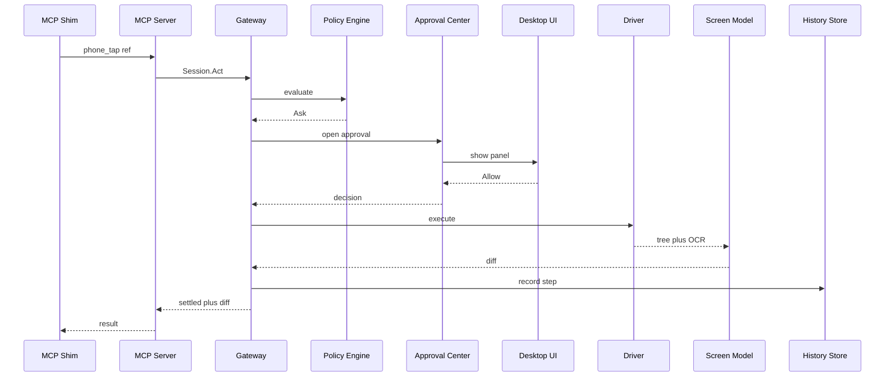
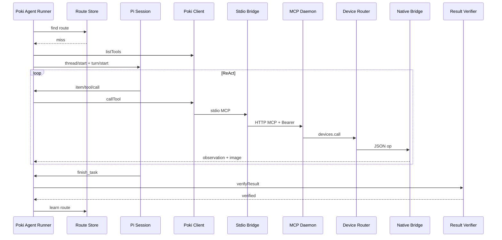
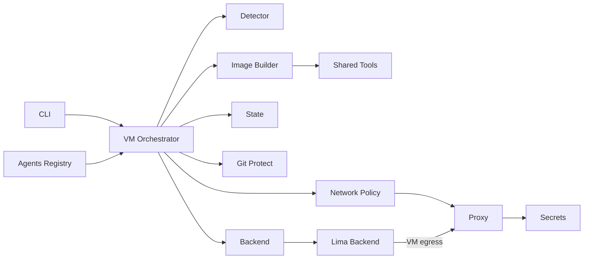
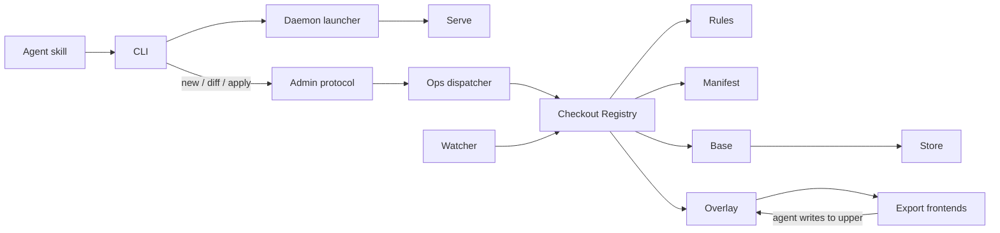

# Agentic AI weekly scan — 2026-11-11

Khoảng quét: repo tạo sau 2026-11-04, stars > 200 (`gh api search/repositories`, query `agent OR multi-agent OR agentic created:>2026-11-04 stars:>200`). Có 14 kết quả, đủ ngưỡng nên không cần mở rộng sang `pushed:`. Mọi phân tích dựa trên shallow clone (50 commit) đọc ngày 2026-11-11.

## Executive summary

- **Chủ đề tuần này: "harness" quanh agent, không phải agent framework.** Cả 4 repo được chọn đều đặt guardrail ở tầng hạ tầng chứ không ở prompt. Pinky enforce approval trong MCP gateway; devvm cô lập agent trong VM với proxy inject secret; ovnfs cho agent ghi vào overlay copy-on-write rồi người review bằng `diff`/`apply`.
- **Phone-use agent đang chín.** Pinky (Go) và Poki (Node/Rust/Swift) đều biểu diễn màn hình dạng text (accessibility tree, ref, diff) để tiết kiệm context. Poki đi xa hơn: có verifier LLM độc lập không cầm tool, và replay route đã học với 0 lần gọi model.
- **Bị loại:** 2 danh sách/so sánh (`best-agent-memory-mcp`, `agent-deploy-memory-muse`); 3 skill thuần prompt (humanizer ×2, `tinker-ai-skill`); 2 integration mỏng (`hermes-voice`, `image-to-sculpt`); 1 repo không phải agent (`youtube-ai-video-editing-system`). Hai repo pass filter nhưng xếp sau (giới hạn 4 repo): `vork` (render engine cho agent, ít kiến trúc agentic) và `phoneuse` (trùng chủ đề với Pinky/Poki).

## Table of contents

1. [DIYgod/pinky — MCP gateway điều khiển điện thoại có human-in-the-loop](#1-diygodpinky)
2. [JosssphZhou/poki — iPhone agent với verifier và learned routes](#2-josssphzhoupoki)
3. [devvmhq/devvm — VM sandbox cho coding agent](#3-devvmhqdevvm)
4. [stencil-hq/ovnfs — copy-on-write checkout cho agent](#4-stencil-hqovnfs)

---

## 1. DIYgod/pinky

Link: https://github.com/DIYgod/pinky

### §1 — Quick context

- **Pitch:** Gateway MCP cho mọi AI agent điều khiển iPhone/Android thật; bước rủi ro bị gateway giữ lại chờ người duyệt.
- **Stack:** Go 1.27 (một binary), `modelcontextprotocol/go-sdk`, `go-ios`, adb/scrcpy cùng companion app Android, SQLite (`modernc.org/sqlite`), Cloudflare Worker cho telemetry.
- **Health:** 1740★, tạo 2026-11-06, commit cuối 2026-11-11, 4 author trong 50 commit gần nhất. CI (`.github/workflows/ci.yml`) chạy test trên Linux/Windows, còn macOS chỉ build+vet. Có 394 file `*_test.go` trên 915 file `.go`. README tự ghi là pre-alpha.

### §2 — Architecture deep-dive

**A. Component inventory**
- `CLI entry` (`cmd/pinky/main.go`): một binary nhiều mode (`app`, `daemon`, `mcp`, `decide`, `token`…).
- `MCP Shim` (`cmd/pinky/shim.go`): stdio server do agent spawn, forward mọi lệnh tới gateway đang chạy.
- `MCP Server` (`internal/mcp/server.go`, `internal/mcp/tools.go`, `internal/mcp/http.go`): đăng ký 19 tool `phone_*`; mỗi MCP session tương ứng một gateway Session.
- `Gateway` (`internal/gateway/gateway.go`, `internal/gateway/pipeline.go`): lease, scope và action pipeline.
- `Policy Engine` (`internal/policy/engine.go`, `internal/policy/detect.go`, `internal/policy/defaults.yaml`): trả Allow / Ask / Deny.
- `Approval Center` (`internal/approval/approval.go`): giữ các call đang chờ người quyết định.
- `Screen Model` (`internal/screen/screen.go`, `internal/screen/refs.go`, `internal/screen/diff.go`): chuẩn hóa màn hình thành text, gán ref ổn định, tính diff.
- `OCR` (`internal/ocr/ocr.go`): đọc vùng accessibility tree không thấy.
- `Driver` (`internal/driver/driver.go`, `internal/driver/android`, `internal/driver/ios`, `internal/driver/fake`): abstraction thiết bị.
- `History Store` (`internal/history/history.go`): lịch sử trong SQLite.
- `Desktop UI` (`ui/doc.go`): approval panel và mirror màn hình.
- `Ask Pinky` (`internal/pilot/pilot.go`): agent tích hợp sẵn (tùy chọn).

**B. Control flow — tool server + gateway interception.** Gateway là pipeline đồng bộ, lock theo từng device, với cổng policy/approval đặt trước khi thực thi. Vòng ReAct do agent bên ngoài tự chạy.
1. Agent gọi `phone_connect` qua `MCP Shim` (hoặc HTTP). `MCP Server` mở gateway Session, cấp lease, trả màn hình đầu.
2. Agent gọi action (vd. `phone_tap`). `Gateway.act()` (`internal/gateway/pipeline.go`) chạy gate → lock device → `startScreen` → `prepare`.
3. `Policy Engine` evaluate. Nếu là Ask, `Approval Center` mở panel trên `Desktop UI`. Call bị block tối đa 45 s (`MaxBlock` trong `internal/gateway/gateway.go`), quá hạn thì trả `approval_pending`.
4. Sau khi người bấm Allow, gateway re-check label/vị trí/text; màn hình đã đổi thì trả `stale`.
5. `Driver` thực thi, gateway chờ settle (tối đa 3 s), rồi `Screen Model` trả diff (`+`/`-`/`~`).
6. Step, ảnh và approval được ghi vào `History Store` (`internal/gateway/record.go`).

**C. State & data flow.** Agent nhận text, mỗi element một dòng `[ref] role "label" @x,y`, trong đó ref là hash ổn định (`docs/DESIGN.md`). SQLite có các bảng devices/agents/sessions/tasks/steps/approvals/media/recordings. Context được giữ gọn vì mỗi lần chỉ trả diff, và chỉ gửi screenshot khi agent yêu cầu.

**D. Tool integration.** Tool đăng ký bằng `sdk.AddTool` (`internal/mcp/tools.go`). Transport là stdio hoặc Streamable HTTP trên 127.0.0.1 với token riêng cho từng agent (`internal/mcp/http.go`). Approval quyết định phía client, dùng một lần, gắn với đúng device + lease + tool + tham số (`internal/approval/approval.go`). Rule đọc từ YAML; khi nhiều rule khớp, rule nghiêm nhất thắng.

**E. Memory.** `Ask Pinky` không nhớ gì giữa các task (comment trong `internal/pilot/pilot.go`). Không có long-term memory.

**F. Model orchestration.** Gateway không gọi model. `internal/pilot` chạy ReAct đơn với `DefaultMaxSteps=100`, `DefaultMaxTime=20m`, `DefaultMaxCost=2.0` USD (quy ra token limit). Provider là Anthropic hoặc OpenAI-compatible (`internal/pilot/claude.go`, `internal/pilot/openai.go`).

**G. Observability & eval.** Mỗi task có recording kèm mốc cho từng step và export được báo cáo HTML (`internal/gateway/export.go`). Có log `slog`, telemetry redact (`internal/telemetry/redact.go`) và driver `fake` cho CI. Replay không cần model: không xác định từ code.

**H. Extension points.** Interface `Driver` tách thành nhiều capability interface tùy chọn. Ngoài ra có `rules.yaml`/`apps.yaml`, agent catalog (`internal/agents/catalog.go`) và remote qua Tailscale (`internal/tailnet`).

### §3 — Architecture diagram

### §4 — Verdict

- **Đáng học:** approval là một **capability token dùng một lần, gắn với đúng tham số**, kèm re-check `stale` trước khi thực thi, nên chặn được TOCTOU giữa lúc người duyệt và lúc tap. Screen-as-diff là pattern tiết kiệm context nên copy. Status `uncertain` được trả về trung thực thay vì retry mù.
- **Red flags:** pre-alpha. `docs/DESIGN.md` ghi "ships no model" nhưng code đã có `internal/pilot`. Agent có shell vẫn đi vòng qua adb được (threat model có thừa nhận). Phát hiện nút nguy hiểm dựa trên keyword.
- **Open questions:** commit detector chính xác đến đâu với icon-only button hoặc app lạ? Có kế hoạch replay deterministic từ History Store không?

---

## 2. JosssphZhou/poki

Link: https://github.com/JosssphZhou/poki

### §1 — Quick context

- **Pitch:** MCP server cục bộ cùng agent tùy chọn, điều khiển iPhone thật qua accessibility tree và HID, không cần jailbreak.
- **Stack:** Node.js ≥24 ESM (`@modelcontextprotocol/*`, zod, sharp), Rust (`native/bridge`, idevice), Swift (iOS app, PokiCore), pi SDK (`@earendil-works/pi-coding-agent`). Model mặc định thuộc OpenAI.
- **Health:** 937★, tạo 2026-11-05, commit cuối 2026-11-10, 11 author. Có 18 workflow, nhưng `pr-checks.yml` chỉ chạy `cargo test` + actionlint. 53 file test Node (`test/`, `agent/test/`) **không được workflow nào gọi** (đã grep).

### §2 — Architecture deep-dive

**A. Component inventory**
- `MCP Daemon` (`src/daemon.mjs`): HTTP MCP trên 127.0.0.1:47825, xác thực Bearer token, mỗi session một `Devices`.
- `Stdio Bridge` (`src/stdio.mjs`): proxy MCP stdio → HTTP daemon, dùng cho Claude Code/Codex.
- `Tool Registry` (`src/tools.mjs`, `src/data/tools.json`): tool định nghĩa bằng zod, có profile `default`/`cua`.
- `Device Router` (`src/device.mjs`): chọn thiết bị vật lý (native), simulator hay platform tools.
- `Native Bridge` (`native/bridge/src/main.rs`): binary Rust nhận JSON qua stdin để chạy `ax_tree`, tap, `type_text`, screenshot.
- `Poki Agent Runner` (`agent/task-runner.mjs`): vòng lặp task, route, verify.
- `Pi Session` (`agent/pi-session.mjs`): adapter giữa pi SDK và OpenAI.
- `Poki Client` (`agent/poki-client.mjs`): MCP client spawn `src/stdio.mjs`.
- `Route Store` (`agent/routes.mjs`) và `Fast Replay` (`agent/fast/run.mjs`).
- `Result Verifier` (`agent/verify-result.mjs`).
- `PokiCore` (`native/ios/PokiCore`): look/do và approvals chạy trên iPhone.
- `Poki Gym` (`native/ios-gym`): bộ scenario để eval.

**B. Control flow — ReAct tool-calling bọc trong state machine theo phase** (planning → running → completed/failed/stopped), kèm route cache và verifier độc lập.
1. `agent/poki.mjs` tạo `PhoneTask` và gọi `RouteStore.find`. Nếu khớp route, `runFast` replay mà không gọi model.
2. Nếu không khớp, `Poki Client` lấy tool list, lọc theo `allowedTools` rồi thêm `report_plan`, `finish_task`, `unlock_device`.
3. `Pi Session` gửi `thread/start` + `turn/start` với `agent/prompts/system.md`. Mỗi tool call đi Stdio Bridge → MCP Daemon → Device Router → Native Bridge (`toolExecution='sequential'`).
4. Model gọi `finish_task`. Runtime bắt buộc phải có observation sau action cuối (`observedAfterAction`).
5. `Result Verifier` mở một Pi Session mới **không có device tool**, chỉ được gọi `report_verification`. Bị reject thì task chạy tiếp.
6. Task verified thì `routes.learn` lưu route.

**C. State & data flow.** Message theo dạng giống Codex app-server (`item/tool/call`, `turn/completed`), được map sang pi. Ảnh truyền inline dạng data URL base64. Compaction **tắt** (`compaction: { enabled: false }` trong `agent/pi-session.mjs`). `agent/post-action-observation.mjs` tái dùng observation gắn với action receipt (≤25 s) thay vì đọc lại màn hình.

**D. Tool integration.** Tool đăng ký bằng `McpServer.registerTool`, schema zod sinh từ JSON, có `readOnlyHint` (`src/tools.mjs`). Agent throw nếu tool list trong payload lệch allowlist. `run_code` chạy trong worker thread, không có require/fs/network (`src/run-code.mjs`). Approval: dialog macOS (`src/human.mjs`) và `SensitivityRules` trong `native/ios/PokiCore/Sources/PokiCore/Approvals.swift`. Lease/input lock nằm ở `src/coordination.mjs`.

**E. Memory.** Learned routes (`agent/routes.mjs`) gồm selector, plan và readout gắn với task + context. `UserLearning.swift` học từ observation khi user can thiệp.

**F. Model orchestration.** Chỉ OpenAI (`agent/model-config.mjs`), mặc định `gpt-6.1-terra`, reasoning low, `service_tier=priority`. Bị từ chối thì retry một lần với tier `default`; không có fallback provider khác.

**G. Observability & eval.** `src/call-log.mjs` ghi JSONL (tool, ms, verdict, session hash); `requests.jsonl`/`responses.jsonl` lưu ở `agent/.runtime`. `ios-gym.yml` chạy `native/ios-gym/check/GymScorecard.swift` trên 13 scenario, kích hoạt thủ công hoặc qua `promotion-gate.yml`. `bin/eval-first-call.mjs` đo Claude/Codex CLI trên simulator.

**H. Extension points.** Có `POKI_TOOL_PROFILE=cua` (`src/cua.mjs`), `POKI_MCP_TOOLS=all`, skill `skills/poki-mcp`, channel Telegram (`agent/telegram.mjs`) và `OPENAI_BASE_URL`.

### §3 — Architecture diagram

### §4 — Verdict

- **Đáng học:** pattern **"verifier không cầm tool"**. Prompt của verifier đòi bằng chứng cụ thể, ví dụ phải scroll đến khi nội dung không đổi rồi mới chấp nhận kết luận "không tìm thấy", và coi text trên màn hình là untrusted. Route cache biến task lặp lại thành replay deterministic với 0 lần gọi model.
- **Red flags:** chỉ một provider. Compaction tắt cùng ảnh inline dễ tràn context với task dài. Unit test Node không chạy trong CI. Thiết bị thật mới verify trên UI tiếng Trung, portrait. `type_text` đi qua clipboard. HANDOFF.md và AGENTS.md mâu thuẫn về branch.
- **Open questions:** route có bền khi UI app đổi không, và có cơ chế invalidation không? Approval phía Mac có dùng chung rule với PokiCore không?

---

## 3. devvmhq/devvm

Link: https://github.com/devvmhq/devvm

### §1 — Quick context

- **Pitch:** Mỗi project folder một Lima VM với toolchain và coding agent sẵn; secrets ở lại host, egress qua proxy allowlist.
- **Stack:** Go 1.27 (`CGO_ENABLED=0`), Cobra, BurntSushi/toml, go-i18n; Lima (vz trên macOS, QEMU trên Linux); mise và EROFS cho shared tools.
- **Health:** 544★, tạo 2026-11-06, commit cuối 2026-11-09, 1 author. CI lint+test trên ubuntu/macos; fuzz hàng tuần (`fuzz.yml`); e2e trên KVM chỉ chạy tay (`e2e.yml`). Có 331 file `_test.go` và 106 testscript.

### §2 — Architecture deep-dive

**A. Component inventory**
- `Entrypoint` (`cmd/devvm/main.go`): `ui.Main` → `cli.Execute`.
- `CLI` (`internal/cli/up.go`): mỗi Cobra command một file.
- `VM Orchestrator` (`internal/vm/up.go`, `internal/vm/start.go`): launch, `bringUp`, remake.
- `Detector` (`internal/vm/detect.go`): suy toolchain từ marker file (`package.json` → node…).
- `Image Builder` (`internal/build/build.go`, `internal/image/key.go`): build image theo layer, image key hash mọi input.
- `Shared Tools` (`internal/tools/share.go`): toolchain mount read-only.
- `Backend` (`internal/backend/backend.go`): interface 4 role (Host/Images/Machines/Housekeeping) cùng `Caps`.
- `Lima Backend` (`internal/backend/lima/lima.go`, `internal/backend/lima/seatbelt.go`, `internal/backend/lima/qemu.go`).
- `Network Policy` (`internal/netpolicy/tier.go`): tier open/internet/allowlist/none.
- `Proxy` (`internal/proxy/proxy.go`): mỗi VM một proxy trên host, chỉ dùng stdlib.
- `Secrets` (`internal/secrets/secrets.go`): Keychain hoặc file; VM chỉ giữ placeholder.
- `Agents Registry` (`internal/agents/agents.go`): claude, codex, opencode, pi.
- `Git Protect` (`internal/gitprotect/gitprotect.go`): `chflags uchg` trên macOS, bind read-only trên Linux.
- `State` (`internal/state/vm.go`, `internal/paths/vm.go`): `vm.json`.

**B. Control flow — imperative pipeline orchestration với cleanup stack** (rollback khi bị interrupt). Thứ tự "check-everything-first → build → state → create → lock → start → self-check → setup" ghi trong `docs/content/docs/internals/overview.md`.
1. `devvm` chạy trong folder. `Detector` đề xuất toolchain/agent/layer, kiểm tra size, ports, tier.
2. `Image Builder` build base/layer nếu thiếu; `Shared Tools` build tool còn thiếu.
3. `State` ghi `vm.json` (gồm network choice) **trước** khi `Backend` tạo VM. VM chỉ mount project folder (hoặc dùng `--clone`).
4. `Git Protect` khóa `.git`, `Proxy` start. VM khởi động ở trạng thái confined và chạy self-check (`internal/netpolicy/selfcheck.go`).
5. Setup (`internal/vm/sync.go`) rồi mở shell. Agent chạy bên trong, mọi egress đi qua `Proxy`.

**C. State & data flow.** State nằm ở `~/.local/share/devvm` và `~/.config/devvm`, không ghi gì vào project. Mỗi VM có `vm.json`, `logs/proxy.log`, `ports.log` (`internal/paths/vm.go`). Project mount read-write, tools/agent settings mount read-only. Với `--clone`, host lấy kết quả bằng `git fetch devvm`.

**D. Tool / isolation.** Proxy kiểm tra password, SNI, rule theo method/path và chặn địa chỉ private (`internal/proxy/README.md`). Proxy **thay placeholder bằng secret thật trong header** (`internal/proxy/secrets.go`) và **bắt OAuth token** để token không vào VM (`internal/proxy/capture.go`). Có learning mode rồi `devvm network lock` (`internal/netpolicy/learn.go`). Threat model nằm ở `docs/content/docs/safety/attack-vectors.md`.

**E. Memory.** Không áp dụng.

**F. Model orchestration.** Không áp dụng: `api.anthropic.com`/`api.openai.com` chỉ xuất hiện như host để bind credential (`internal/agentlogin/logins.go`).

**G. Observability & eval.** Run log có redact (`internal/ui/runlog.go`), proxy log JSONL (`devvm network log`), `devvm doctor` (`internal/cli/doctor.go`). Có **architecture test** (`internal/structure/structure_test.go`), backend conformance suite và fuzz proxy/policy.

**H. Extension points.** Thêm backend bằng cách implement `backend.Backend` và khai báo `Caps` (`internal/backend/caps.go`). Thêm agent/toolchain theo `docs/content/docs/contributing/extending.md`. User layer qua `devvm layer new`.

### §3 — Architecture diagram

### §4 — Verdict

- **Đáng học:** **secret placeholder + proxy injection** (VM không bao giờ thấy secret thật), proxy bắt OAuth refresh token, và allowlist mặc định có learning mode. Khóa `.git` để chặn tấn công qua hook/fsmonitor lên host là chi tiết hiếm thấy. Kỷ luật kiến trúc thể hiện qua structure test và fuzz.
- **Red flags:** 1 author, repo khoảng 5 ngày tuổi. E2E chỉ chạy tay. Docs tự thừa nhận vài lỗ hổng: domain fronting, GitHub token vẫn push được, không có `.git` protection trên Ubuntu ≥23.10 nếu thiếu user namespace. Chỉ có backend Lima.
- **Open questions:** overhead thực tế khi chạy nhiều VM song song? Hỗ trợ Windows: không xác định từ code.

---

## 4. stencil-hq/ovnfs

Link: https://github.com/stencil-hq/ovnfs

### §1 — Quick context

- **Pitch:** Daemon cấp checkout copy-on-write cô lập cho agent trên bất kỳ folder nào; review bằng `diff`, merge về bằng three-way `apply`.
- **Stack:** Go 1.27; kong (CLI), go-fuse/v2, WinFsp; tự hiện thực NFSv3/v4, SMB2/3 và git object store; zstd (klauspost/compress).
- **Health:** 228★, tạo 2026-11-05, commit cuối 2026-11-11, 9 author. CI (`ci.yml`) chạy gofmt, vet trên 3 OS và test matrix ubuntu/macos/windows với `-race`. Có 191 file `*_test.go` trên 391 file `.go` không phải test.

### §2 — Architecture deep-dive

**A. Component inventory**
- `CLI` (`cli.go`, `grammar.go`): grammar kong, mỗi verb ứng với một admin op.
- `Daemon launcher` (`daemon.go`): tự spawn `ovnfs serve`, dùng socket `admin.sock`.
- `Serve` (`serve.go`): daemon foreground, có `eventHub` cho subscribers.
- `Admin protocol` (`admin/admin.go`, `api/api.go`): frame JSON có tiền tố độ dài u32.
- `Ops dispatcher` (`ops.go`): `opsHandler` nối op vào checkout registry.
- `Checkout Registry` (`checkout/registry.go`, `checkout/diff.go`, `checkout/merge.go`): checkout, snapshot, fork, diff, apply.
- `Overlay` (`overlay/overlay.go`): writable upper trên các frozen layer và base, whiteout kiểu AUFS.
- `Base` (`base/base.go`): capture của source folder.
- `Store` (`store/store.go`): object content-addressed theo định dạng git, có pack, chunk và delta zstd.
- `Rules` (`rules/rules.go`, `rules/secret.go`): phân loại path thành source/cache/local/hidden.
- `Manifest` (`manifest/manifest.go`): resolve rule từ `.o2/ovnfs.yml` thành Lock.
- `Watcher` (`watch/watch.go`): FSEvents/inotify/ReadDirectoryChangesW.
- `Export frontends` (`export/`, `nfs/`, `fuse/`, `smb/`): một mount chung cho mọi checkout.
- `Peer link` (`peer/peer.go`): attach checkout sang máy khác, fetch blob lazy.
- `Agent skill` (`skills/ovnfs/SKILL.md`): hướng dẫn agent dùng vòng new/diff/apply/rm.

**B. Control flow — CLI → admin control socket (JSON RPC) → daemon; filesystem ops phục vụ event-driven** qua NFS/FUSE/SMB.
1. `ovnfs new`: `CLI` gọi `client()`, spawn `Daemon launcher` nếu daemon chưa chạy.
2. Op đi qua `Admin protocol`; `Ops dispatcher` decode args với `DisallowUnknownFields`.
3. `Checkout Registry` capture folder. `Rules`/`Manifest` phân loại path, `Store` lưu object, rồi tạo `Base` và upper của `Overlay`. Checkout được phục vụ qua `Export frontends`.
4. Agent ghi vào checkout. Mọi ghi chỉ vào upper, source folder không bị chạm.
5. `ovnfs diff` so sánh với base (`checkout/diff.go`).
6. `ovnfs apply` tạo snapshot tạm rồi three-way merge từng source path về folder (`checkout/merge.go`).

**C. State & data flow.** Overlay xếp lớp upper → frozen layers → base. `state.json` (v5) được ghi atomic, thư mục state gồm `bases/`, `layers/`, `uppers/`, `store/`, `nodes.log` (`docs/internals.md`). Blob >1 MiB được chia content-defined chunk (~8/16/32 KiB), delta chain tối đa 8, object id là Git SHA-1.

**D. Capability integration.** Agent dùng CLI theo `skills/ovnfs/SKILL.md`; `run.go` cấp checkout dùng một lần. `rules/` chỉ phân loại path, không phải security policy. `docs/limitations.md` ghi rõ: *"This is not a sandbox: absolute paths and symlinks can reach the host."*

**E. Memory.** Không áp dụng.

**F. Model orchestration.** Không áp dụng: repo không gọi LLM.

**G. Observability & eval.** Daemon log vào `serve.log`, verb `profile` trả pprof, `bench.sh` so sánh build Rust giữa worktree, ovnfs và reflink.

**H. Extension points.** Rule tùy biến qua `.o2/ovnfs.yml` hoặc `--rule`. Embedder có thể gọi thẳng admin protocol (`api/api.go`). Thêm frontend mới qua `export/`. `remotefs/server.go` cung cấp virtio-fs cho VM.

### §3 — Architecture diagram

### §4 — Verdict

- **Đáng học:** dùng **filesystem làm ranh giới review** giữa agent và người. Agent không cần biết git, mọi thay đổi nằm ở upper layer và được merge bằng three-way apply. Daemon dùng chung một mount cho mọi checkout, không cần root. Store tương thích git có CDC chunking, attach sang máy khác lazy và có verify blob id.
- **Red flags:** tác giả tự nhận không phải sandbox. Metadata không dùng `F_FULLFSYNC`, nên mất điện có thể mất dữ liệu. NFSv3 cache tới 60 s. Implementation git tự viết có rủi ro lệch so với git gốc.
- **Open questions:** hành vi khi nhiều agent ghi song song vào nhiều checkout cùng base? Trạng thái thật của "vibevmm"/"omp" được nhắc trong docs: không xác định từ code.

---

## Self-check log

- [x] Link verify: endpoint git smart-HTTP (`/info/refs?service=git-upload-pack`) trả HTTP 200 cho cả 4 repo. Trang HTML github.com bị proxy của môi trường chặn (403), nên dùng endpoint này thay thế.
- [x] Không có awesome-list hay tutorial.
- [x] §2.A: toàn bộ file path đã được kiểm tra tồn tại (`test -e`) trên clone.
- [x] §2.B: mỗi repo đã gọi tên pattern.
- [x] §3: 4/4 Mermaid block parse OK (mermaid@11.4.1 qua Chromium headless).
- [x] §3: mọi node/participant đều có trong §2.A. Đã bỏ node agent bên ngoài (Pinky) và node source folder (ovnfs) vì không có file path.
- [x] §4: điểm novel cụ thể.
