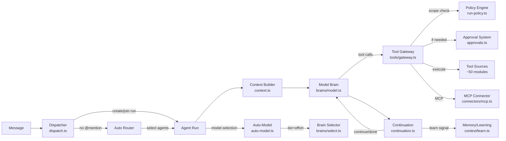
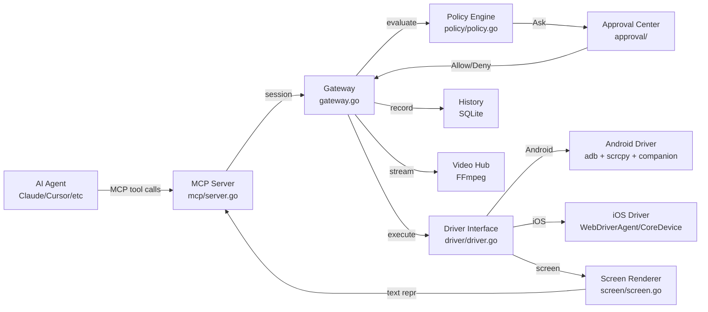
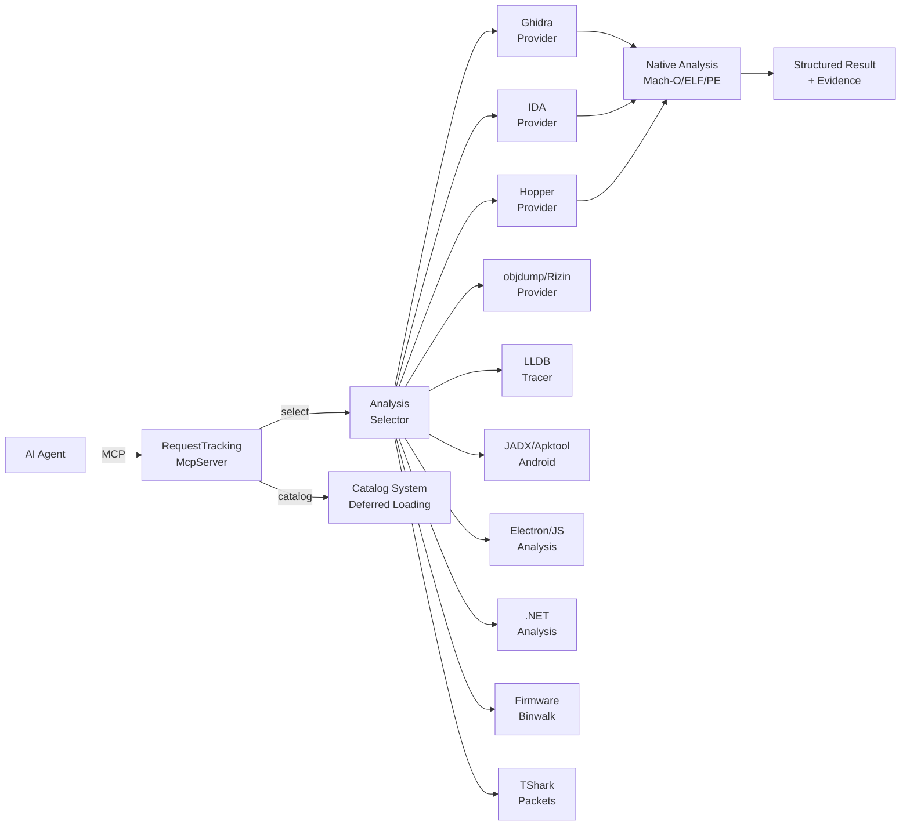
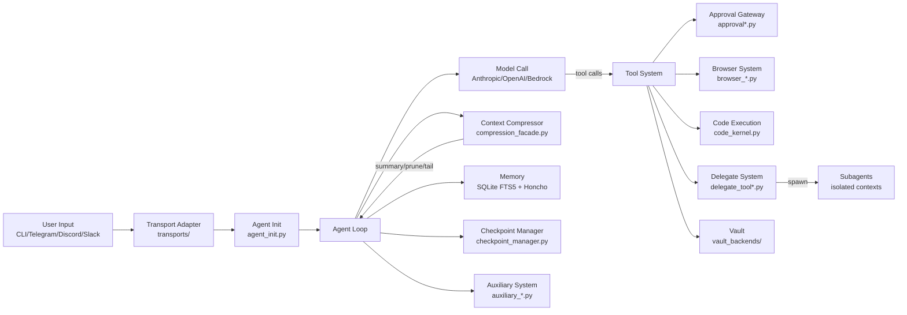

# Weekly Agentic AI Research Scan — 2026-11-12

## Executive Summary

- **Tuần này nổi bật nhất**: agentes-chat — Slack alternative self-hosted với AI agents chạy multi-model, approval workflow production-grade, và memory/learning loop tự động. Kiến trúc engine monorepo rất mature (~2,400 LOC context builder, ~1,400 LOC tool gateway).
- **Phone-as-tool paradigm**: Pinky (Go, MCP) đưa ra mô hình gateway-based approval cho agent điều khiển điện thoại thật — policy engine enforce bên ngoài agent, không dựa vào prompt instructions.
- **REA mở rộng reverse engineering**: MCP server cho agent phân tích binary/app/firmware với pluggable provider pattern, hỗ trợ Ghidra/IDA/Hopper/LLDB — kiến trúc multi-format analysis chuyên sâu nhất trong tuần.

## Table of Contents

- [1. agentes-chat/agentes-chat](#1-agentes-chatagentes-chat)
- [2. DIYgod/pinky](#2-diygodpinky)
- [3. morluto/rea](#3-morlutorea)
- [4. NousResearch/hermes-agent](#4-nousresearchhermes-agent)

---

## 1. agentes-chat/agentes-chat

**Link**: https://github.com/agentes-chat/agentes-chat

### §1 — Quick Context

**Pitch**: Slack alternative self-hosted nơi team và AI agents cộng tác trong channels, DMs — agents có computer, browser, memory, approvals.

**Tech stack**: TypeScript (Bun runtime), Hono (HTTP), Drizzle ORM, PostgreSQL + pgvector, React/Vite (web), Expo (mobile), Tauri (desktop). Models: Claude, OpenAI, Gemini, DeepSeek, Kimi, Z.ai, MiniMax, Grok qua OpenRouter. MCP + Composio connectors.

**Repo health**: 456 stars, created 2026-11-09, pushed 2026-11-12. AGPL-3.0. Monorepo với 11 packages + 4 apps. Có CI (`ci:local`), extensive eval suite (memory, behavior, resilience, router, conversation, browser, desktop, media). Biome linter, gitleaks.

### §2 — Architecture Deep-Dive

#### A. Component Inventory

| Component | File Path | Vai trò |
|-----------|-----------|---------|
| **Engine Builder** | `apps/server/src/engine.ts` | Wiring ~50 tool sources, brains, connectors, gateway vào một object |
| **Context Builder** | `packages/engine/src/context.ts` | Build system prompt + conversation history cho mỗi agent run (~2,444 LOC) |
| **Dispatcher** | `packages/engine/src/dispatch.ts` | Route messages tới agents, create/join runs, handle @mentions và DMs |
| **Tool Gateway** | `packages/engine/src/tools/gateway.ts` | Central tool invocation — scope checks, approval gates, audit, cost tracking (~1,417 LOC) |
| **Continuation Controller** | `packages/engine/src/continuation.ts` | Agent loop control — verdict (done/continue/ask), nudges, safety refusals |
| **Model Brain** | `packages/engine/src/brains/model.ts` | Brain interface wrapping model gateway calls, prompt cache warm-up |
| **Brain Selector** | `packages/engine/src/brains/select.ts` | Chọn brain (model/Claude Code/Codex/Cursor/Grok) và model cho mỗi run |
| **Auto-Model Router** | `packages/engine/src/auto-model.ts` | Judge-based tier+effort selection (small/medium/large) với 1.5s timeout fallback |
| **Approval System** | `packages/engine/src/approvals.ts` | Human-in-the-loop approval cards, bulk decide, "always allow" rules, expiry |
| **Agent Manager** | `packages/engine/src/agents.ts` | CRUD agents, handle validation, budget, scope grants, archival |
| **MCP Connector** | `packages/engine/src/connectors/mcp.ts` | MCP server connections, tool discovery (paged), signed GitHub operations |
| **Memory/Learning** | `packages/engine/src/context/learn.ts` | Post-turn learning — judge decides, model extracts facts/lessons/skills, trust levels |
| **Provider Catalog** | `packages/providers/src/catalog.ts` | Model registry — pricing, tiers, context limits cho 20+ models |
| **Policy Engine** | `packages/engine/src/tools/run-policy.ts` | Per-tool permission decisions (allow/ask/deny) |
| **Runner** | `apps/server/runner/` | Agent computer execution — terminal, browser, git, desktop, phone control (~95 files) |
| **Realtime Server** | `apps/server/src/realtime/` | WebSocket event delivery |

#### B. Control Flow — Event-driven + Continuation Loop

Pattern: **Event-driven dispatch → Model brain loop → Judge-based continuation**

1. **Message arrives** → `dispatch.ts` routes: `dispatchMentions` (explicit @mention), `dispatchDm` (DM), hoặc router chọn tối đa 4 agents (khi không có @mention)
2. **Run creation** → `startOrJoinRun` kiểm tra active run có thể nhận message không, nếu không tạo run mới hoặc park trong inbox
3. **Context assembly** → `buildRunContext` assemble system blocks + conversation history, parallel lookups, stable blocks đầu cho prompt caching
4. **Brain execution** → `ModelBrain.run()` gọi model gateway, stream text deltas + tool calls
5. **Tool invocation** → `ToolGateway.invoke()` kiểm tra scopes → policy → approval → execute → audit
6. **Continuation** → `decideTurnEnd` áp dụng rules tuần tự: hard stops → pending work → judge verdict → waiting. Max 2 extra turns per run, 1 cho routines

#### C. State & Data Flow

- **Message format**: Typed `ModelMessage` với `SystemBlock[]` (system) + message blocks. Context builder output là structured blocks, không phải raw strings
- **State storage**: PostgreSQL (Drizzle ORM) cho tất cả persistent state. pgvector cho embeddings. In-memory caches (`caches`) cho hot data (agents, channels, orgs)
- **Context management**: `cutOldToolSteps` cắt tool results cũ. `context-budget.ts` quản lý token budget. 1-hour prompt cache TTL với stable blocks xếp đầu

#### D. Tool / Capability Integration

- **Register**: `buildEngine` wire ~50 tool sources vào Tool Gateway. Mỗi source là một module export tools
- **Invocation**: Native function-calling qua model providers. Tool Gateway validate JSON schema (`json-schema.ts`), check scopes (`scopes.ts`), apply policy, require approval nếu cần
- **MCP**: `connectors/mcp.ts` — kết nối HTTP transport, page qua tool listings, prefix tool names (`github_merge_pull_request`). Built-in connectors filtered qua catalog, custom tools cần admin classify
- **Sandbox**: Tool output treated as untrusted (`untrustedBlock`). Signed GitHub operations. Composio file downloads saved as untrusted

#### E. Memory Architecture

- **Learning trigger**: Post-turn, judge hoặc heuristic quyết định learn (failed→succeeded tool pattern, search found prior steps)
- **Learning job**: Model extract structured items: fact, preference, decision, lesson, how-to, term, access — mỗi item có refs tới messages/tool calls
- **Trust levels**: High trust (person behind run, no external content read) vs Low trust. Low-trust items stay với agent, không replace person-written items
- **Context recall**: `context/learned-skills.ts`, `context/summaries.ts` — loaded vào system prompt mỗi turn
- **Daily cap**: 20 learning items per agent per day

#### F. Model Orchestration

- **Auto-model**: Judge (Haiku-class) chọn tier (small/medium/large) và effort cho mỗi run, timeout 1.5s fallback medium
- **Tier mapping**: Small (Haiku 5.5, GPT-6-Luna, DeepSeek Flash), Medium (Sonnet 5.5, GPT-6.1-Sol, Gemini 3.8 Flash), Large (Opus 5.5, GPT-6-Astra, Gemini 4 Argon)
- **Computer brains**: Claude Code, Codex, Cursor, OpenCode, Grok, Antigravity — mỗi loại có protocol version riêng
- **Fallback**: `mayFallBack` xử lý model unavailable, `liveModelLimits` track rate limits real-time

#### G. Observability & Eval

- **Audit**: `agent-audit.ts` — mỗi tool call được record với subject, title, outcome
- **Telemetry**: `apps/server/src/telemetry.ts` — usage reports
- **Eval suite**: 12+ eval scripts: memory, behavior, resilience, mentions/handoff, catch-up, router, turns, conversation, browser, desktop, media, brain-floor
- **Autonomy report**: `autonomy-report.ts` — track agent autonomous actions

#### H. Extension Points

- **Custom agents**: Create qua API với role, instructions, model, budget, scopes
- **MCP connectors**: Plug bất kỳ MCP server nào, per-agent scopes
- **Composio integrations**: Google Drive, Slack, HubSpot, etc.
- **Skills**: `SKILL.md` files attached to agents
- **Custom model providers**: `providers/src/custom.ts` — workspace endpoint
- **Apps/OAuth**: `packages/engine/src/apps/` — OAuth app registration, tool management

### §3 — Architecture Diagram

### §4 — Verdict

**Điểm novel**: Auto-model routing bằng judge call với timeout fallback là pattern production-grade hiếm thấy — tránh over-spending trên simple messages. Continuation controller dùng judge verdict kết hợp rule-based hard stops tạo agent loop có kiểm soát tốt. Trust-level memory system (high/low trust dựa trên provenance) giải quyết vấn đề prompt injection vào long-term memory.

**Red flags**: Repo mới 3 ngày — chưa rõ community adoption. Monorepo lớn với coupling chặt giữa engine modules. AGPL license hạn chế commercial use.

**Open questions**: Router logic chọn 4 agents từ message không có @mention hoạt động thế nào? Stretch limits và budget enforcement chi tiết ra sao? Runner computer execution có sandboxing gì ngoài scope gates?

---

## 2. DIYgod/pinky

**Link**: https://github.com/DIYgod/pinky

### §1 — Quick Context

**Pitch**: Cho AI agents dùng điện thoại thật của bạn qua MCP, với approval gateway enforce ngoài agent.

**Tech stack**: Go 1.27.3 (no cgo), MyGo native GPU UI (không Electron), FFmpeg 9, SQLite. Android: bundled adb + scrcpy + Kotlin companion app. iOS: WebDriverAgent (iOS 17-26), CoreDevice (iOS 27+). MCP protocol. Apache-2.0.

**Repo health**: 1,897 stars, created 2026-11-06, pushed 2026-11-12. Pre-alpha. Có design docs (`docs/DESIGN.md`), acceptance tests, changelog. Active development (6 ngày tuổi, pushed hôm nay).

### §2 — Architecture Deep-Dive

#### A. Component Inventory

| Component | File Path | Vai trò |
|-----------|-----------|---------|
| **Gateway** | `internal/gateway/gateway.go` | Session management, device map, lease lifecycle, event system (~984 LOC) |
| **MCP Server** | `internal/mcp/server.go` | MCP protocol implementation, agent session mapping, tool registration |
| **Policy Engine** | `internal/policy/policy.go` | Rule-based action decisions (Allow/Ask/Deny), kind detection, YAML rules |
| **Approval Center** | `internal/approval/` | Human approval flow, timeout (60s), "always allow" per-app exemptions |
| **Driver Interface** | `internal/driver/driver.go` | Abstraction layer cho iOS/Android — Device, Provider, Stream interfaces (~1,596 LOC) |
| **Screen Renderer** | `internal/screen/screen.go` | Phone screen → text representation cho agents: elements with refs, roles, labels |
| **Android Driver** | `internal/driver/` (Android impl) | adb + scrcpy, companion app, background display (Android 13+) |
| **iOS Driver** | `internal/driver/` (iOS impl) | WebDriverAgent, CoreDevice, disk images, WiFi pairing |
| **Pilot** | `internal/pilot/` | Built-in "Ask Pinky" agent cho single-phone tasks |
| **History** | `internal/history/` | Task history store (SQLite), step logs, recordings |
| **Video Hub** | `internal/video/` | Live mirror + screen recording (FFmpeg) |
| **OCR** | `internal/ocr/` | On-device text recognition |
| **Secret Store** | `internal/secret/` | OS keychain/credential manager cho PINs, API keys |
| **Tailnet** | `internal/tailnet/` | Remote phone access qua Tailscale |

#### B. Control Flow — Gateway-mediated Action Pipeline

Pattern: **MCP tool call → Gateway session → Policy check → Approval gate → Driver execution**

1. **Agent connects** → MCP server tạo gateway session, identify agent từ client name
2. **`phone_connect`** → Gateway assign device lease, agent nhận screen state
3. **Agent sends action** (tap/type/swipe/launch) → Gateway nhận MCP tool call
4. **Policy evaluation** → Policy engine detect action kinds (Payment, SendMessage, InstallApp...), match YAML rules, strictest wins
5. **Approval gate** → Nếu policy returns `Ask`: action blocked, agent nhận `approval_pending`, user click Allow/Deny trong Pinky UI (timeout 60s)
6. **Driver execution** → Action dispatch tới platform driver (Android/iOS), kết quả + new screen state trả về agent

#### C. State & Data Flow

- **Message format**: MCP tool calls/results. Screen rendered as text: `[ref] role "label" @x,y states...`
- **State storage**: SQLite (task history), OS keychain (secrets), in-memory (sessions, leases, device map)
- **Event system**: Buffered channels (64 events), subscriber pattern. Events: `EventNeeds` (approval needed), `EventDevices` (device state change)

#### D. Tool / Capability Integration

- **Register**: `addTools` registers ~14 `phone_*` tools vào MCP SDK server
- **Invocation**: MCP native tool calls. Tools: `phone_connect`, `phone_tap`, `phone_type`, `phone_swipe`, `phone_key`, `phone_launch`, `phone_drag`, `phone_device`, `phone_app`, `phone_logs`, `phone_handoff`
- **Validation**: Policy engine validates mọi action. Password/OTP fields blocked. Banking/wallet apps hidden by default
- **Sandbox**: Gateway enforce — agents không thể approve own actions. `ReadOnly` mode. App scope restrictions per task

#### E. Memory Architecture

Không có long-term memory. Task history (SQLite) lưu step logs + recordings cho review.

#### F. Model Orchestration

Pinky là tool server, không orchestrate models. Agent bên ngoài (Claude Code, Cursor, etc.) gọi Pinky qua MCP. Built-in "Ask Pinky" agent dùng user's own API key.

#### G. Observability & Eval

- **Step logs**: Mỗi action recorded với screenshots
- **Screen recordings**: HTML export cho review
- **Telemetry**: Cloudflare Worker, anonymous usage stats (opt-out)
- **Acceptance tests**: `docs/ACCEPTANCE.md`

#### H. Extension Points

- **MCP integration**: Bất kỳ MCP client nào đều connect được (`pinkyctl mcp` hoặc HTTP+token)
- **Policy rules**: YAML config cho custom approval rules per app/category/action
- **Driver providers**: Provider interface cho thêm platform mới
- **Middleware**: `server.Use(mw...)` cho MCP request middleware

### §3 — Architecture Diagram

### §4 — Verdict

**Điểm novel**: Policy engine enforce approval **bên ngoài agent** (không dựa vào system prompt) là architecture decision quan trọng — agent không thể bypass bằng prompt injection. Screen-as-text representation (`[ref] role "label" @x,y`) cho phép model thao tác mà không cần vision, giảm cost. Background display (Android 13+) cho agent dùng phone mà không chiếm screen.

**Red flags**: Pre-alpha, 6 ngày tuổi. Go + MyGo UI framework ít mainstream. iOS support phụ thuộc WebDriverAgent (Appium) — fragile across iOS versions. Không có test suite visible trong repo listing.

**Open questions**: Performance của screen-to-text conversion với complex UIs? Latency của approval flow khi agent cần nhiều rapid actions? Scrcpy server bundling có legal implications gì?

---

## 3. morluto/rea

**Link**: https://github.com/morluto/rea

### §1 — Quick Context

**Pitch**: MCP server cho AI agents reverse engineer mọi thứ — từ app behavior tới native binaries.

**Tech stack**: TypeScript/Node.js 22+, MCP protocol, Turbo (monorepo build), Vitest + Stryker (mutation testing). Analysis backends: Ghidra, IDA, Hopper, Kuna, objdump, Rizin, JADX, Apktool, TShark, Binwalk, pwntools, LLDB, Frida. npm package `rea-agents`.

**Repo health**: 453,221 stars, created 2026-04-14, pushed 2026-11-12. Active development. Extensive test suite (`.test.ts` alongside mỗi module). oxlint/oxfmt, husky, release-please. Có `docs/architecture/architecture.mermaid`.

### §2 — Architecture Deep-Dive

#### A. Component Inventory

| Component | File Path | Vai trò |
|-----------|-----------|---------|
| **MCP Entry Point** | `src/main.ts` | Entry — chọn deferred hoặc eager runtime, startup config |
| **Request Tracking Server** | `src/server/RequestTrackingMcpServer.ts` | MCP server subclass — in-flight request tracking, graceful shutdown |
| **Provider System** | `src/providers/` | Pluggable analysis client creation, deferred loading, structured MCP responses |
| **Native Analysis** | `src/native/` | Multi-format binary analysis: Mach-O, ELF, PE, Android (~90 files, 12 subdirs) |
| **Apple Mach-O** | `src/native/MachoBinaryProjection.ts`, `AppleMachoFixups.ts`, `AppleMachoSelection.ts` | Mach-O parsing, fixup chains, architecture selection |
| **Apple Obj-C** | `src/native/AppleObjcCategories.ts`, `AppleObjcProperties.ts`, `AppleObjcProtocols.ts` | Objective-C class/category/protocol extraction |
| **Apple Swift** | `src/native/AppleSwiftNominalTypes.ts`, `AppleSwiftVtables.ts`, `AppleSwiftConformanceTypeReference.ts` | Swift metadata, vtables, type conformances |
| **LLDB Integration** | `src/native/LldbCallTracer.ts`, `LldbReadbackFiles.ts` | Runtime tracing qua LLDB |
| **Native UI Helper** | `src/native/NativeUiHelperRuntime.ts`, `NativeUiObservation.ts` | UI interaction observation cho macOS apps |
| **Android Analysis** | `src/android/` | APK analysis (JADX, Apktool, adb) |
| **Electron/JS** | `src/electron/`, `src/javascript/` | Electron app + JS analysis |
| **.NET Analysis** | `src/dotnet/` | .NET assembly analysis |
| **Firmware** | `src/firmware/` | Firmware extraction (Binwalk/Unblob) |
| **Packet Capture** | `src/pcap/` | Network analysis (TShark) |
| **Ghidra Provider** | `src/ghidra/` | Ghidra headless analysis integration |
| **IDA Provider** | `src/ida/` | IDA Pro integration |
| **Hopper Provider** | `src/hopper/` | Hopper disassembler integration |
| **CLI** | `src/cli.ts`, `src/cliCommandNames.ts` | CLI interface cho same workflows |
| **Catalog System** | `src/catalogDiscovery.ts`, `src/recordedMcpCatalog.ts` | Tool catalog management, deferred loading optimization |

#### B. Control Flow — Provider-based Analysis Pipeline

Pattern: **MCP tool call → Provider selection → Analysis engine dispatch → Structured result**

1. **Agent registers REA** → `rea-agents setup` installs MCP server + skill vào agent
2. **Agent sends analysis request** → MCP tool call tới REA server (stdio hoặc HTTP)
3. **Runtime selection** → `main.ts` chọn deferred runtime (cached catalog, fast startup) hoặc eager runtime (full load)
4. **Provider dispatch** → Analysis selector chọn provider phù hợp (Ghidra/IDA/Hopper/objdump/etc.) dựa trên target type
5. **Analysis execution** → Provider run analysis engine, parse output, structure results
6. **Response** → `StructuredContentMcpClient` format kết quả với evidence, limitations, unknowns

#### C. State & Data Flow

- **Message format**: MCP tool calls với compact hoặc full input schemas. Output: structured content với evidence references
- **State storage**: Stateless — analysis results trả về trực tiếp. `RequestTrackingMcpServer` track in-flight requests cho graceful shutdown
- **Catalog optimization**: Recorded catalog hash cho phép deferred loading — skip full provider init khi catalog unchanged

#### D. Tool / Capability Integration

- **Register**: Tool registration qua `registerTool` override trong `RequestTrackingMcpServer`. Catalog-based discovery
- **Invocation**: MCP native. Compact schema profiles giảm context overhead mặc định
- **Validation**: Server-side canonical validation. Provider selection match target → engine
- **Sandbox**: Analysis tools chạy locally, không modify targets. REA không install/update external providers (trừ Hopper setup với approval)

#### E. Memory Architecture

Không có memory system. Stateless analysis server.

#### F. Model Orchestration

REA là tool server, không orchestrate models. Agent bên ngoài gọi qua MCP.

#### G. Observability & Eval

- **Testing**: Vitest unit tests alongside mỗi module. Stryker mutation testing
- **Doctor**: `mcpDoctor.ts` — runtime diagnostics, startup policy checks
- **Logging**: `src/logger.ts`, CLI logging configuration
- **CI**: release-please, husky hooks, oxlint

#### H. Extension Points

- **Provider pattern**: Thêm analysis engine mới bằng implement provider interface
- **Schema profiles**: Compact/full input schema cho different context budgets
- **CLI + MCP**: Same workflows accessible qua cả CLI và MCP
- **Tool families**: Scoped tool sets cho different analysis domains

### §3 — Architecture Diagram

### §4 — Verdict

**Điểm novel**: Deferred runtime với recorded catalog hash — server start nhanh bằng cách skip full provider init khi tool catalog không đổi. Multi-format native analysis depth (Mach-O fixup chains, Swift vtables, Obj-C categories) vượt xa typical RE tool wrappers. Mutation testing (Stryker) cho analysis code là uncommon và valuable.

**Red flags**: 453K stars có vẻ inflated — cần verify. Dependency vào nhiều external tools (Ghidra, IDA, Hopper) tạo setup friction. Provider selection logic không rõ từ public code — `analysisSelector` chỉ thấy test file.

**Open questions**: Deferred vs eager runtime chọn thế nào ảnh hưởng tool availability? Provider fallback khi preferred engine không available? Validation pipeline cho analysis results trước khi trả agent?

---

## 4. NousResearch/hermes-agent

**Link**: https://github.com/NousResearch/hermes-agent

### §1 — Quick Context

**Pitch**: AI agent tự học từ interactions — closed learning loop với memory, skill creation, và cross-session recall.

**Tech stack**: Python 3.14, Node.js (TUI). Models: any provider (Nous Portal, OpenRouter, OpenAI, Anthropic, Bedrock, custom). Terminal backends: local, Docker, SSH, Modal, Daytona, Vercel Sandbox, Singularity. SQLite FTS5 (session search), Honcho (user modeling). MCP servers + agentskills.io.

**Repo health**: 262,779 stars, created 2025-07-22, pushed 2026-11-12. MIT license. Massive codebase: `agent/` alone có 95+ files (truncated listing). Test suites (`tests/`, `tests-js/`, `evals/`). Nix flake, Docker support.

### §2 — Architecture Deep-Dive

#### A. Component Inventory

| Component | File Path | Vai trò |
|-----------|-----------|---------|
| **Agent Init** | `agent/agent_init.py` | Initialization pipeline — routing, client construction, tool loading (~2,211 LOC) |
| **Context Compressor** | `agent/context_compressor.py`, `context_compressor_prune.py`, `context_compressor_tail.py` | Multi-strategy context compression: summary, prune, tail |
| **Compression Facade** | `agent/compression_facade.py` | Orchestrate compression strategies |
| **Delegate System** | `tools/delegate_tool.py`, `delegate_tool_dispatch.py`, `delegate_tool_registry.py`, `delegate_tool_sessions.py`, `delegate_tool_tasks.py` | Subagent spawning, dispatch, progress tracking (~12 files) |
| **Approval Gateway** | `tools/approval.py`, `approval_context.py`, `approval_detection.py`, `approval_floors.py`, `approval_gateway_wait.py`, `approval_smart.py`, `approval_yolo.py` | Multi-level approval: smart detection, floors, YOLO mode (~9 files) |
| **Browser System** | `tools/browser_tool.py`, `browser_session.py`, `browser_supervisor.py`, `browser_launcher.py`, `browser_vault_tool.py` | Full browser automation: CDP, sandbox, real profiles, vault integration (~20 files) |
| **Checkpoint Manager** | `tools/checkpoint_manager.py`, `checkpoint_pruning.py`, `checkpoint_refs.py`, `checkpoint_undo_hint.py` | Git checkpoint management, pruning, undo |
| **Transports** | `agent/transports/` | Multi-provider API adapters: Anthropic, OpenAI (chat completions), Bedrock, Codex |
| **Vault Backends** | `agent/vault_backends/` | Secret management: Bitwarden, 1Password, local, browser, plugin |
| **Cronjob System** | `tools/cronjob_tools.py`, `cronjob_job_args.py`, `cronjob_prompt_scan.py` | Built-in cron scheduler |
| **Code Execution** | `tools/code_execution_tool.py`, `code_kernel.py`, `code_kernel_remote.py`, `code_execution_rpc.py` | Sandboxed code execution with RPC |
| **Computer Use** | `tools/computer_use/`, `computer_use_tool.py` | Desktop computer use |
| **Bot/Messaging** | `tools/bot_mode_dm.py`, `bot_chain.py`, `bot_relay.py`, `bot_live_delivery.py` | Multi-platform messaging: Telegram, Discord, Slack, WhatsApp, Signal |
| **Monitoring** | `agent/monitoring/` | Runtime monitoring |
| **Activity Tracking** | `agent/activity_tracking.py` | Session activity provenance |
| **Auxiliary System** | `agent/auxiliary_client.py`, `auxiliary_wire.py`, `auxiliary_hooks.py`, `auxiliary_fallback_recovery.py`, `auxiliary_rate_limit_backoff.py` | Auxiliary model calls — structured output, health, fallback (~20 files) |

#### B. Control Flow — Multi-transport Agent Loop with Delegation

Pattern: **Transport-agnostic agent loop → Tool execution → Compression → Delegation**

1. **Init** → `agent_init.py` resolve routing (provider, model, API mode), build client, load tools, configure compression
2. **Message arrives** → Transport adapter (Anthropic/OpenAI/Bedrock/Codex) normalize tới common format
3. **Agent turn** → Model call với conversation context, streaming tool output
4. **Tool execution** → Tools execute, approval gateway kiểm tra nếu cần
5. **Context check** → Compression facade kiểm tra token budget, apply strategy (summary/prune/tail)
6. **Delegation** → Complex tasks có thể spawn subagents qua delegate system, isolated contexts, progress tracking

#### C. State & Data Flow

- **Message format**: Transport-specific → normalized. Anthropic native, OpenAI chat completions, Codex responses
- **State storage**: SQLite FTS5 (session search + cross-session recall), Honcho (user modeling), in-memory session state
- **Context management**: Multi-strategy compression — pre-LLM pruning, LLM summarization, tail preservation. `context_breakdown.py` analyze token distribution. `cache_bounds.py` manage cache limits

#### D. Tool / Capability Integration

- **Register**: `_load_tools` trong `agent_init.py`. Dynamic loading based on config
- **Invocation**: Function-calling qua provider APIs. `tools/arg_coercion.py` + `arg_validation.py` handle edge cases
- **MCP**: MCP server integration (`hermes_tools_mcp_server.py`). agentskills.io standard
- **Sandbox**: Code execution qua RPC (`code_execution_rpc.py`), remote kernels (`code_kernel_remote.py`)

#### E. Memory Architecture

- **Short-term**: In-memory conversation context với multi-strategy compression
- **Cross-session**: SQLite FTS5 session search với LLM summarization
- **User modeling**: Honcho dialectic user modeling — builds model of user across sessions
- **Skill creation**: Autonomous skill creation post-task, skills improve during use
- **Checkpoints**: Git-based checkpoints với pruning strategy

#### F. Model Orchestration

- **Multi-provider**: Anthropic, OpenAI, Bedrock, Codex, Ollama, custom endpoints. Switch với `hermes model`
- **Auxiliary system**: ~20 files cho auxiliary model calls — structured output, health checks, fallback recovery, rate limit backoff, key rotation
- **Delegation**: Subagents configurable by provider, model, limits. Isolated contexts
- **Reasoning**: `anthropic_thinking_policy.py`, `auxiliary_reasoning_floor.py` — thinking/reasoning controls

#### G. Observability & Eval

- **Monitoring**: `agent/monitoring/` directory
- **Activity tracking**: `activity_tracking.py` — provenance cho session actions
- **Stream watchdog**: `auxiliary_stream_watchdog.py`
- **Evals**: `evals/` directory
- **Billing**: `billing_usage.py`, `billing_view.py`, `billing_links.py`

#### H. Extension Points

- **Plugins**: Plugin system cho vault backends, tools
- **Custom providers**: Custom endpoint support
- **Skills**: Bundled + optional skills (`skills/`, `optional-skills/`)
- **MCP servers**: `optional-mcps/`
- **Terminal backends**: Pluggable (local, Docker, SSH, Modal, etc.)
- **Bot platforms**: Multi-platform messaging gateway

### §3 — Architecture Diagram

### §4 — Verdict

**Điểm novel**: Multi-strategy context compression (pre-LLM prune → LLM summary → tail preserve) với `context_breakdown` analysis là sophisticated hơn typical sliding window. Auxiliary system (~20 files) cho secondary model calls — structured output, health, fallback, rate limiting — cho thấy production battle-testing. Delegate tool system (12 files) cho subagent orchestration có progress tracking + session isolation.

**Red flags**: Codebase massive và phân tán (95+ files chỉ trong `agent/`, listing bị truncate). Naming convention inconsistent (`auxiliary_*` proliferation gợi ý organic growth hơn là planned architecture). Python codebase không thấy type hints enforcement.

**Open questions**: Learning loop cụ thể hoạt động thế nào — skill creation trigger conditions? Honcho user modeling integration depth? Compression strategy selection logic — khi nào summary vs prune vs tail?

---

*Scan date: 2026-11-12. Search window: 2026-11-05 → 2026-11-12.*
*Query: `agent OR multi-agent OR agentic created:>2026-11-05 stars:>200` + fallback `pushed:>2026-11-05 stars:>500`.*
*Repos excluded: awesome-lists, tutorials, fork-only, <500 LOC, thin wrappers.*
