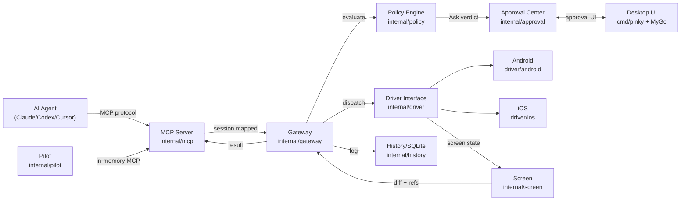
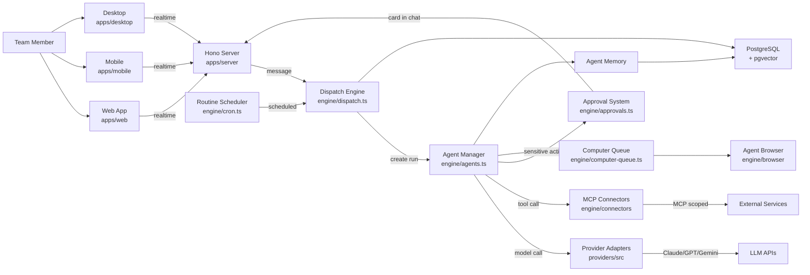
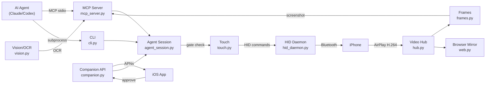
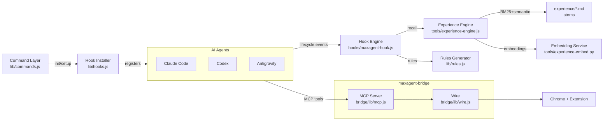

# Weekly Agentic AI Research Scan — 2026-11-12

## Executive Summary

- **Phone-as-tool cho AI agents** là trend nổi bật tuần này: cả DIYgod/pinky (Go, MCP gateway) và lxe/phoneuse (Python, AirPlay+BLE) đều giải quyết bài toán agent điều khiển điện thoại thật với human-in-the-loop, nhưng bằng hai kiến trúc hoàn toàn khác nhau — gateway-mediated policy vs state-machine gating.
- **agentes-chat** đưa multi-agent collaboration vào team chat thay vì single-player agent app, với dispatch engine phân phối work, approval cards, agent computers, và MCP connector scoping — kiến trúc production-grade hiếm gặp trong open-source.
- **maxagent** tiếp cận agent memory theo hướng "experience atoms" — Markdown files với BM25 + semantic search surface tại đúng lifecycle event, thay vì vector-DB monolithic, hoạt động như meta-layer trên coding agents có sẵn.

## Mục lục

1. [DIYgod/pinky — Phone control gateway cho AI agents](#1-diygodpinky)
2. [agentes-chat/agentes-chat — Team chat nơi agents và người làm việc cùng nhau](#2-agentes-chatagentes-chat)
3. [lxe/phoneuse — iPhone control qua AirPlay + Bluetooth HID](#3-lxephoneuse)
4. [vzroslieigry/maxagent — Experience layer cho coding agents](#4-vzroslieigrimaxagent)

---

## 1. DIYgod/pinky

**GitHub:** https://github.com/DIYgod/pinky

### §1 — QUICK CONTEXT

**Pitch:** Nền tảng cho phép AI agent điều khiển iPhone/Android thật qua MCP, với human approval gateway chống agent tự phê duyệt.

**Tech stack:** Go 1.27.3, MyGo (native GPU UI — no webview), MCP SDK (`go-sdk`), go-ios (iOS CoreDevice), adb/scrcpy (Android), SQLite, Cloudflare Worker (telemetry). Hỗ trợ Claude Code, Codex, Cursor, và bất kỳ MCP-compatible agent.

**Repo health:** 1,897 stars, pre-alpha, created 2026-11-06, last push 2026-11-12. Apache-2.0. Hàng trăm `_test.go` files. Có design doc (`docs/DESIGN.md`), AGENTS.md, CLAUDE.md. Download 16–22 MB.

### §2 — ARCHITECTURE DEEP-DIVE

**A. Component inventory:**

| Component | Path | Vai trò |
|---|---|---|
| Gateway | `internal/gateway/gateway.go` | Central coordinator: device discovery, session lifecycle, leases, event routing. Mọi interaction đi qua đây |
| MCP Server | `internal/mcp/server.go`, `internal/mcp/tools.go` | Expose 19 `phone_*` tools cho agents. Map MCP session → gateway session |
| Policy Engine | `internal/policy/engine.go`, `internal/policy/policy.go` | Rules engine: Allow/Ask/Deny cho mỗi action. YAML config (`defaults.yaml`, `apps.yaml`) |
| Approval Center | `internal/approval/` | Human-in-the-loop queue. States: open → decided → used. Client-only decide |
| Driver Interface | `internal/driver/` | Platform abstraction: `Provider` + `Device` interfaces. ~25 optional capability interfaces |
| Android Driver | `internal/driver/android/` | adb + scrcpy implementation |
| iOS Driver | `internal/driver/ios/` | go-ios CoreDevice protocol |
| Pilot | `internal/pilot/pilot.go`, `internal/pilot/claude.go` | Built-in agent "Ask Pinky": model loop qua in-memory MCP session |
| Screen | `internal/screen/screen.go`, `internal/screen/diff.go` | Screen state representation, diff detection, ref system |
| OCR | `internal/ocr/` | Text recognition trên screen captures |
| History | `internal/history/history.go` | SQLite persistent storage: sessions, actions, screenshots |
| Recording | `internal/recording/recording.go` | Fragmented MP4, không re-encode. H.264/HEVC |
| UI | cmd/pinky + MyGo | Native desktop: mirroring, approval dialogs, rules editor |
| Agents Config | `internal/agents/` | Agent registration, configuration bundles |
| Tailnet | `internal/tailnet/` | Remote phone access qua Tailscale |

**B. Control flow — Event-driven gateway-mediated pattern:**

1. Agent gọi MCP tool (e.g., `phone_tap`) → **MCP Server** nhận request, map tới gateway session
2. **Gateway** chuyển request tới **Policy Engine** evaluate: Allow / Ask / Deny
3. Nếu Ask → **Approval Center** tạo pending approval, block agent call, chờ human
4. Human approve trong **Desktop UI** → `Approval.Decide()` → unblock
5. **Gateway** dispatch action tới **Driver** (platform-specific)
6. **Driver** thực thi → screen settles → **Gateway** trả settled screen state + diff

Pattern là **event-driven gateway** — gateway là trung tâm routing với policy enforcement tại mỗi bước. Không phải ReAct hay planner-executor.

**C. State & data flow:**

- Messages: **typed Go structs** (`actionArgs`, `tapIn`, `swipeIn`) với JSON schema cho MCP
- State: **SQLite** (history, recordings), **in-memory** (sessions, leases, approvals, device registry)
- Context: Agent nhận screen refs (element identifiers) thay vì raw pixel data. Settled screen diff cho agent biết kết quả mà không re-observe toàn bộ

**D. Tool/capability integration:**

- 19 tools registered qua `addTools` function, JSON Schema derived từ Go structs (`schema[T]`)
- MCP protocol native (function-calling qua SDK)
- Schema patches enforce bounds. Policy engine validate mỗi action
- Hard-deny: password fields, finance apps, Pinky UI. Agent không bao giờ nhận PIN

**E. Memory architecture:** Không có agent memory. Pilot ghi rõ "remembers nothing between tasks." History module lưu recordings cho audit/replay.

**F. Model orchestration:** Pilot hỗ trợ Anthropic Messages API + OpenAI-compatible. Limits: 100 steps, 20 phút, US$2 cost cap. Single model per task.

**G. Observability & eval:** Telemetry module (opt-out), Cloudflare Worker backend. Full screen recording playback. History ghi mọi action với screenshots. Không có OpenTelemetry.

**H. Extension points:** Bất kỳ MCP client nào connect được. Driver interface cho platform mới. YAML rules editable. Skill system (`docs/SKILL.md`).

### §3 — ARCHITECTURE DIAGRAM

### §4 — VERDICT

**Điểm novel:** Gateway-mediated approval architecture tách biệt hoàn toàn agent và approval authority bằng architectural boundary (`client-only Decide`), không phải convention. Policy engine với YAML rules + hard-deny tiers cho finance/password apps là production-grade safety. Driver abstraction với ~25 optional capability interfaces cho graceful degradation. 19 MCP tools cover full phone interaction surface.

**Red flags:** Pre-alpha. MyGo (UI framework) là pre-1.0 dependency. Apple private protocol risk. Agent có shell access bypass được qua adb (design doc thừa nhận). Không có agent memory.

**Open questions:** Settle detection reliability trên diverse Android devices? iOS CoreDevice stability khi Apple thay protocol? OCR + screen diff performance per action? Tailnet remote access security model?

---

## 2. agentes-chat/agentes-chat

**GitHub:** https://github.com/agentes-chat/agentes-chat

### §1 — QUICK CONTEXT

**Pitch:** Team chat open-source nơi AI agents là workspace members thực sự — đọc channels, respond, dùng MCP tools, có computer và browser riêng.

**Tech stack:** Bun, Hono (server), Drizzle ORM, PostgreSQL + pgvector, React + Vite + TanStack (web), Expo (mobile), Tauri (desktop). Multi-model: Claude, ChatGPT, Gemini, Grok, DeepSeek, OpenRouter.

**Repo health:** 456 stars, created 2026-11-09, last push 2026-11-12. AGPL-3.0. Monorepo: `apps/` (server, web, mobile, desktop), `packages/` (engine, providers, modules, db, config, ui, i18n, tokens, adapters, client, setup). Docker Compose deployment.

### §2 — ARCHITECTURE DEEP-DIVE

**A. Component inventory:**

| Component | Path | Vai trò |
|---|---|---|
| Dispatch Engine | `packages/engine/src/dispatch.ts` | Central routing: dispatch mentions, DMs → agent runs. Join/park/create logic |
| Agent Manager | `packages/engine/src/agents.ts` | Agent lifecycle: create, update, archive, handle resolution, budget enforcement |
| Approval System | `packages/engine/src/approvals.ts`, `approval-requests.ts`, `approval-rules.ts` | Sensitive action cards trong chat. Run once, exactly as approved |
| Router | `packages/engine/src/` (referenced in features) | Tin nhắn không có @mention → router chọn ≤4 agents respond, hoặc none |
| Provider Adapters | `packages/providers/src/anthropic.ts`, `openai.ts`, `gemini.ts`, `openrouter.ts` | Model API adapters. Catalog + context limits |
| Connector System | `packages/engine/src/connectors/` | MCP server connections per org, scoped per agent |
| Memory Module | `packages/engine/src/` (referenced) | Store decisions, facts, preferences. Learn from corrections. Propose instruction changes |
| Routine Scheduler | `packages/engine/src/cron.ts` | Scheduled/event-driven work (GitHub PRs, Sentry, tasks, email) |
| Computer Queue | `packages/engine/src/computer-queue.ts` | Queue cho agent computer access. Advisory lock per agent |
| Agent Browser | `packages/engine/src/browser/` | Headless browser cho agents. Human watch + takeover |
| Context Budget | `packages/engine/src/context-budget.ts` | Context window management |
| Autonomy Controls | `packages/engine/src/autonomy-settings.ts`, `autonomy-report.ts`, `brakes.ts` | Budget enforcement, safety brakes |
| Wiki | (referenced in features) | Versioned pages, `[[links]]`, graph view, Obsidian import |
| Tasks Board | (referenced in features) | Kanban-style, custom columns, auto-update from agent runs |
| Server App | `apps/server/src/main.ts`, `apps/server/src/app.ts` | Hono HTTP + realtime (WebSocket) |

**B. Control flow — Hierarchical dispatch + event-driven pattern:**

1. Message arrives (mention hoặc DM) → **Dispatch Engine** evaluate eligibility (channel membership, audience rules, right-hand reach)
2. **Dispatch** quyết định: **join** existing run (nếu `mayJoin` pass) hoặc **park** (nếu agent busy, enqueue look) hoặc **create** new `agent_run`
3. Agent run execute → model call qua **Provider Adapter** → tool calls qua **Connector System** (MCP scoped)
4. Sensitive action → **Approval System** tạo card trong chat → human approve → execute once
5. Agent response posted back to channel/DM → có thể trigger mention dispatch cho agent khác (hop limit enforced)
6. **Routine Scheduler** fire events → dispatch → new agent runs

Pattern: **Hierarchical dispatch** — message routing quyết định agent nào respond, với hop-limited agent-to-agent chaining.

**C. State & data flow:**

- Messages: Structured TypeScript types, Drizzle ORM schema → PostgreSQL
- State: PostgreSQL + pgvector (primary), advisory locks cho concurrency
- Context management: `context-budget.ts` manage token allocation, `auto-model.ts` cho model selection

**D. Tool/capability integration:**

- MCP servers connected per organization, scoped per agent qua `tools/scopes.ts`
- Composio integration cho third-party services (Google Drive, Slack, HubSpot...)
- Agent computers: shell + code execution trên runner machine
- Browser: headless browser với human takeover capability

**E. Memory architecture:**

- Agents store decisions, facts, preferences — persistent qua PostgreSQL
- Learn from corrections và refused approvals
- Propose changes to own instructions (human approval required)
- pgvector cho semantic search

**F. Model orchestration:**

- Multi-provider: Anthropic, OpenAI, Gemini, DeepSeek, Kimi, MiniMax, OpenRouter
- `auto-model.ts` cho automatic model selection
- Monthly budget enforcement per agent (`budget` trong agent config)
- `brakes.ts` cho safety controls

**G. Observability & eval:**

- `apps/server/src/telemetry.ts` — telemetry module
- `packages/engine/src/audit.ts` — audit logging
- Agent autonomy reports
- `packages/engine/src/agent-audit.ts` — per-agent audit trail

**H. Extension points:**

- Custom MCP connectors per organization
- Skills system (Markdown `SKILL.md` files, versioned)
- Custom provider via `packages/providers/src/custom.ts`
- Import system cho migration from other platforms

### §3 — ARCHITECTURE DIAGRAM

### §4 — VERDICT

**Điểm novel:** Dispatch engine với join/park/create decision tree là core innovation — thay vì mỗi mention tạo run mới, agents tham gia conversation đang diễn ra qua `mayJoin`, park khi busy, và hop-limited chaining ngăn infinite loops. Approval cards hiện trong chat flow thay vì modal riêng. MCP connector scoping per agent (không phải per org) là fine-grained access control. `stretchStop` pattern cho resource-aware scheduling.

**Red flags:** 3 ngày tuổi, chưa battle-tested. AGPL-3.0 restrictive. Monorepo lớn — complexity cao. Phụ thuộc Bun (chưa mainstream bằng Node). Desktop/mobile apps đều beta.

**Open questions:** Dispatch performance khi nhiều agents cùng channel? Memory "propose instruction changes" — governance model? Computer queue fairness? Migration robustness từ các platforms?

---

## 3. lxe/phoneuse

**GitHub:** https://github.com/lxe/phoneuse

### §1 — QUICK CONTEXT

**Pitch:** Điều khiển iPhone thật từ PC qua AirPlay mirror + Bluetooth HID, cung cấp CLI và MCP server cho AI agent.

**Tech stack:** Python 3.11+, GStreamer (Linux), PyAV (Windows), GTK 4, aiohttp, ONNX Runtime + RapidOCR, MCP SDK 2.3+, GLib/DBus. iOS companion app (Swift). Bridge firmware cho LilyGO T-Display.

**Repo health:** 612 stars, 366 commits, 9 open issues. Last push 2026-11-10. CI workflows. MIT license. Alpha.

### §2 — ARCHITECTURE DEEP-DIVE

**A. Component inventory:**

| Component | Path | Vai trò |
|---|---|---|
| CLI Dispatcher | `phoneuse/cli.py` | Entry point, dispatch 30+ subcommands |
| MCP Server | `phoneuse/mcp_server.py` | MCP tools qua stdio transport, hot-reload code giữa tool calls |
| Agent Session | `phoneuse/agent_session.py` | State machine: idle → requested → driving → paused. Human-in-the-loop gating |
| HID Daemon | `phoneuse/hid_daemon.py` | Bluetooth HID profile (keyboard + mouse + absolute pointer), Unix socket |
| Video Hub | `phoneuse/hub.py` | Decode H.264 từ AirPlay, re-encode per viewer qua GStreamer (NVENC/x264) |
| Frames Service | `phoneuse/frames.py` | Screen settle detection, lag measurement, screenshot. GstSource (Linux) / AvSource (Windows) |
| Vision/OCR | `phoneuse/vision.py` | RapidOCR + ONNX Runtime (CUDA/CPU). Separate venv |
| Pointer Bridge | `phoneuse/pointer.py` | Mouse events → phone touch, hover/press/drag/scroll với calibration |
| Touch Module | `phoneuse/touch.py` | Low-level gestures: tap, long_press, swipe, scroll_drag. Per-phone calibration |
| Companion API | `phoneuse/companion.py` | aiohttp port 8778, iOS app pairing (HMAC-SHA256), Live Activity push (APNs) |
| Browser Mirror | `phoneuse/web.py` | Phone mirror trên localhost:8777 |
| IPC Layer | `phoneuse/ipc.py` | Unix socket (Linux) / authenticated TCP (Windows) |
| Bridge Module | `phoneuse/bridge.py` | Hardware bridge management (LilyGO board) |
| Skill Definition | `skill/SKILL.md` | Agent instructions cho Claude Code / Codex |

**B. Control flow — Event-driven + state machine pattern:**

1. Agent gọi tool (MCP hoặc CLI) → e.g., `tap_on("Settings")`
2. **Agent Session** gate check: phải ở state `driving`, nếu `idle` → trigger request flow (auto/countdown/ask)
3. **Vision + Frames**: OCR screen text, chờ settle trước khi action
4. **Stale-look guard**: So sánh target area với last screenshot, refuse nếu đã thay đổi
5. **Touch** gửi absolute hover → press → release qua **HID Daemon** socket, calibrated per phone model
6. **Frames** detect meaningful pixel change, chờ quiet period (0.1s), trả screenshot mới

**C. State & data flow:**

- Messages: CLI dùng plain text qua Unix socket. MCP dùng structured JSON. Frames dùng line-protocol
- State: In-memory (AgentSession state machine), file-based config, JSON file cho paired devices (mode 0600)
- Context: Không có conversation memory — mỗi tool call stateless

**D. Tool/capability integration:**

- MCP server dùng `@tool` decorator với **hot-reload** — check file mtime mỗi call, reload nếu code changed
- Fail-closed gating: mọi action check mirror live, Bluetooth connected, agent session approved
- Position taps refused nếu screen area changed. Passcode entry blocked

**E. Memory architecture:** Không có persistent memory.

**F. Model orchestration:** Phoneuse là tool layer, model chạy bên ngoài. Vision dùng RapidOCR (ONNX, không phải LLM).

**G. Observability & eval:** Timestamped logging per service. `phoneuse doctor` diagnostic. Session recording. Latency measurement qua clock pixel analysis. Tests directory.

**H. Extension points:** MCP protocol cho bất kỳ agent nào. Hot-reload cho developer iteration. Companion API (REST + APNs). Per-phone calibration extensible.

### §3 — ARCHITECTURE DIAGRAM

### §4 — VERDICT

**Điểm novel:** Settle-based timing thay vì fixed sleep — frames service detect meaningful pixel change, tránh race condition phổ biến trong phone automation. Stale-look guard refuse tap khi screen area đã thay đổi. Zero-mod iPhone approach (chỉ AirPlay + Bluetooth HID, không jailbreak). Hot-reload MCP server — sửa code, tool call tiếp tự dùng code mới. Agent Session state machine hoàn chỉnh với Live Activity push notification trên iOS.

**Red flags:** Alpha quality. Hardware bridge dependency (LilyGO board). OCR-based vision giới hạn với icon-only UI. Companion API crypto (HMAC + AES-GCM) tự implement — cần audit. Bluetooth latency.

**Open questions:** Performance với concurrent agents? Calibration accuracy trên non-reference phones? Bridge latency impact? Windows support status (run from source only)?

---

## 4. vzroslieigry/maxagent

**GitHub:** https://github.com/vzroslieigry/maxagent

### §1 — QUICK CONTEXT

**Pitch:** Hệ thống "experience" cho AI coding agents — hooks ghi nhớ và surface kinh nghiệm qua sessions, kèm bridge điều khiển Chrome qua MCP.

**Tech stack:** Node.js (CommonJS, zero deps), Python (ONNX Runtime + multilingual-e5-small cho semantic search), Chrome Extension, MCP server (JSON-RPC 2.0 stdio). Hỗ trợ Claude Code, Codex, Antigravity, Hermes, OpenClaw.

**Repo health:** 265 stars, created 2026-11-08, last push 2026-11-10. MIT. Monorepo 2 packages (`maxagent`, `maxagent-bridge`). Có tests. 10 ngôn ngữ. 32 commits.

### §2 — ARCHITECTURE DEEP-DIVE

**A. Component inventory:**

| Component | Path | Vai trò |
|---|---|---|
| Hook Engine | `packages/maxagent/hooks/maxagent-hook.js` | Script hook duy nhất xử lý mọi lifecycle events |
| Hook Installer | `packages/maxagent/lib/hooks.js` | Cài đặt/gỡ hooks cho từng agent |
| Agent Adapters | `packages/maxagent/lib/agents.js` | Detect agents trên máy, map tới rules file |
| Rules Generator | `packages/maxagent/lib/rules.js` | Sinh rules block inject vào AGENTS.md, i18n support |
| Experience Engine | `packages/maxagent/tools/experience-engine.js` | BM25 + optional semantic search. Lint, index, recall atoms |
| Experience Index | `packages/maxagent/tools/experience-index.js` | Build table từ experience files, parse YAML frontmatter |
| Embedding Service | `packages/maxagent/tools/experience-embed.py` | Python HTTP server: multilingual-e5-small (384-dim), ONNX Runtime |
| Command Layer | `packages/maxagent/lib/commands.js` | CLI: init, setup, doctor, update, bridge, vectors, experience |
| MCP Bridge Server | `packages/maxagent-bridge/lib/mcp.js` | MCP server cho Chrome control. Per-agent auth key, owner approval |
| Bridge Wire | `packages/maxagent-bridge/lib/wire.js` | Socket connection tới Chrome extension |
| Activity Logger | `packages/maxagent-bridge/lib/activity.js` | Log mọi browser action |

**B. Control flow — Event-driven hook pattern:**

1. Agent khởi session → hook `session_start` → inject rules từ AGENTS.md, env summary, inbox
2. User submit prompt → hook `prompt_submit` → BM25 + semantic search → surface relevant atoms
3. Agent gọi tool → `pre_tool` → block destructive commands, block browser nếu bridge enabled, recall
4. Tool result → `post_tool` → lint experience files vừa edit, search experience nếu command fail
5. Agent muốn dừng → `stop` → consolidate: nhắc ghi experience, chạy verify, format check
6. Atom mới → index rebuild → available cho session tiếp

Pattern: **Event-driven hooks** — meta-layer trên agent có sẵn, không phải agent architecture.

**C. State & data flow:**

- Atoms: Markdown files trong `experience/` với YAML frontmatter (title, task, aliases, verified)
- Index cached theo mtime/size, rebuild tự động. Table stored trong `experience.md`
- State: File system thuần (`~/.maxagent/`), `config.json`. Không dùng DB
- Atom limit: 900 chars. Shared packs có stricter similarity gate. Recall mỗi atom 1 lần/session

**D. Tool/capability integration:**

- Hook register qua config files native của mỗi agent (JSON hooks cho Claude Code/Codex, config cho Antigravity)
- Browser bridge expose tools qua MCP protocol (tools/list, tools/call)
- Pre-tool block destructive patterns, block Chrome process management

**E. Memory architecture:**

- **Short-term:** Per-session — atoms surfaced once, not repeated
- **Long-term:** Markdown atoms trên filesystem, persistent across sessions
- **Retrieval:** Hybrid — BM25 keyword (stemmed, weighted by field) + optional semantic (multilingual-e5-small, cosine similarity). Semantic phải vượt similarity floor VÀ stand out
- **Two shelves:** Own (`experience/`) — prioritized, can block. Shared (`experience/shared/<pack>/`) — reference only, stricter gates, adoptable
- **Pack security:** sha256 checksums. Reject: download-and-run commands, rule rewriting, secret exfiltration, destructive commands, hidden chars

**F. Model orchestration:** Không orchestrate LLM — layer bên ngoài, inject context. Embedding model (multilingual-e5-small) local, offline, ONNX CPU.

**G. Observability & eval:** `doctor` command check config/workspace/hooks. Bridge activity log. Experience lint check format, secrets, duplicates. Không OpenTelemetry.

**H. Extension points:** Custom atoms (Markdown files). Shared packs (GitHub Releases). Agent adapters extensible. MCP bridge tools. `.maxagent-off` opt-out per-directory.

### §3 — ARCHITECTURE DIAGRAM

### §4 — VERDICT

**Điểm novel:** "Experience as persistent memory" — atoms dạng Markdown với BM25 + semantic search surface tại đúng lifecycle event — thực tế hơn vector-DB monolithic. Stop-hook "nudge" pattern (nhắc ghi experience, verify, format) là quality gate nhẹ không cần thêm LLM call. Two-shelf design (own vs shared, khác trust level) giải quyết knowledge curation. Pack security validation trước install.

**Red flags:** Zero npm deps = tự implement nhiều thứ (stemming, HTTP server, JSON-RPC) — maintenance burden. Bilingual ru/en hardcoded strings gây noise. 270MB semantic model là barrier. Single hook file xử lý mọi event → phình nhanh.

**Open questions:** BM25 + embed performance khi >1000 atoms? Conflict resolution khi nhiều agent cùng ghi? Pack signing (chỉ có sha256, chưa có GPG)?

---

*Scan date: 2026-11-12. Search window: 2026-11-05 → 2026-11-12.*
*Query: `agent OR multi-agent OR agentic created:>2026-11-05 stars:>200` + fallback `pushed:>2026-11-05 stars:>500`.*
*Repos excluded: awesome-lists, tutorials, fork-only, <500 LOC, thin wrappers.*
