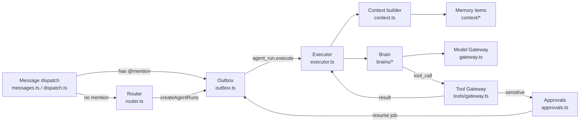
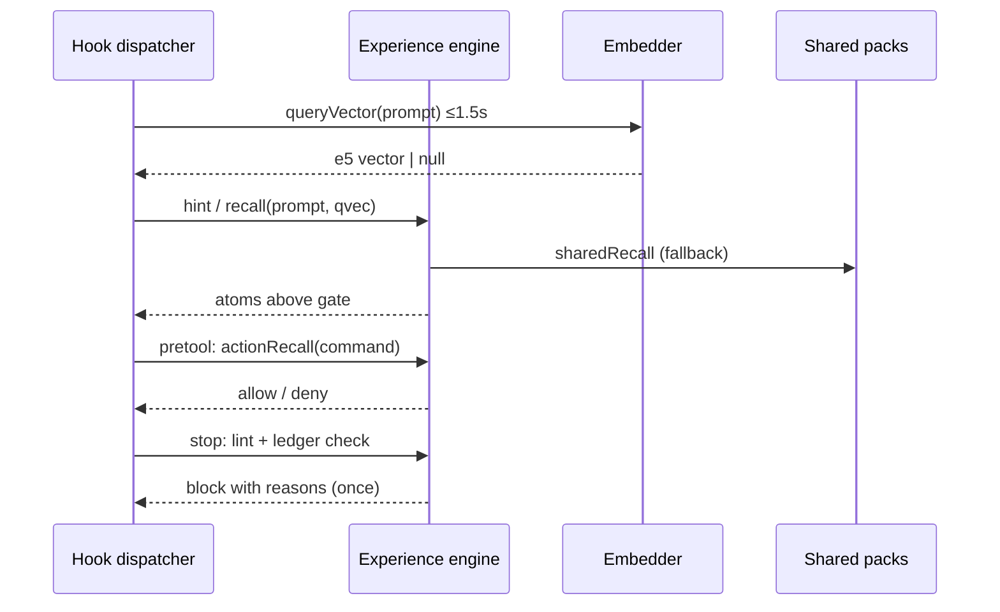
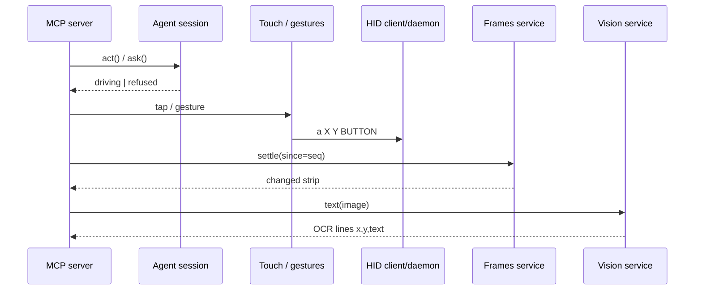

# Agentic AI weekly scan — 2026-11-13

Cửa sổ quét: repo tạo từ 2026-11-06 đến 2026-11-13, `stars:>200`. Truy vấn chính trả về 9 repo nên không cần dùng truy vấn dự phòng (`pushed:` + `stars:>500`). 3 repo qua được relevance filter.

## Executive summary

- **agentes-chat** là repo đáng đọc nhất tuần: một agent engine production-grade chạy trên Postgres (outbox, run state machine, Tool Gateway có approval gắn với hash của action). Repo có 174 ADR và một bộ eval hành vi đa ngôn ngữ chạy bằng model thật.
- **maxagent** cho thấy một pattern "experience memory qua hooks": không viết lại agent mà chèn recall (BM25 + e5 với gate đã calibrate) và chặn ở Stop hook vào Claude Code, Codex và Antigravity.
- **phoneuse** là một capability layer cho computer use trên iPhone thật. Phần đáng học là session state machine cho quyền điều khiển agent ↔ owner, cùng cơ chế "settle" và guard chống tap vào vị trí cũ (stale tap).

## Table of contents

1. [agentes-chat/agentes-chat](#1-agentes-chatagentes-chat)
2. [vzroslieigry/maxagent](#2-vzroslieigrymaxagent)
3. [lxe/phoneuse](#3-lxephoneuse)
4. [Repo bị loại](#repo-bị-loại)
5. [Phương pháp & self-check](#phương-pháp--self-check)

---

## 1. agentes-chat/agentes-chat

https://github.com/agentes-chat/agentes-chat

### §1 — Quick context

- **Pitch:** Slack self-hosted, trong đó agent là thành viên của channel, có budget, approval, memory và máy tính riêng.
- **Stack:** TypeScript chạy trên Bun (monorepo `apps/*` + `packages/*`), Postgres + Drizzle, pgvector, zod, MCP SDK. Provider: Anthropic, OpenAI, Gemini, OpenRouter (`packages/providers/src/`).
- **Health:** 1229★, tạo ngày 2026-11-09, commit cuối 2026-11-13. CI có trong `.github/workflows/ci.yml`, khoảng 1113 file `*.test.ts`, test DB bằng PGlite (ADR 0003). Số contributor không xác định được (API bị giới hạn scope trong session này).

### §2 — Architecture deep-dive

**A. Component inventory**

- `Message dispatch` (`packages/engine/src/messages.ts`, `packages/engine/src/dispatch.ts`): `insertMessage` resolve @mention và enqueue `message.posted` trong cùng transaction. `createAgentRuns` là helper dùng chung cho cả mention lẫn router.
- `Outbox` (`packages/engine/src/outbox.ts`): job queue trên Postgres, có lease (2 phút), backoff 5s→3h, `PermanentJobError` và phân biệt long/background job.
- `Router` (`packages/engine/src/router.ts`, `router-jev.ts`): code chọn candidate, strategy chỉ chấm điểm, `selectAgents` áp policy.
- `Executor` (`packages/engine/src/executor.ts`, 6.4k LOC): `executeRun` chạy run state machine và tool loop.
- `Context builder` (`packages/engine/src/context.ts`, `context-budget.ts`): `buildRunContext` và `fitContextWindow`.
- `Brain` (`packages/engine/src/brains/types.ts`, `model.ts`, `claude-code.ts`, `codex.ts`, `select.ts`): interface `run(turn, io) → AsyncIterable<BrainEvent>`.
- `Model Gateway` (`packages/engine/src/gateway.ts`): `createModelGateway` giữ chỗ budget (reservation) trước mỗi lần gọi và ghi usage/cost.
- `Tool Gateway` (`packages/engine/src/tools/gateway.ts`, `tools/scopes.ts`): con đường duy nhất từ tool call của model đến lúc execute.
- `Approvals` (`packages/engine/src/approvals.ts`): `decideApproval`, `executeApproved`.
- `Memory items` (`packages/engine/src/context/consolidate.ts`, `context/judgments.ts`, `context/summaries.ts`; schema ở `packages/db/src/schema/context.ts`).
- `Judge` (`packages/engine/src/judge.ts`): `createJevJudge` / `createLlmJudge` cho các phán đoán nhỏ.

**B. Control flow:** state machine lưu trong Postgres + event-driven (outbox). Bên trong mỗi run là ReAct-style tool loop. ADR 0008 định nghĩa `queued → running → (waiting_approval → running)* → done | failed`, mỗi transition là compare-and-set.

1. Một message được insert. Nếu có @mention thì đi thẳng vào `dispatchMentions`, nếu không thì `routeMessage` chấm điểm các candidate (ngưỡng 0.5; mặc định chọn 1 agent, tối đa 4 khi `for_everyone ≥ 0.5`).
2. `createAgentRuns` tạo các row `agent_runs` và enqueue `agent_run.execute`.
3. `executeRun` dựng context rồi giao cho `Brain`. Brain stream text/tool_call qua `Model Gateway`.
4. Mỗi tool call đi qua `Tool Gateway`: lookup → kiểm tra scope trong DB → validate JSON Schema → nếu tool là sensitive thì tạo approval và dừng.
5. Khi có người duyệt, `executeApproved` kiểm tra lại `action_hash` và scope rồi enqueue một execute job mới (resume).
6. Reply, steps và `done` được persist trong một transaction.

**C. State & data flow:** message trao đổi dưới dạng typed schema (`BrainEvent`, `ToolDefinition`, zod/JSON Schema). Toàn bộ state nằm trong Postgres: `agent_runs.transcript` là append-only, giúp resume với cùng prefix và giữ ấm prompt cache. Context ban đầu là sliding window 30 message, `fitContextWindow` thay tool result cũ bằng placeholder, kèm thread summary. Hai ADR 0050 (stable prefix, anchor/epoch) và 0051 (compaction) mới ở trạng thái *Proposed*; bảng `prompt_snapshots` chưa có trong `packages/db/src`.

**D. Tool integration:** `ToolSource` gồm built-in, MCP connector và sandbox. Model dùng function-calling native, nhưng input được tự validate vì input stream eager. Scope là grant lưu trong DB và được đọc lại ở mỗi lần gọi, nên prompt không thể thay đổi quyền.

**E. Memory:** item ngắn hạn (thread summary) và dài hạn (decision/fact/lesson). Retrieval là hybrid: `tsvector` + pgvector 1024-dim (`schema/context.ts`). Job consolidate dedupe theo text, sau đó theo nghĩa. Ở bước này judge chỉ chọn giữa những move mà code đã cho phép.

**F. Model orchestration:** brain chọn theo từng agent (`brainFor`, `mayFallBack` trong `brains/select.ts`). Router và judge dùng "small model" của org với effort thấp. Lúc này các agent khác nhau có thể dùng frontier model, Claude Code hoặc Codex.

**G. Observability & eval:** bảng `agent_run_steps` (model_call ghi tokens, cost, stop reason), `routing_decisions` lưu điểm của mọi candidate. Không thấy OpenTelemetry hay Langfuse; tracing là custom trên DB. `packages/engine/eval/` có khoảng 15 suite (behavior, router, memory, resilience, mention-handoff, browser A/B) chạy bằng model thật, thủ công, không chạy trong CI.

**H. Extension points:** `RouterStrategy` (`JobDeps.router.strategy`), `ToolSource`, các brain mới (đã có Grok và Antigravity theo amendment của ADR 0032), skill dạng `SKILL.md`.

### §3 — Architecture diagram

### §4 — Verdict

**Novel:** ba điểm đáng học. (1) Router tách "code chọn candidate / model chấm điểm / code áp policy", nên LLM không bao giờ cấp được quyền. (2) Approval gắn với `sha256(tool+scope+connection+params)` và chỉ execute một lần, tức người duyệt thấy đúng cái sẽ chạy. (3) Transcript append-only để resume mà không làm hỏng thinking block hay cache.

**Red flags:** `executor.ts` dài 6.4k dòng và engine có hơn 300 file phẳng trong `src/`. ADR bị amend chồng chéo, chuỗi supersede rất khó lần theo. Eval không nằm trong CI.

**Open questions:** ADR 0050 đã đạt mục tiêu cache read 70% chưa? `Jev` (classifier bên ngoài) là dependency bắt buộc ở mức độ nào?

---

## 2. vzroslieigry/maxagent

https://github.com/vzroslieigry/maxagent

### §1 — Quick context

- **Pitch:** Lớp "experience memory" dùng chung cho mọi coding agent trên máy, chèn vào qua hooks thay vì viết agent mới.
- **Stack:** Node ≥18, JS thuần không có dependency runtime. Python + ONNX `multilingual-e5-small` là tùy chọn (`tools/experience-embed.py`). Có MCP bridge điều khiển Chrome qua extension.
- **Health:** 265★, tạo ngày 2026-11-08, commit cuối 2026-11-11. CI gồm `ci.yml`, `packs.yml`, `publish.yml`; test ở `packages/maxagent/test/{run,hooks,packs}.js`. Số contributor không xác định được.

### §2 — Architecture deep-dive

**A. Component inventory**

- `Hook dispatcher` (`packages/maxagent/hooks/maxagent-hook.js`): một script dùng cho mọi `<agent> <event>` (start/prompt/pretool/posttool/stop/invocation).
- `Experience engine` (`packages/maxagent/tools/experience-engine.js`): parse "atom" từ markdown, lint, index, `search`, `recall`, `actionRecall`.
- `Embedder` (`packages/maxagent/tools/experience-embed.py`): e5-small ONNX, chạy như process nền, trả vector đã chuẩn hóa.
- `Shared packs` (`packages/maxagent/tools/experience-packs.js`): tải pack đã được ký sẵn vector int8, kiểm tra sha256 và quét nội dung độc hại.
- `Installer / rules` (`packages/maxagent/lib/hooks.js`, `lib/rules.js`, `lib/agents.js`): ghi hook và block rule vào config của từng agent, có backup.
- `Browser bridge` (`packages/maxagent-bridge/lib/mcp.js`, `lib/host.js`, `lib/wire.js`): MCP server ↔ native messaging ↔ extension Chrome.

**B. Control flow:** event-driven (lifecycle hooks của agent host). Bản thân maxagent không có loop, nó "ký sinh" vào ReAct loop của host.

1. `prompt` (UserPromptSubmit): lấy query vector (timeout ≤1.5s, nếu hết giờ thì chỉ dùng từ khóa) rồi `hint()` chèn các atom liên quan và project card vào context.
2. `pretool`: `actionRecall` theo command. Một atom "của mình" có thể chặn một command đã biết là sẽ fail; command phá hoại (catastrophic) luôn bị deny.
3. `posttool`: chỉ áp cho tool của bridge.
4. `stop`: gom mọi kiểm tra cuối turn vào một lần block duy nhất: turn có search hay edit mà experience không đổi, câu "done" khi chưa chạy kiểm tra lại sau lần sửa cuối, format câu trả lời, và gợi ý adopt shared atom.
5. Agent ghi atom mới, chạy `lint`, rồi commit.

**C. State & data flow:** hook nhận JSON qua stdin và trả JSON hoặc plain text theo dialect của từng host. State là file: index cache và ledger mỗi turn nằm trong `~/.maxagent/state/turn-<session>.json`; nguồn dữ liệu chính là markdown trong `experience/`. Hook `start` re-inject rule sau compaction (`compactHead`).

**D. Tool integration:** không đăng ký tool cho agent (ngoại trừ MCP bridge). Agent gọi engine bằng shell: `node experience-engine.js find "…"`. Guardrail gồm `SECRET_RE` chặn secret lọt vào atom, và bộ quét pack (lệnh kiểu download-and-run, ký tự ẩn).

**E. Memory:** long-term là các atom (tối đa 900 ký tự, field bắt buộc `когда/вещь/источник`). Retrieval là hybrid: BM25 trên word stem cộng cosine e5, gate bằng `SIM_GATE=0.855` / `Z_GATE=1.5` (calibrate ngày 2026-11-08 trên 74 rồi 628 atom). Có hai "kệ": atom của mình có ưu tiên, shared atom có threshold cao hơn và không bao giờ chặn command.

**F. Model orchestration:** không xác định từ code. Repo không gọi LLM; mọi model là model của host agent.

**G. Observability & eval:** có `explain "<phrase>"` để đo lại gate và `stats`. Không có tracing. Phần calibration chỉ được ghi trong comment, không có eval script được lưu lại.

**H. Extension points:** pack trong `packs/src/`, adapter cho agent mới trong `lib/agents.js`, file `.maxagent-off` để tắt maxagent theo từng thư mục.

### §3 — Architecture diagram

### §4 — Verdict

**Novel:** Stop hook được dùng như "forcing function" cho việc ghi memory: block đúng một lần, kèm lý do cụ thể rút từ ledger của turn. Recall có gate calibrate trên dữ liệu thật và ghi rõ "magnet atom" làm ví dụ failure mode. Cơ chế hai kệ tin cậy (own vs shared) có hành vi bất đối xứng.

**Red flags:** các package `maxagent-core`, `-memory`, `-sdk`… chỉ là placeholder 3 dòng, trông như chiếm tên trên npm. Prompt và format atom gắn chặt với tiếng Nga (tên field bằng chữ Cyrillic). Ngưỡng gate được hardcode.

**Open questions:** Gate có giữ được khi thư viện lên hàng nghìn atom không? Có đo tỷ lệ atom được ghi nhưng không bao giờ được recall lại không?

---

## 3. lxe/phoneuse

https://github.com/lxe/phoneuse

### §1 — Quick context

- **Pitch:** Cho agent nhìn và điều khiển iPhone không jailbreak: màn hình nhận qua AirPlay, thao tác gửi qua Bluetooth HID, kèm MCP server.
- **Stack:** Python ≥3.11 (BlueZ/dbus, GTK4, PyAV), firmware ESP32 bằng C (`bridge/`), app iOS bằng Swift, OCR dùng RapidOCR PP-OCRv6 (ONNX) hoặc Apple Vision, `mcp>=2.3`.
- **Health:** 638★, tạo ngày 2026-11-07, commit cuối 2026-11-12. CI có `mac-core.yml`; `tests/` gồm test offline, e2e và `mcp_check.py`. Số contributor không xác định được.

### §2 — Architecture deep-dive

**A. Component inventory** (chỉ phần phục vụ agent)

- `MCP server` (`phoneuse/mcp_server.py`): khoảng 20 tool (`look`, `wait`, `tap`, `tap_on`, `gesture`, `recipe`, `type_text`, `open_app`, `end_session`…), hot-reload module trước mỗi lần gọi.
- `Agent session` (`phoneuse/agent_session.py`): state machine `idle/requested/driving/paused`, là nguồn sự thật duy nhất về việc ai đang điều khiển.
- `Frames service` (`phoneuse/frames.py`): luma thumbnail, `settle()` đợi màn hình đứng yên (tối đa 3s).
- `Vision service` (`phoneuse/vision.py`): process OCR chạy thường trực, giao tiếp qua Unix socket.
- `Touch / gestures` (`phoneuse/touch.py`, `phoneuse/pointer.py`): chuyển tọa độ dạng fraction thành chuyển động HID.
- `Recipes` (`phoneuse/recipes.py`): gesture có tham số, agent tự lưu được qua `save_recipe`.
- `HID client/daemon` (`phoneuse/hidclient.py`, `phoneuse/hid_daemon.py`): line protocol qua `/run/phoneuse-hid.sock`.

**B. Control flow:** ReAct-style, nhưng loop do agent bên ngoài giữ (act → observe). Quyền điều khiển là một state machine riêng.

1. Hành động đầu tiên của agent đi qua `AgentSession`: chế độ `auto` cho chạy ngay, `ask` hoặc `countdown` thì chờ owner.
2. `tap(x,y)` gọi `_guard`, từ chối nếu vùng đó đã thay đổi kể từ lần `look` cuối (trừ khi `force`).
3. `_act` gửi lệnh qua `HID client`.
4. `Frames service` settle rồi trả về một "strip" ảnh hoặc text OCR làm observation.
5. Mỗi action đẩy `until` thêm 60s; owner có thể "Take over" để chuyển sang `paused`, khi đó action kế tiếp của agent bị từ chối.

**C. State & data flow:** IPC dùng line protocol hoặc JSON một request mỗi connection. Session là một JSON record đọc từ `config_path`. Observation có dạng `[text, Image(jpeg)]` hoặc các dòng `x y text` với tọa độ fraction. Không có quản lý context window; tham số `look` (`none/strip/text/both`) để agent tự chọn kích thước observation.

**D. Tool integration:** decorator `@tool` bọc `server.tool` (MCP Python SDK). Validation gồm stale-tap guard và state gate. Không có sandbox, an toàn dựa vào sự đồng ý của owner.

**E. Memory:** chỉ có `recipes.json` (procedural memory cho gesture). Ngoài ra không có.

**F. Model orchestration:** không xác định từ code. Repo không gọi LLM; GUI grounding model (GoClick) đã bị gỡ ngày 2026-11-08 để chuyển sang OCR.

**G. Observability & eval:** browser mirror hiển thị chỗ agent đang trỏ; `film.py` có trong repo nhưng chưa đọc. Không có agent eval.

**H. Extension points:** `save_recipe`, MCP tool mới, backend OCR riêng cho từng nền tảng.

### §3 — Architecture diagram

### §4 — Verdict

**Novel:** `_guard` từ chối tap theo tọa độ khi pixel đã đổi kể từ lần quan sát cuối. Đây là cách xử lý rẻ và cụ thể cho race condition "agent hành động dựa trên frame cũ". Session state machine gom tất cả các mặt (HID gate, Live Activity, notification) về một record duy nhất. Repo cũng ghi lại quyết định bỏ grounding model để dùng OCR, kèm số đo.

**Red flags:** HID daemon chạy root, chấp nhận "any paired device". Hot-reload code trong MCP server có thể gây trạng thái không nhất quán. Không có eval cho tỷ lệ task thành công.

**Open questions:** Agent xử lý UI không có text (icon) ra sao khi đã bỏ grounding model?

---

## Repo bị loại

| Repo | Lý do |
|---|---|
| Dodaios/ste80-humanizer | Prompt/skill viết lại văn bản, không có kiến trúc agent |
| drost-ai/tinker-ai-skill | Pipeline SFT từ transcript (~2k LOC), là data/training tooling chứ không phải kiến trúc agent. Đáng xem phần `references/chunking-and-compaction.md` |
| gokayfem/image-to-sculpt, Moh4696/cinematic-skill, op7418/guizang-game-skill | Skill sinh nội dung (3D, video, game) cho coding agent, không có orchestration |
| setyamickala/fastmint-fcfs-agentic | Bot mint crypto, "agentic" chỉ là tên |

## Phương pháp & self-check

- Truy vấn: `gh api -X GET search/repositories -f q='agent OR multi-agent OR agentic created:>2026-11-06 stars:>200'` trả về 9 kết quả.
- Mỗi repo được `git clone --depth 1`. Đã đọc README, ARCHITECTURE/ADR, entry point và core module trước khi viết §2.
- Link: GitHub smart-HTTP endpoint (`git ls-remote`) trả về `HTTP/1.1 200 OK` cho cả 3 repo. Trang HTML bị proxy của môi trường chặn, không phải do repo.
- Mermaid: cả 3 diagram parse thành công bằng `mermaid.parse` (mermaid@11.4.1, headless Chromium).
