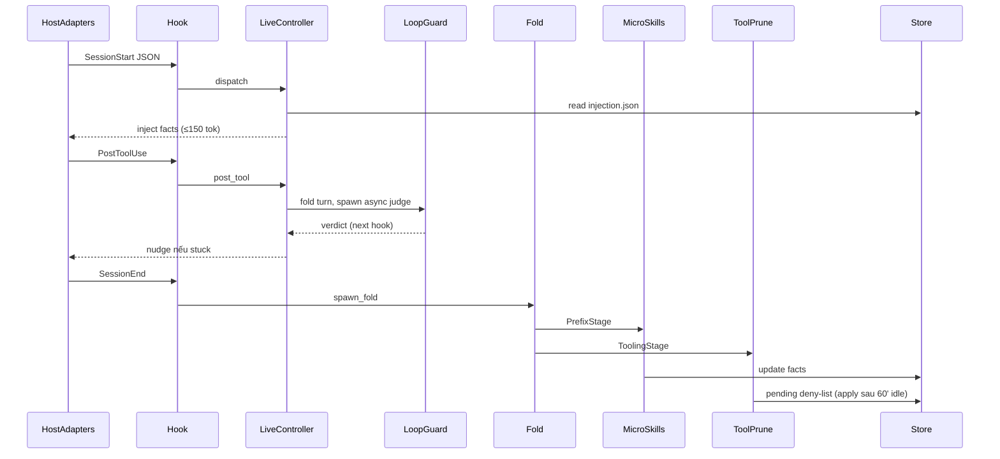
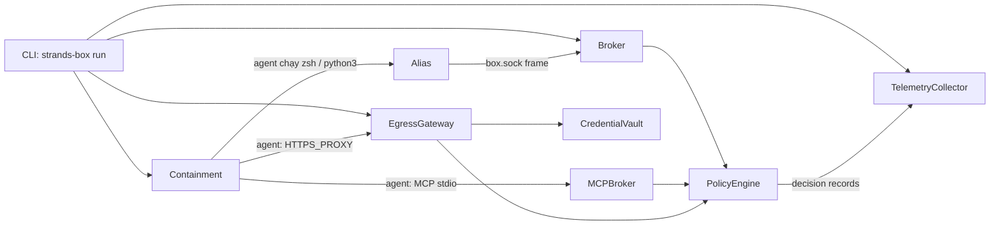
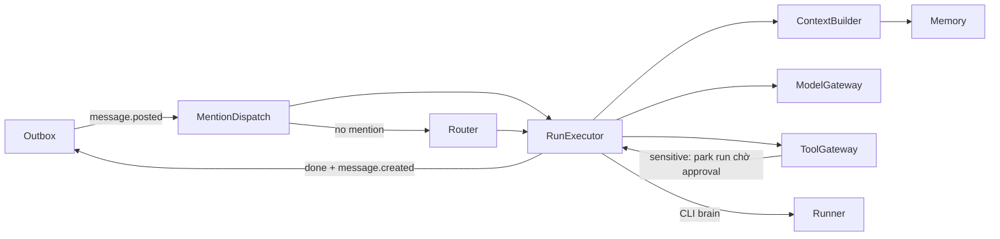
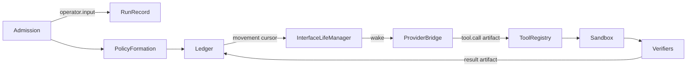

# Agentic AI Weekly Scan — 2026-11-14

Khoảng quét: 2026-11-07 → 2026-11-14. Nguồn: GitHub search (`agent OR multi-agent OR agentic created:>2026-11-07 stars:>200`, rồi mở rộng sang `pushed:>2026-11-07 stars:>500`). Mọi repo được clone và đọc code trực tiếp; mỗi file path dưới đây đều đã được kiểm tra là tồn tại ở commit được quét.

## Executive summary

- **Chủ đề của tuần là cost control và guardrails cho coding agent, không phải orchestration mới.** Hai repo đáng học nhất, TokenEconomizer và Strands Box, đều bọc *bên ngoài* một harness có sẵn (Claude Code, Codex…) thay vì viết agent loop mới.
- **agentes-chat là hệ thống production đầy đủ nhất.** Nó dùng Postgres làm state machine, outbox và vector store. Approval được gắn với hash của đúng tham số tool call. Nhưng codebase khoảng 930K LOC chỉ sau 1 tháng và phần lớn do AI viết, nên cần thận trọng.
- **Octopus-SI-OS có ý tưởng hay nhưng marketing lớn hơn code.** Ý tưởng là grant formation thuần, replay được, chạy trên một append-only ledger. Thực tế agent loop là Codex CLI vendored, và mặc định mới là chạy không sandbox.

## Mục lục

1. [microsoft/TokenEconomizer](#1-microsofttokeneconomizer)
2. [strands-agents/box](#2-strands-agentsbox)
3. [agentes-chat/agentes-chat](#3-agentes-chatagentes-chat)
4. [miuuyy/Octopus-SI-OS](#4-miuuyyoctopus-si-os)
5. [Loại bỏ & phương pháp](#loại-bỏ--phương-pháp)

---

## 1. microsoft/TokenEconomizer

🔗 https://github.com/microsoft/TokenEconomizer · paper: arXiv 2610.22732

### §1 — Quick context

- **Pitch:** Plugin học kinh nghiệm qua các session để cắt chi phí token của coding agent mà không cần sửa agent.
- **Stack:** Python ≥3.10, chỉ dùng stdlib (`dependencies = []`). Có launcher shell và extension TS cho Pi/opencode. Không bundle model: mọi side-call đi qua CLI của chính host agent.
- **Health:** khoảng 6K★, tạo 2026-10-13, 73 commit trong 7 ngày (nhiều PR từ bên ngoài). Có khoảng 45 file test và CI chạy Ubuntu + Windows (`.github/workflows/tests.yml`).

### §2 — Architecture deep-dive

**A. Component inventory**

- `Hook` (`tokeneconomizer/plugin/hook.py`): entry point duy nhất, nhận JSON qua stdin/stdout và fail-open về `{}`.
- `LiveController` (`tokeneconomizer/plugin/controller.py`): dispatch 6 event SessionStart / UserPromptSubmit / PostToolUse / PostToolUseFailure / Stop / SessionEnd.
- `HostAdapters` (`tokeneconomizer/plugin/hosts.py`): chuẩn hoá payload của khoảng 10 agent khác nhau.
- `MicroSkills` (`tokeneconomizer/microskills/`):
  - `envfacts.py` học fact không cần LLM.
  - `distiller.py` là LLM proposer.
  - `lifecycle.py` lo promote/retire fact.
- `ToolPrune` (`tokeneconomizer/toolprune/stage.py`, `tokeneconomizer/plugin/denylist.py`): gỡ các tool không dùng bằng settings của từng host.
- `LoopGuard` (`tokeneconomizer/loopguard/turn.py`, `tokeneconomizer/loopguard/judge.py`): phát hiện turn bị "kẹt".
- `Fold` (`tokeneconomizer/plugin/fold.py`): job nền chạy sau khi session kết thúc, đưa transcript qua các stage.
- `SideCall` (`tokeneconomizer/plugin/sidecall.py`): gọi model thông qua CLI của host.
- `Store` (`tokeneconomizer/plugin/store.py`): JSON state ghi atomic, có file lock.

**B. Control flow: event-driven / hook-based, kèm một vòng học offline giữa các session.** Plugin không bao giờ điều khiển agent; mỗi hook là một process mới.

1. *SessionStart*: `LiveController` đọc `injection.json` và inject block fact, tối đa 4 fact và 150 token.
2. *PostToolUse*: mỗi tool call được đưa qua `TurnGuard`. Một gate miễn phí quyết định có đánh thức `LoopGuard` judge hay không.
3. Judge chạy **async, detached**. Verdict được lấy ở một hook *sau đó*, nên agent không phải chờ. Nếu turn bị kẹt, plugin nudge 1 lần/turn qua context.
4. *SessionEnd*: hook gọi `Fold`, chạy transcript qua `PrefixStage` (facts) và `ToolingStage` (tools).
5. Deny-list chỉ được ghi sau 60 phút idle (`toolprune_quiet_minutes`), để **không phá prompt cache đang ấm**.

**C. State & data flow.** Dữ liệu là untyped dict/JSON. Typed contract chỉ có ở `DomainAdapter` Protocol (`tokeneconomizer/domain.py`) và class `Stage` (`tokeneconomizer/stage.py`). State nằm ở `~/.tokeneconomizer`, key theo repo (origin remote) và tách theo host. Hook chạy song song được serialize bằng lock và hàng đợi replay (`tokeneconomizer/plugin/hookqueue.py`). Khi resume hoặc compact, plugin re-inject đúng cùng một text để giữ cache.

**D. Tool integration.** Plugin chỉ dùng native hook và file settings của từng host (manifest nằm ở `plugin/hooks/*.json`), không có proxy hay MCP. Pruning trên mỗi host dùng một cơ chế khác nhau:

| Host | Cơ chế pruning |
|---|---|
| Claude Code | `permissions.deny` |
| Codex | capability toggle trong `.codex/config.toml` |
| Copilot | `disabledMcpServers` |

Guardrail của chính plugin:
- `PROTECTED_TOOLS` không bao giờ bị prune.
- Một lint (`_LINT_RE`) loại các fact kiểu "skip/done".
- Mode `shadow` chỉ log, không áp dụng.

**E. Memory ("experience").**
- **Fact families:** 5 họ fact không cần LLM.
- **LLM proposer:** chạy mỗi 3 session và sinh fact kèm *detector* chạy trên host (`PREDICATES`), nên kiểm tra fact không tốn LLM.
- **Lifecycle:**
  - Fact được promote sau `K_PROMOTE=3` lần xác nhận.
  - Điểm decay với `GAMMA=0.8`.
  - Một lần mâu thuẫn tính bằng 5 lần xác nhận (`LAMBDA=5.0`).
  - Fact chỉ được inject nếu fire ở ≥40% session.
- **Retrieval:** không có; mọi fact đang active đều được render.

**F. Model orchestration.** Có 2 role dùng model: proposer và stuck-judge. Trên Claude Code, mặc định là `haiku` qua `claude -p --max-turns 1 --tools ""`. Khi judge fail, nó trả `stuck=None` và turn đó được tha. Nếu không có judge, vẫn còn hard backstop bằng 2.5× envelope.

**G. Observability & eval.**
- **Arms** (`experiments/te_bench/arms.py`):
  - baseline effort high/med/low
  - RTK / RepoMap / Serena
  - full system và các ablation `inject-only` / `untool-only` / `spiral-only`
- **Workloads:** SWE-bench (277 task), Web-Bench (102), cùng 2 bộ security, chạy 3 seed.
- **Cost metric:** cache-aware (`tokeneconomizer/pricing.py`), và overhead của chính plugin được tính vào ledger.

**H. Extension points.** `DomainAdapter` và các hook của `Stage`. Muốn thêm host thì viết adapter (trong `hosts.py`), trace reader (`tokeneconomizer/trace/`) và một side-call. Có preset `SPIRAL_LEVELS`.

### §3 — Architecture diagram

### §4 — Verdict

- **Đáng học:**
  - LLM-judge chạy async và trả verdict ở hook sau, nên không tăng latency của agent.
  - Pruning được trì hoãn để giữ prompt cache.
  - Fact kèm detector chạy cục bộ và bị gate theo tần suất fire, tránh làm phình context.
  - Ablation có từng mechanism riêng; hiếm thấy ở repo agent tooling.
- **Red flags:**
  - Có các module rất lớn (`hosts.py` 1380 dòng, `cli.py` 1013).
  - Hành vi gắn với version CLI cụ thể của từng agent, nên dễ vỡ khi agent cập nhật.
  - Trên các nền tảng thiếu API lock, lock lặng lẽ thành no-op.
- **Câu hỏi mở:** kết quả −18% đến −31% cost trên SWE-bench chưa reproduce được nếu không có API key trả phí, và kết quả không được commit vào repo.

---

## 2. strands-agents/box

🔗 https://github.com/strands-agents/box

### §1 — Quick context

- **Pitch:** Sandbox engine cho agent, kết hợp cô lập ở tầng OS với policy ngữ nghĩa có trạng thái viết bằng Dogwood.
- **Stack:**
  - Rust workspace gồm 8 crate.
  - Engine policy `dogwood-local-engine` và `cedar-policy`.
  - Mạng: `rustls`, `rcgen` (MITM CA).
  - Telemetry: OpenTelemetry.
  - Cô lập trên Linux bằng namespaces + seccomp; trên macOS bằng Seatbelt.
- **Health:** khoảng 544★, tạo 2026-10-07, khoảng 46 commit trong 7 ngày, 20 author. Có 14 workflow CI, trong đó có containment suite chạy deterministic.

### §2 — Architecture deep-dive

**A. Component inventory**

- `CLI` (`crates/box/src/command/cli.rs`): lệnh `run` và `policy generate-schema`. Library API nằm ở `crates/box/src/lib.rs`.
- `Broker` (`crates/box/src/run/broker/mod.rs`): phục vụ `run/box.sock` và route request từ alias. Bản thân Broker không authorize.
- `Alias` (`crates/box/src/bin/strands-box-sock-alias.rs`): binary nằm trong sandbox, cài dưới tên `zsh`/`bash`/`python3`/MCP server.
- `PolicyEngine` (`crates/policy/src/policy.rs`, `crates/policy/src/dogwood.rs`): PDP, deny-by-default, `forbid` thắng `permit`. Adapter cho shell/script/egress nằm ở `crates/policy/src/adapters/`.
- `EgressGateway` (`crates/egress-gateway/src/`): terminate TLS, hỏi policy `net:connect`/`http:request`, rồi inject credential thật.
- `MCPBroker` (`crates/box/src/run/broker/mcp/server.rs`).
- `Containment` (`crates/containment/src/facade.rs`, `crates/containment/src/bin/contain_trampoline/main.rs`).
- `CredentialVault` (`crates/credentials/src/vault.rs`).
- `TelemetryCollector` (`crates/telemetry/src/collector.rs`).

**B. Control flow: Policy Enforcement Point interceptor (brokered mediation).** Bốn PEP (Shell, Monty/Python, Gateway, MCP broker) cùng gọi một engine dùng chung (`docs/design/architecture.md`).

1. `strands-box run box.toml` lấy lock trên box dir, rồi mở Collector, PolicyEngine (kèm history), Gateway và Broker.
2. Trampoline tự áp sandbox cho chính nó, rồi `exec` agent. Agent nhận `PATH` trỏ vào Alias và `HTTPS_PROXY` trỏ vào Gateway.
3. Agent chạy `zsh -c '…'`. Alias gửi một frame qua socket tới Broker, Broker chuyển cho Strands Shell.
4. Shell hỏi policy `shell:exec` và `fs:*`. Path được resolve symlink rồi *bind* vào object đã resolve, nên chống được TOCTOU. Sau đó còn một lớp kiểm tra "reachable paths".
5. Traffic mạng đi qua Gateway: policy duyệt, rồi token "phantom" được thay bằng secret thật. Decision record được gửi về Collector.

**C. State & data flow.**
- **Config:** `box.toml` (TOML). Policy viết trong file `.dw`, schema event ở `crates/policy/schema/events.dwschema`.
- **History:** lưu bền trong `dogwood.redb` (`crates/box/src/record/layout.rs`) và tồn tại qua nhiều lần run. Nhờ đó có rule temporal, ví dụ `count … within 1h`.
- **Audit:** OTLP JSON trong `records.jsonl`.
- **Context window:** không áp dụng (Box không gọi LLM).

**D. Tool / capability integration.**
- Box không phụ thuộc harness: chạy bất kỳ `[agent] command` nào (Claude Code, Codex, Pi…; xem `examples/`).
- "Tool grammars" (`crates/policy/src/grammar/`) map cách gõ CLI (git/cargo/aws/curl) sang action ngữ nghĩa như `force_push`.
- MCP call bị kiểm tra 2 lớp: `mcp:call`, rồi action riêng của tool.
- **Không có LLM-based judging:** "semantic" ở đây là rule trên input có cấu trúc cộng với history.

**F. Model orchestration.** Box không tự gọi model nào; model thuộc về harness.

**G. Observability & eval.**
- **Telemetry:** OpenTelemetry. Collector nhận cả span của agent nhưng tách riêng khỏi record của Box.
- **Containment suite:** `test-integ/` gồm 79 case black-box.
- **Workload suite:** `test-workload/` cho *agent thật* (claude/codex/strands) làm việc thật. Có 34 cell mỗi platform, mỗi dimension có `goal.md`/`case.sh`/`oracle.sh`.
- **Verdict layer** (`test-workload/verdict/`):
  - Jailbreak harness đặt canary listener ở 169.254.255.254 và gắn token riêng cho từng run.
  - Unit test của verdict layer chạy hermetic trên mỗi PR.

**H. Extension points.** Tool grammar (TOML), `[mcp.<name>]`, credential source (env/file/aws/op/credsd), hot `reload()` policy, và nhúng như Rust library.

### §3 — Architecture diagram

### §4 — Verdict

- **Đáng học:**
  - **Một policy history dùng chung** cho shell, Python, network và MCP. Ví dụ: đọc một file nhạy cảm qua shell có thể chặn một HTTP request về sau.
  - Agent chỉ thấy credential "phantom"; secret thật nằm ở Gateway.
  - Eval dùng agent thật kèm canary và oracle thay vì chỉ unit test.
- **Red flags** (tự khai trong `docs/design/limitations.md`):
  - Trusted process giữ secret và CA key mà không có sandbox.
  - Record không được ký hay chain.
  - Không giới hạn CPU, disk hay số process.
  - Agent tự đọc/ghi file trực tiếp thì không qua policy.
  - Linux x86-64 vẫn experimental.
- **Câu hỏi mở:** log-only mode mới ở mức design doc (`team/designs/0005-log-only-mode.md`). BPF guard sẽ ship hay không vẫn chưa rõ.

---

## 3. agentes-chat/agentes-chat

🔗 https://github.com/agentes-chat/agentes-chat

### §1 — Quick context

- **Pitch:** Slack self-hosted nơi người và AI agent làm việc chung trong channel, có approval, memory và nhiều "brain".
- **Stack:**
  - TypeScript/Bun monorepo; server dùng Hono, better-auth và zod 4.
  - Storage: Postgres + pgvector (Drizzle), PGlite cho test.
  - Provider: Anthropic, OpenAI, Gemini, OpenRouter và custom.
  - Client: web, mobile (Expo) và desktop (Tauri).
- **Health:** khoảng 1.35K★, tạo 2026-11-09. Lịch sử từ 2026-10-14, khoảng 2.3K commit trong 7 ngày. Có khoảng 1.4K file test và CI (`ci.yml`).

### §2 — Architecture deep-dive

**A. Component inventory**

- `Outbox` (`packages/engine/src/outbox.ts`): job queue trên Postgres, dùng `FOR UPDATE SKIP LOCKED` kèm lease. Không cần Redis.
- `MentionDispatch` (`packages/engine/src/dispatch.ts`): `dispatchMentions` tạo một `agent_runs` cho mỗi @mention.
- `Router` (`packages/engine/src/router.ts`): chọn ai trả lời khi tin nhắn không mention ai.
- `RunExecutor` (`packages/engine/src/executor.ts`): `executeRun` chạy vòng model → tool → result và giữ run state machine.
- `ContextBuilder` (`packages/engine/src/context.ts`, `packages/engine/src/context-budget.ts`).
- `ModelGateway` (`packages/engine/src/gateway.ts`): reserve budget, ghi usage, kiểm tra key.
- `ToolGateway` (`packages/engine/src/tools/gateway.ts`): kiểm tra scope, validate schema, xử lý approval.
- `Memory` (`packages/engine/src/context/`, bảng ở `packages/db/src/schema/context.ts`).
- `Runner` (`apps/server/runner/`): daemon trên máy của agent, chạy các CLI brain (Claude Code, Codex…) và có command gate.

**B. Control flow: event-driven, một Postgres state machine bọc quanh tool loop kiểu ReAct.** Trạng thái: `queued → running → (waiting_approval → running)* → done|failed`, cập nhật bằng compare-and-set.

1. `insertMessage` resolve @mention và enqueue `message.posted` trong cùng một transaction.
2. `MentionDispatch` tạo run. Nếu không có mention, `Router` thử lần lượt: Jev → small model → plan → rules.
3. Job `agent_run.execute` trong `Outbox` gọi `RunExecutor`, executor gọi `ContextBuilder`.
4. `ModelGateway` stream response. Tool call đi qua `ToolGateway`; call nhạy cảm tạo bản ghi `approvals` và park run lại.
5. Reply, các step và `done` được ghi trong một transaction, rồi publish `message.created`.

**C. State & data flow.**
- **Typed schema:** `ContentBlock`, `ModelMessage`, `ToolSpec` (`packages/providers/src/types.ts`). Các bảng runtime nằm ở `packages/db/src/schema/runtime.ts`.
- **Transcript:** append-only và lưu sau mỗi turn, để khi resume thinking block và prompt cache vẫn hợp lệ.
- **Context window:**
  - History mặc định 30 message.
  - `fitContextWindow` thay tool result cũ bằng placeholder.
  - Mỗi agent tự đặt `context_tokens`: 200K, 400K hoặc 1M.

**D. Tool integration.**
- **Đăng ký tool:** interface `ToolSource` trả về `ToolDefinition`, gồm JSON Schema, `scope` và cờ `sensitive` (`packages/engine/src/tools/types.ts`).
- **Gọi tool:** native function-calling.
- **Connector lớn:** load lazy qua `find_tools`/`use_tool`.
- **Nguồn tool:** MCP (`packages/engine/src/connectors/mcp.ts`) và Composio.
- **Guardrail:**
  - Output bên ngoài được bọc trong `<external_data>` (`packages/engine/src/untrusted.ts`).
  - Approval gắn với `sha256(canonical JSON)` và hết hạn sau 24h.
  - SQL "luôn cho phép đọc" phải được **parser của chính Postgres** (`libpg-query`) chứng minh là read-only.

**E. Memory.**
- **Lưu trữ:** bảng `context_items` với các kind fact/decision/preference/lesson…, kèm trust level, scope và `subjectKey` để dedupe.
- **Retrieval:** hybrid, gồm `vector(1024)` HNSW cosine và tsvector.
- **Pipeline:** consolidate/reflect/learn. Các câu hỏi phán đoán (ví dụ "A có trùng B không") được hỏi một judge bên ngoài tên Jev.

**F. Model orchestration.**
- Router fallback theo chuỗi Jev → small model → plan → rules.
- Khi provider outage, run được park theo ladder 2/15/30/60 phút.
- Tối đa 4 agent cùng trả lời một message.
- Brain có thể đổi giữa API model và coding CLI chạy trên subscription của người dùng.

**G. Observability & eval.**
- **Logging:** JSON-lines logger tự viết và Sentry; không dùng OTel/Langfuse.
- **Per-step tracking:** mỗi step lưu token và cost trong `agent_run_steps`.
- **Eval:** chạy với model thật nằm ở `packages/engine/eval/` (memory, router, mentions…) nhưng chạy thủ công. CI dùng phiên bản fake-provider.

**H. Extension points.** `ToolSource`, MCP thêm qua URL, skill dạng `SKILL.md`, custom endpoint, brain kind mới, và routine theo lịch hoặc webhook.

### §3 — Architecture diagram

### §4 — Verdict

- **Đáng học:**
  - Approval gắn hash tham số và có `executed_at`, nên mỗi action chạy tối đa một lần.
  - Chứng minh read-only bằng parser của Postgres thay vì regex.
  - Transcript append-only để giữ thinking block và cache khi resume.
  - Giới hạn vòng lặp nhiều lớp: 50 run tự khởi / 100 hop / 200 tool turn, có wrap-up note trước khi chạm cap.
- **Red flags:**
  - Khoảng 930K LOC TS và 183 ADR chỉ trong 1 tháng. Khoảng 80% commit gần đây có trailer co-author là AI, và một author chiếm khoảng 1.8K commit/tuần.
  - `executor.ts` dài 6,470 dòng.
  - Đường đi lõi phụ thuộc vào Jev, một service bên thứ ba.
  - Sandbox của Claude Code brain "never switched on".
- **Câu hỏi mở:** ADR khớp với code tới mức nào? Eval với model thật có bao giờ chạy ngoài máy dev không?

---

## 4. miuuyy/Octopus-SI-OS

🔗 https://github.com/miuuyy/Octopus-SI-OS

### §1 — Quick context

- **Pitch:** "Agentic OS": agent chạy trên kernel Rust kiểu OS, capability là contract, và agent có thể tự sửa môi trường của mình.
- **Stack:**
  - Rust: 20 crate kernel (khoảng 54K LOC) cộng khoảng 380K LOC trong `registry/`.
  - Desktop app: Electron + React.
  - Storage: SQLite index cộng ledger JSONL.
  - Engine: Codex CLI vendored (`rust-v0.166.0`) cộng bridge opencodex.
  - Chỉ chạy trên macOS.
- **Health:** khoảng 760★, tạo 2026-10-10, 125 commit trong 7 ngày. Thực chất là single-author (517/524 commit). Khoảng 2.5K test, CI ở `quality.yml`.

### §2 — Architecture deep-dive

**A. Component inventory**

- `PolicyFormation` (`crates/octopus-policy/src/lib.rs`): `form_policy` tính grant = ceiling ∩ các lớp EE-chain ∩ các lớp binding, rồi trừ `hard_blocks_tools`. Đây là phép giao tập thuần.
- `Ledger` (`crates/octopus-ledger/src/lib.rs`, `crates/octopus-ledger-store/src/durable_ledger.rs`): `MovementKind` (ArtifactMoved, VerificationFailed, DeliveryRefused…) và `RefusedReason`.
- `Admission` (`crates/octopus-app-server/src/artifact_arrival.rs`): ghép artifact đến với các checkpoint đang pin interface đó.
- `RunRecord` (`crates/octopus-run-record/src/lib.rs`): run, checkpoint và inbound/outbound binding.
- `InterfaceLifeManager` (`crates/octopus-interface-transport/src/interface_life.rs`): mỗi interface là một process, có sleep/coma/backoff.
- `Sandbox` (`crates/octopus-worker-env/src/sandbox.rs`): Seatbelt qua `sandbox-exec`.
- `Verifiers` (`crates/octopus-verifiers/src/lib.rs`, `registry/verifier/`): script out-of-process trả `{"passed":…}`.
- `ToolRegistry` (`registry/tool/`): 191 descriptor `tool.json`, mỗi cái có `args_schema` và `authority`.
- `ProviderBridge` (`registry/interface/world_provider_codex/packages/octopus-provider-codex/src/`): bọc Codex app-server.

**B. Control flow: event-driven, nguồn sự thật là ledger, theo kiểu OS.** Kernel không có orchestrator trung tâm; mỗi interface tự đọc cursor movement của mình. Vòng lặp bên trong là ReAct thuần của Codex, và `docs/architecture.md` tự thừa nhận điều này.

1. Client đưa artifact `operator.input` vào chat interface.
2. `Admission` tìm checkpoint khớp, `PolicyFormation` tính grant, `Ledger` ghi movement.
3. Process của `ProviderBridge` được `InterfaceLifeManager` đánh thức, đọc movement, rồi dựng context và danh sách tool đã được chiếu từ grant.
4. Artifact `tool.call` đi tới "door". Door kiểm tra grant, rồi chạy process của tool trong `Sandbox`. `Verifiers` có thể gate edge này.
5. Kết quả quay về dưới dạng artifact. Vòng lặp tiếp tục tới khi có reply text; `RunRecord` được ghi ở cuối turn.

**C. State & data flow.**
- **Typed schema:** sinh bằng `schemars` vào `schemas/*.schema.json`, mirror sang `.d.ts`.
- **Artifact:** pin bằng blake3.
- **Lưu trữ:** ledger append-only `movements.jsonl` cộng SQLite index có thể bỏ đi và dựng lại.
- **Context window:** giao hết cho compaction native của Codex (`.../octopus-provider-codex/src/context_refresh.rs`).

**D. Tool integration.**
- **Đăng ký tool:** khai báo bằng descriptor JSON, validate args bằng `jsonschema`. Ceiling của từng worker nằm trong `registry/interface/system_worker_*/policy.json`.
- ⚠️ **Sandbox có cách bypass:** khi grant là `whole_host`, `sandboxed_exec.rs` trả argv thô, tức là không sandbox. "Full access" hiện là mặc định cho task mới.

**E. Memory.** Có các tool `memory.save/search/read/list` (`registry/worker_environment_kind/system_room/packages/octopus-system-room-env/src/memory_bound.rs`). Search chỉ là đếm term khớp lexical, không có embedding.

**F. Model orchestration.** Người dùng chọn model cho từng agent. Danh sách model cho phép được giao (`reduce: intersection`) qua các lớp. Không có fallback xuyên provider, chỉ có `max_attempts`.

**G. Observability & eval.** Ledger đóng vai audit trail. `tracing` chỉ được dùng ở 3 file kernel. Không xác định được từ code có eval nào đo "self-improvement".

**H. Extension.** "Self-evolving" thực chất là agent sửa JSON descriptor thông qua các file tool được cấp quyền (`registry/ee_template/self_improvement/ee_template.json` chỉ chứa một goal string). Không có learning loop.

### §3 — Architecture diagram

### §4 — Verdict

- **Đáng học:**
  - Grant formation là hàm thuần, replay được và pin vào hash của descriptor.
  - Interface là process ngủ, được đánh thức bởi ledger movement. Có handoff socket qua `OCTOPUS_INHERITED_SOCKETS`.
  - Chỉ verifier chạy out-of-process mới được cấp "mark".
- **Red flags:**
  - "Rust kernel OS" thực chất là lớp orchestration quanh Codex CLI vendored cộng một npm bridge bên thứ ba. 34 "provider" phần lớn chỉ là config trỏ về cùng một binary.
  - Mặc định chạy không sandbox.
  - Single-author.
  - README tự thừa nhận Octopus không hơn Codex ở việc code thông thường.
- **Câu hỏi mở:** có số liệu thực nghiệm nào cho "self-improvement" không? Ghi descriptor đồng thời được bảo vệ ngoài `StaleEpoch` ra thế nào? Có kế hoạch hỗ trợ Linux không?

---

## Loại bỏ & phương pháp

- **Agent skill/prompt pack** (prompt-engineering, không có kiến trúc): ste80-humanizer, guizang-game-skill, cinematic-skill, sakurai-skill, maxagent, bookleme.
  - Riêng bookleme có fidelity eval, nhưng nó là pipeline compile sách thành skill, không phải kiến trúc agent.
- **Spam/clone:** khoảng 6 repo "Blender AI MCP" và khoảng 4 repo "ai--manus", tạo cùng ngày với description gần như giống hệt nhau.
- **Dưới ngưỡng star** (ghi lại để theo dõi tuần sau): pmndrs/pine (185★, harness event-driven reactive).
- **Ngoài phạm vi agentic architecture:** setyamickala/fastmint-fcfs-agentic (bot mint crypto), berkantay/gpucanvas.
- **Cách verify:** mỗi repo được kiểm tra bằng `git ls-remote` và `raw.githubusercontent.com/.../README.md` (HTTP 200). Trang `github.com/<repo>` bị proxy của sandbox chặn (403 do scope session, không phải do repo).
