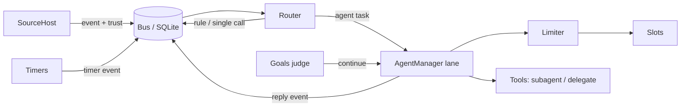
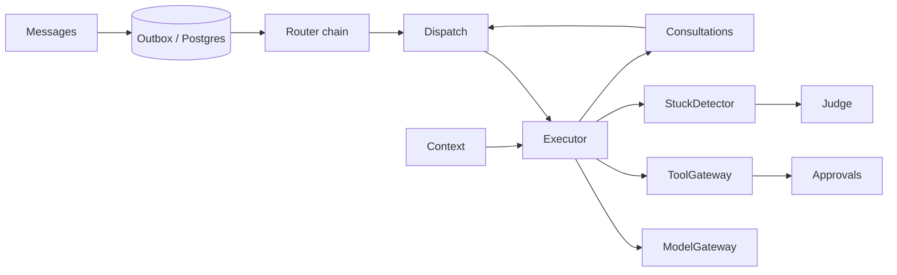
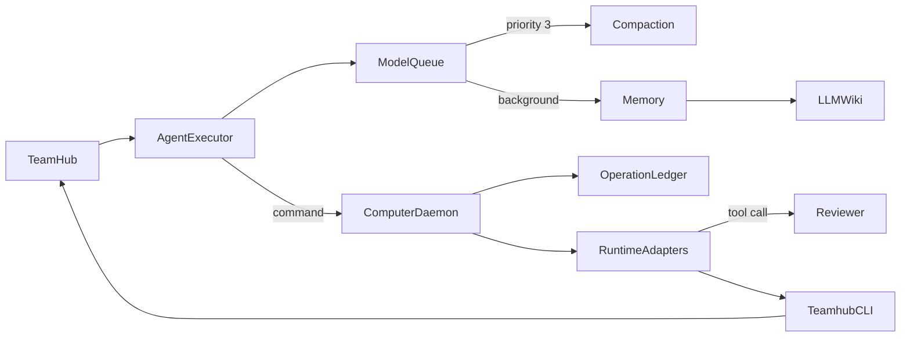

# Agentic AI weekly scan — 2026-11-15

Cửa sổ quét: repo tạo sau `2026-11-08`, `stars:>200` (GitHub search, 410 kết quả thô).

## Executive summary

- **Tuần này nhiễu rất nặng:** khoảng 380/410 kết quả là bản clone star-farm (`*/GitHub-Copilot-app`, `*/ai--manus2.0`: không có language, cùng description, tạo cùng phút 19:15–19:25 UTC ngày 14/11), nên đã loại hết. Lọc xong còn 12 repo thật; 3 repo qua relevance filter.
- **Chủ đề chung:** "agent = đồng nghiệp chạy lâu dài" (daemon / workspace), không phải chat một lượt. Cả 3 repo đều tách *routing rẻ* khỏi *agent run đắt*, gắn **trust label cho nội dung bên ngoài**, và có **scheduler cấp model** (priority queue / adaptive concurrency).
- **Đáng đọc nhất:** `agentes-chat` (router chain có eval đa ngôn ngữ, stuck-detector, 185 ADR) và `pine` (event bus SQLite + llama.cpp slot affinity + baseline harness test SDK). `linger` có scheduler AIMD đáng học, nhưng README chứa claim marketing chưa kiểm chứng.

## Table of contents

1. [pmndrs/pine](#1-pmndrspine)
2. [agentes-chat/agentes-chat](#2-agentes-chatagentes-chat)
3. [simplexai-labs/linger](#3-simplexai-labslinger)
4. [Đã xem nhưng loại](#đã-xem-nhưng-loại)

---

## 1. pmndrs/pine

<https://github.com/pmndrs/pine>

### §1 — Quick context

- **Pitch:** Daemon multi-agent event-driven: agent tự subscribe vào folder, MQTT, webhook, Telegram rồi phản ứng, không chỉ chờ chat.
- **Stack:** TypeScript, Node ≥24 (`node:sqlite`), `@earendil-works/pi-coding-agent` SDK, `pi-mcp`, Playwright MCP, typebox; model qua llama-server hoặc endpoint OpenAI-compatible.
- **Health:** 206★, tạo 10/11, commit cuối 14/11, 1 contributor (Paul Henschel), 37 file test + `baseline/` harness; CI chỉ có `release.yml`.

### §2 — Architecture deep-dive

**A. Component inventory**

- `Bus` (`src/store.ts`): append-only event log trong SQLite (bảng `events` có `topic, payload, cause, hops, trust`), kèm subscription in-process và bảng `tasks`.
- `SourceHost` (`src/sources.ts`): nạp event source module (`src/sources/{folder,mqtt,telegram,webhook,ftp,http,command}.ts`). Mỗi module export `type` có schema để agent tự cấu hình qua tool call.
- `Timers` (`src/timers.ts`): schedule cron / every / at, phát event `timer/<name>`.
- `Router` (`src/router.ts`): khớp topic pattern MQTT-style (`+`, `#`), `when`, debounce/throttle; chọn **handler rẻ nhất đủ dùng**: set state, publish event, một model call không tool, hoặc agent turn đầy đủ.
- `AgentManager` (`src/agents.ts`, 3.4k LOC): mỗi conversation một "lane" (promise chain), tạo pi session, gắn policy gate, compaction.
- `Tools` (`src/tools.ts`): `defineTool` + typebox; có `delegate` (giao cho agent khác) và `subagent` (bản sao song song, context trống).
- `Limiter` (`src/limiter.ts`): giới hạn số run đồng thời tới model server bằng priority queue.
- `Slots` (`src/slots.ts`): chọn `id_slot` của llama.cpp để giữ KV cache theo conversation, kèm page-out ra file.
- `Goals` (`src/goals.ts`): goal mode, gọi lại agent tới khi judge trả `met`.
- `Manual` (`src/manual.ts`): BM25 trên `docs/` cho agent tự tra cứu.
- `Security` (`src/security.ts`, `src/sandbox-linux.ts`): sandbox profile, audit cấu hình.

**B. Control flow:** **Event-driven**, bên trong mỗi agent turn là vòng **ReAct** của pi SDK; goal mode thêm vòng judge bên ngoài.

1. Source/Timer phát event → `Bus.publish` ghi SQLite kèm `trust` (`untrusted` mặc định với webhook/source).
2. `Router` khớp route/subscription, áp dụng debounce/throttle/`when` trên payload và state.
3. Nếu cần agent: tạo task trong bảng `tasks`, xếp vào lane `agentId:session` của `AgentManager`.
4. `Limiter.acquire(priority)` → `Slots` chọn slot llama.cpp ít tốn để mất nhất.
5. pi session chạy tool loop; policy gate chặn tool theo trust (run từ event untrusted bị giới hạn tool set); có thể `subagent`/`delegate`.
6. Kết quả publish thành event (vd `out/source/telegram`) → về lại người dùng.

**C. State & data flow:** Message là `PineEvent` typed (`src/types.ts`), payload JSON. State nằm trong SQLite WAL (`events`, `state`, `kv`, `tasks`), session lưu JSONL của pi. Context: auto-compaction của pi (threshold + khi overflow), có thêm compaction chủ động (`session.compact()`, `src/agents.ts:1551`). Docs không nằm trong prompt mà tra bằng `manual`.

**D. Tool integration:** Tool khai báo bằng `defineTool` với schema typebox → function-calling native qua pi SDK. MCP qua `pi-mcp` (stdio và streamable HTTP). Agent cấu hình MCP/source/schedule bằng *admin tool* (`src/admin.ts`, `src/agent-admin.ts`) thay vì sửa file config. Sandbox: `src/sandbox-linux.ts`, `src/sandbox-fs.ts`.

**E. Memory:** `MEMORY.md` trong workspace, luôn được nạp; khi file vượt 6000 ký tự (`MEMORY_LONG`, `src/agents.ts:72`) thì agent được nhắc dọn lại. Không có vector retrieval.

**F. Model orchestration:** Mỗi agent một model. `subagent` nhận `model` riêng (vd model nhỏ hoặc model có vision). Route `call` là một model call không tool. Retry 429/5xx do pi SDK lo (`baseline/RESULTS.md`). Song song qua `subagents.maxParallel`.

**G. Observability & eval:** Event log có `cause` + `hops`, nên truy được chuỗi nhân quả; xem bằng `pine events -f`. `baseline/` là 59 check trên mock server OpenAI-compatible để kiểm tra *harness* (không phải chất lượng model). Không thấy OpenTelemetry.

**H. Extension points:** Event source mới = một file `*.ts` export default function + `type` schema; skills; MCP server; routes trong `pine.json`.

### §3 — Architecture diagram

### §4 — Verdict

- **Novel:** (1) Router chọn handler *rẻ nhất đủ dùng* (rule → một call → full agent): routing theo chi phí ngay ở tầng event. (2) `slots.ts` biết KV cache: gắn conversation với slot llama.cpp và page ra file, tối ưu latency cho local inference. (3) `baseline/RESULTS.md` ghi lại các gotcha của SDK (project trust mặc định bật, nghĩa là có RCE qua `.pi/extensions`; stream treo sau header) trước khi thiết kế daemon.
- **Red flags:** bus factor = 1; CI không chạy test; `agents.ts` và `tui/app.ts` mỗi file hơn 3k LOC.
- **Open questions:** Goal judge chạy bằng model nào, giới hạn bao nhiêu vòng? `hops` có giới hạn cứng chống vòng lặp event không?

---

## 2. agentes-chat/agentes-chat

<https://github.com/agentes-chat/agentes-chat>

### §1 — Quick context

- **Pitch:** Slack tự host, nơi người và agent (Claude/GPT/Gemini/Grok) làm việc chung trong channel, có approval, budget, routines.
- **Stack:** TypeScript, Bun + Hono + Drizzle, PostgreSQL (dependency bắt buộc duy nhất), React/TanStack, Tauri desktop, mobile; MCP + Composio.
- **Health:** 1.414★, 250 fork, tạo 09/11, commit 15/11, 11 tác giả trong 50 commit gần nhất (1.9k commit trong lịch sử shallow), CI đầy đủ (`ci.yml`, iOS/Android/desktop), 185 ADR.

### §2 — Architecture deep-dive

**A. Component inventory** (tất cả dưới `packages/engine/src/`)

- `Messages` (`messages.ts`): post, parse mention, ghi outbox.
- `Router` (`router.ts`, `router-jev.ts`, `router-plan.ts`): router chain quyết định 0–2 agent trả lời tin không @mention.
- `Dispatch` (`dispatch.ts`): tạo `agent_runs`, giữ lại việc agent tự khởi khi vượt giới hạn "stretch".
- `Executor` (`executor.ts`, 6.6k LOC): tool loop với transcript append-only.
- `Context` (`context.ts`, `context/*`): dựng prompt, thread summary, memory items.
- `ModelGateway` (`gateway.ts`): mọi model call đi qua đây; kiểm budget trước khi gọi, ghi token/cost theo `org_id`/`agent_id`.
- `ToolGateway` (`tools/gateway.ts`, `tools/run-policy.ts`, `tools/scopes.ts`): JSON Schema, scope, policy theo authority (person / routine / unattended).
- `Approvals` (`approvals.ts`): hành động nhạy cảm biến thành approval card trong chat.
- `StuckDetector` (`stuck.ts`): phát hiện run lặp.
- `Judge` (`judge.ts`): small-model judge dùng chung (stuck, memory, media...).
- `Consultations` (`consultations.ts`): `ask_agent` / `tell_agent`, handoff bất đồng bộ giữa agent.
- `Outbox` (`outbox.ts`): job queue trên Postgres, worker in-process.
- `Untrusted` (`untrusted.ts`): bọc nội dung ngoài trong `<external_data>`, trung hòa marker giả.

**B. Control flow:** **Event-driven routing + swarm/handoff**; mỗi run là vòng **ReAct** tool loop.

1. `Messages` lưu tin và ghi outbox job.
2. Không có @mention → `Router` chạy chain: Jev (classifier hosted) → small model (Haiku-class, khoảng 0,0006 USD/call) → plan của tác giả → rule R1–R4 → "nobody" kèm lý do. Bước nào lỗi thì ghi vào `error` và chuyển sang bước sau.
3. `Dispatch` tạo run cho agent được chọn.
4. `Executor` lấy context từ `Context`, gọi `ModelGateway`; mỗi tool call qua `ToolGateway` và `Approvals`; sau mỗi bước `StuckDetector` kiểm tra lặp.
5. Agent có thể `ask_agent` để handoff; `Consultations` trả kết quả về một lần mỗi turn.
6. `continuation.ts` quyết định cách turn kết thúc (continue / wait / ask / done).

**C. State & data flow:** Typed schema Drizzle (`packages/db/src/schema/*`), bảng `messages` partitioned (ADR 0009). Mọi state ở Postgres, không Redis (ADR 0005). Context: thread summary, cắt tin cũ khi vượt range (`context.ts:754`); computer brain tự compaction.

**D. Tool integration:** Tool registry + JSON Schema trong `tools/*`; MCP connector hai tầng (org kết nối một lần, agent nhận subset scope); Composio cho SaaS. Sandbox: computer brain dùng `packages/adapters/src/command-policy.ts`.

**E. Memory:** `context/consolidate.ts`, `reflect.ts`, `learn.ts`, `learned-skills.ts`, `summaries.ts`; item memory lưu `source_ids` trỏ về tin gốc (`message-memories.ts`), có ACL theo channel. Retrieval: không xác định từ phần code đã đọc.

**F. Model orchestration:** Router và judge dùng small model (`routerModelOf`, `cheapModelOf` trong `packages/providers`); agent dùng model riêng của nó. Fallback theo chain như ở bước 2. Provider adapter: Anthropic, Gemini, compat (DeepSeek/Kimi/GLM/MiniMax).

**G. Observability & eval:** Mỗi routing decision lưu đủ candidate và score kèm `strategy` (`jev`, `llm:<model>`, `rule:<name>`); freeze-watch worker thread; Sentry; operator API. `packages/engine/eval/`: router (42 case, 6 ngôn ngữ), behavior (LLM judge, `--repeat`, deterministic checks), memory, catch-up, browser, desktop, media (precision/recall theo ngưỡng). Eval chạy tay, không nằm trong CI.

**H. Extension points:** `AgentesModule` + adapters (`packages/modules/src/index.ts`), provider adapter, MCP connector.

### §3 — Architecture diagram

### §4 — Verdict

- **Novel:** (1) Router chain có thứ tự chi phí, ghi lại *mọi* quyết định kèm strategy, và có eval đa ngôn ngữ cho câu hỏi "tin này nói với ai" (ADR 0074). (2) `stuck.ts`: phát hiện lặp bằng heuristic có cấu trúc (`sameCall:3`, `sameError:3`, `failing:4`, `nothingNew:5`) trước, rồi mới hỏi judge; lần stuck đầu được nhắc, lần thứ hai bị dừng. (3) Bất biến "model không được tự cấp quyền": marker follow-up chỉ do code ghi.
- **Red flags:** `executor.ts` 6.6k LOC; phụ thuộc Jev, một service hosted ngoài repo; `CLAUDE.md` dày đặc, khó onboard.
- **Open questions:** Retrieval memory là keyword hay vector? Tỷ lệ pass của behavior eval là bao nhiêu (repo không commit kết quả)?

---

## 3. simplexai-labs/linger

<https://github.com/simplexai-labs/linger>

### §1 — Quick context

- **Pitch:** Agent cá nhân chạy local trên PC: điều phối Claude Code/Codex/Pi runtime qua daemon, có wiki/memory và guardrail.
- **Stack:** Go (TeamHub: Gin, Postgres 17, River; Computer Daemon: SQLite), TypeScript (node-services: Hono, Yjs), React 19, LiveKit voice, OpenAPI contracts codegen.
- **Health:** 291★, tạo 10/11, commit 14/11, 5 contributor, CI (`ci.yml`), docs kiến trúc khoảng 8.4k từ.

### §2 — Architecture deep-dive

**A. Component inventory**

- `TeamHub` (`apps/teamhub`): Go service giữ Account, Room, Work Item, permission.
- `ComputerDaemon` (`apps/computer/local-daemon/cmd/linger-computer-daemon/main.go`, `internal/daemon/command_dispatch.go`): một process mỗi máy, mở một WebSocket outbound, command queue theo Context.
- `RuntimeAdapters` (`internal/provider/native/claude_*.go`, `codex_binding.go`): bọc Claude stream-json, Codex app-server, Pi RPC.
- `Reviewer` (`internal/permission/reviewer.go`, `allowlist.go`): guardrail, allowlist tool read-only rồi đến LLM permission review; lỗi thì trả Unavailable (fail-closed).
- `OperationLedger` (`internal/daemon/operation_ledger.go`): giữ event chưa ack để resume khi gateway rớt.
- `AgentExecutor` (`apps/node-services/src/agent/executor/run-loop.ts`, `context-executor.ts`): vòng đời run và reply delivery.
- `ModelQueue` (`src/agent/runner-gateway/model-queue.ts`, `adaptive-limit.ts`): hàng đợi theo endpoint, có priority và concurrency thích ứng.
- `Compaction` (`src/agent/runner-gateway/runner-session-compaction.ts`).
- `Memory` (`apps/node-services/src/memory/`: `chunk-index.ts`, `knowledge-query.ts`, `graph/`).
- `LLMWiki` (`apps/node-services/src/llm-wiki/service.ts`).
- `TeamhubCLI` (`apps/teamhub-cli`): 155 command thay cho các MCP server riêng lẻ.

**B. Control flow:** **Hierarchical** (Meta agent → AlterEgo, mỗi Task một bản sao, theo `docs/task-delegation.md`) chạy trên nền **event-driven** hub–daemon. Vòng ReAct nằm bên trong runtime ngoài (Claude/Codex/Pi).

1. Tin trong Room đến `TeamHub` → `AgentExecutor` tạo run.
2. `ModelQueue` xếp run theo priority: tool approval > agent run > compaction > background.
3. `ComputerDaemon` nhận command qua WebSocket, xếp hàng theo Context (tối đa 8 Context đồng thời).
4. `RuntimeAdapters` chạy runtime trong Agent workspace; mỗi tool call đi qua `Reviewer`.
5. Runtime gọi `TeamhubCLI` (token riêng từng agent, write idempotent theo operation ID) để trả lời hoặc tạo Task.
6. Ban đêm `Memory`/`LLMWiki` gom hội thoại thành trang wiki typed.

**C. State & data flow:** Contract OpenAPI sinh code Go/TS (`contracts/`). State ở Postgres (TeamHub), SQLite trên máy (`internal/platform/sqlitedb`), file trong workspace (`memory/`, `llm-wiki/` read-only với runtime). Context: compaction chạy như một job có priority riêng, bị hủy khi conversation có việc mới.

**D. Tool integration:** Qua CLI (`--schema` sinh từ cùng một định nghĩa command) thay vì MCP; computer/browser qua MCP local (Cua, Playwright). Mỗi input được log trước khi chạy; input có kết quả không chắc chắn sẽ chặn lane chứ không replay.

**E. Memory:** Hai tầng: wiki cá nhân (trang typed theo entity, có change log) và memory riêng của từng agent. Retrieval dùng BM25 (`knowledge-query.ts` import `bm25.ts`) cộng entity graph; vector: không xác định từ code.

**F. Model orchestration:** `adaptive-limit.ts` là AIMD: tăng 1 slot khi latency trên 1k token không đổi, giảm một nửa khi bị 429/overload, backoff 5 → 30 phút. Background không bao giờ chiếm slot cuối cùng.

**G. Observability & eval:** `src/agent/observability/agent-log.ts` (JSON log ra file worker), `model-call-log.ts`; không thấy OTel. Eval: không xác định từ code (chỉ có test và e2e).

**H. Extension points:** Built-in Skills (`skills/builtin`, nhúng vào TeamHub), runtime adapter mới, connector Composio.

### §3 — Architecture diagram

### §4 — Verdict

- **Novel:** (1) Concurrency AIMD theo endpoint, chuẩn hóa latency theo 1k token, đáng copy cho multi-agent chạy local. (2) "Harness of harnesses": không tự viết agent loop mà điều phối Claude Code/Codex/Pi, còn guardrail được chèn ở tầng daemon. (3) CLI thay MCP, write idempotent theo operation ID.
- **Red flags:** README có claim marketing ("Claude-class 125B trên GPU 12 GB", "Grok Bot experience") chưa có benchmark trong repo. Doc nói event ledger lưu SQLite, nhưng comment trong `operation_ledger.go` ghi "lives in memory only".
- **Open questions:** Reviewer dùng model nào, latency mỗi review bao nhiêu? Ghi chú "Pi runs without review" trong `docs/architecture.md` có phải là lỗ hổng guardrail không?

---

## Đã xem nhưng loại

| Repo | Lý do loại |
|---|---|
| `*/GitHub-Copilot-app`, `*/ai--manus2.0` (khoảng 380 bản) | Star-farm clone, không có language, nghi phát tán malware |
| `bookleme/bookleme` | Pipeline compile sách thành skill (3.2k LOC Python). Fidelity gate (shingle Jaccard, contiguous copy) khá hay, nhưng không phải kiến trúc agent |
| `nickvasilescu/bot-hq` | 4 commit, 1 contributor, chủ yếu glue code Composio/Orgo |
| `Dodaios/ste80-humanizer`, `*-skill` (cinematic, game, sakurai) | Agent skill / prompt pack, không có runtime |
| `MZULALI/xj-scanner`, `setyamickala/fastmint-fcfs-agentic` | Dưới 500 LOC hoặc không liên quan đến agent architecture |
| `berkantay/gpucanvas` | UI canvas, không phải agent |

Phương pháp: GitHub search API, clone shallow (`--depth 50`), đọc README, docs, entry point và module lõi. Số contributor của agentes-chat tính trên 50 commit gần nhất (API contributors bị chặn trong phiên này).
