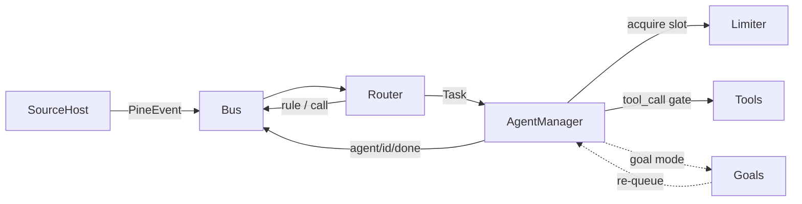
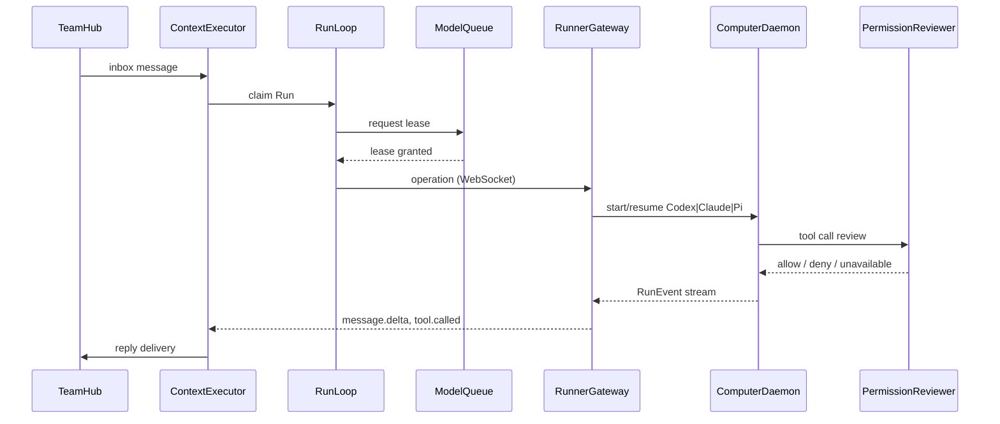
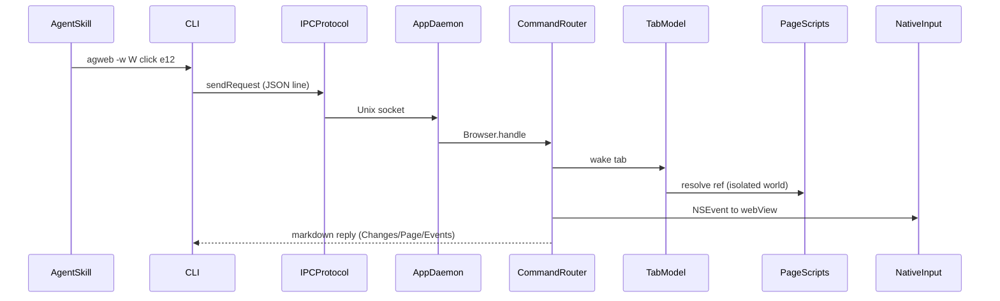
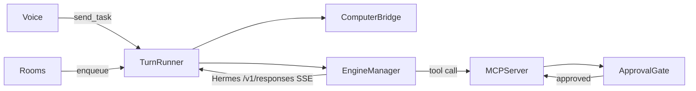

# Agentic AI Weekly Scan — 2026-11-16

Khoảng scan: repo tạo sau 2026-11-09, stars > 200 (`gh api search/repositories`, query `agent OR multi-agent OR agentic created:>2026-11-09 stars:>200`, 106 hits). Không cần dùng query dự phòng `pushed:>...` vì query chính đã ra đủ ứng viên.

## Executive summary

- **Đa số các hit là spam:** khoảng 85/106 kết quả là các bản clone giống hệt nhau, không có code (`*/ai--manus*`, `*/GitHub-Copilot-app`, `*/blender-ai-*`; `language=null`, tạo hàng loạt cùng phút). Đã loại toàn bộ. Sau khi lọc còn **4 repo** có kiến trúc thực sự.
- **Xu hướng chung là "harness quanh agent loop có sẵn":** cả 4 repo đều không tự viết vòng ReAct. Chúng ủy thác vòng lặp cho runtime có sẵn (pi SDK, Codex, Claude Code, Hermes) và đầu tư vào phần bên ngoài: event routing, permission gate, scheduling, quản lý concurrency cho model và giữ prompt cache ổn định.
- **Đáng học nhất:** `pmndrs/pine` (router chọn handler rẻ nhất, slot lending chống deadlock khi delegate) và `simplexai-labs/linger` (LLM permission judge fail-closed, model queue có adaptive concurrency). `agweb` là hạ tầng browser-for-agents có engineering tốt. `bot-hq` chủ yếu là glue code quanh SaaS.

## Table of contents

1. [pmndrs/pine — reactive harness cho agents](#1-pmndrspine)
2. [simplexai-labs/linger — personal agent chạy local](#2-simplexai-labslinger)
3. [paul-nameless/agweb — browser cho agent](#3-paul-namelessagweb)
4. [nickvasilescu/bot-hq — team Hermes agents trên một máy Orgo](#4-nickvasilescubot-hq)
5. [Repo bị loại & phương pháp](#5-repo-bị-loại--phương-pháp)

---

## 1. pmndrs/pine

https://github.com/pmndrs/pine

### §1 — Quick context
- **Pitch:** Daemon multi-agent dạng event-driven. Event từ Telegram, MQTT, webhook hoặc timer được route thành rule, một lệnh gọi model, hoặc một agent turn đầy đủ.
- **Stack:** TypeScript chạy trực tiếp trên Node ≥24 (không build), `node:sqlite`, pi coding-agent SDK, typebox, mqtt, `@playwright/mcp`.
- **Health:** ★217, 1 author, push gần nhất 2026-11-15. Có 36 file `test/*.test.ts` (dùng mock model server). CI (`release.yml`) chỉ typecheck rồi publish npm, **không chạy test**.

### §2 — Architecture deep-dive

**A. Component inventory**
- `startPine` (`src/pine.ts`): composition root. Khởi tạo và nối mọi component bên dưới, kèm `complete` (một lệnh gọi model duy nhất).
- `Bus` / `State` / `TaskStore` (`src/store.ts`): event log append-only trên SQLite, kèm pub/sub theo topic, shared state và bảng task.
- `Router` (`src/router.ts`): biến event thành work, gồm filter `when`, debounce/throttle, và chặn event có `hops > maxEventHops`.
- `AgentManager` (`src/agents.ts`): mỗi `agent:session` có một lane (promise chain riêng). Tạo pi session, chạy policy gate qua hook `tool_call`, inject context.
- `Limiter` / `Slot` (`src/limiter.ts`): priority semaphore giới hạn số run đồng thời tới model server.
- `Tools` (`src/tools.ts`, `src/catalogue.ts`): khoảng 43 `defineTool` (delegate, subagent, publish_event, state…), gom lại thành các "family".
- `SourceHost` (`src/sources.ts`, `src/sources/`): nguồn event gồm telegram, mqtt, folder, webhook, ftp, http, command.
- `Goals` (`src/goals.ts`): judge là một lệnh gọi model riêng, quyết định có cho agent chạy thêm một vòng hay không.

**B. Control flow — event-driven / reactive.** Vòng ReAct bên trong mỗi turn do pi đảm nhiệm. Happy path:
1. `SourceHost` publish một `PineEvent` lên `Bus`.
2. `Router` match topic rồi áp `when`, debounce, throttle.
3. Route chọn handler rẻ nhất: rule → `call` → submit Task vào lane của `AgentManager`.
4. Task lấy slot từ `Limiter` rồi chạy pi session. Mỗi `tool_call` phải qua gate (deny-rule, sandbox, approval).
5. Kết quả được publish thành `agent/<id>/done`, có thể gửi trả về `out/source/telegram`.
6. Ở goal mode, `Goals` judge quyết định có xếp thêm vòng nữa không.

**C. State & data flow.**
- **Message format:** typed (`src/types.ts`). `PineEvent` mang `trust: owner|untrusted`, `cause`, `hops`, `reply`; `Task` mang delegation chain và taint.
- **Storage:** SQLite (bảng `events/state/kv/tasks`). pi session lưu dạng JSONL.
- **Context window:** compaction do pi đảm nhiệm. System prompt và tool declaration được giữ cố định; mọi phần thay đổi được đưa vào `<pine-note>` đặt trước message, để giữ prompt cache.

**D. Tool integration.**
- Tool khai báo bằng typebox schema và được gọi qua native function-calling.
- **Tool family:** gom nhiều tool thành một tool kèm tham số `action`, giảm từ 81 xuống 25 declaration. Có `find_tools` để tra phần còn lại.
- `ease`/`fit` sửa các argument gần đúng.
- MCP qua `pi-mcp`.
- Sandbox: `sandbox-exec` trên macOS, `bwrap` trên Linux (`src/security.ts`, `src/sandbox-linux.ts`).

**E. Memory.** `MEMORY.md` dạng file trong workspace của từng agent, được đọc ở mỗi message. Không có vector store; tool `manual` là BM25 trên `docs/` (`src/manual.ts`).

**F. Model orchestration.**
- Provider đi qua pi runtime (`src/models.ts`). Server llama.cpp được map slot theo từng conversation (`src/slots.ts`).
- `subagent` chạy song song tới `maxParallel`.
- Không xác định từ code có fallback chain hay không.

**G. Observability & eval.**
- Logger có redaction. Mọi tool call, delta và token stats được publish thành topic, và HTTP server cung cấp `/events/stream` (`src/http.ts`).
- `baseline/` gồm 59 check hành vi của pi SDK. Không có harness chấm chất lượng model.

**H. Extension points.** Custom source type (`src/source-types.ts`), MCP server, skill (`src/skills.ts`), route/schedule trong `pine.json`.

### §3 — Diagram

### §4 — Verdict
- **Novel:**
  - Router leo thang theo chi phí (rule → một lệnh gọi model → agent turn).
  - Slot lending: run đang chờ subagent sẽ `suspend()` để nhả slot và lấy lại với priority +1000, tránh deadlock khi chỉ có một slot.
  - Trust/taint được truyền theo delegation chain.
  - Reason của goal judge không bao giờ được đưa lại cho agent, giúp chống injection loop.
- **Red flags:** CI không chạy test mà vẫn auto-publish npm mỗi lần push lên main. Có god file (`src/agents.ts` khoảng 3.5k LOC). Nhiều `as any` quanh pi API.
- **Open questions:** Đã có fallback model chưa? Đưa `${roster}` vào description của `delegate` có phá cache-stability không?

---

## 2. simplexai-labs/linger

https://github.com/simplexai-labs/linger

### §1 — Quick context
- **Pitch:** Lớp orchestration và guardrail chạy local, điều phối các agent runtime có sẵn (Codex, Claude Code, Pi) thành "team" theo Room/Task.
- **Stack:** pnpm monorepo. TypeScript (Hono, Yjs, React 19) cho node-services; Go (Gin, Postgres, SQLite) cho TeamHub và daemon; Playwright và Cua MCP.
- **Health:** ★361, 28 forks, ≥6 contributors, push 2026-11-16. Có 879 test TS và 930 test Go; CI có, nhưng không chạy suite node-services.

### §2 — Architecture deep-dive

**A. Component inventory**
- `ContextExecutor` (`apps/node-services/src/agent/executor/context-executor.ts`): một executor cho mỗi Context (agent × Room/Task/Document), tạo bởi `registry.ts`.
- `RunLoop` (`apps/node-services/src/agent/executor/run-loop.ts`): queue Local Run bền vững, steering, cancel; đây là đường duy nhất để thực thi một runtime.
- `Provider` (`apps/node-services/src/agent/executor/provider.ts`): định nghĩa `SessionSpec`, `SandboxMode` và union `RunEvent`. Hiện thực trong `runner-gateway/remote-codex-provider.ts`.
- `ModelQueue` (`apps/node-services/src/agent/runner-gateway/model-queue.ts`, `adaptive-limit.ts`): cấp lease cho lệnh gọi model, có priority và concurrency thích ứng.
- `RunnerGateway` (`apps/node-services/src/agent/runner-gateway/runner-gateway.ts`): WebSocket tới daemon trên máy người dùng.
- `ComputerDaemon` (`apps/computer/local-daemon/internal/daemon/command_dispatch.go`, `provider/native/`): Go daemon, có adapter cho Codex app-server, Claude stream-json và Pi RPC.
- `PermissionReviewer` (`apps/computer/local-daemon/internal/permission/reviewer.go`, `allowlist.go`, `shell.go`): guardrail cho từng tool call.
- `TeamHub` (`apps/teamhub/internal/`): source of truth cho Room, permission, skill, delegation.

**B. Control flow — event-driven orchestration quanh một vòng ReAct do runtime bên ngoài đảm nhiệm.** Mỗi Context là một serialized queue. Happy path:
1. `TeamHub` lưu message, feature `inbox-source` đánh thức `ContextExecutor`.
2. Bước activation chuẩn bị workspace và Context View (đặt tên theo SHA-256), rồi tạo mới hoặc resume native session.
3. `RunLoop` claim một Run; `Provider` xin lease từ `ModelQueue` và gửi operation qua `RunnerGateway`.
4. `ComputerDaemon` khởi động hoặc tái dùng process Codex/Claude/Pi đang park. Mỗi tool call phải qua `PermissionReviewer`.
5. `RunEvent` (`message.delta`, `tool.called`, `plan.updated`) stream ngược về, reply được gửi qua `TeamHub`.

**C. State & data flow.**
- **Typed contracts:** AsyncAPI và JSON Schema cho wire format với daemon (`contracts/runner-gateway/`), OpenAPI cho HTTP.
- **Storage:** Postgres cho TeamHub. SQLite ở daemon cho Context view và shared task. History nằm trong session của runtime.
- **Context window:** session đang park được compact ở priority thấp hơn Run (`runner-session-compaction.ts`); context length được phát hiện theo từng model.

**D. Tool integration.**
- Native function-calling bên trong runtime, cộng MCP (browser qua Playwright, computer qua Cua).
- Product action đi qua CLI `apps/teamhub-cli`; agent học cách dùng qua Skill, không qua MCP.
- **Permission pipeline:** allowlist → shell classifier → LLM judge với strict JSON Schema, timeout 20s. Lỗi judge trả về `unavailable` và **không thực thi** (fail-closed).
- `SandboxMode`: `read-only` / `workspace-write` / `danger-full-access`.

**E. Memory.**
- **Retrieval:** hybrid nhưng **chỉ keyword**: Postgres tsvector cộng CJK bigram, lexical rerank và RRF (`apps/node-services/src/memory/search/rrf.ts`). Không dùng embedding.
- **Long-term:** file trong workspace, entity graph do LLM Wiki đề xuất và validate (`apps/node-services/src/llm-wiki/`), và "proactive dreaming" viết lại rule list hằng đêm.

**F. Model orchestration.**
- Không có role-based model selection; mỗi Context dùng model của Agent.
- Concurrency: runtime dùng subscription được 10; endpoint API/local bắt đầu từ 1 và tăng dần tới 8 nếu latency ổn.
- Không có fallback; model không có trên máy thì fail `model_not_offered`.

**G. Observability & eval.** Structured JSON log, `model-call-log.ts` kèm token usage, golden trace cho thứ tự hook (`tests/agent/__golden__/`). Không có OpenTelemetry. Không xác định từ code eval harness của "SimplexAI score".

**H. Extension points.** Skill (`skills/builtin/`, kiểm tra digest), agent feature (`agent-features/catalog.generated.ts`), bring-your-own runtime.

### §3 — Diagram

### §4 — Verdict
- **Novel:**
  - Một model queue chung có priority approval > run > compaction > background, và concurrency limit chỉ tăng khi latency còn giữ được.
  - LLM permission judge fail-closed, verdict là final (không retry cho tới khi được "allow").
  - Mỗi GUI input được ghi log trước khi chạy và không bao giờ replay nếu chưa rõ kết quả.
  - Rule ở root `AGENTS.md` cấm điều khiển behavior bằng cách match câu chữ tự nhiên.
- **Red flags:**
  - `docs/architecture.md` nói event ledger nằm trên SQLite, nhưng `operation_ledger.go` ghi là "in memory only".
  - Pi runtime bỏ qua review.
  - Suite agent không chạy trong CI.
- **Open:** Phụ thuộc vào tool `localmodels` bên ngoài; chưa rõ cơ chế lập lịch multi-agent (`teamhub/internal/taskdelegation`).

---

## 3. paul-nameless/agweb

https://github.com/paul-nameless/agweb

### §1 — Quick context
- **Pitch:** Browser macOS dành cho agent: điều khiển qua CLI, không chiếm focus, trả về accessibility tree và diff thay vì screenshot.
- **Stack:** Swift 5.10 SwiftPM, AppKit, WKWebView, Unix socket; không có dependency SwiftPM. Đóng gói Defuddle JS. Chỉ chạy trên macOS 26.
- **Health:** ★230, 2 authors, push 2026-11-14. Có 59 unit test (Swift Testing) và selftest khoảng 440 check; CI chạy trên `macos-26`.

### §2 — Architecture deep-dive

**A. Component inventory**
- `CLI` (`Sources/agweb/main.swift`): parse flag theo allowlist, đọc `--secret-cmd` ngay ở phía CLI, launch app bằng `open -g`.
- `IPCProtocol` (`Sources/AgwebCore/Protocol.swift`): `Request`/`Response` dạng JSON qua Unix socket (umask 0o177); `flock` đảm bảo chỉ có một launcher.
- `AppDaemon` (`Sources/AgwebApp/main.swift`): `serve(path:)` rồi chuyển request vào `Browser.handle`.
- `CommandRouter` (`Sources/AgwebApp/Browser.swift`): `switch` lớn trên `command`; mỗi workspace có một Task chain riêng (tuần tự trong workspace, song song giữa các workspace).
- `TabModel` (`Sources/AgwebApp/Model.swift`): `Tab` làm delegate cho WKWebView; `callAsyncJavaScript` chạy trong `WKContentWorld "agweb"` tách biệt.
- `PageScripts` (`Sources/AgwebCore/PageScripts.swift`): resolve ref, dựng ARIA-ish tree, network hook.
- `NativeInput` (`Sources/AgwebApp/Input.swift`, `Sources/AgwebCore/Motion.swift`): tạo NSEvent, đường chuột theo Bezier và timing theo Fitts.
- `AgentSkill` (`skill/SKILL.md`): skill cho Claude Code và Codex, `allowed-tools: Bash(agweb:*)`.

**B. Control flow — client-server request/response RPC** (mỗi connection một request). Không có agent loop. Happy path:
1. Agent gọi `agweb -w W click e12` qua Bash; `CLI` validate rồi launch app nền nếu cần.
2. `IPCProtocol.sendRequest` ghi một dòng JSON vào `agweb.sock`.
3. `CommandRouter` nối request vào chain của workspace rồi chạy `run()`.
4. `PageScripts` resolve target trong isolated world; `NativeInput` gửi NSEvent thẳng vào web view.
5. Reply là markdown gồm `### Changes` (fetch/XHR và tree diff), `### Page`, `### Events`, đã redact secret, rồi trả về CLI để in.

**C. State & data flow.**
- **Wire format:** JSON envelope, payload là markdown.
- **Storage:** WebKit data store theo profile UUID; `workspaces.json` và cookie plist với mode 0600.
- **Condense cho context window:**
  - Chỉ đưa phần tử có role và đang hiển thị, tối đa 2000 dòng.
  - Diff trong action reply cắt ở 20 dòng.
  - `refSeed` theo workspace làm ref cũ fail thay vì click nhầm phần tử.

**D. Tool integration.**
- Bash CLI cộng SKILL.md; **không có MCP**.
- 72 verb (giống playwright-cli). Gõ sai lệnh được gợi ý "did you mean" theo Levenshtein ≤ 2.
- Target theo role/text phải match đúng một phần tử; click bị từ chối nếu target bị phần tử khác che.

**E/F.** Không có memory LLM và không gọi model (model-agnostic).

**G. Observability & eval.**
- `AGWEB_COMMAND_LOG` ghi JSONL đã redact (`Sources/AgwebCore/CommandLog.swift`).
- `scripts/selftest.sh` fail nếu agweb từng trở thành frontmost app.
- Bảng benchmark memory trong README không có script đi kèm.

**H. Extension points.** Thêm verb phải sửa 3 chỗ (`Commands.swift`, `Browser.run`, CLI flags); không có plugin API.

### §3 — Diagram

### §4 — Verdict
- **Novel:**
  - Chống chiếm focus nhiều lớp: `open -g`, `orderBack`, gửi event thẳng vào web view thay vì `NSWindow.sendEvent`, và `isKeyWindow` được override.
  - Action reply kèm luôn diff và network, nên agent không cần gọi snapshot lần nữa.
  - Secret được đọc ở process CLI, không bao giờ vào transcript.
  - Chủ động ẩn tab để WebKit throttle rồi suspend.
- **Red flags:**
  - Phụ thuộc private WebKit selector, dễ vỡ giữa các bản macOS.
  - Định nghĩa option bị nhân đôi ở hai nơi.
  - Output dạng markdown bị parse ngược theo tên heading.
- **Open:** Socket an toàn đến đâu trước các process khác cùng user? `refSeed` có bền khi bfcache restore không?

---

## 4. nickvasilescu/bot-hq

https://github.com/nickvasilescu/bot-hq

### §1 — Quick context
- **Pitch:** Web app điều phối nhiều bot Hermes, mỗi bot có màn hình riêng trên một máy Orgo, có tool Composio và voice của xAI.
- **Stack:** TypeScript (Hono, better-sqlite3, ws, croner), React 18 và noVNC; Python trong `server/box`; xAI (grok-4.7, grok-voice).
- **Health:** ★292 nhưng **113 forks** và chỉ có 1 lần push (2026-11-11). Không có CI; 3 script test thủ công cần infra thật.

### §2 — Architecture deep-dive

**A. Component inventory**
- `TurnRunner` (`server/src/agent/loop.ts`): serialized promise queue cho từng bot; POST tới Hermes `/v1/responses` dạng SSE, rồi upsert thành transcript row.
- `EngineManager` (`server/src/engine.ts`): engine "primary" (Hermes có sẵn) hoặc "managed" (sinh `config.yaml`/`SOUL.md`, chạy `hermes gateway run`, cấp port).
- `MCPServer` (`server/src/mcp.ts`, `server/src/agent/tools.ts`): endpoint JSON-RPC viết tay `POST /mcp/:bot`, gồm app tool và tool Composio.
- `ApprovalGate` (`server/src/agent/tools.ts` `policyFor`, `server/src/agent/loop.ts` `requestApproval`): MCP call bị block tới 25 phút chờ user duyệt.
- `ComputerBridge` (`server/src/computer.ts`, `server/src/desk.ts`, `server/src/vnc.ts`): cho mỗi bot thuê một trong ≤4 màn hình Orgo, relay VNC qua WebSocket.
- `Rooms` (`server/src/agent/rooms.ts`): group chat, chỉ tối đa 3 bot trả lời.
- `Voice` (`server/src/voice.ts`): mint ephemeral secret cho xAI realtime; tool `send_task` đẩy việc vào queue của `TurnRunner`.

**B. Control flow — event-driven queue trước một vòng ReAct do Hermes đảm nhiệm.** Các bot liên lạc ngang hàng qua `send_to_bot`, không có supervisor. Happy path:
1. Message, routine, voice task hoặc bot khác gọi `enqueue` của `TurnRunner`.
2. `TurnRunner` lấy màn hình từ `ComputerBridge` và engine từ `EngineManager`.
3. POST `/v1/responses` với `instructions` giữ byte-stable (cho prompt cache) và `conversation: hq-<bot>-g<gen>`.
4. Hermes gọi ngược app tool qua `MCPServer`; `ApprovalGate` áp policy và có thể chờ user duyệt.
5. SSE event được upsert vào SQLite và push lên browser.

**C. State & data flow.**
- Transcript là các row `{seq, kind, body JSON}` trong SQLite (`server/src/store.ts`).
- History của model nằm trong Hermes (`store: true`).
- Approval đang chờ chỉ ở trong memory; khi restart sẽ bị expire.

**D. Tool integration.**
- MCP over HTTP; Composio ở chế độ tool-router với meta tool (`server/src/composio.ts`).
- Token là HMAC theo bot id.
- Read-only hay không được phân bằng **regex trên slug**.
- Schema khai báo nhưng **không validate lúc runtime**; không có sandbox.

**E. Memory.** Dùng `MEMORY.md`/`USER.md` của Hermes; app chỉ list và xóa (`server/src/engine-memory.ts`).

**F. Model orchestration.**
- "Hermes" là agent gateway, không phải model.
- Fallback được copy từ config của engine primary.
- Các bot chạy song song; mỗi bot xử lý tuần tự.

**G. Observability & eval.** Chỉ `console.*` và log file của gateway. Không có tracing, không có eval.

**H. Extension points.** `EXTRA_MCP_SERVERS`, thêm vào `TOOLS`, inject skill và instruction theo bot.

### §3 — Diagram

### §4 — Verdict
- **Novel:**
  - Approval được đặt *bên trong* MCP call, nên dùng chung cho mọi engine và mọi kênh.
  - Mỗi bot có `BH_HOME` và DevTools port riêng để không giành cùng một browser.
  - Sau khi user điều khiển màn hình, một "handback" note được chèn vào trước turn kế tiếp.
  - Voice model chỉ làm relay cho text agent.
- **Red flags:**
  - `claimToolRow` nối tool call bằng tên tool cộng cửa sổ 600 ms, dễ race khi gọi song song.
  - Dead code (`createSubagent`, `llm_items`).
  - Chạy với quyền root qua `bash -c`.
  - Không có CI.
  - Tỷ lệ fork/star bất thường.
- **Open:** Toàn bộ logic agent nằm trong Hermes; chưa rõ isolation giữa nhiều user trên cùng một máy.

---

## 5. Repo bị loại & phương pháp

| Repo / nhóm | Lý do loại |
|---|---|
| ~85 clone `*/ai--manus*`, `*/GitHub-Copilot-app`, `*/blender-ai-*`, `*/Capri-AI`, `tradingview-indicator-*` | `language=null`, mô tả copy y hệt nhau, tạo hàng loạt cùng phút: spam/fork-farm, không có source |
| `op7418/guizang-game-skill`, `kociden/sakurai-skill`, `vaibhav-space/my-ai-coding-workflow` | Chỉ là prompt/skill content, không có kiến trúc agent |
| `berkantay/gpucanvas`, `MZULALI/xj-scanner`, `setyamickala/fastmint-fcfs-agentic` | Không phải agentic architecture (UI canvas, OBD reader, mint bot) |
| `fendouai/ViralForge` | Có code, nhưng là ứng dụng video; đã chạm giới hạn 4 repo nên ưu tiên các repo có pattern orchestration rõ hơn |

**Phương pháp:**
- Shallow clone từng repo vào scratchpad, đọc tĩnh README, cây thư mục, manifest, entry point và core module. Không chạy code của repo.
- Mermaid được kiểm tra bằng `@mermaid-js/mermaid-cli`.
- Tồn tại của link được xác minh bằng `git ls-remote` và Search API. Proxy của môi trường chặn HTTP HTML tới github.com (trả 403), nên không lấy được status 200 trực tiếp.
