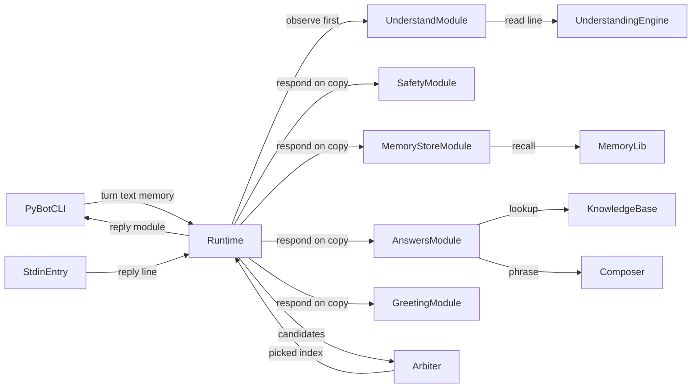
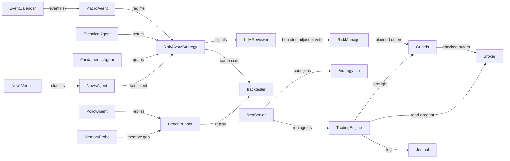
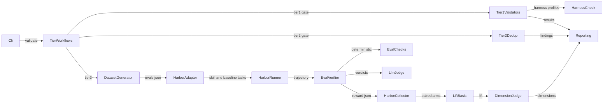
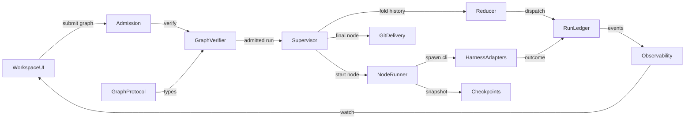

# Agentic AI weekly scan — 2026-11-17

> Cửa sổ quét: 2026-11-10 → 2026-11-17. Nguồn: GitHub search API (`created:>2026-11-10 stars:>200`, sau đó fallback `pushed:>2026-11-10 stars:>500`). Tất cả phân tích dựa trên đọc code của bản clone tại thời điểm quét.

## Executive summary

- **Eval methodology là chủ đề chính của tuần.** NVIDIA/SkillEvaluator đo uplift của skill bằng A/B ghép cặp (cùng case, cùng judge model). risk-aware-trading-agents chống look-ahead bằng cách replay trên market bị "poison" sau các cut day, đồng thời tách điểm trước và sau training cutoff.
- **Engine nắm control flow, LLM bị chặn biên.** zeroshot dùng graph được verify tĩnh và pure reducer trên event log SQLite, nên engine quyết định routing chứ không phải agent. Tuần này repo thêm durable steering và human request. Trading-agents chỉ cho LLM chỉnh conviction ±0.15 (default) hoặc veto, và có risk manager deterministic chạy sau đó.
- **Repo mới có tín hiệu nhiễu cao.** Phần lớn kết quả `stars:>200` tạo trong tuần là spam hoặc clone (hàng chục bản "Blender-AI-MCP", "ai--manus2.0", "GitHub-Copilot-app" của account rác, 0 LOC, chỉ có link tải binary), nên đã bị loại. huggingface/pybot là trường hợp hiếm: code do swarm agent sinh ra (640k LOC), nhưng repo không public harness lẫn eval.

## Mục lục

1. [huggingface/pybot](#1-huggingfacepybot) — propose-then-arbitrate, swarm-generated rule bot
2. [jackson-cmd/risk-aware-trading-agents](#2-jackson-cmdrisk-aware-trading-agents) — benchmark LLM trading chống look-ahead
3. [NVIDIA/SkillEvaluator](#3-nvidiaskillevaluator) — eval 3 tier cho agent skill *(fallback: significantly updated)*
4. [the-open-engine/zeroshot](#4-the-open-enginezeroshot) — graph harness durable cho coding agent *(fallback: significantly updated)*

## Phương pháp & loại trừ

- **Primary query** (`agent OR multi-agent OR agentic`, `created:>2026-11-10 stars:>200`): sau khi lọc chỉ còn 2 repo hợp lệ (pybot, risk-aware-trading-agents). Số còn lại bị loại vì là clone hoặc spam không có source (ví dụ `hitkeeen/blender-ai-mcp-addon`: 7 file, 0 LOC, chỉ có bản tải Windows), skill pack/prompt (`*-skill`, `boring-marketing-skills`), hoặc không thuộc chủ đề agentic (`gpucanvas`).
- **Fallback** (`pushed:>2026-11-10 stars:>500`): chọn repo có thay đổi lớn trong 7 ngày, đo bằng `git log --since`. SkillEvaluator có 285 commit (+155k dòng), zeroshot có 80 commit (+101k dòng), trong đó có tính năng kiến trúc mới (durable steering).
- **Honorable mentions** (có kiến trúc tốt nhưng dưới ngưỡng sao, nên không deep-dive): [spacesky-cell/TwinFix](https://github.com/spacesky-cell/TwinFix) (130★) là agent sửa bug theo state machine LangGraph trong twin environment, dùng hidden test mà agent không thấy và verifier tách riêng khỏi fixer. [DeskLabs-OpenSource/DeskVoice](https://github.com/DeskLabs-OpenSource/DeskVoice) (124★) là tổng đài voice agent self-host, có bước human approval khi đang trong cuộc gọi.

---

## 1. huggingface/pybot
**Link:** https://github.com/huggingface/pybot

### §1 — Quick context
**Pitch:** Chatbot rule-based thuần Python (regex, if-else, lookup table), do swarm hơn 1000 agent viết, không weights, không training.
**Stack:** Python 3.8+, chỉ stdlib, `dependencies = []` trong `pyproject.toml`. **Health:** 229 stars, 21 forks, 6 commit author, Apache-2.0, repo mới (12–16/11/2026). Không có CI workflow (`.github/` chỉ có `dependabot.yml`). `tests/test_cli.py` (161 dòng) chỉ test CLI. README nói có "550k lines of tests" nhưng các test đó không có trong repo.

### §2 — Architecture deep-dive
**A. Component inventory**
- `PyBotCLI` (`pybot.py`): REPL, `-p`, pipe, `-s` seed, `-v` in module đã trả lời; không chứa logic bot.
- `StdinEntry` (`bot/__main__.py`): interface cố định, đọc một dòng stdin và in một reply.
- `Runtime` (`bot/runtime.py`): "Fixed module interface" (120 dòng), tự discover module qua `pkgutil`, chạy observe, respond, choose, after.
- `UnderstandModule` (`bot/modules/understand.py`): PRIORITY 10000, gọi engine rồi ghi kết quả vào `memory["understood"]`.
- `UnderstandingEngine` (`bot/understanding`): normalize, kinds, topics, references (resolve "it/that").
- `SafetyModule` (`bot/modules/safety.py`): band 9000, không bao giờ bị outvote.
- `MemoryStoreModule` (`bot/modules/memory_store.py`): band 7000, nhớ và recall fact người dùng.
- `AnswersModule` (`bot/modules/answers.py`): PRIORITY 0, trả lời từ knowledge base, khai báo `ANSWERS = topics()`.
- `KnowledgeBase` (`bot/knowledge`): 159 file fact lưu dạng data, có `lookup.py`.
- `MemoryLib` (`bot/memory`): 117 file reader cho hội thoại (recall, repeat, narrow...).
- `Composer` (`bot/compose`): 126 file lo phrasing, hedge và `fallback.py`.
- `GreetingModule` (`bot/modules/greeting.py`): PRIORITY -1000, last resort.
- `Arbiter` (`bot/modules/arbiter.py`): 5532 dòng, `choose()` chọn candidate.

**B. Control flow: propose-then-arbitrate (blackboard + priority bands).** Happy path:
1. `PyBotCLI` gọi `runtime.turn(text, memory)`.
2. Chạy mọi `observe()` theo PRIORITY giảm dần. `UnderstandModule` chạy đầu tiên và ghi reading.
3. Mọi `respond()` chạy, mỗi module trên một `deepcopy` của memory riêng, và trả về string hoặc None.
4. `Arbiter.choose()` áp các rule: specialist (`ANSWERS`) thắng generalist, không lặp reply, safety ≥9000 không bị vượt, recall band 7000.
5. Copy memory của module thắng trở thành memory chính, sau đó chạy `after()` và append vào `memory["turns"]`.

**C. State & data flow:** chỉ có một dict `memory`, in-process, không persistence. `turns` dùng chung còn mọi key khác được copy-on-propose. Cách này giúp candidate bị loại không để lại side effect (`bot/runtime.py:_copy`).

**D. Tool/capability integration:** không có tool hay API ngoài. Có thứ "capability" ngầm giữa các module: `ANSWERS`, `ANSWERS_INSTEAD`, `DEFERS_TO`, `TAKES_AS_IT_COMES`, `CLAIMS_INSTEAD` (`arbiter.py:146-169`).

**E. Memory:** short-term trong phiên, gồm `memory["turns"]` cùng các fact do observer ghi (tên, topic, số liệu). `/reset` xóa hết. Không có long-term memory.

**F. Model orchestration:** không có LLM. "Orchestration" ở đây là PRIORITY band cộng các heuristic của arbiter. Randomness của wording được seed qua `-s`.

**G. Observability & eval:** observability chỉ có `-v`, in tên module và số ms, và `turn()` trả về toàn bộ `candidates`. Eval SmolTalkBench (LLM judge) và harness của swarm đều **không có trong repo**, nên không reproduce được con số 26% từ code này.

**H. Extension points:** thả một file mới vào `bot/modules/` với `PRIORITY` và `observe/respond/after`, runtime tự discover. Module lỗi thì bị skip trong im lặng.

### §3 — Architecture diagram

### §4 — Verdict
**Novel:** contract runtime rất nhỏ, chỉ 120 dòng và được đóng băng ("Edit bot/modules/, never this file"). Contract này cho phép hàng nghìn agent cùng sửa song song, mỗi module propose trên memory copy riêng, còn arbiter phân xử bằng priority band và topic declaration. Đây là một thiết kế blackboard kiểu ELIZA nhưng scale lên 640k LOC.
**Red flags:** `arbiter.py` dài 5532 dòng toàn heuristic vá theo từng case cụ thể ("we lost the baby", "not curry"). `except Exception: continue` có ở khắp nơi nên bug thành silent; chính `answers.py` ghi lại một vụ NameError (#3748) từng âm thầm tắt cả knowledge base. Có 253 tham chiếu issue `#NNNN` và 196 tham chiếu `README.md`/`STYLE.md` của source repo không được công bố. Tên file kiểu văn xuôi (`a_thing_being_weighed.py`) xuất hiện ở cả modules lẫn compose, nên con người gần như không maintain nổi.
**Open questions:** có công bố eval harness hoặc 550k test không? Arbiter có overfit benchmark không? Latency sẽ ra sao khi số module tăng tuyến tính?

---

## 2. jackson-cmd/risk-aware-trading-agents
**Link:** https://github.com/jackson-cmd/risk-aware-trading-agents

### §1 — Quick context
**Pitch:** Trading agent cổ phiếu Mỹ chạy rule-based, risk manager deterministic, LLM chỉ đóng vai reviewer bị chặn biên, kèm benchmark LLM trading chống look-ahead.
**Stack:** Python ≥3.10, pandas/numpy, yfinance, pydantic, typer, MCP SDK (FastMCP), Streamlit; LLM provider gồm Anthropic, OpenAI-compatible, Ollama và CLI (claude/codex/gemini).
**Health:** 207★/50 fork, MIT, v0.8.0. Repo tạo 12/11, 50 commit trong khoảng 2 ngày, tất cả của "Anonymous". Có 42 file test offline, CI chạy ma trận 3 OS × 3 phiên bản Python (ruff + pytest), cùng workflow replay leaderboard.

### §2 — Architecture deep-dive
**A. Component inventory**
- `MacroAgent` (`src/riskaware/agents/macro.py`): phân regime RISK_ON/NEUTRAL/UNCERTAIN/RISK_OFF từ VIX, breadth và fear-greed.
- `EventCalendar` (`src/riskaware/data/events.py`): lịch FOMC/CPI/NFP, tính event risk. Repo không có "event agent" riêng.
- `TechnicalAgent` (`src/riskaware/agents/technical.py`): các setup EMA 50/100/200, mean reversion, breakout.
- `FundamentalAgent` (`src/riskaware/agents/fundamental.py`): chấm earnings quality.
- `NewsVerifier` (`src/riskaware/news/verify.py`): cluster tin, chấm PRIMARY/ISSUER/CONFIRMED/UNCONFIRMED, xử lý red flag và denial.
- `NewsAgent` (`src/riskaware/agents/news.py`): chuyển tin đã verify thành sentiment score.
- `RiskAwareStrategy` (`src/riskaware/strategy/risk_aware.py`): gộp signal theo `conviction = 0.55·tech + 0.20·fund + 0.15·news + 0.10·macro`.
- `LLMReviewer` (`src/riskaware/llm/reviewer.py`): bull/bear/judge, trả JSON schema strict, adjustment bị clamp ±`max_adjustment` và có quyền veto.
- `RiskManager` (`src/riskaware/risk.py`): cash floor 30%, cap theo position/sector, rule theo regime, sizing theo tranche.
- `Guards` (`src/riskaware/guards.py`): kill switch, max order, price band, stale quote.
- `Broker` (`src/riskaware/brokers/base.py`): interface chung cho 10 adapter, mặc định `paper`.
- `TradingEngine` (`src/riskaware/engine.py`): orchestrator của một cycle.
- `Journal` (`src/riskaware/journal.py`): log SQLite.
- `Backtester` (`src/riskaware/backtest/engine.py`): backtest daily, signal ở close t, fill ở t+1.
- `StrategyLab` (`src/riskaware/lab.py`): sandbox chạy code strategy do AI viết.
- `McpServer` (`src/riskaware/mcp_server.py`): MCP tools.
- `PolicyAgent` (`src/riskaware/research/agent.py`): LLM làm policy, có mode `Blind` và `observation_check`.
- `BenchRunner` (`src/riskaware/research/bench.py`): rta-bench-1, gồm submit, check và replay entry.
- `MemoryProbe` (`src/riskaware/research/memory.py`): đo mức model "nhớ" giai đoạn test.

**B. Control flow.** Pattern: **Sequential deterministic pipeline với bounded LLM critic**, không phải ReAct (`TradingEngine.run_cycle`):
1. `Guards.preflight` chạy, rồi engine đọc account/positions từ `Broker`.
2. `MacroAgent` (cùng `EventCalendar`) tính regime, sau đó `RiskAwareStrategy.on_bar` gọi Technical, Fundamental và News agent để ra `Signal`.
3. `review_with_llm` cho `LLMReviewer` chỉnh conviction hoặc veto từng buy candidate.
4. `RiskManager.plan` biến signal thành order, kèm cash floor và cap.
5. `Guards.check` chạy tiếp, client order id được làm deterministic để chống trùng lệnh, rồi `broker.place_order`. Mọi bước được ghi vào `Journal`.

**C. State & data flow.** Data đi một chiều: prices/news → `StrategyContext` → `Signal` → `PlannedOrder`. State của mỗi agent nằm ở `~/.riskaware/arena/NAME/` (account JSON, `journal.db`, `equity.csv`, theo `docs/agents.md`). Bench dùng `FrozenMarket` với hash SHA-256 cho file giá và file tin.

**D. Tool integration.** `McpServer` đăng ký 13 tool qua `FastMCP` với annotation `readOnlyHint`. Không tool nào gửi lệnh tới broker thật. `StrategyLab` chạy code ở child process, kiểm AST, dùng `sys.addaudithook` để chặn ghi file và đọc ngoài các root cho phép, chặn luôn thư mục news. Ngoài ra có `RLIMIT_CPU`/`RLIMIT_AS`.

**E. Memory.** Agent không có long-term memory kiểu LLM. `MemoryProbe` là công cụ eval: so AUC named với blind, cộng thêm phép thử direct recall, có tách theo cutoff.

**F. Model orchestration.** Một model cho mỗi agent, chọn qua `--llm provider:model`. LLM không tự tạo trade được (`reviewer.py`). Trong bench thì ngược lại: LLM chính là policy, chạy execution "plain", không có risk rule bọc ngoài.

**G. Observability & eval.** `Journal` lưu prompt và raw reply của mỗi decision. `observation_check` replay các reply trên bản market bị "poisoned" sau 3 cut day (`FrozenMarket.poisoned`), và observation trước mỗi cut phải giống hệt bản gốc. `check_entry` và `verify_entry` replay deterministic. Nhãn contamination gồm clean/partly/may_remember. Có 67 entry trong `leaderboard/entries/`.

**H. Extension points.** Subclass `Strategy` (`strategy/base.py`, `loader.py`), thêm broker adapter mới, `Provider` Protocol cho LLM, hoặc policy là bất kỳ hàm observation → orders nào (`bench.run_task`).

### §3 — Architecture diagram

### §4 — Verdict
**Novel:** Look-ahead check dựa trên replay trên market và news bị poison sau các cut day. Kết hợp với blind aliasing, chia score theo training cutoff và memory probe AUC, đây là cách hiếm thấy để tách skill khỏi memorization. LLM bị đặt dưới risk gate deterministic.

**Red flags:**
- 50 commit trong khoảng 2 ngày, tác giả "Anonymous". Tỉ lệ 207★/50 fork bất thường với repo mới 5 ngày.
- Headline 2020/2022/2026 là dữ liệu licensed, không phân phối, nên người ngoài không chạy lại bench được, chỉ replay được reply đã có.
- `max_adjustment` cho phép tới 0.5 (`config.py`), tức "±0.15" chỉ là giá trị default.
- Docs tự thừa nhận survivorship bias và blind mode "không kín".

**Open questions:** Ai cung cấp news feed? Kết quả leaderboard có ý nghĩa thống kê không, khi mỗi period chỉ 10–12 tháng?

---

## 3. NVIDIA/SkillEvaluator
**Link:** https://github.com/NVIDIA/SkillEvaluator

### §1 — Quick context
Framework 3 tier đo chất lượng, bảo mật, trùng lặp và "uplift" thực tế của agent skill/plugin (chạy có skill và không có skill rồi so sánh).
Stack: Python 3.12–3.14, Click, Pydantic, Harbor (sandbox cho agent), Docker/GKE/NeMo Gym, embeddings + LLM judge (OpenAI/Anthropic/NVIDIA Build), SkillSpector/Gitleaks/Bandit/Semgrep.
Health: 2895★, 389 fork, Apache-2.0, v0.9.0, 15 GitHub workflow (ci, security, evaluate-all-tiers…), khoảng 158 mục test cùng golden fixtures. Tuần này có 285 commit, trong đó 2 tác giả chiếm khoảng 95%.

### §2 — Architecture deep-dive
**A. Component inventory**
- `Cli` (`src/skillevaluator/cli.py`): một console script `skillevaluator` gồm các lệnh validate, tier1/2/3, harness-check, ci init, doctor.
- `TierWorkflows` (`src/skillevaluator/tier_workflows.py`): điều phối từng tier, ghi scope theo stage (skipped hay enabled) và áp `apply_policy`.
- `Tier1Validators` (`src/skillevaluator/validators`): schema, security, secrets, PII, license, unicode smuggling, mcp_static, quality_score, rubric_eval.
- `HarnessCheck` (`src/skillevaluator/harness`): YAML profile cho 6 harness (claude-code, codex, copilot-cli, hermes, openclaw, opencode) để biết skill có được load hay không.
- `Tier2Dedup` (`src/skillevaluator/deduplication`): pipeline collect, chunk, embed, cluster, LLM analyze, chạy được cả intra-skill lẫn so với catalog.
- `DatasetGenerator` (`src/skillevaluator/tier3/generate_dataset.py`): sinh `evals/evals.json` qua 4 lớp grounding (từ SKILL.md đến trajectory thật).
- `HarborAdapter` (`src/skillevaluator/tier3/harbor/adapter.py`): từ một evals.json sinh 2 dataset là `harbor-tasks/` (có skill) và `harbor-tasks-baseline/` (không có).
- `HarborRunner` (`src/skillevaluator/tier3/harbor/runner.py`): khởi chạy Harbor, xử lý credential, timeout và cooperative cancellation.
- `EvalVerifier` (`src/skillevaluator/tier3/harbor/templates/eval.py`): chạy trong sandbox, đọc ATIF trajectory rồi ghi `reward.json`.
- `EvalChecks` (`src/skillevaluator/tier3/eval_core/checks.py`): các deterministic check là pure function chạy trên tool-call dict.
- `LlmJudge` (`src/skillevaluator/tier3/eval_core/llm_judge.py`): judge chỉ trả verdict, điểm số do code tự tính.
- `HarborCollector` (`src/skillevaluator/tier3/harbor/collector.py`): gom job dir về `evals/results/<agent>/`.
- `LiftBasis` (`src/skillevaluator/tier3/harbor/lift_basis.py`): ghép cặp 2 arm theo từng case trước khi tính lift.
- `DimensionJudge` (`src/skillevaluator/evaluation/dimension_judge.py`): map điểm thô sang các dimension (Correctness, Effectiveness…), có fallback weighted-average.
- `Reporting` (`src/skillevaluator/reporting`): xuất CLI/JSON/HTML/Markdown/SARIF/JUnit, BENCHMARK và dashboard.

**B. Control flow** — pattern là **Pipeline with gates**: các tier chạy tuần tự, mỗi tier là một quality gate. Tier 1 luôn gate. Tier 2 gate trừ khi có `--no-block-on-dedup`. Tier 3 chỉ gate khi có `--block-on-agent-eval`.
1. `Cli` `validate` gọi `TierWorkflows.run_tier1_workflow`: kiểm tra config trước, sau đó mới chuẩn bị scanner và chạy `Tier1Validators` (cùng rubric LLM nếu bật).
2. `Tier2Dedup` embed và cluster các chunk, rồi để LLM xác nhận chỗ trùng lặp.
3. `DatasetGenerator` (autopilot) tạo hoặc tái dùng case. `HarborAdapter` sinh 2 arm.
4. `HarborRunner` chạy agent trong sandbox. `EvalVerifier` chấm điểm bằng `EvalChecks` và `LlmJudge`.
5. `HarborCollector`, `LiftBasis` và `DimensionJudge` tính lift; cuối cùng `Reporting` render ra report.

**C. State & data flow** — hoàn toàn dựa trên file: `evals/evals.json` sinh ra task dir (`instruction.md`, `task.toml`, `tests/entry.json`), sau đó là `/logs/agent/trajectory.json` (ATIF), `/logs/verifier/reward.json`, `lift.json`, rồi tới report. Kết quả Tier 1 dùng model `ValidationResult` (`src/skillevaluator/models/result.py`).

**D. Tool/capability integration** — scanner bên ngoài (SkillSpector được pin version, Gitleaks có verify bản tải về) chạy qua `uv tool run`. Agent được tích hợp qua Harbor và adapter riêng cho từng loại (`local_agents.py`, `hermes_agent.py`). Có kiểm tra tĩnh cấu hình MCP. Sandbox chạy trên Docker, GKE hoặc NeMo Gym.

**E. Memory** — `baseline_store.py` và `history.py` lưu baseline/lịch sử để so sánh giữa các lần chạy. Không có agent memory.

**F. Model orchestration** — `provider_config.py` và `inference/client.py` hỗ trợ OpenAI, Anthropic, NVIDIA Build và Vertex ADC. Chat và embedding là hai đường riêng. Judge có cơ chế fallback, và `LiftBasis` loại khỏi phép so sánh những case mà hai arm bị chấm bởi judge khác nhau.

**G. Observability & eval** — `judge_attempts.json` được redact, có progress reporter, đo resource usage, có golden tests cho benchmark, và xuất được JUnit/SARIF để đưa vào CI.

**H. Extension points** — thêm harness bằng YAML trong `harness/profiles`, custom execution backend (`tests/test_custom_execution_backends.py`), quality config và profile policy (`config/`), CI template (`ci/templates`).

**Thay đổi tuần này (2026-11-10..17):** thêm JUnit reporter, pre-commit hook chạy Tier 1 offline (`precommit.py`: quality, schema, lint-scripts), test linearity cho phần masking credential, cooperative cancellation trong Tier 3, report ghi rõ execution backend, và loạt requirement ledger trong `docs/superpowers/specs`. Phần lớn commit là fix tính đúng của verdict/lift trong report.

### §3 — Architecture diagram

### §4 — Verdict
**Novel:** đo uplift bằng A/B: từ cùng một evals.json sinh ra arm có skill và arm baseline. `LiftBasis` chỉ so sánh trên những case mà cả hai arm đều được chấm, với cùng judge model. LLM judge chỉ trả verdict còn điểm do code tính. Harness-check kiểm tra tĩnh xem skill có load được trên 6 harness hay không.
**Red flags:** codebase khoảng 214k LOC, nhiều file đơn lẻ 5–9k dòng (`checks.py`, `collector.py`, `runner.py`). Bus factor thấp vì 2 tác giả chiếm khoảng 95% commit. Support ghi là "Experimental". Tier 3 mặc định không gate.
**Open questions:** độ tin cậy thống kê của lift khi chỉ có ít case do autopilot sinh ra? Chi phí Tier 3 khi chạy trên CI ở quy mô catalog?

---

## 4. the-open-engine/zeroshot
**Link:** https://github.com/the-open-engine/zeroshot

### §1 — Quick context
Engine chạy quy trình coding dưới dạng graph do engine cưỡng chế, để agent viết code không tự chấm bài của chính nó.
Stack: Rust 2024 workspace (tokio, rusqlite, jsonschema, OpenRPC protocol), UI React/Vite (`ui/`), Python SDK (`sdks/python`), phân phối qua npm. Health: 2180 stars, 208 forks, MIT, 80 commits/5 authors trong tuần 10–17/11; CI gồm ci, coverage, docs, opcore, pr-policy, release; có 45 file integration test trong `zeroshot/tests` cùng conformance testkit.

### §2 — Architecture deep-dive
**A. Component inventory**
- `GraphProtocol` (`crates/openengine-cluster-protocol`): các type GraphSpec, run, steering, requests, checkpoints. JSON Schema/OpenRPC nằm ở `protocol/openengine-cluster/v1`.
- `GraphVerifier` (`crates/openengine-cluster-server/src/graph_verifier.rs`): kiểm tra trước khi chạy (type, loop bounds, nhánh unreachable, concurrent delivery).
- `Admission` (`zeroshot/src/native_v2_admission.rs`): compiler thuần, resolve leaf thành WorkerRegistry, validate input và runtime binding không chứa secret.
- `Supervisor` (`zeroshot/src/native_v2_supervisor.rs`): mỗi run có một supervisor. Nó fold history qua reducer, ghi dispatch trước khi start, settle completion rồi lặp lại cho tới khi terminal.
- `Reducer` (`zeroshot/src/full_v1_reducer.rs`): pure reduction trên `VerifiedGraph` (seq/choice/par/loop/map).
- `RunLedger` (`zeroshot/src/v2_run_ledger.rs`): history bền vững trên SQLite, kèm inbox và steering vectors.
- `NodeRunner` (`zeroshot/src/native_v2_runner.rs`): quản lý session, live output, conversation và steering receipts.
- `HarnessAdapters` (`zeroshot/src/harnesses/adapters`): core gồm claude/codex/copilot/pi, contributed gồm opencode/hermes.
- `Checkpoints` (`zeroshot/src/native_v2_checkpoints.rs`): snapshot workspace (filesystem/restic).
- `GitDelivery` (`zeroshot/src/native_v2_delivery.rs`): node commit, push, PR/merge, chờ CI.
- `Observability` (`zeroshot/src/native_v2_observability.rs`): status/watch/logs/attach dựng lại từ ledger.
- `WorkspaceUI` (`ui/src`): canvas graph, run history, replay.

**B. Control flow — State machine-graph** (theo kiểu durable-execution/event-sourced reducer):
1. Người dùng gửi title + GraphSpec JSON + input + runtime plan. `Admission` và `GraphVerifier` duyệt graph (`--validate-only` chỉ chạy bước kiểm tra).
2. `Supervisor` fold ledger qua `Reducer` để biết các node được phép dispatch, rồi ghi dispatch vào `RunLedger` trước khi chạy.
3. `NodeRunner` chạy `HarnessAdapters`, mỗi adapter spawn CLI native. Ví dụ Claude chạy `--print --output-format ... --json-schema ... --resume` (`harnesses/adapters/core/claude/command.rs`).
4. Output được validate theo contract. Verifier trả enum signal, và `choice`/`loop` route theo signal đó (repair loop có `maxIterations`).
5. Engine lặp lại cho tới `succeed`/`fail`. `GitDelivery` mở PR và chờ CI.

**C. State & data flow:** state là event log append-only (`RunEvent::Vector`) trong SQLite. Reducer chỉ nhận history đã normalize, còn scheduling, process và workspace nằm ngoài reducer (`full_v1_reducer.rs`). Checkpoint lưu workspace, không lưu provider session, nhưng commit #1574 có mang conversation qua checkpoint.

**D. Tool integration:** agent CLI là tool cấp node. Ngoài ra có script step (lệnh deterministic, chỉ chạy local) và delivery qua GitHub/GitLab. Secret được giữ dưới dạng named connection, tách khỏi graph.

**E. Memory:** Active Memory (`zeroshot/src/active_memory.rs`, `docs/reference/active-memory.md`). Sau khi graph settle, một postmortem gồm 4 specialist sẽ discover và maintain "lessons" theo scope graph hoặc repo. Worker không được tự ghi lesson.

**F. Model orchestration:** mỗi node chọn harness/provider/model riêng (per-node lanes), qua các provider anthropic, openai, openrouter, bedrock, foundry hoặc gateway. Version của từng CLI được check trước khi chạy (`docs/project/harness-adapters.md`).

**G. Observability & eval:** ledger dựng lại status/watch/logs, attach live chỉ đọc. UI có replay bar và hiển thị human request. Testkit có conformance catalog và golden fixtures. Không thấy eval harness chấm chất lượng output.

**H. Extension points:** contributed harness adapters, graph JSON/profiles/templates, source-code và issue-provider adapters, Python SDK, plugin Claude/OpenAI (`plugins/`).

**Thay đổi trong tuần:** durable steering. `v2_run_ledger/steering.rs` ghi `Steer` vector vào ledger, runner trả về `SteerReceipt`. Thêm request node cho human-in-the-loop (`native_v2_run/requests.rs`), có `signals`/`output`/`expires_at`, resolution là Answer hoặc Expiry, và host kiểm tra trước khi admit node kế tiếp. Ngoài ra có suspension/waits, map với bounded concurrency, và Claude giờ trả final answer qua native StructuredOutput.

### §3 — Architecture diagram

### §4 — Verdict
**Novel:** graph được verify tĩnh trước khi chạy (bounded loop, type, reachability). Reducer là hàm thuần trên event log, nên routing do engine quyết định chứ không phải agent. Steering và human request đều là vector durable trong ledger, có receipt và expiry. Nhiều PR được ký "zeroshot-app[bot]" hoặc "Co-authored-by: Zeroshot", tức repo dùng chính zeroshot để phát triển (dogfooding).

**Red flags:** codebase rất lớn (+101k dòng/tuần). Bản tóm tắt trong PR tự ghi nhận nhiều check còn "pending". Engine phụ thuộc vào pin version của từng CLI. Workspace dùng chung khi chạy song song nên writer có thể ghi đè nhau. Script step mới chỉ chạy local.

**Open questions:** chi phí token của các review loop? Steering được chèn vào session agent đang chạy như thế nào? Reducer `full_v1` sẽ cùng tồn tại với native-v2 đến bao giờ?

---

*Generated by weekly agentic research scout routine — 2026-11-17.*
