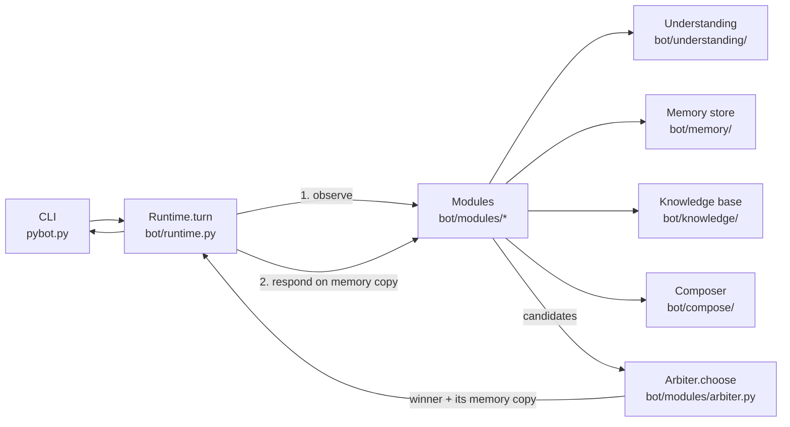
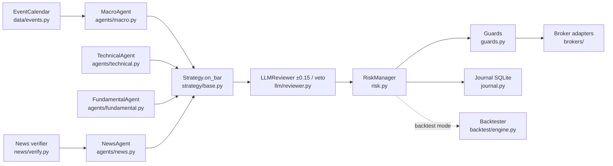
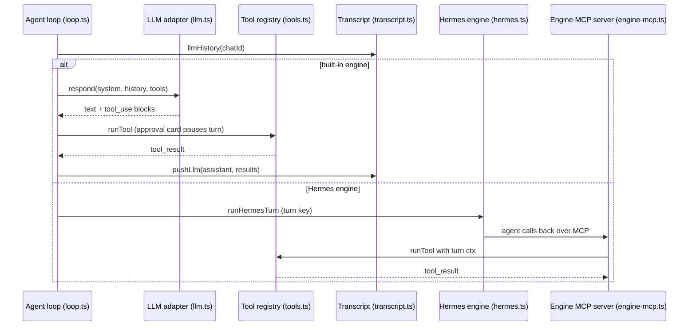

# Agentic AI weekly scan: 2026-11-18

Khoảng quét: repo tạo sau 2026-11-11, `stars:>200`, query `agent OR multi-agent OR agentic` (GitHub search, 100 kết quả). Chọn được **3 repo**, vì phần lớn kết quả là spam, xem [Ghi chú về nguồn](#ghi-chú-về-nguồn--loại-trừ).

## Executive summary

- **Đáng đọc nhất là `huggingface/pybot`.** Đây là sản phẩm của một swarm hơn 1.000 agent viết khoảng 640k LOC rule-based Python. Win-rate trên SmolTalkBench (LLM-judge) tăng từ 0% lên 26%. Kiến trúc runtime nhỏ gọn đáng học: *mọi module cùng propose, một arbiter chọn*, memory dạng copy-on-propose. Code orchestration của swarm thì **không** được public.
- **`risk-aware-trading-agents` có eval methodology tốt nhất tuần.** Harness kiểm tra look-ahead bằng cách thay toàn bộ dữ liệu sau một ngày cắt bằng giá trị ngẫu nhiên, sau đó so trace quyết định; có blind mode để ẩn danh ticker. LLM chỉ đóng vai critic bị chặn biên (±0.15, veto), quyền quyết định cuối thuộc về một risk manager deterministic.
- **`parallax` minh họa pattern engine-agnostic agent loop.** Server sở hữu turn queue, approval card và tool. "Bộ não" có thể là loop built-in (Anthropic Messages API) hoặc một Hermes agent bên ngoài gọi ngược tool qua MCP. Repo mới có 1 commit và engine Hermes chưa được test với agent thật.

## Table of contents

1. [huggingface/pybot](#1-huggingfacepybot)
2. [jackson-cmd/risk-aware-trading-agents](#2-jackson-cmdrisk-aware-trading-agents)
3. [nickvasilescu/parallax](#3-nickvasilescuparallax)
4. [Ghi chú về nguồn & loại trừ](#ghi-chú-về-nguồn--loại-trừ)

---

## 1. huggingface/pybot

Link: https://github.com/huggingface/pybot

### §1 Quick context

- **Pitch:** Chatbot thuần rule-based Python do một swarm hơn 1.000 agent viết, không có weights, ngang SmolLM-360M trên SmolTalkBench.
- **Stack:** Python ≥3.8, stdlib only (không có dependency runtime). Không gọi model lúc chạy.
- **Health:** 714★, khoảng 4 người commit cộng account "Agent Manager", commit cuối 2026-11-16. Có `tests/test_cli.py` (chỉ test CLI). Không thấy CI workflow, chỉ có `dependabot.yml`.

### §2 Architecture deep-dive

> Repo chỉ chứa **artifact** do swarm sinh ra (`bot/`), không chứa orchestrator của swarm. Commit `b9e128b` ghi "Remove code source and interface details from README". Vì vậy phân tích dưới đây là kiến trúc của bot, còn kiến trúc swarm là **không xác định từ code**.

**A. Component inventory**
- `CLI` (`pybot.py`): REPL, `-p`, `-v` in module đã trả lời. Không chứa logic chatbot.
- `Runtime` (`bot/runtime.py`, 120 LOC): "fixed module interface". Docstring ghi rõ swarm *không được sửa* file này. Nó load module, chạy 3 phase, rồi commit memory.
- `Modules` (`bot/modules/*.py`, 110 file như `a_shock_at_a_bill.py`, `aboutachild.py`): mỗi file là một skill nhỏ, khai báo `PRIORITY`, `observe`, `respond`, `after`, và tùy chọn `ANSWERS` (topic).
- `Arbiter` (`bot/modules/arbiter.py`, 5.532 LOC): hàm `choose()` chọn reply. Docstring gọi đây là thứ "the routing lane owns".
- `Understanding engine` (`bot/understanding/`): typo, chat-speak, topic, coreference.
- `Memory store` (`bot/memory/`, ~109k LOC): các reader như `recall`, `repeat`, `lineback`, `named`.
- `Knowledge base` (`bot/knowledge/`, ~317k LOC): facts lưu dưới dạng data.
- `Response composer` (`bot/compose/`, ~104k LOC): phrasing, fallback, các luồng safety (`harm`, `loss`, `badnews`).

**B. Control flow:** pattern là **Blackboard / propose-then-arbitrate** (mọi chuyên gia propose song song, sau đó có một router chọn). Happy path:
1. `runtime.turn(text, memory)` chạy `observe()` của mọi module theo `PRIORITY` giảm dần. Phase này chỉ ghi vào memory.
2. Mỗi module `respond()` trên **deep-copy riêng** của memory (`_copy`), trả về str hoặc None.
3. Các candidate `{"module","priority","reply"}` được đưa vào `arbiter.choose()`.
4. Arbiter áp các rule: specialist (`ANSWERS` khớp topic) thắng generalist; band safety (`PRIORITY ≥ 9000`) không bao giờ bị bỏ qua; không lặp lại reply cũ; không gợi ý món ăn mà user vừa từ chối.
5. Copy memory của candidate thắng **thay thế** memory hội thoại. Sau đó các hook `after()` chạy và `turns` được append.

**C. State & data flow:** message giữa các component là `dict`/`str` không typed. State là một `dict` in-memory cho mỗi process. `memory["turns"]` dùng chung và chỉ runtime được ghi. Không có context window vì không có LLM.

**D. Tool integration:** không có tool calling. "Plugin" chính là file trong `bot/modules/`, được auto-discover qua `pkgutil.iter_modules`.

**E. Memory:** chỉ có short-term trong một phiên (dict). Retrieval bằng regex/keyword reader trong `bot/memory/`. Không có long-term.

**F. Model orchestration:** runtime không dùng model. Phía swarm (model nào, bao nhiêu agent mỗi vai trò): không xác định từ code.

**G. Observability & eval:** `-v` in tên module và latency. `turn()` trả về toàn bộ `candidates` nên có thể replay/debug. Code của LLM-judge eval (SmolTalkBench) không có trong repo.

**H. Extension points:** thêm file vào `bot/modules/` với `respond()`. Có thể khai báo `ANSWERS` hoặc hook `TAKES_AS_IT_COMES(text, memory)` để xin ưu tiên mà không cần tăng `PRIORITY`.

### §3 Diagram

### §4 Verdict

- **Novel:** (1) Ràng buộc kiến trúc để nhiều agent cùng sửa code mà không giẫm chân nhau: runtime bất biến, mỗi agent chỉ thêm module, mỗi module chạy trên memory copy nên một proposal bị loại không để lại side-effect. (2) Arbiter mã hóa "routing policy" bằng prose docstring kèm counter-example cụ thể, giống một spec mà swarm tự viết.
- **Red flags:** `arbiter.py` dài 5,5k LOC và rule bị vá theo từng ca, dấu hiệu overfit vào benchmark. Mọi exception đều bị nuốt (`except Exception: continue`). Repo có ~550k LOC test nhưng không ship.
- **Open questions:** Swarm phối hợp ra sao (các "lane", merge conflict, ai chạy eval)? Win-rate 26% có giữ được trên prompt ngoài phân phối không?

---

## 2. jackson-cmd/risk-aware-trading-agents

Link: https://github.com/jackson-cmd/risk-aware-trading-agents

### §1 Quick context

- **Pitch:** Benchmark cho LLM trading agent, replay news theo đúng phút publish, có harness tự chứng minh không có look-ahead.
- **Stack:** Python ≥3.10, pandas/numpy, pydantic, typer, `mcp`, streamlit (extra). LLM qua Anthropic, OpenAI-compatible, Ollama, hoặc CLI (`claude`/`codex`/`gemini`). Lưu trữ bằng SQLite.
- **Health:** 229★, 50 commit, tất cả mang author "Anonymous". Commit cuối 2026-11-14, version 0.8.0 (lịch sử được import). Có CI (`ci.yml`, `leaderboard.yml`) và 42 file test.

### §2 Architecture deep-dive

**A. Component inventory** (path tính từ `src/riskaware/`)
- `TradingEngine` (`engine.py`): `run_cycle()` cho chế độ paper/live.
- `MacroAgent` (`agents/macro.py`): xếp regime (risk-on/neutral/uncertain/risk-off) theo VIX, breadth, credit.
- `TechnicalAgent` (`agents/technical.py`), `FundamentalAgent` (`agents/fundamental.py`), `NewsAgent` (`agents/news.py`): analyst deterministic.
- `News verifier` (`news/verify.py`): story chỉ được coi là "confirmed" khi có ≥2 nguồn độc lập hoặc có 8-K.
- `EventCalendar` (`data/events.py`): lịch FOMC/CPI/NFP.
- `Strategy` (`strategy/base.py`): interface `on_bar(ctx) → signals`.
- `LLMReviewer` (`llm/reviewer.py`): bull/bear/judge trong **một** call, output theo JSON schema. Adjustment bị kẹp trong ±0.15, có quyền veto.
- `RiskManager` (`risk.py`) và `Guards` (`guards.py`): cash floor, cap, kill switch.
- `Journal` (`journal.py`): SQLite với các bảng `runs/decisions/orders/llm_reviews`.
- `Broker adapters` (`brokers/`), `Backtester` (`backtest/engine.py`).
- `Policy harness` (`research/agent.py`): cho LLM trade trên frozen market từng ngày; có `Blind`, `observation_check`.
- `leak_check` (`research/experiment.py`), `Strategy lab` (`lab.py`, AST checker cho code do LLM viết), `MCP server` (`mcp_server.py`).

**B. Control flow:** pattern là **Hierarchical fan-in pipeline**: các analyst agent → strategy aggregator → LLM critic bị chặn biên → deterministic gate. Đây không phải ReAct. Happy path của `run_cycle`:
1. Data provider và các analyst agent tính regime, setup, earnings, news.
2. `strategy.on_bar(ctx)` sinh `Signal`. Conviction được tính bằng tổng có trọng số `0.55·tech + 0.20·fund + 0.15·news + 0.10·macro`.
3. `LLMReviewer` (tùy chọn) chỉnh conviction trong ±0.15 hoặc veto bằng cách đặt strength = 0.
4. `RiskManager` lập `PlannedOrder` theo regime policy, cap và tranche.
5. `Guards` kiểm tra (paper/live, halt), sau đó broker đặt lệnh và `Journal` ghi decision, order, LLM review.

Ở research mode, `research/agent.py` chạy vòng **observe → orders → fill at next open** cho từng decision day. Session MCP lưu orders xuống đĩa và replay lại để sống sót qua restart.

**C. State & data flow:** dùng typed dataclass/pydantic (`types.py`, `config.py`). LLM trả về JSON validate bằng pydantic (`_Verdict`). State lưu trong SQLite journal, run folder trên disk, và disk cache cho data. Context management: news được `sanitize()` (cắt còn 220 ký tự, đóng khung là untrusted text) và giới hạn bằng `max_news`.

**D. Tool integration:** LLM không gọi tool trực tiếp trong engine. Agent bên ngoài (Claude/Codex) gọi qua `mcp_server.py` (`trading_session_start/step`). Code strategy do LLM viết được `lab.py` kiểm bằng AST visitor (chặn import và truy cập tương lai), sau đó chạy ở process riêng.

**E. Memory:** không có agent memory. `research/memory.py` là **memory probe**, tức là đo xem model có nhớ giá 2026 từ training data hay không, chứ không phải bộ nhớ của agent.

**F. Model orchestration:** mỗi agent có thể cấu hình một provider riêng. Không thấy cơ chế fallback hay routing giữa model trong code đã đọc.

**G. Observability & eval:** đây là điểm mạnh nhất. Gồm `leak_check` (thay dữ liệu sau ngày cắt bằng random, so `_first_difference`, phân biệt các verdict "fail" / "not repeatable"), `observation_check` (digest observation phải trùng nhau trên các market bị poison), blind mode, `reproduce_command`, và leaderboard chấm riêng phần trước/sau training cutoff.

**H. Extension points:** subclass `Strategy` (một method `on_bar`), plug-in provider LLM, broker adapter, hoặc truyền `policy` callable bất kỳ vào `run_policy`.

### §3 Diagram

### §4 Verdict

- **Novel:** Leak check dạng *counterfactual*: poison phần tương lai rồi diff trace quyết định. Cách này kiểm được cả harness lẫn strategy, và tách được "strategy đọc tương lai" khỏi "strategy không deterministic". Blind mode (alias ticker, mask năm/người/sản phẩm, rebase giá) kèm memory probe là thiết kế eval nghiêm túc cho vấn đề contamination. Pattern "LLM as bounded critic" cũng là một guardrail đáng copy.
- **Red flags:** Author ẩn danh và README nhồi keyword SEO. Analyst "agent" thực chất là rule deterministic, không phải LLM agent. Headline đã được license nên không được phân phối, khiến kết quả leaderboard khó reproduce đầy đủ.
- **Open questions:** Bull/bear/judge gộp trong 1 call có thật sự là "debate" không? Chênh lệch giữa điểm trước và sau cutoff lớn đến mức nào?

---

## 3. nickvasilescu/parallax

Link: https://github.com/nickvasilescu/parallax

### §1 Quick context

- **Pitch:** Studio ảnh/video/audio open-source, có agent "Supercomputer" chạy bằng loop built-in hoặc bằng Hermes agent của chính bạn qua MCP.
- **Stack:** TypeScript, Next.js, `node:sqlite`, `@anthropic-ai/sdk` (default `claude-opus-5-5`). Orgo (computer), Composio (connectors), gateway treg.to cho model media.
- **Health:** 202★, 1 contributor, **1 commit** (2026-11-13). Có 14 file test e2e Python. Không thấy CI workflow.

### §2 Architecture deep-dive

Chỉ phân tích phần agent (`src/server/super/`, ~3,3k LOC). Phần studio là CRUD web app nên nằm ngoài scope.

**A. Component inventory**
- `Agent loop` (`src/server/super/loop.ts`): turn queue nối tiếp theo từng chat, `runTurn`, `builtInTurn`, approval (`ask`, `answerCard`), sweep/recovery.
- `LLM adapter` (`src/server/super/llm.ts`): streaming qua Messages API (beta), có adaptive thinking. Mock "scripted brain" dùng cho test.
- `Tool registry` (`src/server/super/tools.ts`): `ToolDef[]` gồm `generate_media`, `quote`, `search_library`, `connect_app`, `remember`, `recall`, `ask_user`, `schedule_chat`. Có `runTool`.
- `Transcript` (`src/server/super/transcript.ts`): SQLite `super_llm` (history LLM append-only) và `super_rows` (UI rows).
- `Hermes engine` (`src/server/super/hermes.ts`): một turn tương ứng một call stream `/v1/responses` tới agent ngoài.
- `Engine MCP server` (`src/server/super/engine-mcp.ts`): MCP Streamable HTTP viết tay, xác thực bằng `SUPER_ENGINE_TOKEN`, giữ keepalive cho tool chạy lâu.
- `Config/limits` (`src/server/super/config.ts`): `maxSteps` (12), `turnMs` (5 phút, không tính thời gian chờ user), `approvalMs`.
- `Memory library` (`src/server/super/library.ts`), `Computer` (`src/server/super/computer.ts`, Orgo), `Connectors` (`src/server/super/connectors.ts`, Composio), `Schedules` (`src/server/super/schedules.ts`).

**B. Control flow:** pattern là **ReAct-style tool loop** (native function calling) có **human-in-the-loop gate**, và "brain" có thể thay được. Happy path của built-in engine:
1. `postMessage` enqueue một turn. `kick` khởi động turn nếu chat đang rảnh (mỗi chat chỉ chạy một turn tại một thời điểm).
2. `builtInTurn` gọi `llm().respond()` với system prompt, `llmHistory` và tools. Text được stream vào UI row, flush mỗi ~120ms.
3. Nếu model trả về `tool_use`, gọi `runTool` cho từng call theo thứ tự. Riêng `generate_media` ở mode "ask" sẽ gọi `ctx.ask("approval")` và **treo turn** cho đến khi user trả lời card.
4. `tool_result` được `pushLlm` vào history. Loop lặp lại cho tới khi hết tool call, gặp `refusal`, chạm `maxSteps`, hết timeout, hoặc bị abort.

Với Hermes engine, bước 2 và 3 được thay bằng agent ngoài. Agent đó gọi ngược `/api/super/mcp` kèm `turn` key, và key này chết cùng turn.

**C. State & data flow:** typed block của Anthropic SDK (`BetaMessageParam`). History append-only, replay nguyên văn để thinking block vẫn hợp lệ. State lưu trong SQLite và trong `globalThis.__superLoop` (Map các turn đang chạy và waiters). Context management: **không có** compaction hay summarization. `llmHistory` load toàn bộ history của chat.

**D. Tool integration:** native function calling (`input_schema`). Tool không tồn tại sẽ trả về error result. Mọi tool call đều nhận được result kể cả khi bị stop ("history stays well formed"). Engine ngoài dùng tool qua MCP. Input được kiểm bằng helper `S()` (giới hạn độ dài).

**E. Memory:** long-term là các fact `remember`/`recall` lưu trong `super_memories`. Recall dùng **substring match** (`includes`), giới hạn 50 kết quả. Có 40 memory gần nhất được nhét vào system prompt. Chế độ incognito không lưu gì.

**F. Model orchestration:** user chọn model trong `LLM_MODELS`, `auto` sẽ dùng `SUPER_LLM_MODEL` hoặc mặc định `claude-opus-5-5`. Không có fallback, tool call chạy tuần tự.

**G. Observability & eval:** mỗi turn có `steps`, `status` và timestamps trong `super_turns`. Mỗi tool call là một row có status/summary. Không thấy OpenTelemetry hay Langfuse. Test e2e chạy với mock LLM.

**H. Extension points:** thêm `ToolDef` vào `tools.ts`, đổi engine bằng `SUPER_ENGINE=hermes`, dùng skills/projects qua `src/app/api/super/skills/route.ts`.

### §3 Diagram

### §4 Verdict

- **Novel:** Tách bạch giữa *ai suy nghĩ* và *ai sở hữu tài nguyên*. Engine ngoài không bao giờ giữ provider key hay session của user. Mọi chi tiêu credit đều đi qua approval card của server, và capability gắn theo từng turn qua turn key. Thời gian chờ approval không bị tính vào time budget của turn.
- **Red flags:** Repo chỉ có 1 commit. Hermes engine "chưa chạy với agent thật". Không có context compaction, nên chat dài sẽ vỡ context. Tool riêng của Hermes (shell, files) nằm ngoài approval. State nằm trong `globalThis` nên chỉ chạy được một instance.
- **Open questions:** Làm sao chống agent ngoài replay `turn` key? Có kế hoạch summarize history không?

---

## Ghi chú về nguồn & loại trừ

- **Spam:** khoảng 70% kết quả search là các repo clone hàng loạt được tạo cùng phút với star bị thổi phồng (`*/ai--manus`, `*/GitHub-Copilot-app`, `*/blender-ai-*`). Không có source (`language: null`), có thể là malware lure, nên bị loại.
- **< 500 LOC:** `RouteInferno/shamus-osint-ai-agent` (122 LOC), `sybil-solutions/inference-optimisation-skill` (313 LOC).
- **Skill/prompt pack, không có kiến trúc agent:** `boringmarketer/boring-marketing-skills`, `kociden/sakurai-skill`, `vaibhav-space/my-ai-coding-workflow`, `roan-maverick/tradingview-indicator-for-ai-agents`.
- **Không phải agent architecture:** `leostera/git-twig` (Rust tool worktree cho agent, đáng theo dõi nhưng là infra), `berkantay/gpucanvas`.
- **Verify link:** proxy của môi trường chặn trang HTML GitHub, nên link được verify bằng `git ls-remote` và endpoint smart-HTTP `info/refs` (HTTP 200) cho cả 3 repo.
