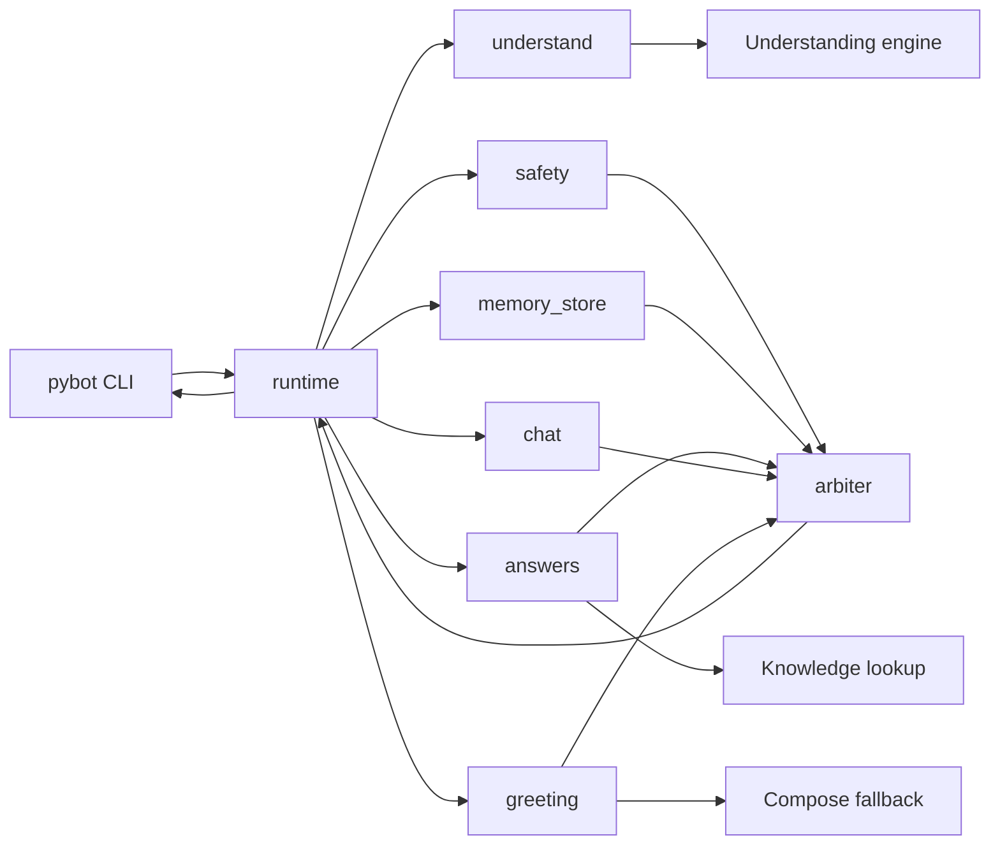
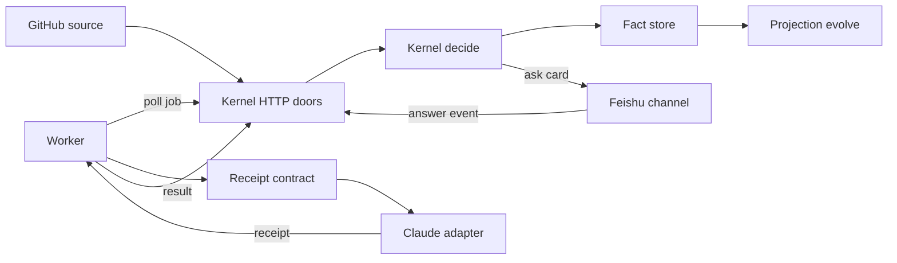
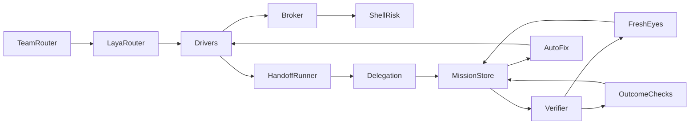
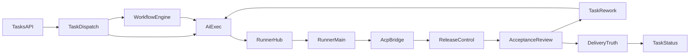

# Weekly agentic scan: 2026-11-19

> Cửa sổ quét: 2026-11-12 → 2026-11-19. Nguồn: GitHub search API (`created:>2026-11-12 stars:>200`, mở rộng sang các repo cập nhật mạnh trong tuần với `stars:>500`).

## Executive summary

- **Chủ đề nổi bật tuần này là "done phải có bằng chứng".** kwant và SoduWork đều không cho agent tự tuyên bố hoàn thành. kwant dùng SQLite trigger để chặn task chuyển sang `verified` khi chưa có check pass từ người khác, không phải owner của task. SoduWork bắt mỗi tiêu chí phải có evidence, và `DeliveryTruth` là cổng duy nhất để đóng task.
- **Kỹ thuật hệ phân tán đang được mang vào orchestration cho CLI agent.** agent-autoloop dựng một kernel deterministic với event sourcing. Agent chạy như process CLI và trả về một "receipt" JSON. Hệ được kiểm thử bằng simulation và mutation test.
- **huggingface/pybot là kết quả thực nghiệm thú vị nhưng không tái lập được.** Một swarm hơn 1.000 agent đã viết khoảng 640k dòng rule Python và đạt win rate 26% trên SmolTalkBench. Tuy vậy repo không chứa swarm orchestrator, eval harness hay test suite.

## Mục lục

1. [huggingface/pybot](#1-huggingfacepybot): swarm-generated rule-based chatbot
2. [KKKKhazix/agent-autoloop](#2-kkkkhazixagent-autoloop): event-sourced kernel cho background CLI agent
3. [alexsergivan/kwant](#3-alexsergivankwant): team bot với cross-verification enforce ở DB
4. [mdiri-ai/SoduWork](#4-mdiri-aisoduwork): multi-harness workflow engine với sign-off contract
5. [Phương pháp & repo bị loại](#phương-pháp--repo-bị-loại)

---

## 1. huggingface/pybot

### §1 — Quick context
- **Pitch:** Chatbot thuần Python, ~640k dòng if-else/regex/lookup table, do swarm >1.000 agent viết, không model, không weights.
- **Tech stack:** Python ≥3.8, chỉ standard library (`dependencies = []`), setuptools; demo trên HF Space.
- **Repo health:** 852 stars, ~6 git authors (gồm "Agent Manager"), push cuối 2026-11-16; không có CI (`.github/workflows` vắng), `tests/test_cli.py` chỉ test CLI (12 test).

### §2 — Architecture deep-dive

**A. Component inventory**
- `pybot CLI` (`pybot.py`) — command line (interactive/`-p`/pipe), ghim `SOURCE_COMMIT`; không chứa logic bot.
- `runtime` (`bot/runtime.py`) — "fixed interface": load mọi module trong `bot/modules/`, chạy 3 phase observe → respond → choose.
- `understand` (`bot/modules/understand.py`) — module PRIORITY 10000, ghi `memory["understood"]` trước mọi module khác.
- `Understanding engine` (`bot/understanding/__init__.py`) — normalize (typo, chat-speak) → kinds (intent) → topics → references (coreference "it/that").
- `memory_store` (`bot/modules/memory_store.py`) — PRIORITY 7000, lưu/recall fact người dùng (tên, dị ứng, kế hoạch).
- `safety` (`bot/modules/safety.py`) — PRIORITY 9000, band khẩn cấp không bao giờ bị override.
- `answers` (`bot/modules/answers.py`) — trả lời từ knowledge base, khai báo `ANSWERS` = union topic các domain.
- `Knowledge lookup` (`bot/knowledge/lookup.py`) — matcher chung trên `ENTRIES` của từng domain file.
- `chat` (`bot/modules/chat.py`) — small talk, PRIORITY 300.
- `greeting` (`bot/modules/greeting.py`) — floor module PRIORITY -1000.
- `arbiter` (`bot/modules/arbiter.py`) — 5.5k dòng heuristic chọn candidate (specialist > generalist, chống lặp, safety-first).
- `Compose fallback` (`bot/compose/fallback.py`) — câu trả lời khi không gì khớp.

**B. Control flow — rule-based pipeline với blackboard + arbiter (không phải LLM agent).** Happy path:
1. `pybot CLI` gọi `runtime.turn(text, memory)`.
2. Phase observe: `understand` gọi `Understanding engine`, `memory_store` ghi fact.
3. Phase respond: ~110 module (`safety`, `memory_store`, `answers`, `chat`, `greeting`…) mỗi module đề xuất reply trên bản deep-copy của memory.
4. `arbiter.choose()` chọn một candidate; bản memory của module thắng trở thành memory hội thoại.
5. Hook `after()` chạy, runtime append `{"user","bot","module"}` vào `memory["turns"]`; reply trả về CLI.

**C. State & data flow:** một dict `memory` duy nhất làm blackboard (keys `turns`, `understood`, `user`, `others`, `topic`, `facts_log`…, document trong `bot/memory/__init__.py`). Copy-on-propose: candidate thua không để lại side effect. Mọi exception bị nuốt, fallback "Hello!".

**D. Tool integration:** không có — không network, không file I/O, không subprocess trong `bot/` (grep import trống). Knowledge nhúng thẳng thành `.py` data.

**E. Memory:** short-term trong session (`memory_store`, `bot/memory/` ~117 file); `/reset` xóa sạch, không persistence.

**F. Model orchestration:** không có LLM lúc runtime. Phần "swarm >1.000 agent, >5.000 version" chỉ được mô tả trong README; code điều phối swarm **không có trong repo**. Dấu vết duy nhất là docstring nhắc "routing lane", "conversation lane", "answers lane", "every arm of the swarm lands at once", và file `STYLE.md` được tham chiếu nhưng không tồn tại → bot/ là snapshot copy từ repo swarm riêng (commit `24cbc04`).

**G. Observability & eval:** observability = flag `-v` in tên module + latency. Eval SmolTalkBench (LLM judge so với reference, win rate 0%→26%) **không xác định từ code** — không có harness, prompt judge hay dataset loader; 550k dòng test của agent cũng không được publish ("the bot's own tests live in the swarm's repository").

**H. Extension points:** thêm file vào `bot/modules/` với `PRIORITY` + `observe/respond/after`, tùy chọn `ANSWERS`, `TAKES_AS_IT_COMES`; thêm domain = một file `ENTRIES` trong `bot/knowledge/`. Auto-discovery qua `pkgutil`, không registry.

### §3 — Architecture diagram


### §4 — Verdict
**Novelty:** artifact thực nghiệm hiếm — chứng minh swarm agent có thể "compile" hành vi chatbot thành symbolic code ngang SmolLM-360M; interface cố định (`runtime.py` bất biến, module tự đăng ký, arbiter riêng một "lane") là pattern hay để chia việc song song cho nhiều agent mà ít merge conflict. **Red flags:** chỉ là output, không có quy trình — swarm orchestrator, eval harness và test suite đều vắng nên kết quả 26% không tái lập được; file khổng lồ (`chat.py` 16.7k, `safety.py` 12k dòng), `except Exception` khắp nơi che lỗi; khởi động vài giây. **Open questions:** judge model nào, có overfit SmolTalkBench không, và bao giờ repo swarm/harness được công bố?


---

## 2. KKKKhazix/agent-autoloop

### §1 — Quick context

**Pitch:** Biến CLI agent (Claude Code, Codex…) thành vòng lặp nền chạy theo event, chỉ gửi card khi cần con người quyết định.

**Tech stack:** TypeScript chạy thẳng trên Node ≥24 (`node:sqlite`, `node:test`), không có runtime dependency nào, SQLite append-only log, giao thức HTTP + JSON.

**Repo health:** 5.938 stars, ~9 git authors (chủ yếu Khazix và argszero), 44 commit trong 7 ngày, push gần nhất 2026-11-19. CI `check.yml` chạy trên Ubuntu/macOS/Windows, `nightly.yml` chạy simulation và benchmark; khoảng 90 file test cùng thư mục `sim/` (crash, mutation, enumerate).

### §2 — Architecture deep-dive

**A. Component inventory**
- `CLI entry` (`bin/agent-autoloop.ts`): entry point, chuyển sang `cli/main.ts` (status, answer, why, try…).
- `Kernel decide` (`kernel/decide.ts`): hàm thuần `decide(view, input, now, env)` nhận một input và chỉ sinh ra facts; mọi thay đổi trạng thái đều đi qua `HANDLERS` (ingest, createCard, tell, rules…).
- `Fact store` (`kernel/store.ts`): append fact log và `commit`/`rebuild` trong cùng transaction SQLite.
- `Projection evolve` (`kernel/evolve.ts`): là thành phần duy nhất ghi projection tables (runs, cards, deliveries, timers…).
- `Kernel HTTP doors` (`kernel/http.ts`): định nghĩa endpoint, loại key được yêu cầu và input tương ứng; bản thân không quyết định gì.
- `Host runtime` (`host/runtime.ts`): mở `hub.db`, hàm `execute()` gọi decide rồi commit, reload `rules.json`, chạy tick.
- `Plugin loader` (`host/plugins.ts`): nạp `plugins/<name>/{agent,channel,source}.ts`, ưu tiên bản trong thư mục cài đặt.
- `Protocol client` (`protocol/client.ts`) và `Validator` (`protocol/validate.ts`): HTTP client, parse event và receipt.
- `Worker` (`worker/worker.ts`): poll để lấy job, spawn agent thành process group tách rời, theo dõi heartbeat/stop, lưu kết quả ra file trước khi nộp.
- `Receipt contract` (`worker/contract.ts`): dựng prompt (`promptFor`) và parse khối ` ```agent-autoloop ` ở message cuối.
- `Claude adapter` (`plugins/claude/agent.ts`): dựng command `claude -p … --resume/--session-id --permission-mode`.
- `GitHub source` (`plugins/github/source.ts`): verify HMAC webhook rồi chuyển thành event.
- `Feishu channel` (`plugins/feishu/channel.ts`): gửi card và nhận lại click trả lời.
- `MCP server` (`cli/mcp.ts`): mở các endpoint của hub dưới dạng MCP tools qua stdio.
- `Simulator` (`sim/random.ts`): mô phỏng mất gói, crash, request trùng, có thể tái lập từ seed.

**B. Control flow** — pattern **event-driven**, kết hợp state machine cho runs (`queued → claimed → done/nothing/cancelled/unknown`) và cards (`open → decided → done`):
1. `GitHub source` (hoặc cron/tick) gửi event; `Kernel HTTP doors` chuyển nó thành input `ingest`.
2. `Kernel decide` so event với rules, gộp vào "matter" (rule + lane) rồi enqueue một run; `Fact store` commit.
3. `Worker` long-poll lấy job; `Receipt contract` dựng prompt, còn nội dung bên ngoài được ghi vào context file và đánh dấu là "dữ liệu".
4. `Claude adapter` chạy agent một lượt, agent kết thúc bằng một receipt (`ask/notice/resolve/later/events`).
5. `Worker` nộp result; `Kernel decide` áp dụng receipt trong một transaction. Nếu có `ask` thì tạo card và `Feishu channel` giao card đó.
6. Câu trả lời của người dùng trở thành event mới, run tiếp theo resume đúng session cũ.

**C. State & data flow:** Event sourcing: fact log là nguồn sự thật duy nhất, projection được rebuild khi format fingerprint thay đổi nên không cần migration. Worker lưu `worker/runs/<run>-<attempt>/entry.json` cùng stdout và exit file.

**D. Tool integration:** Bản thân agent không được cấp tool nào của hub, mọi yêu cầu đều nằm trong receipt. Quyền truy cập ánh xạ `access` (read/edit/full) sang `--permission-mode` của từng CLI. Có thêm `MCP server` cho client bên ngoài.

**E. Memory:** Không có vector/long-term memory. "Memory" ở đây gồm session resume của CLI agent, cộng với `answers/decided/timers` được ghi vào context file mỗi lượt.

**F. Model orchestration:** Không gọi LLM API trực tiếp. Model, effort và tier chỉ được truyền xuống CLI qua `rules.json`, và rules quyết định agent nào nhận event. Hop circuit breaker dừng chuỗi dispatch khi vượt `MAX_HOPS = 8`, đồng thời giới hạn `MAX_ATTEMPTS = 10`.

**G. Observability & eval:** `agent-autoloop why <run>` dựng lại timeline của một run từ log; `cli/status.ts` và `cli/spend.ts` thống kê token và chi phí. Phần eval là `Simulator` (200k bước), crash test, mutation test và `scripts/benchmark.ts`; không có eval chất lượng output của agent.

**H. Extension points:** Plugin `agent.ts` / `channel.ts` / `source.ts` (template trong `examples/plugins/`), `use: "command"` cho một CLI bất kỳ, `use: "acp"`, lệnh `agent-autoloop add <git>`.

### §3 — Architecture diagram



### §4 — Verdict

**Novelty:** Áp dụng các pattern hệ thống phân tán cho CLI agent một cách triệt để: kernel thuần, deterministic (không đọc clock, không dùng randomness, không gọi ra ngoài); event sourcing; tách code và data giống parameterized SQL để giảm prompt injection; "zero-cost wait", tức agent process thoát hẳn trong lúc chờ người. Hệ simulation và mutation testing có độ nghiêm ngặt hiếm thấy với một agent tool.

**Red flags:** `kernel/decide.ts` (848 dòng) và `cli/main.ts` (958 dòng) khá lớn; code dùng `any[]` cho args. CLI output và docs chủ yếu bằng tiếng Trung. Việc dùng subscription cá nhân cho tác vụ tự động có rủi ro về ToS (chính README đã cảnh báo). Nhiều adapter và webhook mới chỉ được test với mock.

**Open questions:** Khả năng scale khi log phình to (rebuild 1,1 triệu facts mất 43 giây)? Có hỗ trợ multi-hub hay chỉ chạy single-node?


---

## 3. alexsergivan/kwant

### §1 — Quick context
**Pitch:** Một team bot AI tự host, giao việc cho nhau bằng @mention và chỉ báo "done" khi có check độc lập xác nhận.
**Tech stack:** Rust (Tokio, Axum, SQLite/sqlx) + React (Vite) embed vào một binary `kwnt`; engine là Claude/Codex/Grok CLI, API Anthropic/OpenAI/xAI, Ollama.
**Repo health:** 703 stars; 2 git author (46/50 commit của maintainer, 4 của "Ada (kwant bot)"); push gần nhất 2026-11-19; ~263k dòng Rust, 242 file trong `tests/`, 8 workflow GitHub Actions (`ci.yml`, mac/linux/windows…).

### §2 — Architecture deep-dive

**A. Component inventory**
- `LayaRouter` (`src/router/laya.rs`): sidecar router (Laya) chọn engine/model tier, có fallback heuristic khi timeout.
- `TeamRouter` (`src/router/team.rs`): `TeamDecision`, chọn bot nào trong team trả lời.
- `HandoffRunner` (`src/server/routes.rs`): `run_handoffs` parse @mention, xếp hàng teammate theo dependency, `MAX_HANDOFFS = 4` cho channel thường.
- `Delegation` (`src/server/delegation.rs`): lead giao task cho specialist chạy thread nền rồi báo về; `MAX_DEPTH = 2`, `MAX_OPEN_PER_LEAD = 5`.
- `KeepGoing` (`src/server/keep_going.rs`): phát hiện chain bị kẹt, cho lead thêm tối đa 2 turn rồi hiện card "Keep going?".
- `Drivers` (`src/drivers/cli.rs`, `src/drivers/api.rs`): chạy turn qua CLI hoặc HTTP API.
- `Broker` (`src/broker/mod.rs`): `ApprovalDecision`, hàng đợi approval card.
- `ShellRisk` (`src/mcp/shell_risk.rs`): allowlist fail-closed cho chế độ `smart`.
- `FlightSchool` (`src/server/missions/flight_school.rs`): tier `observe/sandbox/act`, chỉ thêm card chứ không bỏ card.
- `MissionStore` (`src/db/missions.rs`): bảng `tasks`, claims, evidence, `outcome_checks`, kèm SQLite trigger.
- `MissionTools` (`src/server/missions/tools.rs`): `task_claim`, `task_update`, `task_request_check`, `task_review`…
- `OutcomeChecks` (`src/server/missions/checks.rs`): kwant tự chạy check `command`/`http`/`file_*`.
- `Verifier` (`src/server/missions/verifier.rs`): verdict pass/fail/needs-you, chọn model khác author, có mutation testing.
- `FreshEyes` (`src/server/fresh_eyes.rs`): reviewer turn không có chat history, tool bị giới hạn.
- `AutoFix` (`src/server/missions/autofix.rs`): phân loại failure một cách deterministic và lên lịch retry.
- `MemoryRecall` (`src/server/memory_recall.rs`): hybrid search (embedding + FTS5 bm25, RRF).
- `TruthLedger` (`src/db/truth_ledger.rs`): trigger mirror memory sang `knowledge_facts`.

**B. Control flow — pattern: swarm-handoff** (thêm lớp hierarchical khi lead của team dùng `Delegation`).
1. Tin nhắn của người dùng đi qua `TeamRouter`/`LayaRouter` để chọn bot và model.
2. `Drivers` chạy turn. Mỗi tool call đi qua `Broker` + `ShellRisk` + `FlightSchool`.
3. Reply có @mention thì `HandoffRunner` enqueue teammate (không ping-pong, có xét thứ tự "after @X"). Nếu là lead thì chuyển sang `Delegation`, và `MissionStore` tạo task `source_kind=delegation`.
4. Owner chuyển task sang `review`. `Verifier` thêm một *hold* `peer_review`, rồi chạy turn `FreshEyes` trên clean copy với model khác, qua các bước `contract → reproduce → mutation → attack → scope`. Song song, `OutcomeChecks` chạy các check đã được duyệt.
5. Khi có một check pass không phải của owner, task thành `verified` (trigger chặn mọi đường khác). Fail lần đầu thì task quay lại owner hoặc `AutoFix`. Fail lần hai thì vào Inbox "Needs you".

**C. State & data flow:** Toàn bộ state nằm trong SQLite. State machine của task (`backlog→ready→working→review→verified/failed`) được enforce hai lần, trong Rust và bằng trigger, ví dụ `RAISE(ABORT, 'a task is verified only by a passing check that is not its owner''s')`. `task_events` là append-only. Lease/claim có hạn.
**D. Tool integration:** MCP client/registry (`src/mcp/`), tool nội bộ (`src/tools/`), browser sandbox, Composio. Check do owner tự thêm luôn ở trạng thái `needs_approval`.
**E. Memory:** Note riêng của từng bot cộng với hybrid recall (`MemoryRecall`). Lessons được suy ra lúc đọc từ `task_failures`, nên bot không tự sửa được. `TruthLedger` chạy ở shadow mode.
**F. Model orchestration:** Multi-account failover theo quota (schema `profiles`). `Verifier::choose_model` ưu tiên family khác, sau đó đến tier khác.
**G. Observability & eval:** `tracing`, SSE `RuntimeEvent`, export receipts CSV, chỉ số tỷ lệ người dùng lật verdict của verifier. Không thấy benchmark eval agent; eval là test tích hợp + chính các outcome check.
**H. Extension points:** MCP servers, skill do bot đề xuất (người dùng duyệt), team preset JSON (`src/teams/presets.json`), import subagent/SKILL.md, custom OpenAI/Anthropic-compatible endpoint.

### §3 — Architecture diagram


### §4 — Verdict
**Novelty:** Phần đáng chú ý nhất là "verified" không dựa vào lời bot. Ràng buộc này được enforce ở tầng DB bằng SQLite trigger. Thêm vào đó, verifier chạy trên model khác, đọc clean copy và có mutation testing để kiểm tra test của chính author. Approval `smart` dùng shell parser fail-closed, còn payment, khóa cửa Home Assistant luôn hỏi người dùng.
**Red flags:** Khoảng 263k LOC trong khoảng 4 tuần, gần như một tác giả, kèm bot tự commit. Comment trỏ tới contract nằm ngoài repo (`/home/maus/shared/...`). Code chứa nhiều nhật ký sự cố theo ngày. `routes.rs` dài khoảng 7.9k dòng. License AGPL.
**Open questions:** Nếu chỉ có một engine thì "fresh eyes" thực chất là cùng model, chỉ khác tier, vậy độc lập đến mức nào? Chi phí token của verifier/mutation ra sao? `smart` mode cho chạy script trong folder mà không cần card.


---

## 4. mdiri-ai/SoduWork

### §1 — Quick context
- **Pitch:** Bàn làm việc tự host cho team và agent của họ. Mỗi request chỉ đóng khi người yêu cầu sign-off, không phải khi AI trả lời xong.
- **Stack:** FastAPI + SQLAlchemy/Alembic (SQLite/PostgreSQL), Runner Python qua WebSocket, React/Vite admin, Electron desktop, ACP (Agent Client Protocol).
- **Health:** 2997★, khoảng 48 author, push gần nhất 2026-11-19 (≥50 commit/7 ngày). Có 4 workflow CI (ci, packages, release, security) và khoảng 480 file test/e2e ở `hub-backend/`.

### §2 — Architecture deep-dive

**A. Component inventory**
- `HubApp` (`hub-backend/app/main.py`): entry FastAPI của Hub.
- `AgentCatalog` (`hub-backend/app/agent_catalog.json`, `hub-backend/app/agent_catalog.py`): khai báo 9 harness (transport `direct|runner`, adapter `native|acp`, modelMode, access modes). File được validate khi load và không bao giờ cài đặt hay thực thi gì.
- `LocalProfiles` (`hub-backend/app/services/local_base.py`): sinh `_PROFILES` từ catalog. Pi/OpenCode/Codex dùng native argv, các harness còn lại đi qua ACP profile.
- `AcpAgents` (`hub-backend/app/services/acp_agents.py`): biến spec ACP thành lệnh chạy bridge.
- `AcpBridge` (`hub-backend/app/services/acp_bridge.py`): subprocess bridge ACP v1 (NDJSON JSON-RPC: `session/new`, `session/prompt`, `session/update`, `session/request_permission`). Bridge chuẩn hoá event và giới hạn file/terminal trong workspace của task.
- `TasksAPI` (`hub-backend/app/api/tasks.py`): các route `/ai-dispatch`, `/auto-review`, `/review`, `/reject-artifact`.
- `TaskDispatch` (`hub-backend/app/services/task_dispatch.py`): kiểm tra quota, chặn tạo executor trùng, rẽ nhánh giữa workflow project và direct dispatch.
- `AiExec` (`hub-backend/app/services/ai_exec.py`): resolve assignee/agent theo capability rồi gọi `dispatch_sync`.
- `RunnerHub` (`hub-backend/app/services/runner_hub.py`): registry Runner online, `pick_for`/`pick_by_tags`, reserve capacity, RPC `call_sync`.
- `RunnerMain` (`hub-backend/runner_main.py`): Runner nhận `job.dispatch`, `job.status`, `job.stop`, `mcp.call`...
- `WorkflowEngine` (`hub-backend/app/services/workflow_engine.py`): chạy đồ thị node của plugin (`ai`, `ai_review`, `quality`, `human_review`, `approval`, `merge`, `deploy`, `condition`).
- `AcceptanceReview` (`hub-backend/app/services/task_acceptance_review.py`): validate báo cáo AI theo từng tiêu chí, mỗi tiêu chí phải có evidence.
- `ReleaseControl` (`hub-backend/app/services/release_control.py`): ArtifactVersion bất biến, ApprovalRequest/Decision.
- `DeliveryTruth` (`hub-backend/app/services/delivery_truth.py`): tính `canComplete`/blockers từ các record đang có.
- `TaskStatus` (`hub-backend/app/services/task_status.py`): writer tập trung cho các trạng thái `todo/doing/done/cancel`.
- `TaskRework` (`hub-backend/app/services/task_rework.py`): khi bị reject thì trả feedback về executor.

**B. Control flow:** **state machine-graph**. Task có state machine, còn plugin là DAG node có điều kiện `when`.
1. User tạo request có acceptance criteria rồi gọi `POST /tasks/{tid}/ai-dispatch`.
2. `TaskDispatch` gửi task vào `WorkflowEngine` nếu là project được quản lý. Nếu không, `AiExec` chọn agent/Runner qua `RunnerHub`.
3. `RunnerMain` nhận `job.dispatch` và chạy harness native, hoặc chạy `AcpBridge` cho harness ACP.
4. Output được đóng gói thành ArtifactVersion. Node `ai_review` hoặc `/auto-review` gửi báo cáo từng tiêu chí, `AcceptanceReview` kiểm tra rồi `ReleaseControl.decide`.
5. Nếu reject, `TaskRework` trả việc về. Nếu approve, người tạo request sign-off qua `/review`.
6. `TaskStatus.mark("done")` chỉ chạy khi `DeliveryTruth.canComplete` đúng.

**C. State & data flow:** Toàn bộ trạng thái nằm trong DB (Task, WorkflowRun/NodeRun, ArtifactVersion, ApprovalRequest). Review gắn với `artifactVersionId` và `requirementVersion` (optimistic lock). Khi engine đang sở hữu task thì không writer nào khác được ghi đè.

**D. Tool integration:** ACP permission/terminal gate nằm trong bridge. MCP management và `mcp.call` chạy trên Runner. Task creation/dispatch còn được expose thành MCP server (`hub-backend/app/api/task_mcp.py`).

**E. Memory:** Có `session_memory.py` (import session riêng tư, cách ly theo owner, không promote thành knowledge) và `memory_record_models.py`. Code cho thấy đây là record store, không phải vector memory.

**F. Model orchestration:** Model catalog (`model_catalog.py`) cùng proxy OpenAI-compatible (`api/ai_proxy.py`) cấp model cho harness có `modelMode: managed`. Mỗi bước/node chọn harness và model riêng, nên executor và reviewer có thể dùng model khác nhau.

**G. Observability & eval:** Có `task_events`, `audit.log`, `usage_ledger` (idempotent), `runtime_telemetry` (cửa sổ bounded, code tự ghi chú là không thay OTel) và quality gate. Ngoài acceptance review thì không thấy eval harness offline cho chất lượng agent.

**H. Extension points:** Thêm harness ACP bằng một entry JSON trong catalog. Plugin là workflow JSON (`hub-backend/plugins/*.json`). Ngoài ra có skills (`skills/`) và connector/IM adapter.

### §3 — Architecture diagram


### §4 — Verdict
**Novelty:** "Done" được định nghĩa bằng hợp đồng: AI review phải kèm evidence cho từng tiêu chí và khớp với verdict tổng, decision gắn vào artifact version bất biến, còn `DeliveryTruth` là cổng duy nhất để đóng task. Harness được trừu tượng hoá thành catalog khai báo cộng một ACP bridge chung, nên thêm harness không cần sửa phần dispatch.

**Red flags:** Có các module rất lớn (`workflow_engine.py` khoảng 2.4k LOC, `runner_main.py` khoảng 2.6k LOC). Import cục bộ dày đặc bên trong hàm, có thể để che vòng phụ thuộc. Comment và chuỗi lỗi lẫn tiếng Trung, có cả chuỗi escape `\u`. Còn tên kế thừa `multica.*`. Test để phẳng ở root.

**Open questions:** Tách vai giữa executor và reviewer có được ép buộc bằng code không, hay chỉ là cấu hình? ACP sandbox đang là `false`, vậy cách ly thực tế chỉ dựa vào giới hạn workspace của bridge?


---

## Phương pháp & repo bị loại

**Lý do chọn:** pybot được tạo ngày 2026-11-12, nằm sát mép cửa sổ quét, và có push trong tuần. Ba repo còn lại có 44 đến hơn 600 commit trong 7 ngày nên tính là "significantly updated". Query gốc (`created:>2026-11-12 stars:>200`) chỉ còn chưa đến 4 repo sau khi lọc nên phải mở rộng.

**Bị loại:**
- Khoảng 80 kết quả là clone spam trùng mô tả "AI Manus" / "GitHub-Copilot-app". Các repo này không có ngôn ngữ, được tạo hàng loạt trong vài phút và có star bất thường, nhiều khả năng là mồi phát tán malware.
- `RouteInferno/shamus-osint-ai-agent`: khoảng 271 LOC, README chủ yếu là marketing kèm link tải bản Windows.
- Skill/prompt pack (`boring-marketing-skills`, `inference-optimisation-skill`, `diego3g/craft`, `my-ai-coding-workflow`, …): thuộc nhóm prompt-engineering, không có kiến trúc.
- `leostera/git-twig`: tool git worktree, không phải agent architecture.
- `nickvasilescu/parallax`, `simplexai-labs/linger`, `hevnsnt/CVEngine`: đã clone để triage nhưng xếp hạng thấp hơn 4 repo trên. Lý do: trọng tâm là sản phẩm hoặc UI, hoặc security scanner mà phần agent chỉ là phụ. Giới hạn của báo cáo là tối đa 4 repo.

**Self-check:**
- [x] Link repo: `git ls-remote` / smart-HTTP endpoint trả HTTP 200 cho cả 4 repo. Trang web `github.com/<repo>` bị proxy của môi trường chặn (403), không phải do repo.
- [x] Không có awesome-list hay tutorial.
- [x] §2.A: mọi file path đã được kiểm tra tồn tại trong bản clone.
- [x] §2.B: mỗi repo có control-flow pattern được đặt tên rõ ràng.
- [x] §3: cả 4 diagram parse/render thành công bằng `@mermaid-js/mermaid-cli` 11.4.2.
- [x] §3: mọi node trong diagram đều trùng tên một component ở §2.A (kiểm tra bằng script).
- [x] §4: novelty nêu cụ thể.
- Ghi chú: phần 2 và 3 dài hơn mức 800 từ một chút nếu tính cả code block và path.
