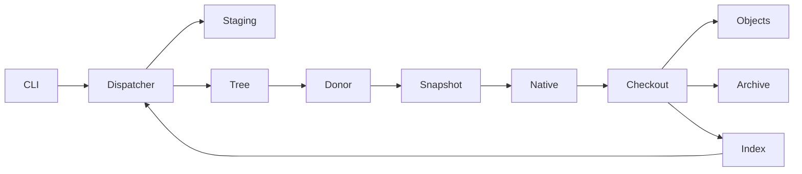
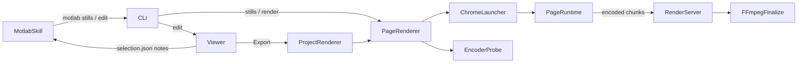
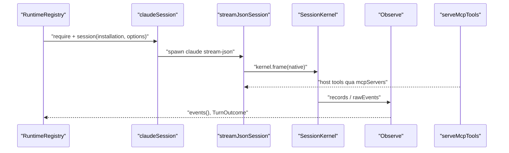
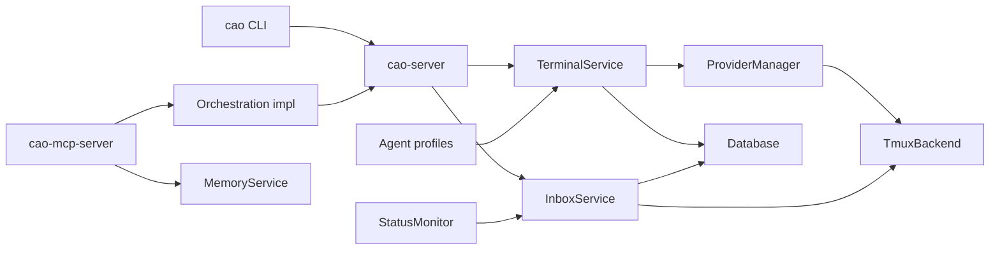

# Agentic AI weekly scan — 2026-11-20

Cửa sổ quét: 2026-11-13 → 2026-11-20.

## Executive summary

- **Xu hướng chính: "infra cho agent" thay vì "agent framework".** Cả 4 repo đều không tự viết vòng ReAct. Chúng dựa vào harness native (Claude Code, Codex…), rồi giải bài toán xung quanh: worktree isolation (`git-twig`), điều phối nhiều CLI (`cli-agent-orchestrator`), API thống nhất cho mọi harness (`oar`), và vòng review người↔agent dựa trên file (`motlab`).
- **Pattern đáng học:**
  - Record stream lossless làm source of truth (`oar`).
  - Tách 3 kiểu delegation sync/async/inbox, inbox gated theo trạng thái IDLE (`cli-agent-orchestrator`).
  - Verify từng file đã clone bằng cách so byte với git blob thay vì tin CoW (`git-twig`).
- **Rủi ro chung:**
  - Phụ thuộc vào output và UI của vendor CLI vốn đổi liên tục (screen scraping, version gating).
  - Bus factor thấp: 1 author, hoặc commit gần như toàn bộ qua bot.
  - Search tuần này lẫn nhiều repo spam/clone (≥15 bản sao `ai--manus2.0` / `GitHub-Copilot-app` từ account ngẫu nhiên). Các repo này đã bị loại.

## Mục lục

1. [leostera/git-twig](#git-twig): CoW git worktree cho agent (mới, Rust)
2. [staryone/motlab](#motlab): video-as-code với vòng review người↔agent (mới, Node)
3. [botiverse/oar](#oar): Open Agent Runtime, API chung cho mọi harness (update lớn)
4. [awslabs/cli-agent-orchestrator](#cao): supervisor→workers trên tmux + MCP (update lớn)
5. [Phương pháp & repo bị loại](#method)

---

## leostera/git-twig

Repo: https://github.com/leostera/git-twig

### §1 Quick context

**Pitch:** CLI Rust thay `git worktree add`, tạo linked worktree bằng copy-on-write native, giảm tới 97% dung lượng cho agent.

- **Tech stack:** Rust 2024 (workspace `git-twig` + `twig-bench`), `anyhow`, `libc`, `windows-sys`; shell-out tới `git`; bench/site bằng TypeScript/Bun.
- **Health:** 265 stars; contributors không xác định từ clone shallow (chỉ thấy 1 author, `Leo Ostera`); last activity 2026-11-19.
- **CI/tests:** có `.github/workflows/ci.yml` (matrix APFS/XFS/Btrfs: fmt, clippy, test). Thư mục `crates/git-twig/tests/` có khoảng 139 `#[test]`.

### §2 Architecture deep-dive

**A. Component inventory**
- `CLI` (`crates/git-twig/src/main.rs`): xử lý help/`skill`/`--version`, rồi gọi `git_twig::run`.
- `Dispatcher` (`crates/git-twig/src/lib.rs`): route sang `adopt`/`remove`, parse `AddRequest`, chạy `prepare` rồi `install`, và fallback về `stock` (`git worktree`).
- `Staging` (`crates/git-twig/src/staging.rs`): thư mục scratch riêng cho mỗi lần chạy, nằm dưới `<common-dir>/twigs/staging`.
- `Signals` (`crates/git-twig/src/signals.rs`): hoãn SIGINT/SIGTERM/SIGHUP cho tới lúc registration.
- `Tree` (`crates/git-twig/src/tree.rs`): parse output `git ls-tree -z`.
- `Donor` (`crates/git-twig/src/donor.rs`): chọn worktree láng giềng có nhiều path cùng object id nhất, trên cùng filesystem.
- `Snapshot` (`crates/git-twig/src/snapshot.rs`): clone entry từ donor vào staging (macOS bulk-clone subtree).
- `Native` (`crates/git-twig/src/native.rs`): `clone_path` dùng `clonefile` (macOS) hoặc `FICLONE` (Linux).
- `Windows` (`crates/git-twig/src/windows.rs`): ReFS block cloning.
- `Checkout` (`crates/git-twig/src/checkout.rs`): policy theo attributes, `repair` (verify/sửa từng path).
- `Objects` (`crates/git-twig/src/objects.rs`): so byte với raw blob qua `git cat-file --batch`.
- `Archive` (`crates/git-twig/src/archive.rs`): lấy byte đã convert (CRLF/ident/encoding) từ `git archive`.
- `Index` (`crates/git-twig/src/index.rs`): ghi draft index từ stat đã verify.
- `Adopt` (`crates/git-twig/src/adopt.rs`): relocate và dedupe các worktree có sẵn.
- `Compact` (`crates/git-twig/src/compact.rs`): compaction APFS offline.
- `Registry` (`crates/git-twig/src/registry.rs`): đọc danh sách worktree đã đăng ký.

**B. Control flow:** pattern **Optimistic native path, fallback về delegate** (strategy/fallback pipeline: prepare → verify → commit, kiểu two-phase). Happy path của `git twig new -b X ../X HEAD`:
1. `CLI` gọi `Dispatcher`. Lệnh `new` được đổi thành `add`, rồi `AddRequest::parse`. Lúc này `Signals` bắt đầu hoãn signal.
2. `prepare`: kiểm tra env/sparse/hook, chạy `git ls-tree` (qua `Tree`), rồi `Staging` tạo thư mục.
3. `Donor::choose` (giữ `registration.lock`), sau đó `Snapshot::materialize` gọi `Native::clone_path`.
4. `Checkout::repair` verify qua `Objects`/`Archive`, rồi `record` ghi draft index (`Index`).
5. `install`: chạy `git worktree add --no-checkout`, sau đó `finish_install` rename data và index vào đích, rồi chạy `update-index --refresh`.
6. Chạy hook `post-checkout`, rồi `Staging.cleanup`.

**C. State & data flow:** Tool không có DB riêng. State nằm trong `<git-common-dir>/twigs/` (gồm `registration.lock` và staging). Dữ liệu đi theo chuỗi: tree entries → danh sách candidate từ donor → file clone private → `Stat` đã certify → git index. Phần registration để Git sở hữu toàn bộ.

**D. Tool/capability integration:** Mọi thao tác Git đều shell-out qua `git -C` (`fn git` trong `lib.rs`). Syscall CoW gọi qua `libc`/`windows-sys`. Có skill cho agent nhúng sẵn (`crates/git-twig/skills/git-twig/SKILL.md`, in ra bằng `git twig skill`).

**E. Memory:** Không có agent memory. Chỉ có "remembered root" per-repo trong `Adopt`.

**F. Model orchestration:** không xác định từ code (không gọi LLM nào).

**G. Observability & eval:** Đặt `TWIG_TRACE=1` để in backend được chọn, donor, số path và timing. Eval làm bằng crate `twig-bench` (`crates/twig-bench/src/bin/twig-real-bench.rs`, …) và thư mục `bench/` (JSON kết quả có version). `crates/git-twig/tests/SAFETY.md` liệt kê các safety property.

**H. Extension points:** Backend CoW chọn theo `cfg(target_os)` trong `Native`. Policy action trong `Checkout` gồm `VerifyClone`/`VerifySettled`. Lệnh nào không hỗ trợ thì tự delegate sang `git worktree`. Không có plugin API: không xác định từ code.

### §3 Mermaid diagram

(Nhánh fallback sang `git worktree` nằm bên trong `Dispatcher`, nên không vẽ thành node riêng.)

### §4 Verdict

**Điểm mới:**
- File clone ra không được tin ngay. Từng file được certify bằng cách so raw byte với blob (`Objects`) hoặc với output `git archive` cho file đã convert, không dùng hash của index.
- Donor được chọn xuyên revision, dựa trên object id.
- Staging đã verify được dùng lại làm index để lần `git status` đầu khỏi đọc lại toàn bộ file.

**Red flags:**
- Tạo worktree chậm hơn `git worktree` từ 1.2 tới 7.6 lần (README).
- Nếu lỗi xảy ra sau registration thì để lại worktree dở dang.
- Repo có hook `reference-transaction`/`post-index-change` bị `prepare` từ chối, nên cả request chuyển sang fallback stock Git.
- `adopt`/`compact` phức tạp (khoảng 1.5k LOC) và chưa release.
- Chỉ có 1 author.

**Câu hỏi mở:**
- Tiết kiệm dung lượng có giữ được khi agent sửa nhiều file không?
- Có hỗ trợ sparse checkout không?

---

## staryone/motlab

Repo: https://github.com/staryone/motlab

### §1 Quick context

**Pitch:** Video-as-code: mỗi scene là một canvas page `renderAt(t)`, render bằng WebCodecs trong headless Chrome, agent skill dựng scene từ references.
**Tech stack:** Node ≥24 (ESM, gần như zero-dependency, chỉ `mediabunny` 1.65.2), Chrome DevTools Protocol qua WebSocket của Node, WebCodecs `VideoEncoder`, ffmpeg/ffprobe, Python helper scripts, Blender (tùy chọn).
**Health:** 226 stars; contributors: unknown (shallow clone, 1 commit); last activity 2026-11-19; CI có (`.github/workflows/ci.yml`, Ubuntu + Windows, `npm test` gồm end-to-end render); tests có (`test/`).

### §2 Architecture deep-dive

**A. Component inventory**
- `CLI` (`bin/motlab.js`, `src/cli.js`) — entry point, parse args, dispatch render/edit/stills/events/doctor/setup.
- `ProjectRenderer` (`src/project.js`) — đọc `project.json`, render từng scene + transition thành part, cache theo SHA-256, mix audio, ghép.
- `PageRenderer` (`src/render.js`) — mở page, kiểm tra page contract, chia frame cho N worker, chọn encoder, fallback mux.
- `ChromeLauncher` (`src/chrome.js`) — tìm/launch headless Chrome, nói chuyện qua DevTools Protocol.
- `PageRuntime` (`src/page/runtime.js`) — inject vào page; gọi `renderAt`, tạo `VideoFrame`, encode, POST bytes về Node.
- `RenderServer` (`src/server.js`) — static server + sink endpoints (`/append`, `/write`) nhận encoded bytes.
- `EncoderProbe` (`src/probe.js`) — đo tốc độ các encoder H.264/HEVC hw/sw, lưu `encoder-probe.json`.
- `FFmpegFinalize` (`src/ffmpeg.js`) — `-c copy`: join, colour tags, audio.
- `Viewer` (`src/viewer.js`, `src/editor.js`, `src/editor.html`) — background server port 4173, review UI, ghi `selection.json`, Export.
- `PageLibs` (`src/page/motion.js`, `src/page/transitions.js`, `src/page/footage.js`, `src/page/transition.html`) — easing, transitions, decode footage bằng Mediabunny.
- `MotlabSkill` (`skills/motlab/SKILL.md`) — workflow cho agent, kèm `scripts/` (mix.py, contact_sheet.py…) và `templates/`.
- `AssetsSkill` (`skills/motlab-assets/SKILL.md`) — dựng asset kit (SVG/PNG/GLB).
- `Installer` (`install.js`) — copy skills vào thư mục skill của agent.

**B. Control flow** — pattern: **human-in-the-loop iterative revision loop** (build → self-check stills → human review notes → revise), agent chỉ dùng CLI. Happy path:
1. Agent (theo `MotlabSkill`) đọc brief/references, lên shot list, viết `scenes/*.html` + `project.json`.
2. Agent chạy `motlab stills` + `contact_sheet.py`, tự xem ảnh và sửa.
3. Agent chạy `motlab edit` → `Viewer` mở project; user để note (point/box/range) → `selection.json` + `selection/<n>.png`.
4. Agent đọc `selection.json`, sửa scene, đặt `"done": true`, bảo user reload; lặp lại.
5. User bấm Export → `Viewer` gọi `ProjectRenderer` → `PageRenderer` + `PageRuntime` encode trong Chrome → `FFmpegFinalize` → `out/<name>.mp4`. Skill cấm agent tự render.

**C. State & data flow** — State nằm trên file: `project.json` (và `project-<v>.json` cho versions), `selection.json` (notes merge qua `mergeNotes`, phân biệt theo `id`/`project`), cache part ở `~/.cache/motlab/parts`, `~/.motlab/recent.json`, `encoder-probe.json`. Frames không rời Chrome dưới dạng ảnh: chỉ encoded chunks POST qua sink.

**D. Tool integration** — Agent gọi qua **CLI** (`motlab stills/events/edit`) và Python scripts; không có MCP server riêng. Skill chỉ nhắc dùng MCP bên ngoài nếu có (earshot, Blender MCP, ElevenLabs).

**E. Memory** — không có agent memory; chỉ `selection.json` đóng vai trò kênh feedback giữa các round.

**F. Model orchestration** — không xác định từ code (không gọi LLM/AI model nào; README nhấn mạnh "No AI image or video model").

**G. Observability & eval** — `Viewer` là công cụ review chính; render log stream về Export; output check frame count/duration sau mỗi render. Tests: `node --test` (notes merge, codecs, motion, install, skill frontmatter, e2e render). Bench: `bench/run.mjs` so với Remotion/HyperFrames (SSIM, thời gian). Không có eval chất lượng output của agent.

**H. Extension points** — page contract (`renderAt`, `TOTAL`, `ready`, `EVENTS`), transitions registry trong `src/page/transitions.js`, templates (2D/3D/p5/three), `--skill-dir` để cài cho agent bất kỳ, asset kits (`kit.json`, `tokens.json`).

### §3 Mermaid diagram

### §4 Verdict

**Điểm mới:** encode WebCodecs ngay trong page (tránh screenshot-pipe), encoder được chọn bằng probe đo thực tế và cache; review loop dựa trên file `selection.json` kèm PNG chú thích — kênh feedback người→agent đơn giản, agent-agnostic; skill quy định rõ "agent không render".
**Red flags:** Chrome chạy `--no-sandbox` khi root và `--enable-unsafe-swiftshader` với scene HTML do agent viết; cache key chỉ hash file scene (code tự thừa nhận asset phụ đổi không bị phát hiện); số liệu benchmark chỉ trên một laptop Windows; repo 1 commit trong clone, chưa test Linux/macOS hay agent ngoài Claude Code (CHANGELOG).
**Câu hỏi mở:** chất lượng agent output được đánh giá thế nào ngoài review thủ công? Mức scale cho video dài/nhiều scene?

---

## botiverse/oar

Repo: https://github.com/botiverse/oar

### §1 Quick context

**Pitch:** Một API TypeScript cho mọi coding-agent harness (Claude Code, Codex, Pi, OpenCode…), điều khiển và quan sát qua một record stream chung.
**Stack:** TypeScript ESM, Node ≥24, pnpm workspace, vitest, oxlint; dùng native CLI/app-server/ACP/SDK của từng vendor.
**Health:** 666 stars; contributors trong cửa sổ 7 ngày: 2 (`stamp-build[bot]` 257 commit, `CZ` 1); last activity 2026-11-20; có CI (`.github/workflows/ci.yml` chạy `pnpm run check`) và 589 file `*.test.ts` trong `tests/`. 7 ngày qua: release v0.122→v0.124, thêm `nativeMemoryDefault`, khai báo capability theo từng installation (`mcpTransports`, `stopTask`, `contextUsage`), siết bảo mật credential/MCP, thêm community runtime cybion.

### §2 Architecture deep-dive

**A. Component inventory**
- `defaultRuntimes` (`packages/oar/src/index.ts`): composition root, đăng ký 13 runtime built-in.
- `RuntimeRegistry` (`packages/oar/src/registry.ts`): lookup theo id (`get/require/list`).
- `defineRuntime` (`packages/oar/src/contracts/runtime.ts`): khai báo runtime cùng capability tĩnh.
- `claudeRuntime` (`packages/oar/src/runtimes/claude/index.ts`): adapter mẫu; `claudeSession` (`packages/oar/src/runtimes/claude/session.ts`) spawn CLI với `--input-format/--output-format stream-json` (`packages/oar/src/runtimes/claude/launch.ts`).
- `streamJsonSession` (`packages/oar/src/shared/stream-json/session.ts`): cơ chế stream-json dùng chung; ACP thì nằm ở `packages/oar/src/shared/acp/session.ts`.
- `SessionKernel` (`packages/oar/src/shared/session-kernel.ts`): record stream (dense `seq`, cursor replay, control recording, reachability rule).
- `sealSession` (`packages/oar/src/shared/seal-session.ts`): dựng mặt API `Session` trên kernel.
- `Observe` (`packages/oar/src/observe/events.ts`, `packages/oar/src/observe/session-view.ts`): fold record → `Event`/status/usage/view.
- `serveMcpTools` (`packages/oar/src/mcp/serve-tools.ts`): host tools dưới dạng MCP server loopback.
- `Subagents` (`packages/oar/src/agents/crew.ts`, `packages/oar/src/agents/subagent.ts`): giao việc sang runtime khác.
- `Voyage` (`packages/oar/src/voyage.ts`): log JSONL `oar-voyage/3`.
- `CLI` (`packages/cli/src/index.ts`): `oar run/install/account/mcp`.

**B. Control flow:** **event-driven** (adapter đẩy frame vào stream, consumer fold lại), cộng thêm **state machine** cho phía control (accepted/rejected, `exited`/`released` khiến mọi control sau đó bị từ chối). OAR không tự chạy vòng ReAct: vòng lặp agent nằm trong harness native. Happy path:
1. `defaultRuntimes.require("claude")` → `installation()`.
2. `runtime.session(installation, options)` → `claudeSession` spawn CLI.
3. `streamJsonSession` ghi mỗi native frame thành một `Frame` record qua `SessionKernel`.
4. `prompt/steer/queue/abort` đi qua `kernel.control()`, cả request lẫn response đều được ghi thành record.
5. `Observe` derive `session.events()` (text_delta, tool_call_started…), `promptAndWait` trả `TurnOutcome`.
6. `dispose()`; sau này `resume: session.id` để tiếp tục.

**C. State & data flow:** record gồm ba kind `frame | request | response` (`packages/oar/src/contracts/records.ts`), mỗi record mang `seq`, `receivedAt`, `agentPath`, `sessionId`, và giữ nguyên payload native (`rawEvents()`). Cursor replay chạy trong bộ nhớ (`record-retention.ts`). Persistence thuộc về host, theo `docs/design/system.md`. Compaction gọi về compaction native (`manualCompaction`).

**D. Tool integration:** OAR không chạy tool. Host tool được serve qua MCP streamable HTTP trên 127.0.0.1 với bearer token, gắn vào qua `SessionOptions.mcpServers`. `disallowedTools` dùng deny channel native và chú thích rõ "not an OS sandbox".

**E. Memory:** OAR không có memory riêng, chỉ có option `nativeMemoryDefault: "off"` để tắt auto-memory native (`packages/oar/src/contracts/session-options.ts`).

**F. Model orchestration:** chọn `model`/`effort`/`serviceTier` theo từng session, `listModels` theo từng installation. Phần đa-runtime đi qua `agents/` (crew có running limit). Routing thông minh: không xác định từ code.

**G. Observability & eval:** voyage log, `observe/` (stall observer, usage totals), `sea-trial/` (contract checks với scripted provider), `tests/replay/`, `apps/harbor/` (host chạy dài với QA agent), `experiments/` (269 thư mục probe vendor).

**H. Extension points:** tạo `packages/oar/src/runtimes/<id>/index.ts` với `defineRuntime({id,…})`, adapter cấp dữ liệu cho `createSessionKernel()` (`packages/oar/src/kernel.ts` SPI), viết projection dạng pure fold, rồi `createRuntimeRegistry([...defaultRuntimes.list(), custom])`. Runtime do cộng đồng maintain nằm ở `packages/oar/src/community/` (`docs/development.md` §"How to add a new runtime").

### §3 Mermaid diagram

### §4 Verdict

**Điểm mới:** abstraction ở tầng *harness* chứ không ở tầng LLM. Record stream lossless (giữ nguyên native payload) là nguồn sự thật duy nhất, mọi view chỉ là fold. Capability honesty: option không hỗ trợ bị refuse bằng typed error thay vì bị bỏ qua. Adapter xây trên kết quả probe vendor (`experiments/`), không dựa vào tài liệu vendor.
**Red flags:** gần như mọi commit đến từ một bot (squash từ Raft), bus factor thấp. Phụ thuộc vào CLI vendor vốn đổi liên tục, nên phải gate version rất nhiều. Bề mặt API rộng, churn cao (3 release mỗi tuần). Không có sandbox.
**Câu hỏi mở:** cam kết ổn định API trước 1.0? Retention record trong process dài hạn? Ai review code do agent viết?

---

## awslabs/cli-agent-orchestrator

Repo: https://github.com/awslabs/cli-agent-orchestrator

### §1 Quick context

**Pitch:** Supervisor agent điều phối nhiều AI coding CLI (Kiro, Claude Code, Codex…) chạy trong tmux, giao tiếp qua MCP tools.
**Tech stack:** Python ≥3.11, FastAPI/uvicorn, FastMCP, SQLAlchemy + SQLite, libtmux, APScheduler, OpenTelemetry (optional), React web UI.
**Health:** 1603 stars; 17 contributors (người, tính từ 61 commit gần nhất trong git log 7 ngày, bỏ dependabot); commit mới nhất 2026-11-19; CI có (`.github/workflows/ci.yml`, CodeQL, nightly Python 3.14); 820 file `test_*.py` dưới `test/`.

### §2 Architecture deep-dive

**A. Component inventory**
- `cao CLI` (`src/cli_agent_orchestrator/cli/main.py`) — Click CLI: install/launch/shutdown.
- `cao-server` (`src/cli_agent_orchestrator/api/main.py`) — FastAPI HTTP/SSE/PTY WebSocket, cổng mặc định 9889 (`constants.py`).
- `cao-mcp-server` (`src/cli_agent_orchestrator/mcp_server/server.py`) — MCP tools trong session: `handoff`, `assign`, `send_message`, `memory_*`, `workflow_*`.
- `Orchestration impl` (`src/cli_agent_orchestrator/utils/orchestration.py`) — `_handoff_impl`, `_assign_impl`, `_send_message_impl`, gọi HTTP tới cao-server.
- `TerminalService` (`src/cli_agent_orchestrator/services/terminal_service.py`) — tạo/quản lý terminal.
- `InboxService` (`src/cli_agent_orchestrator/services/inbox_service.py`) — giao message khi receiver IDLE.
- `StatusMonitor` (`src/cli_agent_orchestrator/services/status_monitor.py`) — theo dõi trạng thái terminal.
- `ProviderManager` (`src/cli_agent_orchestrator/providers/manager.py`) + `BaseProvider` (`src/cli_agent_orchestrator/providers/base.py`) — adapter 13 CLI + mock.
- `TmuxBackend` (`src/cli_agent_orchestrator/backends/tmux_backend.py`) — backend terminal (thêm herdr).
- `Database` (`src/cli_agent_orchestrator/clients/database.py`) — SQLite.
- `MemoryService` (`src/cli_agent_orchestrator/services/memory_service.py`).
- `Agent profiles` (`src/cli_agent_orchestrator/agent_store/code_supervisor.md`, `developer.md`, `reviewer.md`).

**B. Control flow:** hierarchical supervisor→workers. Ba ngữ nghĩa trong code: `handoff` = đồng bộ (tạo terminal, gửi message, monitor đến completion, trả output, teardown); `assign` = bất đồng bộ (trả `terminal_id`, worker gọi `send_message` báo lại; `expect_callback` mặc định forward response cuối nếu worker idle mà không trả lời); `send_message` = ghi vào inbox, chỉ tới caller/children/siblings (khi có grant `discovery`). Happy path:
1. `cao launch --agents code_supervisor` → cao-server tạo tmux session + provider CLI.
2. Supervisor gọi MCP `assign`/`handoff` → `_assign_impl` POST tới cao-server.
3. TerminalService tạo terminal worker (profile `developer`), ProviderManager khởi tạo adapter.
4. Worker làm việc, gọi `send_message` (receiver mặc định = caller).
5. InboxService paste message vào composer supervisor khi status IDLE/COMPLETED, xác nhận submit (timeout 8s, tối đa 2 resubmit — `docs/inbox-delivery.md`).

**C. State & data flow:** SQLite tables `terminals`, `inbox` (sender_id, receiver_id, message, status), `delegation_edges`, `handoff_results`, `flows`… Message là plain text, giao bằng tmux bracketed paste; trạng thái suy ra từ screen scraping (`TerminalStatus`: IDLE/PROCESSING/COMPLETED/WAITING_USER_ANSWER/ERROR) qua `get_status`.

**D. Tool integration:** MCP server stdio khai báo trong frontmatter profile (`mcpServers.cao-mcp-server`). Hạn chế tool qua `role`/`allowedTools`/`delegateTools` (`docs/tool-restrictions.md`). Isolation: `use_worktree` tạo git worktree riêng; không thấy sandbox OS-level trong code đã đọc.

**E. Memory:** 5 scope, markdown wiki + SQLite index, BM25/recency, auto-inject block `<cao-memory>` vào message đầu (`docs/memory.md`). Tuần qua: fix stale memory blocks, xếp hạng BM25 khi recall có query.

**F. Model orchestration:** mỗi profile chọn `provider`; worker kế thừa provider của parent nếu không khai báo (`docs/agent-profile.md`); tham số `model` override; bảng tier small/medium/large (`services/model_tiers.py`); `fallback_model` chỉ là flag chuyển tiếp cho Claude Code, không có fallback chéo provider.

**G. Observability & eval:** OpenTelemetry (`src/cli_agent_orchestrator/telemetry/otel.py`), SSE bus, Web UI, AG-UI dashboard; eval dạng `report_outcome`/`store_lesson` (self-learning, opt-in). Không có benchmark eval chính thức — không xác định từ code.

**H. Extension points:** provider mới = subclass `BaseProvider` + đăng ký trong `provider_class()` và `ProviderType`; profile = file markdown + YAML frontmatter; event plugin qua entry point `cao.plugins` (`plugins/registry.py`). Tuần qua thêm provider Qwen Code (`providers/qwen_cli.py`) và backend herdr-app (`backends/herdr_app_backend.py`).

### §3 Mermaid diagram

### §4 Verdict

**Điểm mới:** điều phối CLI thật (giữ auth/native tools) thay vì gọi API model; tách rõ handoff (sync) / assign (async) / send_message (inbox gated theo IDLE) kèm kiểm tra quyền receiver; worktree-per-worker chống xung đột file; hỗ trợ nhiều provider trong một cây agent.
**Red flags:** phụ thuộc nặng vào screen scraping TUI — nhiều commit tuần qua chỉ để vá parsing cho Codex 0.169, OMP 18, Kimi 2.3; scope rất rộng (memory, workflows, decisions, robotics, EKS) so với độ chín (Beta 2.5.4); chỉ POSIX.
**Câu hỏi mở:** chi phí bảo trì khi CLI upstream đổi UI? Cách bảo mật khi cao-server mở ra ngoài loopback (`security/auth.py` chưa đọc kỹ)?

---

## Phương pháp & repo bị loại

**Nguồn:**
- `gh api search/repositories` với `q="agent OR multi-agent OR agentic created:>2026-11-13 stars:>200"` trả về 24 kết quả. Sau khi lọc, chỉ 2 repo có code thật (git-twig, motlab), nên tôi mở rộng sang `pushed:>2026-11-13 stars:>500`.
- Từ lượt mở rộng, tôi chọn 2 repo có update lớn trong 7 ngày: oar (258 commit, khoảng 159k dòng thêm) và cli-agent-orchestrator (61 commit, khoảng 95k dòng thêm).
- Mỗi repo được clone và đọc trực tiếp. Mọi file path trong §2.A đều đã được kiểm tra là tồn tại trong clone.

**Bị loại:**
- `*/ai--manus2.0`, `*/GitHub-Copilot-app` (khoảng 15 repo): clone spam hàng loạt, tạo cùng phút từ các account ngẫu nhiên.
- `bookwjitchieni1986/blender-ai-mcp-addon`: chỉ có 7 file, khoảng 21 LOC, chỉ README/docs.
- `sybil-solutions/inference-optimisation-skill`, `diego3g/craft`, `boringmarketer/boring-marketing-skills`, `vaibhav-space/my-ai-coding-workflow`: skill/prompt pack, dưới 500 LOC code.
- `lizhenjie137/intelligent-organization`: có code (khoảng 22k dòng) nhưng thiên về workflow app cho người và agent, với 2 edition zh/en gần như trùng nhau; ít insight kiến trúc agent.
- `Tencent/LoopForge`: đáng chú ý nhưng vượt giới hạn 4 repo. Ứng viên cho tuần sau.

**Ghi chú verify:**
- Proxy của môi trường chặn request web tới `github.com` (HTTP 403 từ proxy). Vì vậy tôi verify link bằng `git ls-remote https://github.com/<repo> HEAD`; cả 4 repo đều trả về commit HEAD.
- Mermaid được parse bằng `@mermaid-js/mermaid-cli` 11.4.2; cả 4 diagram đều parse OK.
- Số contributor của git-twig và motlab không xác định được, vì clone shallow chỉ có 1 commit.
