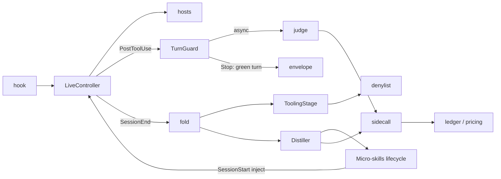
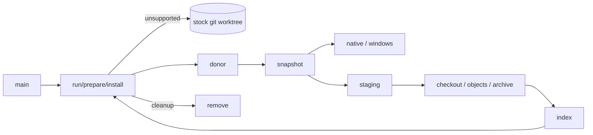
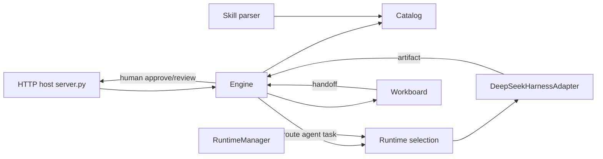
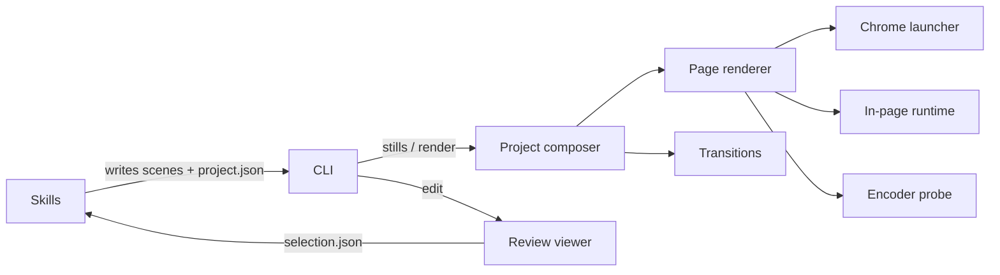

# Agentic AI weekly scan: 2026-11-21

Cửa sổ quét: 2026-11-14 → 2026-11-21.

Phạm vi đọc: đọc source code của 4 repo (bản clone `--depth 50`), không chạy code nào trong các repo.

## Executive summary

- **Chủ đề tuần này là hạ tầng *quanh* agent, không phải framework agent mới.**
  - Bốn repo pass filter đều đứng ngoài agent loop: hook middleware giảm chi phí (TokenEconomizer), workspace copy-on-write (git-twig), state machine giao việc người + agent (Intelligent Organization), engine render có review loop cho agent (motlab).
  - Không có repo nào có orchestration pattern mới kiểu planner/router.
- **Repo đáng đọc nhất là `microsoft/TokenEconomizer`.** Nó có eval methodology nghiêm túc: SWE-Bench Docker, ablation theo từng cơ chế, 3 seed. Nó cũng tính chi phí "honest", tức tính cả overhead của chính plugin. Pattern "learned fact + detector do host chạy" đáng mượn.
- **Phần lớn candidate bị loại** (6/10 sau khi gộp nhóm spam).
  - Loại vì là prompt/skill pack thuần markdown, repo chỉ có README, hoặc spam nhân bản (≥20 repo `*/Gemini-Config-Checker-` tạo cùng một phút).
  - Câu `created:>2026-11-14 stars:>200` chỉ trả về 7 kết quả. Hai candidate bổ sung lấy từ `pushed:>2026-11-14 stars:>500`, xem phần Phương pháp.

## Mục lục

1. [microsoft/TokenEconomizer](#1-microsofttokeneconomizer)
2. [leostera/git-twig](#2-leosteragit-twig)
3. [lizhenjie137/intelligent-organization](#3-lizhenjie137intelligent-organization)
4. [staryone/motlab](#4-staryonemotlab)
5. [Phương pháp & repo bị loại](#phương-pháp--repo-bị-loại)

---

## 1. microsoft/TokenEconomizer

Link: https://github.com/microsoft/TokenEconomizer. Repo tạo 2026-10-13. Tuần này có 138 commit, khoảng 5.5k dòng thêm, nên được tính là *significantly updated*.

### §1 Quick context

- **Pitch:** Plugin hook-based giúp coding agent rẻ hơn trên repo quen thuộc, nhờ học từ các session trước mà không sửa agent.
- **Stack:**
  - Python ≥3.10, chỉ dùng stdlib (`dependencies = []`).
  - Adapter TypeScript cho Pi/opencode.
  - Side-call qua CLI của host agent (mặc định `haiku` trên Claude Code).
- **Health:**
  - Khoảng 55 author trong lịch sử clone nông.
  - CI (`.github/workflows/tests.yml`) chạy Ubuntu + Windows, Python 3.10/3.13, cộng một job chạy Codex CLI thật với model giả lập.

### §2 Architecture deep-dive

**A. Component inventory**

- `hook` (`tokeneconomizer/plugin/hook.py`): entry point JSON stdin/stdout cho mọi hook. Fail-open.
- `LiveController` (`tokeneconomizer/plugin/controller.py`): mỗi hook event (SessionStart, UserPromptSubmit, PostToolUse, Stop, SessionEnd) có một handler riêng.
- `hosts` (`tokeneconomizer/plugin/hosts.py`): dịch payload theo từng host.
- `Micro-skills lifecycle` (`tokeneconomizer/microskills/lifecycle.py`): vòng đời của fact, gồm candidate, active rồi retired.
- `Distiller` (`tokeneconomizer/microskills/distiller.py`): model đề xuất fact, mỗi fact kèm detector regex.
- `ToolingStage` (`tokeneconomizer/toolprune/stage.py`) + `denylist` (`tokeneconomizer/plugin/denylist.py`): quyết định tool nào bị cắt, rồi ghi vào settings của agent.
- `TurnGuard` (`tokeneconomizer/loopguard/turn.py`) + `judge` (`tokeneconomizer/loopguard/judge.py`) + `envelope` (`tokeneconomizer/loopguard/envelope.py`): phát hiện failure loop.
- `fold` (`tokeneconomizer/plugin/fold.py`): process tách rời, gom session đã xong thành learned state.
- `sidecall` (`tokeneconomizer/plugin/sidecall.py`): các lời gọi model của chính plugin.
- `ledger` / `pricing` (`tokeneconomizer/ledger.py`, `tokeneconomizer/pricing.py`): một định nghĩa chi phí duy nhất, có tính đến cache.

**B. Control flow: hook-based middleware (event-driven) + offline learning loop.** Repo không đụng vào agent loop của host. Happy path:

1. SessionStart: inject block learned facts dưới dạng `additionalContext`.
2. UserPromptSubmit: mở một prompt-turn cho loop guard.
3. PostToolUse:
   - fold tool call vào `SpiralState`;
   - chạy gate rule-based miễn phí;
   - nếu cần, spawn judge async; kết quả về ở PostToolUse kế tiếp dưới dạng redirect.
4. Stop: đóng turn. Turn "ended green" được dùng để cập nhật envelope độ dài turn của repo.
5. SessionEnd: spawn `te fold`, chạy prefix stage và tooling stage, ghi ledger.
6. Deny list chỉ được ghi khi repo đã idle quá `toolprune_quiet_minutes` (tức prompt cache đã nguội), tối đa 24h.

**C. State & data flow**

- **Message format:** dict/JSON untyped. Config dùng dataclass. Trajectory là list tuple `(tool, args, result, success)` (`tokeneconomizer/domain.py`).
- **Storage:** JSON/JSONL dưới `~/.tokeneconomizer`, ghi atomic bằng `os.replace` cộng file lock (`tokeneconomizer/plugin/store.py`). Hook chạy song song được serialize qua `tokeneconomizer/plugin/hookqueue.py`.
- **Context window:** chỉ quản lý block inject, cap `MAX_FACTS = 4` và `MAX_TOKENS = 150` (`envfacts.py`). Tool pruning thu nhỏ prefix chứa tool definition. Không trim conversation.

**D. Tool integration**

- Dùng native hook config của từng host (`plugin/hooks/hooks.json`, `codex-hooks.json`, ...). Không dùng MCP, không dùng proxy.
- Side-call bị sandbox theo từng host:
  - Claude: `--tools ""`, `--strict-mcp-config`.
  - Codex: `-s read-only`.
- Biến `TE_SIDECALL=1` chặn đệ quy hook.

**E. Memory.**

- Short-term: `SpiralState` theo turn.
- Long-term: fact theo từng (agent, repo).
  - Fact được promote sau `K_PROMOTE = 3` lần xác nhận.
  - Một contradiction nặng gấp `LAMBDA = 5.0` lần một xác nhận, nên hệ thống nghiêng về retire.
  - Fact chỉ được inject nếu firing rate ≥ `FIRE_GATE = 0.40`.
- Không có retrieval: không vector, không keyword search. Mọi fact active qua gate đều được inject.

**F. Model orchestration.** Có ba vai trò model: fact proposer, stuck judge, redirect writer. Claude dùng `haiku` mặc định. Mọi lỗi của judge rơi về đường rule-based miễn phí (`loopguard/judge.py`).

**G. Observability & eval**

- **Log:**
  - `events.jsonl` ghi mọi quyết định.
  - Có `shadow` mode: tính quyết định nhưng không áp dụng.
  - `te status` / `te doctor`.
  - Không dùng OpenTelemetry.
- **Eval:** `experiments/te_bench/arms.py` định nghĩa các arm baseline (3 mức effort), RTK, RepoMap, ablation từng cơ chế. 277 task SWE-Bench + 102 Web-Bench, 3 seed, chạy tuần tự từ trạng thái trống.

**H. Extension points.**

- Protocol `DomainAdapter` (`tokeneconomizer/domain.py`) và `Stage` (`tokeneconomizer/stage.py`).
- Thêm host mới cần một module `trace/<agent>.py` và một class trong `hosts.py`.

### §3 Diagram

### §4 Verdict

- **Điểm novel:**
  1. Fact do model viết kèm detector do host chạy. Nhờ vậy hot path không cần gọi model.
  2. Deny list được trì hoãn cho tới khi prompt cache nguội, để tránh tự gây cache rewrite đắt.
  3. Ledger tính cả overhead của side-call vào cùng cost.
  4. Loop guard chỉ học threshold từ các turn thành công.
- **Red flag:**
  - Regex do model sinh được `re.compile` trực tiếp (`distiller.py::_rx`), không giới hạn độ dài hay thời gian, nên có rủi ro ReDoS.
  - Text do repo kiểm soát đi vào prompt side-call, rồi fact được inject lại vào agent: một kênh prompt-injection.
  - Số liệu headline (giảm 18.4–30.9% cost) không kèm raw data trong repo.
  - Plugin dùng `haiku` cho side-call, còn paper dùng model của agent.
- **Open questions:** false-positive rate của judge? Tái lập được không khi thiếu raw data?

---

## 2. leostera/git-twig

Link: https://github.com/leostera/git-twig. Tạo 2026-11-15.

### §1 Quick context

- **Pitch:** Worktree copy-on-write cho agent chạy song song, tiết kiệm tới khoảng 97% disk, có verify từng byte so với Git.
- **Stack:**
  - Rust 2024. Runtime deps chỉ có `anyhow`, `libc`, `windows-sys`.
  - Bench viết bằng Bun/TS + Python.
- **Health:**
  - 50 commit (17–20/11), thực tế khoảng 1 author.
  - Khoảng 142 test tích hợp.
  - CI chạy trên XFS/Btrfs/OverlayFS/NTFS/ReFS.
  - Khoảng 220k/250k dòng thêm tuần này là dữ liệu benchmark trong `bench/results/`.

### §2 Architecture deep-dive

**A. Component inventory**

- `main` (`crates/git-twig/src/main.rs`): xử lý `--version` và `skill` (in SKILL.md nhúng sẵn), còn lại gọi `run`.
- `run/prepare/install` (`crates/git-twig/src/lib.rs`): dispatch lệnh, chỉ parse dạng hẹp `-b   | --detach <dest> [rev]`. Mọi dạng khác được chuyển nguyên cho `git worktree`.
- `donor` (`crates/git-twig/src/donor.rs`): chọn worktree có sẵn khớp nhiều path nhất với tree đích (tối đa 5 candidate, phải cùng filesystem).
- `native` (`crates/git-twig/src/native.rs`) / `windows` (`crates/git-twig/src/windows.rs`): primitive clone, gồm `clonefile` (macOS), `ioctl FICLONE` (Linux) và ReFS duplicate-extents.
- `snapshot` (`crates/git-twig/src/snapshot.rs`): CoW-clone file từ donor vào staging.
- `checkout` / `objects` / `archive` (`crates/git-twig/src/checkout.rs`, `objects.rs`, `archive.rs`): verify bản clone so với blob đích (hoặc output `git archive` với file có filter), sai thì để Git tự ghi lại path đó.
- `index` (`crates/git-twig/src/index.rs`): pre-seed index từ stat data để lần `git status` đầu tiên rẻ.
- `staging` (`crates/git-twig/src/staging.rs`): scratch theo từng lần gọi, nằm dưới `<common-git-dir>/twigs/staging`.
- `remove` / `adopt` (`crates/git-twig/src/remove.rs`, `adopt.rs`): dọn worktree và chuyển worktree cũ sang layout mới.

**B. Control flow: CLI dispatch + staged copy-on-write pipeline với fallback.** Không có LLM. Happy path:

1. Agent chạy `git twig new -b feat/x ../feat-x HEAD`.
2. `prepare` kiểm tra điều kiện: env override, sparse checkout, replace refs, hook, destination đã tồn tại. Bất kỳ điều kiện nào không thỏa thì fallback về stock Git.
3. `ls-tree` commit đích, giữ `registration.lock`, `donor::choose`, rồi `snapshot::materialize` vào staging.
4. `checkout` verify từng byte, sửa chỗ mismatch, `index` ghi draft index.
5. `install` gọi `git worktree add --no-checkout`, kiểm tra HEAD chưa đổi, rename staging vào chỗ, `update-index --refresh`, rồi chạy hook `post-checkout`.
6. Agent làm việc bằng Git bình thường, xong thì `git twig remove`. Bước merge về: không xác định từ code, twig không xử lý.

**C. State & data flow**

- Metadata worktree vẫn do Git sở hữu, không đổi format.
- Twig chỉ thêm `twigs/registration.lock`, `twigs/staging/`, config key `twig.worktreesDir` và một recovery journal NUL-delimited (mode 0600).
- File là CoW clone thật, không overlay, không hardlink (`docs/rfds/RFD0001-verified-cow-worktrees.md`).

**D. Agent integration.**

- Chỉ qua CLI. `git twig skill` in hướng dẫn cho agent (`crates/git-twig/skills/git-twig/SKILL.md`).
- Không có MCP. Skill mô tả hook `WorktreeCreate` của Claude Code như một bước setup tùy chọn.
- Bảo đảm an toàn ghi trong `crates/git-twig/tests/SAFETY.md`. Skill nói rõ CoW "is not a sandbox".

**E/F.** Không có memory, không có model orchestration.

**G. Observability & eval.**

- `TWIG_TRACE=1` in backend được chọn, lý do fallback và thời gian từng phase (`lib.rs`).
- Benchmark có manifest và định danh SHA-256 của binary (`bench/README.md`, RFD0002–0021).
- Kết quả trên Linux kernel: 44.7 MiB so với 1.8 GiB, nhưng 48.6s so với 41.0s, tức chậm hơn.

**H. Extension points.** Thêm backend clone mới qua `native.rs`. Thêm target benchmark qua `bench/{os}-{fs}/target.ts`.

### §3 Diagram

> Node `stock git worktree` là binary Git bên ngoài mà `lib.rs` delegate tới, không phải component của repo.

### §4 Verdict

- **Điểm novel:**
  - Donor được chọn *xuyên revision*, nên có thể clone từ worktree đang ở commit khác.
  - Mọi clone đều được chứng thực bằng raw blob bytes, không tin vào CoW mù quáng.
  - Đăng ký worktree vẫn do Git sở hữu qua `--no-checkout`.
  - Fallback toàn phần thay vì hỗ trợ nửa vời.
- **Red flag:**
  - Thường *chậm hơn* Git 1.2–7.6×.
  - Trên ext4 (mặc định trên đa số distro) không tiết kiệm gì.
  - Root commit 195k dòng, có vẻ history bị squash.
  - Bus factor bằng 1.
- **Open questions:** donor bị sửa giữa lúc clone có luôn bị bắt không? RFD0001 thừa nhận đây không phải atomic snapshot. Câu chuyện merge-back cho N agent song song cũng chưa có lời giải.

---

## 3. lizhenjie137/intelligent-organization

Link: https://github.com/lizhenjie137/intelligent-organization. Tạo 2026-11-15.

### §1 Quick context

- **Pitch:** Workspace local nơi người và AI agent nhận task theo capability, nộp bài, được review và handoff có biên nhận.
- **Stack:**
  - Python stdlib (`http.server`, `sqlite3`), web JS thuần, Electron shell.
  - Model gọi qua `deepseek-harness-sdk==0.2.2rc2`.
- **Health:**
  - 1 author, 4 commit (dump source).
  - Khoảng 159 unit test. CI chỉ chạy trên Windows.
  - License source-available, không phải OSI.

### §2 Architecture deep-dive

**A. Component inventory** (path tính từ `editions/en/`; `editions/zh/` là bản copy, chỉ khác chuỗi localize):

- `Engine` (`harness/engine.py`): goal, task DAG, routing, budget, state machine approve/review, permission.
- `Workboard` (`harness/workboard.py`): progress update, attachment, handoff có biên nhận.
- `Catalog` (`harness/catalog.py`): 8 capability, 5 actor (4 agent + owner) và `WORKFLOW` cố định 5 bước.
- `DeepSeekHarnessAdapter` (`deepseek-harness-base/bridge/adapter.py`): gọi model text-only qua SDK.
- `Runtime selection` (`harness/runtime.py`): chọn adapter. Nếu thiếu cấu hình thì dùng `UnavailableDeepSeekAdapter` và fail rõ ràng.
- `RuntimeManager` (`harness/model_settings.py`): cấu hình model, lưu API key bằng DPAPI.
- `Skill parser` (`harness/skills.py`): parse SKILL.md/JSON dưới dạng dữ liệu khai báo, không thực thi code.
- `AuthStore` (`auth.py`) và HTTP host (`server.py`): tài khoản, session, JSON API trên 127.0.0.1.

**B. Control flow: DAG state machine với human-in-the-loop gate.** Không phải ReAct: mỗi lượt agent chỉ là 1 prompt và 1 completion. Happy path:

1. `_create_goal` tạo chuỗi analyze → draft → review → approve → reflect, hoặc DAG custom tối đa 20 bước.
2. `step` lấy task queued đã đủ dependency. `_route` (`engine.py:623`) match actor theo capability, permission và availability; task approve hoặc high-risk bắt buộc giao cho người.
3. Task giao cho agent trừ budget theo số lần chạy, nhận `run_token`, rồi `_context` (`engine.py:647`) build context.
4. `_execute_run` (`engine.py:710`) gọi `adapter.generate()` ngoài lock. Kết quả có run token cũ bị bỏ.
5. Người approve hoặc reject. Task cộng tác đi qua assign → accept → start → submit → review.
6. `workboard` handoff sang task phụ thuộc. `_refresh` (`engine.py:807`) đóng goal và ghi memory.

**C. State & data flow**

- Toàn bộ state là một JSON blob trong bảng SQLite một dòng (WAL). Mỗi action: deepcopy, mutate, lỗi thì rollback.
- Optimistic concurrency theo revision, xung đột trả HTTP 409.
- Prompt là JSON dump của goal, task, capability và context.
- Context giới hạn bằng heuristic ký tự: 3 memory gần nhất, 8 tài liệu, mỗi tài liệu tối đa 12,000 ký tự. Không đếm token.

**D. Tool integration: tool bị tắt có chủ đích.**

- `deepseek-harness-base/config/text-only.patch.yml` tắt fs/bash/pty/MCP và đặt sandbox `read-only`.
- Nếu có `tool/*` event, run bị reject với lỗi `UNEXPECTED_TOOL_CALL` (`adapter.py:276`).
- Output bị kiểm tra độ dài (30–100k ký tự) và được gắn nhãn "AI-generated, human verification required".

**E. Memory.** Khi goal hoàn tất, hệ thống lưu một "candidate lesson" từ output bước reflect. Memory được đưa lại làm context `reference_memories` (lọc theo owner, lấy 3 cái gần nhất). Không có embedding.

**F. Model orchestration.**

- Chỉ một model cho mọi "agent role" (analyst/planner/reviewer/librarian chỉ là nhãn).
- Hai provider: `openai-completions` (local) hoặc `deepseek-messages`.
- `maxRetries: 0`, không có fallback. Semaphore giới hạn concurrency, mặc định 4.

**G. Observability.**

- List `events` trong state dùng làm audit log.
- Mỗi run có `run.json` lưu SHA-256 của prompt (không lưu prompt).
- Không có eval harness.

**H. Extension points.** Thêm capability/actor qua API. Import skill bằng SKILL.md hoặc JSON. Có interface adapter `generate(goal, task, capability, context)`.

### §3 Diagram

### §4 Verdict

- **Điểm novel:**
  - Người và agent dùng chung một actor model. "Được giao" tách khỏi "đủ điều kiện thực thi", và candidate bị chặn vẫn được giải thích lý do.
  - `run_token` ngăn lần chạy đã bị thay thế ghi đè kết quả mới.
  - Handoff có version và biên nhận.
  - Thiết kế "agent không có tool" có chủ đích, với enforcement ở runtime.
- **Red flag:**
  - Hai bản code nhân đôi (en/zh): mỗi fix phải sửa hai lần.
  - Chỉ chạy trên Windows (DPAPI, cwd `C:/`).
  - Mỗi action rewrite toàn bộ state dưới một global lock, không scale.
  - Phụ thuộc SDK bản rc.
  - `harness/adapters.py` còn đường HTTP thô, mâu thuẫn với comment trong adapter.
- **Open questions:** cách đồng bộ hai edition? Roadmap cho multi-machine thế nào?

---

## 4. staryone/motlab

Link: https://github.com/staryone/motlab. Tạo 2026-11-16.

### §1 Quick context

- **Pitch:** "Video as code": scene là trang canvas HTML, render bằng WebCodecs trong headless Chrome. Agent viết scene, người review bằng note có tọa độ.
- **Stack:**
  - Node ≥24 ESM, dependency duy nhất là `mediabunny`, cộng Chrome và ffmpeg.
  - Skill helper viết bằng Python (Pillow, numpy).
  - Bản thân repo không gọi model nào.
- **Health:**
  - 35 commit, khoảng 2–3 người.
  - CI (`.github/workflows/ci.yml`) chạy Ubuntu + Windows, có test render end-to-end.

### §2 Architecture deep-dive

**A. Component inventory**

- `CLI` (`bin/motlab.js` → `src/cli.js`): các lệnh render, edit, stills, events, doctor.
- `Page renderer` (`src/render.js`): mở page, kiểm tra contract `renderAt/TOTAL/ready`, chạy worker song song, mux, rồi ffprobe xác minh frame count.
- `In-page runtime` (`src/page/runtime.js`): `renderAt(t)` → `VideoFrame` → `VideoEncoder`. Chunk được POST về sink local, frame không rời Chrome dưới dạng ảnh.
- `Project composer` (`src/project.js`): đọc `project.json`, render scene song song, cache part theo hash, mix audio.
- `Transitions` (`src/page/transitions.js`): gl-transitions và `.glsl` custom.
- `Encoder probe` (`src/probe.js`): đo hardware/software encoder theo máy rồi cache kết quả.
- `Review viewer` (`src/editor.js`, `src/viewer.js`): server local, ghi note ra `selection.json`, merge note qua `mergeNotes`.
- `Chrome launcher` (`src/chrome.js`) / `Access layer` (`src/access.js`) / file server (`src/server.js`): chỉ bind 127.0.0.1, chặn path traversal.
- `Skills` (`skills/motlab/SKILL.md`, `skills/motlab-assets/SKILL.md`): quy trình phía agent.

**B. Control flow: host-agent-driven loop build → self-check → human review → revise.** Procedure nằm trong skill markdown, engine chỉ là tool. Không có planner hay executor trong code. Happy path:

1. Agent probe reference bằng ffprobe/PIL.
2. Lên shot list và post vào chat, không chờ duyệt.
3. Viết `scenes/*.html` + `project.json`, mix âm thanh từ `EVENTS`.
4. Self-check: `motlab stills` + contact sheet, so với reference.
5. `motlab edit`: người để lại note gắn box, frame hoặc time range.
6. Agent đọc `selection.json` và ảnh note, sửa, rồi đánh `done: true`. Người export. Skill ghi rõ: "You never render the video."

**C. State & data flow**

- Scene là HTML với `<canvas>`, `window.renderAt(t)`, `TOTAL`, `ready`.
- Mọi state nằm trên disk của project. Part cache ở `~/.cache/motlab/parts`.
- Feedback đi theo kênh có cấu trúc: viewer POST `/selection`, `mergeNotes` giữ cờ `done` do agent đặt và đánh số lại note trùng.

**D. Tool integration.**

- Agent gọi qua shell CLI. Engine không có MCP.
- Validation gồm:
  - contract check và timeout khi load page;
  - kích thước canvas phải chẵn;
  - kiểm tra `project.json`;
  - ffprobe sau render.
- Không có lint hay frame-diff cho output của agent.

**E. Memory.** Không có subsystem memory. Kit asset (`kit.json`, `style.md`) giữ style nhất quán giữa các video.

**F. Model orchestration.** Không có. Repo dựa hoàn toàn vào host agent (Claude Code mặc định).

**G. Observability & eval.**

- Test decode frame rồi so mean RGB theo vùng.
- `bench/run.mjs` so với Remotion/HyperFrames bằng wall time và SSIM.
- Không có eval cho chất lượng output của agent hay cho skill loop.

**H. Extension points.** Thêm transition `.glsl`, template 2D/3D/three.js/p5, kit asset, hoặc `--skill-dir` để cài skill cho agent khác.

### §3 Diagram

### §4 Verdict

- **Điểm novel:**
  - Encode bằng WebCodecs ngay trong page, không phải pipe screenshot sang ffmpeg.
  - Kênh review human→agent dạng machine-readable (box pixel, frame, ảnh PNG cho từng note, cờ `done`), với merge note đồng thời. Đây là một pattern HITL feedback tốt, mượn được cho domain khác.
  - Có ranh giới rõ "agent không bao giờ render final".
- **Red flag:**
  - Phần "agentic" chủ yếu là prompt markdown.
  - Benchmark chủ yếu đo trên một laptop Windows.
  - Cache key không track dependency dùng chung giữa các scene.
  - Template load thư viện từ CDN.
- **Open questions:** protocol `done` có bền qua nhiều vòng review không? Chất lượng ra sao với agent khác ngoài Claude Code?

---

## Phương pháp & repo bị loại

**Query (2026-11-21, `gh api search/repositories`):**

1. `agent created:>2026-11-14 stars:>200` trả 7 kết quả. Các biến thể `multi-agent`, `agentic`, `agents` chỉ trả tập con của 7 kết quả này.
2. `llm created:>2026-11-14 stars:>300` cho thêm `neonclipping` (công cụ cắt clip, không thuộc agentic) và khoảng 20 repo spam trùng tên.
3. Vì 7 ≥ 4, không bắt buộc mở rộng. Tuy vậy, sau filter chỉ còn 2 repo, nên chạy thêm `agent pushed:>2026-11-14 stars:>500` để bắt nhánh "significantly updated". Từ đó lấy thêm TokenEconomizer (138 commit tuần này).

**Bị loại:**

| Repo | Lý do |
|---|---|
| `bookwjitchieni1986/blender-ai-mcp-addon` | Chỉ có README + docs, 0 dòng code, 8 commit, 1.8k sao. Dấu hiệu repo mồi, nghi spam. |
| `sybil-solutions/inference-optimisation-skill` | 1 commit, chủ yếu là `PROMPT.md`/skill markdown, khoảng 300 LOC. |
| `boringmarketer/boring-marketing-skills` | Prompt pack marketing. |
| `diego3g/craft` | Design skill thuần markdown, không có source code. |
| `NVlabs/SoL-Pi` | Có nội dung tốt nhưng tuần này chỉ 2 commit (1 dòng), không đạt ngưỡng significantly updated. |
| `*/Gemini-Config-Checker-` (≥20 bản) | Spam nhân bản, không thuộc agentic. |

**Self-check**

- [x] Link verify được.
  - `git ls-remote` + clone thành công cho cả 4 repo.
  - HTTP HEAD tới github.com bị proxy của môi trường chặn (403), nên dùng git transport thay thế.
- [x] Không có awesome-list hay tutorial.
- [x] Mọi path trong §2.A đã được kiểm tra tồn tại bằng script.
- [x] §2.B đặt tên pattern cho từng repo.
- [x] Cả 4 khối Mermaid parse OK với `mermaid@11.4.1`.
- [x] Node trong diagram ⊆ §2.A. Ngoại lệ duy nhất là node "stock git worktree" ở repo 2, đã ghi chú là binary ngoài.
- [x] §4 có điểm novel cụ thể.
