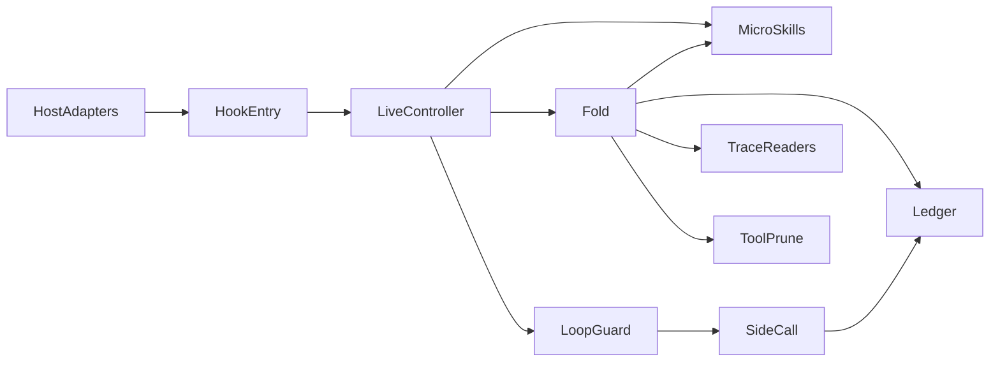
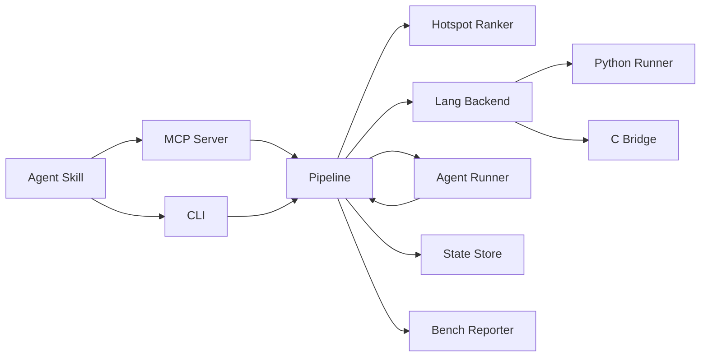
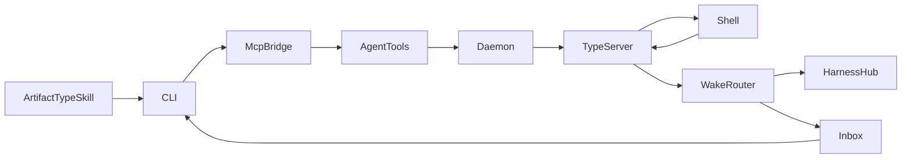
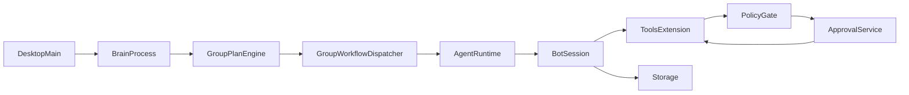

# Agentic AI Weekly Scan — 2026-11-22

Cửa sổ quét: 2026-11-15 → 2026-11-22. Query chính: `agent OR multi-agent OR agentic created:>2026-11-15 stars:>200` (11 kết quả), bổ sung `pushed:>2026-11-15 stars:>500` để bắt repo cũ hơn nhưng có nhiều update lớn.

## Executive summary

- **Xu hướng tuần này là các "lớp bao quanh coding agent", không phải agent framework mới.** Cả 4 repo đều coi Claude Code, Codex, pi… là black-box và can thiệp qua những kênh mà agent vốn đã đọc: hooks, MCP, skills, settings file.
- **Đáng học nhất là `microsoft/TokenEconomizer`.** Nó có eval methodology bài bản (4 workload, nhiều baseline và ablation, tính cost có xét cache). Memory của nó gồm các fact do LLM đề xuất nhưng được kiểm chứng bằng regex detector, đi qua lifecycle CANDIDATE → ACTIVE → RETIRED.
- **Red flag chung: một tác giả viết cả trăm nghìn LOC chỉ trong vài chục commit** (PiBot, open-artifact). Đây là dấu hiệu code do agent sinh, CI test mỏng hoặc không có. Ngoài ra, các guardrail quan trọng như "đừng sửa recordings" (fast-anything) chỉ nằm trong prompt, code không enforce.

## Table of contents

1. [microsoft/TokenEconomizer: black-box cost control](#tokeneconomizer)
2. [EL4CTEO/fast-anything: port hot path sang Rust bằng differential testing](#fast-anything)
3. [JimLiu/open-artifact: artifact runtime cho agent, có vòng comment quay về agent](#open-artifact)
4. [w01fb0ss/PiBot: multi-bot desktop có policy gate](#pibot)
5. [Bị loại và ghi chú phương pháp](#excluded)

---

## 1. microsoft/TokenEconomizer

Link: https://github.com/microsoft/TokenEconomizer

### §1 Quick context
- **Pitch:** Plugin hook vào coding agent, học từ các session trước để giảm token cost mà không sửa agent.
- **Stack:** Python ≥3.10, chỉ dùng stdlib (`dependencies = []`), kèm adapter TypeScript cho Pi và opencode. Hỗ trợ Claude Code, Codex, Copilot, Cursor, Droid, Hermes…
- **Health:** ~7.9k stars, ~55 tên author trong 50 commit gần nhất, 122 commit trong 7 ngày (thêm opencode, Hermes, mở rộng loopguard). CI `.github/workflows/tests.yml` chạy ma trận ubuntu/windows × py3.10/3.13, có job chạy Codex CLI thật với fake model. Có ~70 file trong `tests/`.

### §2 Architecture deep-dive

**A. Component inventory**
- `HookEntry` (`tokeneconomizer/plugin/hook.py`): entry point của mọi hook, đọc JSON từ stdin, trả JSON ra stdout, fail-open (lỗi thì in `{}` và ghi `errors.log`).
- `HostAdapters` (`tokeneconomizer/plugin/hosts.py`): mỗi agent host một class, kèm `detect()`.
- `LiveController` (`tokeneconomizer/plugin/controller.py`): xử lý các event SessionStart, UserPromptSubmit, PostToolUse, Stop, SessionEnd.
- `TraceReaders` (`tokeneconomizer/trace/__init__.py`): chuẩn hoá log của từng agent về dạng `(tool, args, result, ok)`.
- `Fold` (`tokeneconomizer/plugin/fold.py`): process `te fold` chạy detached sau khi session kết thúc.
- `MicroSkills` (`tokeneconomizer/microskills/lifecycle.py`, `distiller.py`): học các fact về repo rồi inject vào context.
- `ToolPrune` (`tokeneconomizer/toolprune/stage.py`, `tokeneconomizer/plugin/denylist.py`): tắt những tool không dùng.
- `LoopGuard` (`tokeneconomizer/loopguard/turn.py`): phát hiện turn bị kẹt trong vòng lặp lỗi.
- `SideCall` (`tokeneconomizer/plugin/sidecall.py`): gọi LLM thông qua chính CLI của agent.
- `Ledger` (`tokeneconomizer/ledger.py`, `pricing.py`): định nghĩa cost duy nhất, có tính cache.

**B. Control flow: hook/interceptor quanh black-box agent, cộng feedback loop giữa các session (event-driven)**
1. `plugin/hooks/hooks.json` đăng ký 6 event, tất cả đều đi qua `te-hook` tới `HookEntry`.
2. Ở SessionStart, `LiveController` inject các micro-skills đã render sẵn qua `additionalContext`.
3. Ở PostToolUse, `LoopGuard` cập nhật spiral state. Khi gate mở, nó spawn `te judge` detached (`tokeneconomizer/plugin/judge.py`) và lấy redirect về ở lần PostToolUse kế tiếp.
4. Ở Stop, turn được đóng lại. Turn nào kết thúc xanh thì được đưa vào `envelope.json`.
5. Ở SessionEnd, `Fold` đọc trace qua `TraceReaders`, cập nhật fact và tool streak, ghi deny-list cho session sau, rồi ghi vào `Ledger`.

**C. State & data flow:** Không có typed schema, chỉ có tuple ngầm định. Dữ liệu lưu dạng JSON/JSONL trong `~/.tokeneconomizer`, key theo repo, ghi atomic và khoá bằng `fcntl`/`msvcrt` (`tokeneconomizer/plugin/store.py`). Không dùng DB.

**D. Tool integration:** Chỉ có 3 kênh tác động lên agent: `additionalContext`, file settings riêng của agent (`permissions.deny` với Claude, `.codex/config.toml` với Codex) và tool result. Có thêm một lock queue theo session (`hookqueue.py`), và `TE_SIDECALL=1` để side call không kích hoạt hook đệ quy.

**E. Memory**
- Short-term là turn state.
- Long-term là các fact có lifecycle với `K_PROMOTE=3`, decay `GAMMA`, và mâu thuẫn bị phạt nặng gấp `LAMBDA` lần.
- Fact đến từ 2 nguồn: `envfacts.py` (không dùng LLM) và một proposer LLM chạy trên digest của nhiều session.
- Mỗi fact kèm một regex detector, nên hot path không cần gọi LLM.
- Retrieval không có semantic search: inject toàn bộ fact ACTIVE, tối đa 4 fact và 150 token (`tokeneconomizer/plugin/config.py`).

**F. Model orchestration:** Không route hay hạ cấp model của agent. Side call dùng `paid_model`, mặc định là `haiku` trên Claude. Nếu judge lỗi thì fallback về rule/envelope.

**G. Observability & eval:**
- 4 workload: SWE-Bench, Web-Bench, CredData, ReposVul (`experiments/workloads/`).
- Các arm so sánh: baseline ở 3 mức effort, rtk, repomap, cùng các ablation `inject-only`/`untool-only`/`spiral-only` (`experiments/README.md`).
- Metric là effective tokens có xét cache, cộng chi phí overhead của chính plugin.
- Có mode `shadow`, và `te history import` để replay log cũ.

**H. Extension points:** Thêm agent bằng một reader trong `trace/` cộng một `Host`. Thêm cơ chế mới bằng cách implement `Stage` (`tokeneconomizer/stage.py`) hoặc `DomainAdapter` (`tokeneconomizer/domain.py`).

### §3 Diagram

### §4 Verdict

**Novel:**
- Kiểm soát cost chỉ bằng các kênh agent vốn đã đọc.
- Fact do LLM viết nhưng được kiểm chứng bằng regex detector.
- Judge chạy async, nằm ngoài critical path.
- Ledger tính cả overhead của chính plugin.

**Red flags:**
- `hosts.py` (~1.4k LOC) và `sidecall.py` (~1k LOC) phải gánh phần đặc thù của 10 host.
- Regex heuristic dễ vỡ, thấy rõ qua các commit sửa liên tục cho `make`/`sudo`/`tox`.
- Hằng số không khớp giữa code, plugin và docs (`PROPOSE_EVERY` là 8, 3 hoặc 5 tuỳ chỗ).
- Micro-skills mặc định là `off`, dù README nhấn mạnh nó.

**Open questions:**
- Rủi ro prompt-injection khi fact được rút ra từ output lệnh.
- Kết quả có tái lập được không khi cần Docker và API.

---

## 2. EL4CTEO/fast-anything

Link: https://github.com/EL4CTEO/fast-anything

### §1 Quick context
- **Pitch:** CLI profile app, giao coding agent port riêng hàm nóng sang Rust, rồi chứng minh tương đương bằng cách replay các lời gọi thật.
- **Stack:** Rust 2024 (clap, serde_json, libloading). Runner cho Python, JS, Ruby, Go, Java, PHP, C được nhúng vào binary bằng `include_str!`. Binding qua PyO3, napi-rs, hoặc C ABI + JSON.
- **Health:** ~225 stars, tạo ngày 2026-11-21, 11 commit, 1 tác giả. CI có `.github/workflows/ci.yml` (fmt, clippy, test, E2E trên 10 example, chạy trên 3 OS). Unit test viết inline `#[cfg(test)]`. Khoảng 7.1k LOC Rust.

### §2 Architecture deep-dive

**A. Component inventory**
- `CLI` (`src/main.rs`): các subcommand `go`, `scan`, `port`, `verify`, `enable`, `bench`, `report`, `mcp`.
- `Pipeline` (`src/pipeline.rs`): các bước dùng chung cho CLI và MCP, gồm vòng retry có `feedback()`.
- `Hotspot Ranker` (`src/hotspot.rs`): score = share × portability, ngưỡng `WORTH_IT = 0.02`, dùng `covered_by` để ưu tiên hàm ở vòng ngoài.
- `Lang Backend` (`src/backend.rs`): enum `Lang` dispatch sang từng ngôn ngữ, chạy `cargo build --release`.
- `Python Runner` (`src/python/runner.py`): profile bằng cProfile, chặn AST (I/O, nondeterminism), lo record, verify, derive.
- `C Bridge` (`src/native.rs`): `fa_call` nhận và trả JSON, replay trong process con, so sánh bằng `same()`.
- `Agent Runner` (`src/agent.rs`): spawn `claude -p` hoặc `codex exec`, đẩy `TASK.md` qua stdin.
- `MCP Server` (`src/mcp.rs`): JSON-RPC qua stdio, có 8 tool `fast_*`.
- `State Store` (`src/state.rs`): `.fast/state.json`, ghi atomic bằng tmp file + rename.
- `Bench Reporter` (`src/bench.rs`, `src/report.rs`): chạy xen kẽ, lấy median, xuất Markdown + SVG.
- `Agent Skill` (`skills/fast-anything/SKILL.md`): hướng dẫn cho agent chủ.

**B. Control flow: pipeline tuyến tính, cộng vòng generate→verify có feedback**

Bên trong tool không có ReAct. Phân vai rõ ràng: CLI đo, record, build, verify và swap; agent chỉ viết `src/lib.rs`. Có 2 cách chạy: agent ngoài điều khiển tool qua skill/MCP, hoặc `go --agent` để CLI tự spawn agent.
1. `scan`: profile rồi gọi `hotspot::rank`.
2. `port`: record tối đa 500 lời gọi vào `recordings.jsonl`, rồi scaffold crate và `TASK.md`.
3. Agent viết phần Rust.
4. `verify`: replay cả case đã record lẫn case suy ra, đo micro-bench. Nếu fail thì nối `feedback()` vào prompt và retry.
5. `enable`: chèn marked block vào file gốc. Bị chặn nếu chưa verify hoặc nếu bản port chậm hơn (`slower()` trong `src/state.rs`).
6. `bench` → `report`.

**C. State & data flow:**
- Các struct serde (`State`/`Port`/`Verify`) lưu trong `.fast/state.json`.
- `recordings.jsonl` có các field `args`, `kwargs`, `result`, `raises`, `derived`.
- Context của agent là `TASK.md` (source gốc, 8 lời gọi mẫu, rules), cộng feedback khi fail.

**D. Tool integration & "prove same":**
- Agent gọi tool qua CLI, MCP (`.mcp.json`) hoặc Claude plugin.
- Chứng minh tương đương bằng **differential testing trên recorded calls**, cộng các derived case: NaN, ±inf, −0.0, số subnormal, input nhỏ đi hoặc lớn gấp 16 lần. Kết quả mong đợi cho derived case do chính bản gốc trả lời.
- So sánh float với rel 1e-9 / abs 1e-12.
- Không có fuzzing kiểu property-based.

**E. Memory:** Không có.

**F. Model orchestration:** Giao hết cho agent chủ. Preset cho Claude giới hạn `--allowedTools` ở Read/Edit/Write/Glob/Grep và `Bash(cargo …)`.

**G. Observability & eval:**
- Profiler riêng cho từng ngôn ngữ, ví dụ `src/cfamily/prof.c`.
- Bench xen kẽ, tính median và stddev.
- Log của agent ghi vào `agent.log`.
- Có lệnh `doctor` kiểm tra môi trường.

**H. Extension points:**
- Thêm biến thể vào `Lang` (8 method dispatch).
- Ngôn ngữ đi qua C bridge chỉ cần cung cấp một `Flavor`.
- Lệnh agent tuỳ ý.

### §3 Diagram

### §4 Verdict

**Novel:**
- Dùng lời gọi thật từ production làm oracle, và để bản gốc tự trả lời các edge case.
- Gate "đúng nhưng chậm hơn": không bật bản port nếu nó chậm hơn.
- Swap chỉ là một marked block, gỡ ra trả lại đúng từng byte.
- Ranking bằng `covered_by` để ưu tiên hàm ở vòng ngoài.

**Red flags:**
- Đáp án mong đợi (`recordings.jsonl`) nằm ngay trong thư mục mà agent có quyền ghi. "Never edit the recordings" chỉ là một dòng trong `SKILL.md`, code không chặn. Preset `codex --full-auto` cũng không bị giới hạn tool.
- Exception chỉ được so theo việc có raise hay không, không so loại.

**Open:**
- 500 mẫu có đủ phủ các nhánh không, khi không có đo coverage?
- Hàm có hidden state thì sao, khi chỉ được chặn bằng heuristic AST?

---

## 3. JimLiu/open-artifact

Link: https://github.com/JimLiu/open-artifact

### §1 Quick context
- **Pitch:** Daemon local cho phép mọi coding agent tạo artifact dạng file thuần (slides, sheets, design…), người dùng sửa và comment rồi gửi ngược về agent.
- **Stack:** TypeScript (Node ≥22.18, React 19, Vite, zustand) và Rust crates biên dịch sang WASM. Không gọi LLM trực tiếp.
- **Health:** ~215 stars, 65 commit, 3 author (1 người chiếm 62 commit). Có ~379 file `*.test.*` và `e2e/`, nhưng CI chỉ có `.github/workflows/publish-npm.yml` và workflow này không chạy test.

### §2 Architecture deep-dive

**A. Component inventory**
- `Daemon` (`packages/daemon/src/daemon.ts`): một daemon mỗi user, chạy trên cổng loopback. Nó serve Shell, Library API, MCP và WebSocket `/__harness`.
- `AgentTools` (`packages/daemon/src/tools.ts`): implementation duy nhất của 3 tool `Artifact`, `ArtifactData`, `ArtifactComments`.
- `McpBridge` (`packages/daemon/src/mcp.ts`): MCP over HTTP, nhận diện caller qua các header `x-open-artifact-*`.
- `HarnessHub` (`packages/daemon/src/harness.ts`): JSON-RPC hai chiều với adapter của agent host.
- `WakeRouter` (`packages/daemon/src/wake.ts`): gộp comment rồi chuyển về session sở hữu artifact.
- `Inbox` (`packages/daemon/src/inbox.ts`): một file JSONL cho mỗi session.
- `CLI` (`packages/daemon/src/bin/open-artifact.ts`): các lệnh `mcp`, `hook`, `watch`, `wait`.
- `TypeServer` (`packages/type-server/src/server.ts`): server riêng cho từng artifact type, watch file và ghi history.
- `Shell` (`packages/shell/src/shell/App.tsx`): khung trang, có nút "Send to agent".
- `ArtifactTypeSkill` (`artifact-types/slides/artifact-type.json` + `SKILL.md`): manifest và hướng dẫn cho agent.

**B. Control flow: event-driven, có human-in-the-loop**
1. Agent host nạp plugin (`plugins/claude-code/.mcp.json`). Lệnh `CLI mcp` bridge sang `McpBridge`.
2. Agent gọi `Artifact {action: publish}`. `AgentTools` ghi file và tạo `ArtifactRecord`.
3. `Daemon` khởi động `TypeServer` theo manifest. `Shell` mở `/a/<id>`, và `fs.watch` đẩy thay đổi lên trang.
4. Người dùng sửa, comment rồi bấm "Send to agent". `TypeServer` gửi wake; nếu lỗi thì rơi về `_agent/inbox/`.
5. `WakeRouter` thử theo thứ tự: giao live qua `HarnessHub`, ghi vào `Inbox`, rồi nudge. Hook `UserPromptSubmit`/`Stop` (`plugins/claude-code/hooks/hooks.json`) chèn message vào session.

**C. State & data flow:**
- Mỗi artifact là một thư mục file thuần, kèm marker `.artifact.json`.
- Record theo `ArtifactRecord` (`packages/protocol/src/library.ts`) với các trường owner, agentSeenAt, userEdits.
- History content-addressed: `history/index.json` + `objects/<sha256>` (`packages/type-server/src/history.ts`).
- Publish có `if_match` để làm optimistic concurrency. `changed_files` cho agent biết người dùng đã sửa những file nào.

**D. Tool integration:**
- Action của tool được định nghĩa trong `packages/protocol/src/tools.ts`.
- Mỗi host có profile riêng (`packages/daemon/harnesses/*.json`). Host không có MCP thì dùng CLI qua `skills/open-artifact/SKILL.md`.
- Các lớp an toàn:
  - Text untrusted được fence bằng nonce (`packages/runtime/src/untrusted.ts`).
  - Mỗi artifact có origin riêng `<id>.frame.localhost`.
  - Code của type đặt ở project root chỉ chạy khi được trusted (`packages/daemon/src/types.ts`).

**E. Memory:** Không có agent memory. Chỉ có Inbox, history và view-context.

**F. Model orchestration:** Không xác định từ code. Dự án tự nhận model-agnostic.

**G. Observability & eval:** Có `log()` trong daemon. E2E điều khiển Chrome qua DevTools (`e2e/run.mjs`), có thêm `e2e/bench`. Unit test dùng `node --test`.

**H. Extension points:**
- Thêm type mới bằng một thư mục có `artifact-type.json` (`packages/protocol/src/manifest.ts`). Thứ tự ưu tiên: project > user > built-in.
- Thêm host mới bằng một file harness profile, có thể kèm nudge (`packages/daemon/src/nudge.ts`).

### §3 Diagram

### §4 Verdict

**Novel:**
- Vòng feedback người → agent được đóng kín qua 3 tầng: live, inbox, nudge. Nudge gọi thẳng CLI của host (`codex queue`, `agentapi send-message`).
- History content-addressed kết hợp `if_match` tách được thay đổi của người và của agent.
- Mỗi type tự đóng gói thành skill.

**Red flags:**
- ~560k LOC (tính cả file sinh sẵn) chỉ trong 65 commit.
- Có những file khổng lồ: `sheet-page.tsx` 9.6k dòng, `function-catalog.ts` 11.9k dòng.
- Không có CI chạy test.
- WASM đã build được commit thẳng vào repo.
- Nhận diện session dựa trên ppid, dễ gắn nhầm.

**Open:**
- Fence bằng nonce có đủ chống prompt-injection qua comment không?
- Security model khi share qua LAN ra sao?

---

## 4. w01fb0ss/PiBot

Link: https://github.com/w01fb0ss/PiBot

### §1 Quick context
- **Pitch:** Ứng dụng desktop local-first, nhiều Bot AI cùng làm việc trên máy, mọi bước rủi ro đều phải được người dùng duyệt.
- **Stack:** Monorepo TypeScript (pnpm, ~50 package): Electron, React Native, Cloudflare Worker relay. Kernel là `pi-coding-agent`/`pi-ai` (có patch). Dùng zod, `node:sqlite`, `@anthropic-ai/sandbox-runtime`. Provider gồm Ollama, OpenRouter, API key và ChatGPT plan.
- **Health:** ~218 stars, 48 commit, 1 tác giả, ~200k LOC. CI (`.github/workflows/ci.yml`) chạy `pnpm check` trên 3 OS. Có 25 unit test cùng `tests/e2e/` và `tests/integration/`.

### §2 Architecture deep-dive

**A. Component inventory**
- `DesktopMain` (`apps/desktop/src/main/index.ts`): Electron main process, fork brain thành utilityProcess.
- `BrainProcess` (`apps/desktop/src/brain/process-entry.ts`, `packages/brain/src/index.ts`): service không phụ thuộc Electron, giao tiếp qua JSON-RPC.
- `GroupPlanEngine` (`packages/orchestration/src/conversations/groups/group-plan-engine.ts`): validate plan và bắt đầu chạy plan.
- `GroupWorkflowDispatcher` (`packages/orchestration/src/conversations/groups/group-workflow-dispatch.ts`): giao từng step cho các member Bot.
- `AgentRuntime` (`packages/agent/src/runtime/runtime.ts`): bọc pi kernel, chọn model.
- `BotSession` (`packages/agent/src/session/session.ts`): vòng prompt/stream, kèm các filter xử lý khi tool markup lọt vào text hoặc thinking bị lặp.
- `ToolsExtension` (`packages/agent/src/extensions/pibot-tools.ts`): đăng ký tool.
- `PolicyGate` (`packages/agent/src/extensions/pibot-policy.ts`, `packages/policy/src/core/evaluate.ts`): policy engine duy nhất cho mọi tool call.
- `ApprovalService` (`packages/brain/src/core/approvals.ts`): đưa yêu cầu duyệt tới người dùng.
- `Storage` (`packages/storage/src/database/database.ts`): SQLite.

**B. Control flow: hierarchical (coordinator → member Bots); bên trong mỗi Bot là vòng tool-calling kiểu ReAct của pi**
1. `DesktopMain` fork `BrainProcess` và gửi chat qua RPC.
2. Coordinator tạo plan. `GroupPlanEngine` validate theo `GroupExecutionPlanSchema` rồi chờ người dùng xác nhận.
3. `GroupWorkflowDispatcher` giao step theo `executionMode` là parallel hoặc serial.
4. Mỗi Bot chạy `BotSession` trên `AgentRuntime`, và model gọi tool.
5. Hook `tool_call` chuyển sang `PolicyGate`; nếu kết quả là "ask" thì đi tiếp tới `ApprovalService`.
6. Run, tool-journal và audit được ghi vào `Storage`.

**C. State & data flow:**
- Message dùng zod schema strict (`packages/protocol-base/src/chat/entities.ts`).
- Storage là SQLite qua `DatabaseSync`.
- Compaction qua hook `session_before_compact`: tạo checkpoint summary, áp redaction (`packages/agent/src/extensions/compaction.ts`). Có thêm context budget và cắt bớt tool result.

**D. Tool integration:**
- Tool đăng ký bằng `pi.registerTool` với TypeBox schema, model gọi bằng native function calling.
- Có tool loadout ở chế độ deferred.
- Có MCP client (`packages/agent/src/mcp/connection.ts`).
- Command chạy trong sandbox (`packages/execution/src/sandbox/sandbox-host.ts`). Lệnh đã nằm trong sandbox có thể được tự động allow.

**E. Memory:** Note lưu trong SQLite, recall bằng FTS (`packages/storage/src/bots/memory-recall.ts`). Budget cố định: recall 2000, catalog 1500, ghi chú người dùng thường trú 800 token (`packages/memory/src/brain/memory-recall.ts`). Một queue LLM trích xuất memory chạy nền.

**F. Model orchestration:** Mỗi Bot có model riêng. Auxiliary model có fallback khi gặp `no_model`, `auth_failed` hoặc `context_too_large`, quyết định trước khi gửi request (`packages/agent/src/runtime/auxiliary-model.ts`).

**G. Observability & eval:**
- Logger ghi file theo ngày, có redact secret, giữ 14 ngày (`packages/observability/src/index.ts`).
- Có policy trace và tool-journal.
- Có fake LLM cho acceptance test (`tools/fake-llm/index.ts`).
- Script có tham chiếu `tools/eval` nhưng thư mục này không tồn tại.
- Tracing ra ngoài (OTel…): không xác định từ code.

**H. Extension points:** Plugin SDK (`sdk/plugin-sdk/src/index.ts`), MCP server, skills, role catalog.

### §3 Diagram

### §4 Verdict

**Novel:**
- Brain tách khỏi Electron nên chạy headless được.
- Một policy gate duy nhất, có trace, cho mọi tool call, kết hợp sandbox để auto-allow có điều kiện.
- Plan của group phải được người dùng xác nhận trước khi dispatch.
- Fallback của auxiliary model được quyết định trước khi gửi request.

**Red flags:**
- ~200k LOC, 48 commit, 1 tác giả.
- Tỉ lệ test so với LOC thấp.
- `orchestration/groups` có hơn 120 file.
- Repo patch thẳng vào kernel.
- Script trỏ tới thư mục không tồn tại.
- E2E không nằm trong CI.

**Open:** Persona và model của coordinator được cấu hình ra sao? Có cơ chế verify/repair step nào không?

---

## 5. Bị loại và ghi chú phương pháp

| Repo | Lý do loại |
|---|---|
| bookwjitchieni1986/blender-ai-mcp-addon | 0 dòng code (chỉ có README/docs/LICENSE), 2.6k stars sau 3 ngày. Nghi là repo lure. |
| sam-ivanov-io1995u2/cs2-skin-changer-win11 | Spam/cheat, không liên quan đến agent. |
| sybil-solutions/inference-optimisation-skill | ~313 LOC, chủ yếu là prompt/skill (dưới 500 LOC). |
| boringmarketer/boring-marketing-skills, danielwh2/sprite-stacking, staryone/motlab, dmitrykurash/holospot | Skill hoặc prompt pack, hay tool domain-specific; không có insight kiến trúc agent. |
| MoritzPindorek/Five-Laws-of-AI-Agents | Bài nghiên cứu triết học, không có code. |

**Ghi chú:**
- Stars và ngày tạo lấy từ GitHub search API. Contributors đếm từ `git log` của shallow clone (50 commit), nên chỉ là cận dưới.
- `microsoft/TokenEconomizer` được tạo ngày 2026-10-13. Nó được đưa vào theo tiêu chí "significantly updated" vì có 122 commit trong cửa sổ quét.
